# ЛР №1 — Готуємо дані про «погані» авто: конспект

## 1. Коротко

Взяли реальну таблицю з аукціонів вживаних авто (Carvana, 72 983 машини, 32 характеристики). Кожна
машина позначена: виявилася покупка «поганою» чи ні. «Поганих» лише 12,3 %. Ми нічого не
передбачали всерйоз. Ми готували дані до моделювання: знайшли й виправили приховані пропуски
(5 423 клітинки з ціною 0 чи 1 долар і текстом `NOT AVAIL`), одразу відклали 20 % рядків на
фінальну перевірку і решту дослідили: кореляції, нормальність, викиди. Далі порівняли способи
заповнити пропуски, закодувати категорії, масштабувати числа, синтезувати рідкісний клас і
додати нові ознаки. Кожне порівняння оцінювала одна й та сама проста модель на тих самих п'яти
розбиттях. Підсумковий рецепт підготовки дає їй PR-AUC 0,438 на 92 вхідних числах; для
порівняння, «вгадування навмання» дало б близько 0,12. Очищені, але ще не перетворені дані й сам рецепт записано на диск для ЛР2–3.

## 2. Навіщо це взагалі

Модель машинного навчання — це функція, яку не пишуть руками, а «підганяють» під приклади. Вона
приймає лише матрицю чисел без дірок. Реальна таблиця не така: в ній є текст (`Model = "IMPALA"`),
порожні клітинки, ціна «0 доларів», що насправді означає «невідомо», і колонки, які дублюють одна
одну. Якщо подати її як є, модель або впаде, або тихо навчиться на сміття.

Друга проблема менш очевидна. Якщо готувати дані, підглядаючи в рядки, на яких модель потім
перевірятимуть, оцінка вийде завищеною. Це як писати юніт-тести, знаючи, які саме входи прийдуть
на продакшн. Тому половина цієї лабораторної — дисципліна: що можна рахувати на яких рядках.

Місце в ланцюжку:

- **ЛР1 (ця):** дані + рецепт підготовки (`data/processed/kick/` і фабрика пайплайнів).
- **ЛР2:** порівняння моделей у трьох сценаріях: А — мінімальна підготовка, Б — повна (наш рецепт
  `FULL`), В — повна плюс синтез рідкісного класу. Усі три збираються з тих самих «цеглин» ЛР1.
- **ЛР3:** витік даних. Ті самі цеглини збираються «правильно» і «неправильно», і видно, як
  неправильна збірка завищує оцінку.
- **ЛР4–5** вже про інші дані й нейромережі.

Тому код, потрібний кільком лабораторним, лежить не в `labs/lab01/`, а в спільних пакетах
`src/mllabs/data/` і `src/mllabs/preprocessing/` (див. розділ 4, крок 5).

## 3. Словник

Загальна шпаргалка Python↔Java — у [`docs/python-for-java.md`](../../docs/python-for-java.md).
Тут — лише терміни ML, що з'являються в цій лабораторній.

| Термін | Пояснення | Аналогія |
|---|---|---|
| Ознака (feature) | Одна колонка-характеристика об'єкта: пробіг, ціна, марка | поле сутності |
| Ціль, цільова змінна (target) | Колонка, яку модель має передбачати: тут `IsBadBuy` (0/1) | значення, яке повертає метод |
| Клас, позитивний клас | Значення цілі; «позитивний» = той, який шукаємо (1 — «погана» покупка), навіть якщо він поганий | — |
| Дисбаланс класів (class imbalance) | Один клас трапляється значно рідше: тут 7,1 «добрих» на 1 «погану» | — |
| Навчальна / тестова вибірка (train / test) | Train — на чому все вчиться; test — відкладені рядки для чесної фінальної оцінки | дані розробника vs дані продакшну |
| Стратифікація (stratification) | Розбиття, що зберігає частку кожного класу в обох частинах | — |
| Витік даних (data leakage) | Інформація з тестових рядків (чи з цілі) потрапила в навчання — оцінка завищена | тест, що «знає» очікувану відповідь |
| Крос-валідація (cross-validation), фолд (fold) | Train ділимо на k частин-фолдів; k разів вчимося на k−1 і міряємо на решті; результат — середнє | k незалежних прогонів тестів з різними наборами даних |
| σ між фолдами | Стандартне відхилення метрики по k фолдах — наскільки оцінка «гуляє» від розбиття | шум бенчмарку |
| Парна різниця Δ, її розкид s | Різниця метрик двох варіантів на **тому самому** фолді, усереднена по фолдах (Δ), і її вибіркове стандартне відхилення (s) | порівняння двох алгоритмів на тих самих тестових входах |
| Трансформер (transformer), `fit` / `transform` | Об'єкт, що спершу **вчить** параметри (`fit`: медіану, словник категорій), потім **застосовує** їх (`transform`) | двофазна ініціалізація: `configure()`, потім `apply()` |
| Конвеєр (`Pipeline`) | Ланцюжок трансформерів + модель, який поводиться як одна модель | `Function.andThen(...)`, але кожна ланка ще й має фазу `fit` |
| Препроцесинг (preprocessing) | Усе, що перетворює таблицю на матрицю чисел для моделі | — |
| Імп'ютація (imputation) | Заповнення пропусків: медіаною, за схожими рядками (KNN), регресією (MICE) | значення за замовчуванням, але розумне |
| MCAR (missing completely at random) | Пропуски, що не залежать ні від чого — «випадково загубилися» | — |
| Кардинальність (cardinality) | Кількість різних значень категоріальної ознаки: `Model` — 1 063 | розмір `enum` |
| Кодування (encoding) | Перетворення категорії на числа: One-Hot, Ordinal, Target, Frequency (розділ 4, крок 3.2) | серіалізація `enum` |
| Масштабування (scaling) | Приведення ознак до порівнянного масштабу та форми розподілу | нормалізація одиниць виміру |
| Асиметрія (skewness), ексцес (kurtosis) | Асиметрія: 0 — симетрично, > 0 — довгий правий хвіст. Ексцес > 0 — хвости важчі, ніж у нормального | — |
| Кореляція Пірсона / Спірмена | Сила зв'язку двох ознак від −1 до 1; Пірсон — лінійного, Спірмен — будь-якого монотонного | — |
| Мультиколінеарність, VIF | Ознака майже виражається через інші; VIF показує, наскільки (> 10 — сильно) | дублювання коду |
| Викид (outlier) | Значення чи рядок, що різко відрізняється від решти | — |
| PCA | Проєкція багатовимірних точок на площину з найбільшим розкидом — для графіків | «найінформативніша тінь» |
| Аугментація, передискретизація (oversampling) | Штучне додавання рядків рідкісного класу: SMOTE, ADASYN, шум | — |
| Інженерія ознак (feature engineering) | Нові колонки, обчислені з наявних (відношення, частини дати) | похідні поля |
| Взаємна інформація (mutual information, MI) | Скільки знання про ціль дає одна ознака; 0 — жодного; ловить і нелінійні зв'язки | — |
| Логістична регресія (logistic regression) | Проста модель: зважена сума ознак → ймовірність класу 1 | — |
| L2-регуляризація | Штраф за великі ваги в моделі; робить ваги стійкими, коли ознаки дублюють одна одну | — |
| Проксі-модель | Фіксована проста модель, якою **міряють** якість підготовки даних (не результат роботи) | еталонний бенчмарк |
| Точність (precision), повнота (recall), F1 | Див. розділ 4.0 | — |
| PR-AUC, ROC-AUC | Метрики якості ранжування, не залежать від порога; див. розділ 4.0 | — |
| Seed | Зерно генератора випадкових чисел; однаковий seed → однакові результати | `new Random(42)` |

## 4. Як це зроблено — крок за кроком

### 4.0. Перед кроками: каркас і три наскрізні ідеї

**Як запускається.** `uv run mllabs run 1` знаходить клас `Lab1` за угодою про імена
(`src/mllabs/core/registry.py:33`) і викликає `run()`. Метод `run` позначений `@final`
(`src/mllabs/core/lab.py:64-74`): він фіксує seed, по черзі виконує кроки й міряє час. Це
патерн «Шаблонний метод». `Lab1` лише повертає список кроків:

```python
# src/mllabs/labs/lab01/lab.py:108-121
return [
    Step("1.1 Завантаження датасету", self._load_dataset),
    Step("1.2 Очищення та опис датасету", self._clean_and_describe),
    Step("1.3 Стратифіковане розбиття", self._split_dataset),
    Step("2.1 Кореляції та мультиколінеарність", self._analyze_correlations),
    ...
    Step("5. Підсумок препроцесингу та збереження даних", self._summarize_and_save),
]
```

`self._load_dataset` без дужок — посилання на метод, як `this::loadDataset` у Java. Стан між
кроками передається через поля `self._split`, `self._factory` тощо: їх оголошено в
`lab.py:83-88` і заповнено під час виконання. Усі числа-параметри лежать у
`src/mllabs/labs/lab01/config.py:82-113`. Таблиці, графіки й метрики пишуться лише через
`ArtifactStore` (`src/mllabs/core/artifacts.py:27`) у `labs/lab01/artifacts/`. Звідти ж їх бере
звіт, тому числа у звіті не можуть розійтися з кодом.

**Ідея 1. Яку метрику брати при 12 % позитивного класу.** Частка правильних відповідей
(accuracy) тут марна: модель, що *завжди* каже «авто добре», має accuracy 87,7 % і не знаходить
жодної поганої машини. Тому дивимося саме на рідкісний клас.

- Із тих машин, які модель назвала поганими, скільки справді погані? Це *точність* (precision).
- Із усіх справді поганих скільки модель знайшла? Це *повнота* (recall).
- *F1* — їхнє середнє гармонійне.

Усі три залежать від порога: модель видає ймовірність, а «погана» вона, якщо ймовірність > 0,5.
Поріг можна зсунути, і precision обміняється на recall. Тому головна метрика — площа під кривою
«precision від recall» при всіх порогах, **PR-AUC**. Код рахує її як `average_precision`
(`src/mllabs/preprocessing/evaluation.py:94-96`). Випадкове вгадування дає PR-AUC, рівну частці
позитивних, тобто ≈ 0,12; ідеальна модель — 1. *ROC-AUC* схожа, але вона «добріша» до
дисбалансу: випадкова модель має 0,5, і на рідкісному класі ROC-AUC часто виглядає оптимістично.
Тому ROC-AUC тут допоміжна.

**Ідея 2. Проксі-модель — вимірювальний прилад.** Щоб порівняти, наприклад, медіану з KNN для
заповнення пропусків, треба число «наскільки дані стали кориснішими для навчання». Беремо одну
фіксовану просту модель — логістичну регресію зі стандартною L2-регуляризацією — і міряємо її
PR-AUC у 5-фолдовій крос-валідації **на train**. Змінюємо рівно одну цеглину, решта однакова.
Модель тут — лінійка, а не результат. Котра модель найкраща, з'ясовуватиме ЛР2.

```python
# src/mllabs/preprocessing/evaluation.py:120-132
pipeline = build_model_pipeline(
    preprocessor,
    LogisticRegression(max_iter=self._max_iter, random_state=self._random_state),
    sampler=sampler,
)
result = cross_validate(
    pipeline,
    features,
    target,
    cv=self.splits(features, target),
    scoring=self._scoring,
    return_estimator=True,
)
```

`cross_validate` для кожного фолда клонує весь ланцюжок, робить `fit` на 4/5 train і рахує
метрики на решті 1/5. Тому медіана, енкодер чи SMOTE ніколи не бачать рядків, на яких їх
оцінюють. Розбиття на фолди дає метод `splits` (`evaluation.py:147-159`). Воно залежить лише від
цілі, кількості фолдів і зерна, тому **однакове для всіх варіантів**. Окрім середнього, оцінювач
повертає PR-AUC кожного фолда (`fold_pr_auc`, `evaluation.py:144`), і на цьому стоїть правило
вибору.

**Ідея 3. Єдине правило вибору: парні різниці.** Правило має відповісти на питання: варіант B
кращий за A по-справжньому чи випадково? Ось як це зроблено:

1. обидва варіанти оцінюються на тих самих 5 фолдах;
2. на кожному фолді k береться різниця d_k = PR-AUC складнішого − PR-AUC простішого;
3. Δ = середнє d_k, s = вибіркове стандартне відхилення d_k (`ddof=1`);
4. складніший варіант (більше ознак, вищий VIF, повільніший метод) обирається, **лише якщо
   Δ > s**. Інакше обирається простіший.

```python
# src/mllabs/preprocessing/selection.py:81-86
differences = np.asarray(complex_folds, dtype=float) - np.asarray(simpler_folds, dtype=float)
return PairedDifference(
    delta=float(differences.mean()),
    spread=float(differences.std(ddof=1)),
    n_folds=len(differences),
)
```

Рішення `PairedDifference.complex_wins` — це рівно `self.delta > self.spread`
(`selection.py:57-60`). Логіка та сама, що у принципі YAGNI: складність має окупитися
виміряною користю.

*Чому парні різниці.* Фолди бувають «легкі» й «важкі»: на одному всі варіанти дають 0,446, на
іншому 0,430. Цей розкид спільний для всіх варіантів. Якщо порівнювати лише середні і мірити
шум σ одного варіанта, спільний розкид заглушує справжню різницю. Різниця на тому самому фолді
його скорочує. Аналогія з Java: щоб порівняти два алгоритми сортування, ти ганяєш обидва на
**тих самих** вхідних масивах і дивишся різницю часу на кожному масиві. Різниця між «швидким
масивом для A» і «повільним масивом для B» нічого не каже.

Числа з цього запуску (крок 2.1). σ PR-AUC одного варіанта між фолдами становить ≈ 0,0059,
а розкид парних різниць для роздрібних цін лише s = 0,0022. Перевага, менша за σ, відтворюється
на 4 із 5 фолдів, і парне порівняння це бачить.

*Чому `ddof=1`.* Стандартне відхилення з діленням на n рахує розкид *саме цих* n чисел. Коли
n = 5 — це вибірка з усіх можливих розбиттів, і ділення на n систематично занижує розкид.
Ділення на n − 1 (`ddof=1`, «вибіркове» σ) це виправляє. На 5 точках різниця становить ≈ 12 %,
на 3 точках ≈ 22 %.

Для тих, хто знає статистику: Δ > s при n = 5 рівносильно статистиці парного t-тесту
Δ / (s/√5) > √5 ≈ 2,24. Це приблизно односторонній t-тест на рівні 5 % (критичне значення для 4
ступенів свободи — 2,13).

*Відносно чого порівнюємо.* Кожне рішення перевіряється відносно **остаточного** `FULL`: «FULL»
проти «FULL зі зміненим одним елементом» (`lab.py:493-499`). Так рішення не залежить від того,
у якому порядку ми їх ухвалювали.

*Свідомі винятки.* Відступити від правила можна лише явно. Виняток оголошується в коді разом з
обґрунтуванням: словник `_DECLARED_EXCEPTIONS` (`summary.py:439-455`). У таблиці рішень такий
відступ позначається «свідомий ВИНЯТОК», а будь-яка неоголошена розбіжність — «УВАГА»
(docstring `selection.py:18-21`, логіка `_decide` у `summary.py:458-491`). Винятків два:
кодування високої кардинальності (крок 3.2) і категорія `MISSING` (крок 3.1). Це як
`@SuppressWarnings` з обов'язковим коментарем: розбіжність не ховається, а документується
там, де її видно рецензенту.

*Урок: чому методику довелося виправити.* Перша версія правила порівнювала різницю середніх із
σ одного варіанта на 3 фолдах і з `ddof=0`. Рев'ю показало, що вона нестійка. Два рішення
перевертались залежно від того, чиє σ взяти і як його рахувати, а σ на трьох числах надто шумне.
Нинішня версія виправляє всі три вади: парні різниці, `ddof=1`, 5 фолдів.

Таблицю `artifacts/tables/preprocessing_summary.csv` генерує `PreprocessingSummaryBuilder`
(`src/mllabs/labs/lab01/summary.py:73`) з PR-AUC по фолдах у `metrics.json`. Кожне рішення —
незмінний об'єкт `Decision` (`summary.py:379-436`): Δ, s, кількість ознак обох варіантів, що
обрано в коді і що радить правило. Ті самі поля записуються в `metrics.json` окремим розділом
`selection.<рішення>` (наприклад, `selection.encoding_onehot.delta`; запис — `lab.py:467`).
Звіт підставляє їх через `{{metrics.selection...}}`, а не переписує руками, тож цифра в тексті
звіту не може розійтися з кодом. У поточних результатах жодної «УВАГИ» немає, а обидва винятки
позначено явно.

Що лишається слабким навіть тепер:

- фолди крос-валідації не незалежні, бо їхні навчальні частини перекриваються на 3/4. Через це
  s трохи занижене, і правило дещо охочіше обирає складніший варіант;
- кілька рішень ухвалено на межі: агрегації мають Δ = +0,0007 при s = 0,0006 (крок 4.2).

---

### Крок 1.1. Завантаження датасету

- **Що:** завантажує таблицю `kick` з OpenML (id 41162) і кешує її в `data/raw/openml/`.
- **Навіщо:** повторні запуски не залежать від мережі.
- **Як:** `OpenMlDatasetSource.load()` (`src/mllabs/data/sources.py:50-74`) викликає
  `fetch_openml(..., parser="liac-arff")`. Інші парсери на цьому датасеті падають (коментар на
  `sources.py:60-61`). Джерело передається в `Lab1` через конструктор (`lab.py:100-102`), тож у
  тестах замість мережі підставляється `_FakeSource` з маленькою синтетичною таблицею
  (`tests/labs/test_lab01_lab.py:30`). Сам тип `DatasetSource` — це `Protocol`
  (`sources.py:23-32`), структурний інтерфейс без `implements`.
- **Чому саме цей датасет (`kick`, погоджено автором).** Carvana «Don't Get Kicked!» — змагання
  Kaggle: передбачити, чи куплене на аукціоні авто виявиться «поганим» (kick). PLAN.md (D1)
  порівнював три кандидати. `kick` — єдиний, що закриває **всі** пункти завдання одночасно:
  - з Kaggle;
  - 32 ознаки обох типів;
  - виражений дисбаланс;
  - справжні пропуски і числові, і категоріальні;
  - сім ознак високої кардинальності, тому Target/Frequency Encoding мають сенс, а не для галочки;
  - яскрава мультиколінеарність (вісім ринкових цін MMR).

  Для ЛР3 висока кардинальність дає наочний витік через Target Encoding, а для ЛР2 12 % дисбалансу
  роблять змістовним сценарій В. Слабке місце: справжніх числових пропусків мало, тож імп'ютацію
  довелося перевіряти штучним маскуванням (крок 3.1). Adult/Census надто «підручниковий» і без
  числових пропусків. Speed Dating містить ознаки-витоки й 120 колонок.

### Крок 1.2. Очищення та опис датасету

- **Що:** приводить типи, уніфікує регістр (`Manual` → `MANUAL`), перетворює `NOT AVAIL` і ціни
  ≤ 1 долара на справжні пропуски, видаляє дублікат `WheelTypeID` і колонки з > 50 % пропусків.
  Потім описує датасет.
- **Навіщо:** ціна «0 доларів» — це не дешева машина, а «невідомо». Без цього правила медіана й
  кореляції рахувалися б на сміттєвих нулях.
- **Як:** правила **детерміновані**. Вони нічого не вчать із даних: не рахують середніх, не
  підбирають параметрів. Тому їх безпечно застосувати до всієї таблиці ще до розбиття.

```python
# src/mllabs/data/cleaning.py:156-162
def _implausible_prices_to_missing(self, data: pd.DataFrame) -> tuple[pd.DataFrame, int]:
    result = data.copy()
    prices = list(self._schema.price_columns)
    is_implausible = result[prices] <= 1  # таблиця True/False того ж розміру
    result[prices] = result[prices].mask(is_implausible)  # True -> NaN
    return result, int(is_implausible.sum().sum())
```

`result[prices] <= 1` порівнює одразу всю підтаблицю й повертає таблицю булевих значень, без
циклів. `.sum().sum()` спершу сумує по колонках, потім ці суми. Ролі колонок (числові,
категоріальні, ціни, дублікати) описує незмінна `KICK_SCHEMA` (`src/mllabs/data/schema.py:137-177`).
Код ніде не пише `"VehBCost"` руками, а питає схему.

Одне правило все ж дивиться на всі рядки: частку пропусків для видалення колонок рахують до
розбиття. Docstring `cleaning.py:53-61` чесно це визнає й пояснює, чому так прийнятно. Рішення
стосується колонки, а не значень, ціль не використовується, а `PRIMEUNIT`/`AUCGUART` мають по
95 % пропусків і в train, і в test.

- **Що вийшло** (`tables/dataset_overview.csv`, `cleaning_log.csv`, `missing_values.csv`):
  - 72 983 рядки;
  - 32 сирі ознаки → 29 після очищення: 13 числових + 15 категоріальних + дата;
  - сім категоріальних мають ≥ 30 категорій, найбільше в `Model` — 1 063;
  - 5 423 прихованих пропуски: 5 329 цін ≤ 1 і 94 `NOT AVAIL`;
  - після очищення порожні 0,59 % клітинок, а хоч один пропуск має 9,11 % рядків;
  - клас 1 — 12,30 %, дисбаланс 7,1 : 1.

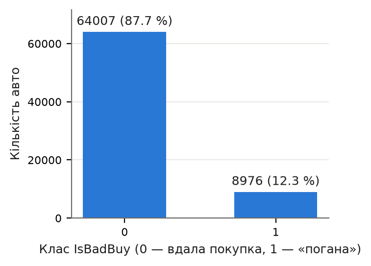

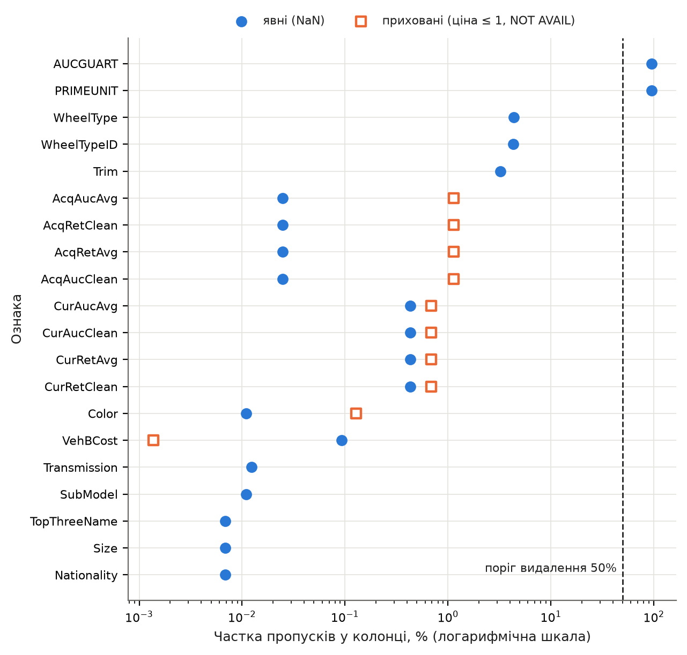

Як читати другий графік: кожен рядок — ознака, вісь X — частка пропусків у логарифмічній шкалі.
Кружок — явні пропуски (NaN у сирих даних), квадрат — приховані, які знайшло очищення. Пунктир —
поріг видалення 50 %. Видно, що в цінах MMR прихованих пропусків (≈ 1 %) у десятки разів більше,
ніж явних (0,02–0,4 %): без очищення ми б їх не побачили. `PRIMEUNIT` і `AUCGUART` (95,32 %) —
праворуч від порога, їх видалено.

- **Чому так:** альтернатива — заповнити 95 % значень модою, тобто вигадати майже всю колонку.

### Крок 1.3. Стратифіковане розбиття

- **Що:** ділить очищені дані на train (80 %) і test (20 %) зі збереженням частки класу 1.
- **Навіщо:** test — це «майбутні» дані, на яких ЛР2–3 чесно оцінюватимуть моделі. Будь-яке
  рішення ЛР1, ухвалене з погляду на test, зробило б ту оцінку оптимістичною. Тому розбиття
  робиться **одразу після детермінованого очищення**, а весь подальший аналіз — EDA, детектори
  викидів, вибір імп'ютації, енкодерів, семплерів — іде лише на train. У ЛР1 test тільки
  записується на диск (docstring `lab.py:8-9`).
- **Як:**

```python
# src/mllabs/data/splitting.py:72-78
x_train, x_test, y_train, y_test = train_test_split(
    features,
    target,
    test_size=self._test_size,
    stratify=target,
    random_state=self._random_state,
)
```

`stratify=target` гарантує однакову частку «поганих» в обох частинах. Без нього тест міг би
випадково отримати, скажімо, 11 % замість 12,3 %, і метрики зсунулися б. Запис `a, b, c, d = ...`
розпаковує кортеж із чотирьох елементів. Тут же створюються `PreprocessorFactory` і
`ProxyModelEvaluator` (`lab.py:177-183`), якими користуються всі наступні кроки.

- **Що вийшло** (`metrics.split`): train 58 386 рядків (12,299 % класу 1), test 14 597 рядків
  (12,297 %).
- **Чому випадкове, а не за часом:** у даних є дата покупки, тож можливе й розбиття «старі →
  train, нові → test». Обрано стратифіковане випадкове, бо цього вимагають правила проєкту, а ЛР3
  передбачає `StratifiedKFold` (PLAN.md, D3). Як дорого коштує порушити цей порядок, покаже ЛР3.

### Крок 2.1. Кореляції та мультиколінеарність

- **Що:** будує матриці кореляцій Пірсона і Спірмена для 13 числових ознак, шукає пари з
  |r| ≥ 0,9 і рахує VIF до і після вилучення дублікатів.
- **Навіщо:** якщо дві ознаки майже однакові, лінійна модель не може вирішити, якій із них дати
  вагу. Ваги стають нестійкими: при новому навчанні одна може стати +5, а інша −4.
- **Як.** Пірсон міряє лінійний зв'язок. Спірмен — той самий Пірсон, але на рангах («перший за
  величиною, другий…»), тому ловить будь-який монотонний зв'язок і стійкий до викидів. VIF
  ознаки *i* дорівнює 1/(1 − R²ᵢ), де R²ᵢ — частка її розкиду, яку пояснює лінійна регресія від
  решти ознак. Якщо ознаку на 90 % пояснюють інші, VIF = 1/0,1 = 10. Код обходиться без
  окремих регресій, бо VIF — це діагональ матриці, оберненої до кореляційної:

```python
# src/mllabs/labs/lab01/correlation.py:91-93
correlation = numeric.dropna().corr().to_numpy()
inverse = np.linalg.inv(correlation)
return pd.Series(np.diag(inverse), index=numeric.columns, name="VIF")
```

- **Що вийшло:**
  - 20 пар із |r| ≥ 0,9; найсильніша — `CurAucAvg`/`CurAucClean`, Пірсон 0,990
    (`tables/high_correlation_pairs.csv`);
  - `VehYear` і `VehicleAge` — r = −0,958: рік випуску й вік авто майже одне й те саме;
  - Спірмен майже скрізь збігається з Пірсоном, тобто зв'язки лінійні.

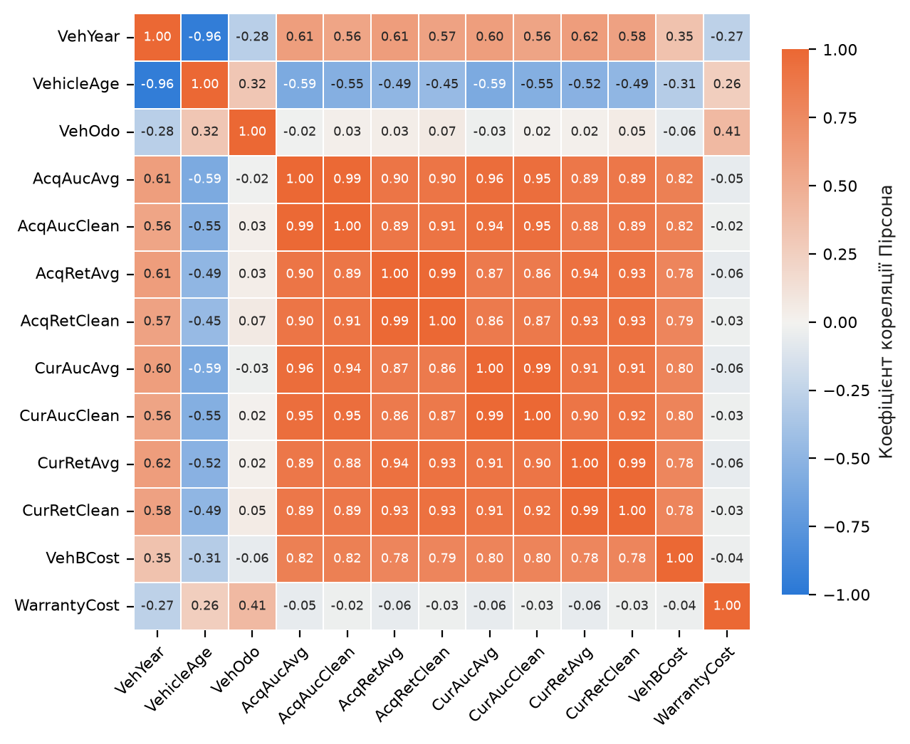

Теплова карта: помаранчеве — сильна додатна кореляція, синє — від'ємна, світле — близько нуля.
Великий помаранчевий квадрат посередині — вісім цін MMR (ринкові оцінки: при купівлі / зараз,
аукціонна / роздрібна, середній / відмінний стан).
Матриця Спірмена (`figures/correlation_spearman.png`) майже ідентична.

Рішення (`tables/vif.csv`). `KICK_SCHEMA.collinear_columns` (`schema.py:156-162`) прибирає
`VehYear` і чотири ціни `*Clean`: кожна з них має r ≈ 0,99 зі своєю `*Avg`. Максимальний VIF
падає з 228 до 21, а кількість ознак із VIF > 10 — з 10 до 4.

Чотири ознаки, що лишилися з VIF > 10, — це `AcqAucAvg`, `CurAucAvg` і роздрібні ціни `AcqRetAvg`
(12,4) та `CurRetAvg` (13,8). Чи прибрати ще й роздрібні? Крок перевіряє це проксі-моделлю
(`ExtraCollinearDropCheck`, `correlation.py:173`):

| Варіант `FULL` | PR-AUC (середнє по 5 фолдах) | σ між фолдами |
|---|---|---|
| з `AcqRetAvg`, `CurRetAvg` (= `FULL`) | 0,4378 | 0,0059 |
| без них | 0,4347 | 0,0054 |

Парне порівняння (`metrics.correlation.pr_auc_folds_full` / `pr_auc_folds_extra_drop`): Δ =
+0,0031, s = 0,0022. Δ > s, тож ціни **залишено**. Цей приклад добре показує, навіщо парні
різниці. Перевага +0,0031 менша за σ кожного варіанта окремо, і за старим правилом її могли б
списати на шум. Проте вона є на 4 із 5 фолдів (на п'ятому варіанти практично рівні), і розкид
саме різниці втричі менший. Запас невеликий (Δ/s ≈ 1,4), тож з іншим seed рішення може
перевернутися.

- **Чому VIF, а не PCA для цін:** PCA злив би всі ціни в «головні компоненти», і пропала б
  інтерпретованість. Для дерев у ЛР2 він не потрібен (PLAN.md, D6).

### Крок 2.2. Перевірка нормальності

- **Що:** для кожної числової ознаки — гістограма, Q-Q графік, тести Шапіро-Уїлка і
  Д'Агостіно-Пірсона, асиметрія та ексцес.
- **Навіщо:** від форми розподілу залежить вибір інструментів. Z-score припускає нормальність, а
  довгі хвости псують лінійну модель. Тут же видно, що потребує степеневого перетворення
  (крок 3.3).
- **Як.** Обидва тести мають нульову гіпотезу «дані нормальні». Якщо p < 0,05, гіпотезу
  відкидаємо. Шапіро-Уїлка в SciPy ненадійний для N > 5 000, тому його запускають на випадковій
  підвибірці з 5 000 рядків. Д'Агостіно запускають на всьому train
  (`src/mllabs/labs/lab01/normality.py:92-97`). Ознака вважається нормальною, лише якщо обидва
  тести не відкидають гіпотезу.
- **Що вийшло** (`tables/normality_tests.csv`): **0 із 13** ознак нормальні, у всіх p < 0,0001.
  Найбільш скошена `WarrantyCost`: асиметрія 2,10, ексцес 10,1. На десятках тисяч рядків тест
  відкидає нормальність за найменшого відхилення. Тому корисніше дивитися на асиметрію: у цін вона
  0,3–0,7, тобто помірна.

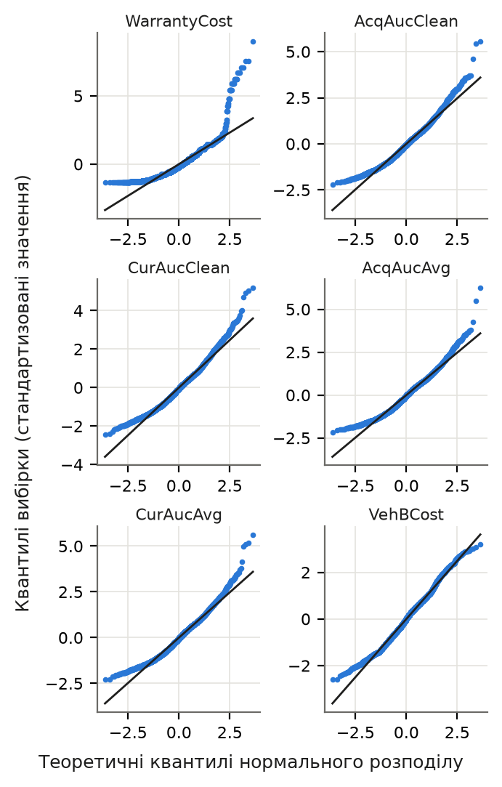

Як читати Q-Q графік: по X — де точка «мала б бути» для нормального розподілу, по Y — де вона
є. Якщо розподіл нормальний, точки лягають на діагональ. На графіку шість ознак, найдальших від
нормальності за |асиметрією| (`config.qq_plot_features = 6`, вибір — `normality.py:63-73`). У
`WarrantyCost` правий кінець різко задирається вгору: це довгий правий хвіст, кілька дуже дорогих
гарантій. У цін MMR обидва кінці відхиляються від прямої: лівий хвіст коротший, правий довший,
ніж у нормального. Гістограми всіх 13 ознак — у `figures/numeric_distributions.png`.

### Крок 2.3. Виявлення викидів

- **Що:** чотири детектори на числових ознаках train. Для кожного: частка рядків-викидів,
  частка «поганих» авто серед викидів і попарний перетин.
- **Навіщо:** завдання вимагає порівняти підходи. Висновок впливає на рішення, видаляти рядки чи
  ні.
- **Як.** Усі детектори реалізують один `Protocol` `OutlierDetector` (`outliers.py:25-33`).
  Порівнянню байдуже, які саме методи йому передали — патерн «Стратегія».
  - **IQR** (`outliers.py:44-82`): беремо межі Q1 − 1,5·IQR і Q3 + 1,5·IQR, де Q1, Q3 — квартилі,
    IQR = Q3 − Q1. Приклад: Q1 = 4 000 $, Q3 = 8 000 $, тоді IQR = 4 000, а «нормально» — від
    −2 000 до 14 000 $. Рядок — викид, якщо хоч одна його ознака поза межами.
  - **Z-score** (`outliers.py:103-106`): |(x − середнє)/σ| > 3, «правило трьох сигм». Припускає
    нормальність.
  - **Isolation Forest** (`outliers.py:113-140`): випадкові дерева ріжуть простір навмання.
    Аномальну точку вдається відрізати за кілька розрізів. Метод багатовимірний: бачить дивні
    *комбінації* значень.
  - **LOF** (`outliers.py:143-166`): порівнює щільність навколо точки зі щільністю навколо її 20
    сусідів. Шукає *локальні* аномалії: точку, яка самотня для свого околу, хоча глобально може
    бути цілком звичайною.

  Для обох багатовимірних методів задано однакову очікувану частку викидів, 3 %
  (`config.outlier_contamination`), щоб порівняння було чесним. Перед ними пропуски заповнюються
  медіаною, а ознаки стандартизуються (`outliers.py:169-175`).
- **Що вийшло** (`tables/outliers_by_method.csv`, `outlier_overlap.csv`):

| Метод | Частка рядків | Клас 1 серед викидів |
|---|---|---|
| IQR | 4,13 % | 17,5 % |
| Z-score | 2,16 % | 15,7 % |
| Isolation Forest | 3,00 % | 17,2 % |
| LOF | 3,00 % | 10,9 % |

Усі чотири методи одночасно позначили лише 0,08 % рядків.

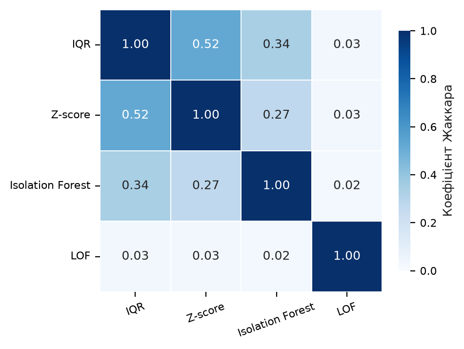

Матриця коефіцієнтів Жаккара: |A ∩ B| / |A ∪ B|, тобто частка спільних викидів серед позначених
хоча б одним методом. IQR і Z-score перетинаються на 0,52, IQR та Isolation Forest — на 0,34. LOF
майже ні з ким не збігається: 0,02–0,03. Це не помилка, а природа методу.

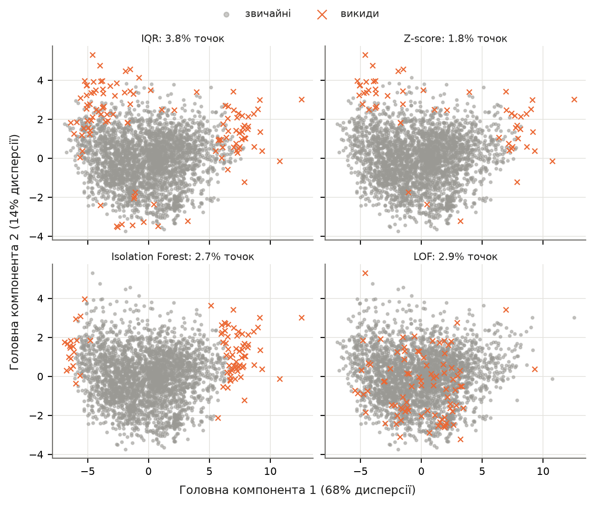

На площині двох головних компонент видно, що IQR, Z-score й Isolation Forest позначають точки на
*краях* хмари. Це глобальні аномалії: дуже дорогі чи дуже дешеві авто. Хрестики LOF розкидані
*всередині* хмари: це точки, яким бракує сусідів у своєму локальному околі.

Ще одна відмінність: серед викидів LOF «поганих» навіть менше за середнє (10,9 % проти 12,3 %),
тоді як серед викидів інших методів — більше. Відсотки в заголовках панелей (3,8 %, 1,8 % …)
трохи інші, ніж у таблиці, бо на графіку лише підвибірка з 3 000 точок.

- **Рішення: викиди не видаляються** (PLAN.md, D5). Причин три:
  - тестові рядки видаляти не можна, тож модель однаково їх зустріне;
  - хвости цін — справжні дорогі авто, а не помилки;
  - серед викидів IQR «поганих» 17,5 % проти 12,3 % у середньому: видалення викидів вибивало б
    саме рідкісний клас.

  Хвости натомість стискає степеневе перетворення (крок 3.3). Очевидно помилкові ціни 0/1 $ уже
  прибрано на кроці 1.2.

### Крок 3.1. Імп'ютація пропусків

- **Що:** порівнює заповнення числових пропусків медіаною, KNN і MICE, а категоріальних — модою
  та окремою категорією `MISSING`.
- **Навіщо:** логістична регресія не приймає NaN, тож пропуски треба чимось замінити. Питання
  чим.
- **Як.** Три способи для чисел (`src/mllabs/preprocessing/factory.py:453-479`):
  - **медіана** — одне число на колонку;
  - **KNN** — середнє значення ознаки в 5 найсхожіших рядках; перед ним стандартизація, інакше
    пробіг у десятках тисяч заглушив би вік в одиницях;
  - **MICE** (`IterativeImputer`) — кожна ознака з пропусками по черзі передбачається регресією
    від решти, кілька кіл поспіль.

  Проблема: на справжніх пропусках якість не виміряти, бо невідомо, що там було. Тому
  **маскування** (`src/mllabs/labs/lab01/imputation.py:89-120`). Беремо 10 000 повних рядків
  train, стандартизуємо їх і ховаємо випадкові 10 % клітинок. Імп'ютер їх відновлює, а ми
  рахуємо RMSE (корінь із середнього квадрата похибки) лише на прихованих клітинках:

```python
# src/mllabs/labs/lab01/imputation.py:98-100, 118-120
generator = np.random.default_rng(self._random_state)
hidden = generator.random(truth.shape) < self._mask_share  # булева матриця маски
masked = truth.mask(hidden)
...
squared_error = ((imputed - truth) ** 2).where(hidden)
rmse_by_feature[_IMPUTER_LABELS[kind]] = np.sqrt(squared_error.mean())
rmse_overall[kind.value] = float(np.sqrt(squared_error.stack().mean()))
```

RMSE вимірюється в стандартних відхиленнях ознаки, тож 1,0 ≈ «вгадали середнім». Окремо кожен
спосіб перевіряється проксі-моделлю на справжніх даних. Для цього в остаточному `FULL` змінюється
лише параметр `imputer` (`imputation.py:164-169`).

- **Що вийшло** (`tables/imputation_comparison.csv`):

| Числові | RMSE відновлення | PR-AUC | Час фолда, с (орієнт.) |
|---|---|---|---|
| Медіана | 1,00 | 0,4378 | 1,4 |
| KNN | 0,42 | 0,4378 | 4,0 |
| MICE | 0,40 | 0,4379 | 5,9 |

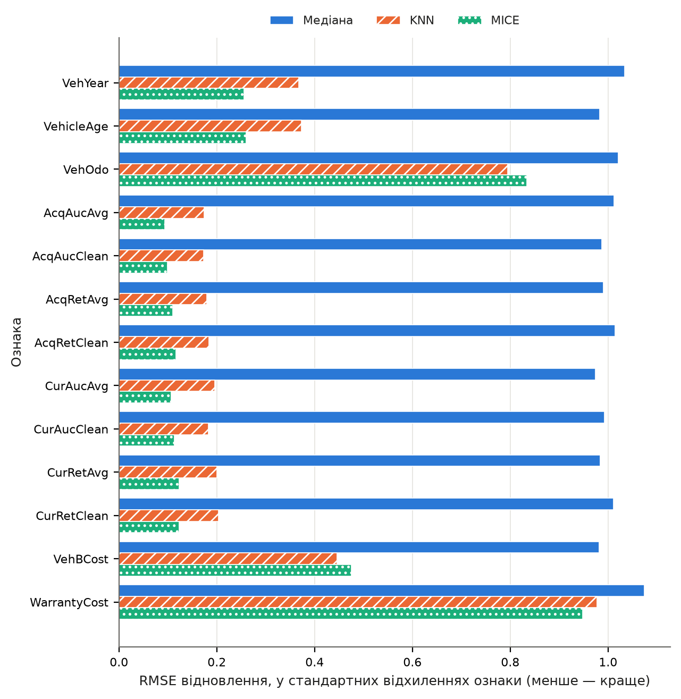

Для цін MMR KNN і MICE відновлюють значення в рази краще за медіану (RMSE ≈ 0,1–0,2). Причина в
тому, що в кожної ціни є сестри з r ≈ 0,9–0,99. `VehOdo` і `WarrantyCost` не мають сильних
корелятів, тому їх погано відновлюють усі три методи: на графіку смуги близько 0,8–1,0.

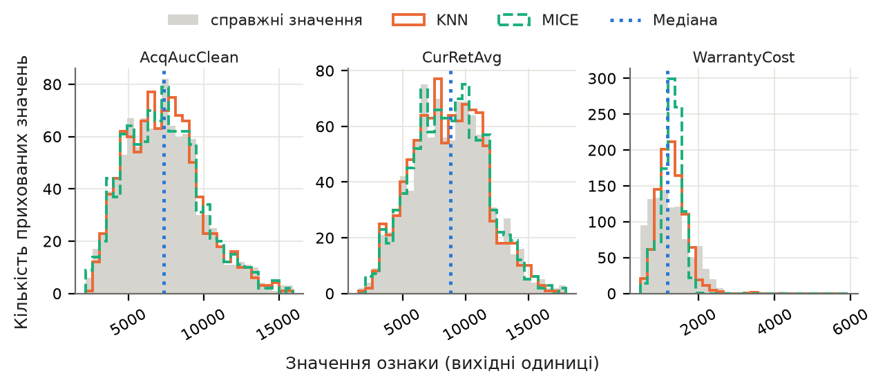

Тут видно головну ваду медіани: усі приховані значення замінено **одним** числом (вертикальний
пунктир), і розподіл схлопується. KNN і MICE (контурні гістограми) повторюють форму справжнього
розподілу (сіра заливка).

Проте на моделі різниці немає. Парне порівняння з медіаною дає для KNN Δ = +0,0001 при
s = 0,0013, для MICE Δ = +0,0001 при s = 0,0010. Обидва Δ ≤ s. Причин дві: справжніх пропусків у
числових ознаках лише ≈ 1 %, і модель однаково має інші, повні ціни. За правилом обрано
**медіану**: найпростіший метод, ще й у 3–4 рази швидший на фолді.

Категоріальні. Серед авто з порожнім `WheelType` (тип дисків) «поганих» **70,4 %**, серед
решти — 9,6 % (`metrics.imputation`, функція `imputation.py:218-228`). Пропуск тут не випадковий,
а найсильніший сигнал у даних. Якби мода просто замінила пропуск найчастішим типом дисків,
сигнал зник би. Але у `FULL` мода не самотня: коли категоріальні пропуски заповнює мода,
фабрика додає індикатор `wheel_type_missing` (0/1, `factory.py:350-366`), і сигнал зберігається
в ньому. Тому порівнюються два варіанти з однаковою інформацією про `WheelType`, але різною
кількістю ознак (`metrics.imputation.n_features_categorical`):

| Категоріальні (у `FULL`) | PR-AUC |
|---|---|
| мода + індикатор `wheel_type_missing` (88 ознак) | 0,4376 |
| категорія `MISSING`, без окремого індикатора (92 ознаки) | 0,4378 |

`MISSING` складніший: окрему колонку `_MISSING` він дає не лише `WheelType`, а й іншим
номінальним ознакам із рідкісними пропусками (`Color`, `Size`, `Nationality`, `TopThreeName`).
Δ = +0,0002, s = 0,0003, тобто Δ ≤ s, і **правило радить «моду + індикатор»**
(`selection.categorical_imputation.rule_verdict`). Обрано все ж **`MISSING`**, і це другий
**свідомий виняток** (`summary.py:439-455`; коментар біля значення за замовчуванням —
`factory.py:145-148`).

Обґрунтування таке. З модою інформація про невипадковий пропуск `WheelType`, найсильніший
предиктор, живе лише в індикаторі з *іншої* групи ознак (комбінації, дата, індикатори). Будь-яка
конфігурація без цієї групи втрачає її: база порівнянь R14/R15 (`FULL` без нових ознак) і
сценарії ЛР2–3. Попередній запуск ЛР1 показав ціну такої втрати: на базі без індикатора мода
дала PR-AUC 0,247 проти 0,431 у `MISSING`. У поточних артефактах цього виміру вже немає; у
тексті винятку в коді він записаний як «≈ 0,43 → 0,25». `MISSING` тримає інформацію в самій
ознаці, тож рішення про імп'ютацію і про групи ознак не залежать одне від одного. Ціна —
4 додаткові ознаки при різниці в межах шуму.

Чесні обмеження:

1. **Маскування моделює лише MCAR.** Ми ховали клітинки навмання, а справжні пропуски тут
   невипадкові: `WheelType` порожній переважно в «поганих» авто. RMSE з маскування показує
   здатність відновити *випадково загублене* значення і нічого не каже про пропуски, що
   залежать від цілі.
2. **MICE не сходиться в експерименті з маскуванням.** Docstring `PreprocessingSettings`
   (`factory.py:188-195`) фіксує, що на стандартизованих, сильно корельованих цінах із 10 %
   дірок MICE не досягає допуску навіть за 100 ітерацій: оцінки коливаються біля розв'язку.
   Тому `ConvergenceWarning` у журналі лишається. У самому пайплайні (без маскування) він
   сходиться приблизно за 21 ітерацію, звідси `mice_max_iter = 25` (рішення «після рев'ю»).

- **Чому не KNN/MICE, якщо вони точніші:** вони точніше відновлюють клітинки, але це не дає
  кращої моделі. Простіший метод при однаковій якості — саме те, що каже правило.

### Крок 3.2. Кодування категоріальних ознак

- **Що:** складає план кодування за кардинальністю й порівнює чотири способи кодувати сім ознак
  високої кардинальності.
- **Навіщо:** модель розуміє лише числа. Як перетворити `Model = "IMPALA"` на числа, суттєво
  впливає і на якість, і на розмір матриці.
- **Як.** Чотири способи:
  - **One-Hot**: колонка на кожну категорію, 1 у «своїй» і 0 в інших. Чесно, але `Model` з 1 024
    категоріями в train дав би 1 024 колонки. Тому для високої кардинальності рідкісні категорії
    (< 50 рядків) зливаються в одну (`factory.py:560-571`).
  - **Ordinal**: категорії просто нумеруються. Для бінарних ознак цього досить; для `Model`
    номери безглузді, бо «IMPALA = 412» не більше за «CAMRY = 87».
  - **Frequency**: категорія замінюється часткою, яку вона займає в train. Власний клас
    `FrequencyEncoder` (`src/mllabs/preprocessing/encoders.py:12-63`) запам'ятовує частки у `fit`
    і застосовує у `transform`.
  - **Target**: категорія замінюється згладженою часткою «поганих» авто цієї категорії. Найбільш
    інформативний і найнебезпечніший спосіб: він використовує ціль. Якщо в категорії лише 2 авто,
    і обидва погані, кодування буквально «знає» відповідь. Тому `TargetEncoder` у `fit_transform`
    робить **крос-фітинг**: кожен рядок train отримує статистику, пораховану на інших 4/5 рядків,
    без нього самого.

```python
# src/mllabs/preprocessing/factory.py:550-557
case HighCardinalityEncoding.TARGET:
    # cv задає внутрішній крос-фітинг: фолди перемішуються з фіксованим зерном.
    cross_fitting = StratifiedKFold(
        n_splits=self._settings.target_encoder_folds,
        shuffle=True,
        random_state=self._random_state,
    )
    steps.append(("encoder", TargetEncoder(target_type="binary", cv=cross_fitting)))
```

Docstring `factory.py:522-540` варто прочитати перед ЛР3. `fit_transform(train)` і
`fit(train).transform(train)` у `TargetEncoder` дають **різний** результат, і саме на цьому
будуватиметься демонстрація витоку.

План (`tables/encoding_plan.csv`, правило `encoding.py:125-133`):

- ≥ 30 категорій → Target: `Model`, `SubModel`, `VNZIP1`, `Trim`, `BYRNO`, `VNST`, `Make`;
- 2 значення → Ordinal 0/1: `Transmission`, `IsOnlineSale`;
- решта (до 15 категорій) → One-Hot.

Поріг 30 у конфігурації і перелік `categorical_high` у схемі — два джерела однієї правди. Тому
крок спершу викликає `EncodingBenchmark.check_schema` (`encoding.py:80-103`, виклик —
`lab.py:325`). Якщо якась ознака зі схеми має на train менше 30 категорій або інша має 30 і
більше, запуск зупиняється з `CardinalityMismatchError`, а не будує пайплайн, що розходиться з
планом.

- **Що вийшло:**

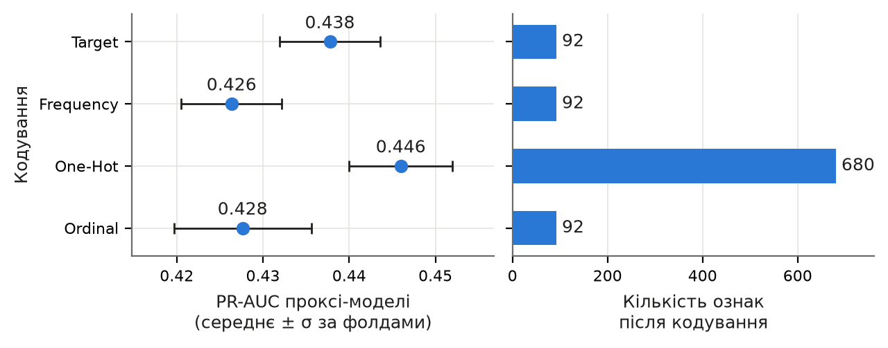

Ліва панель — PR-AUC (точка) ± σ (вуса), права — скільки ознак отримує модель.

| Кодування | Ознак | PR-AUC | σ |
|---|---|---|---|
| Target | 92 | 0,438 | 0,0059 |
| Frequency | 92 | 0,426 | 0,0059 |
| One-Hot | 680 | 0,446 | 0,0060 |
| Ordinal | 92 | 0,428 | 0,0080 |

(Усі варіанти зібрано в остаточному `FULL`, тому ознак 92, а не 63.) Frequency не кращий за
безглузду нумерацію. Target кращий за обидва: у парі з Frequency Δ = +0,0114 при s = 0,0054, у
парі з Ordinal Δ = +0,0101 при s = 0,0053.

**Свідомий виняток із правила.** One-Hot кращий за Target: Δ = +0,0082 при s = 0,0028, тобто
Δ ≈ 2,9 s. За правилом слід було б обрати його. Обрано Target з двох причин. По-перше, завдання
прямо вимагає для високопотужних ознак Target або Frequency Encoding. По-друге, на виході в
≈ 7 разів менше ознак (92 проти 680). Це одне з двох рішень `FULL`, які йдуть проти правила
(друге — `MISSING`, крок 3.1). Обидва оголошено в `_DECLARED_EXCEPTIONS` (`summary.py:439-455`),
і в `preprocessing_summary.csv` вони так і названі: «свідомий ВИНЯТОК». Ціну винятку теж чесно
видно: ≈ 0,008 PR-AUC на проксі-моделі.

### Крок 3.3. Масштабування та степеневі перетворення

- **Що:** порівнює асиметрію числових ознак до і після RobustScaler, Yeo-Johnson і Box-Cox.
- **Навіщо:** довгий хвіст (`WarrantyCost`) змушує лінійну модель підлаштовуватися під кілька
  крайніх точок. Різні масштаби (пробіг у десятках тисяч, вік в одиницях) заважають оптимізатору й
  регуляризації.
- **Як.**
  - **RobustScaler**: (x − медіана)/IQR. Це *лінійне* перетворення: зсув і розтяг. Воно змінює
    одиниці, але не форму.
  - **PowerTransformer** — *нелінійне*: підбирає степінь λ так, щоб розподіл став якомога
    нормальнішим, і стандартизує результат. **Box-Cox** працює лише для строго додатних чисел.
    **Yeo-Johnson** — його узагальнення на нулі й від'ємні.

  Обидва перетворення вчаться на train (`src/mllabs/labs/lab01/scaling.py:76-86`).
- **Що вийшло** (`metrics.scaling`): середня |асиметрія| вихідних ознак 0,61, після RobustScaler
  0,61 (як і має бути), після Yeo-Johnson 0,04. Box-Cox дав 0,02, але лише на 11 ознаках.
  `VehicleAge` має нулі, а для `VehYear` оптимальна λ така величезна, що x^λ переповнює float.
  Такі ознаки код явно відкидає (`scaling.py:102-121`).

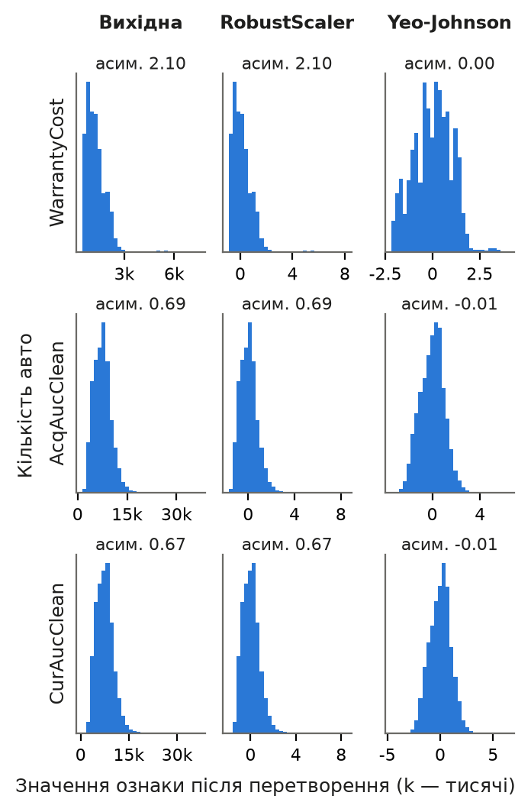

Рядки — три найбільш скошені ознаки (`config.distribution_plot_features = 3`), стовпці —
перетворення, над кожною панеллю — асиметрія. Середній стовпець має ту саму форму, що й лівий,
лише вісь X інша. У правому (Yeo-Johnson) асиметрія ≈ 0. Гребінчаста форма
`WarrantyCost` після перетворення пояснюється тим, що вихідних значень мало: 281 різне.

- **Чому Yeo-Johnson:** він прибирає скошеність, працює з будь-якими числами й водночас
  стандартизує. Тому у `FULL` числова гілка — це медіана → `PowerTransformer(method="yeo-johnson")`
  (`factory.py:482-489`). Числа в `scaling_skewness.csv` трохи відрізняються від асиметрії на
  кроці 2.2 (0,620 проти 0,615 для `AcqAucAvg`): тут пропуски попередньо заповнено медіаною, а
  формула асиметрії в pandas і SciPy різниться поправкою на розмір вибірки.

### Крок 4.1. Аугментація

- **Що:** порівнює три способи штучно додати рядки рідкісного класу: SMOTE, ADASYN і гаусів шум.
- **Навіщо:** на 7 «добрих» припадає 1 «погана». Модель, що мінімізує загальну похибку, тягнеться
  до більшості й рідко каже «погана».
- **Як.** Усі три доводять клас 1 до половини класу 0 (`sampling_strategy = 0.5`), тобто до
  33,3 % рядків.
  - **SMOTE** бере «погану» машину, одного з її 5 найближчих «поганих» сусідів і ставить нову
    точку на відрізку між ними.
  - **ADASYN** робить те саме, але генерує більше точок там, де «погані» оточені «добрими».
  - **Гаусів шум** — власний клас `GaussianNoiseSampler`: копія випадкової «поганої» машини плюс
    малий шум, 5 % σ кожної ознаки.

```python
# src/mllabs/preprocessing/augmentation.py:72-78
class_rows = np.flatnonzero(y == label)  # номери рядків цього класу
picked = generator.choice(class_rows, size=n_new, replace=True)
# Broadcasting: вектор noise_std (по одному σ на колонку) автоматично
# «розтягується» на всі n_new рядків матриці шуму.
noise = generator.normal(size=(n_new, X.shape[1])) * noise_std
synthetic_rows.append(X[picked] + noise)
synthetic_labels.append(np.full(n_new, label, dtype=y.dtype))
```

Критично: семплер стоїть **усередині** `imblearn.pipeline.Pipeline`, між препроцесором і
моделлю (`src/mllabs/preprocessing/pipelines.py:44-47`). Такий конвеєр викликає семплер лише
під час `fit`. У крос-валідації синтетичні рядки потрапляють тільки в навчальні фолди, а метрики
рахуються на реальних рядках. Звичайний `sklearn.Pipeline` так не вміє.

- **Що вийшло:**

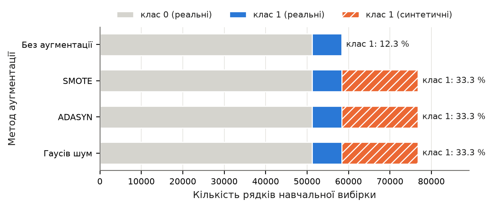

Train зростає з 58 386 до 76 807 рядків: SMOTE і шум додають по 18 421 синтетичний рядок,
ADASYN — 18 396.

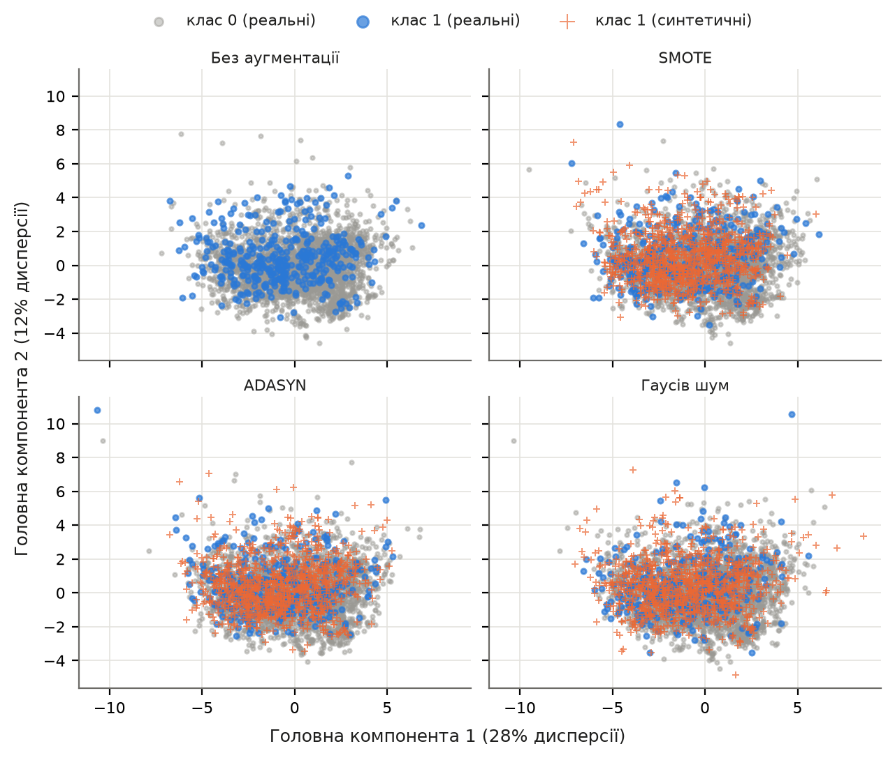

Сірі точки — реальні «добрі», сині — реальні «погані», помаранчеві хрестики — синтетичні. Вони
лягають у ту саму хмару, де класи сильно перемішані. Дві головні компоненти пояснюють лише 28 %
і 12 % розкиду, тож це груба «тінь» простору з 63 вимірів.

| Метод | PR-AUC | ROC-AUC | Recall | Precision | F1 |
|---|---|---|---|---|---|
| Без аугментації | 0,432 | 0,757 | 0,23 | 0,73 | 0,35 |
| SMOTE | 0,425 | 0,757 | 0,36 | 0,46 | 0,41 |
| ADASYN | 0,424 | 0,756 | 0,37 | 0,46 | 0,41 |
| Гаусів шум | 0,429 | 0,758 | 0,36 | 0,47 | 0,41 |

(Аугментацію порівнюють на `FULL` без нових ознак, тобто на 63 ознаках. Тому базове PR-AUC тут
0,432, а не 0,438, як у `FULL`.)

**Аугментація не підняла PR-AUC**, а SMOTE і ADASYN її навіть трохи знизили. **Recall вона
підняла**: з 0,23 до 0,36–0,37. Пояснення не магічне. PR-AUC міряє, наскільки добре модель
*упорядковує* машини від «найпідозрілішої» до «найнадійнішої», при всіх порогах одразу. Нових
знань про машини синтетичні точки не додають, тож порядок майже не змінюється. Але модель, що
бачила 33 % «поганих» замість 12 %, видає вищі ймовірності. При фіксованому порозі 0,5 це те
саме, що знизити поріг: ловимо більше поганих (recall ↑) ціною більшої кількості хибних тривог
(precision 0,73 → 0,46–0,47).

Тому аугментація не входить у `FULL`. Вона вмикається окремо як сценарій В ЛР2. Чи дав би той
самий ефект простий зсув порогу, у ЛР1 не перевірялося.

Ще два чесні обмеження:

1. **SMOTE і шум роблять One-Hot колонки дробовими.** Семплер стоїть після `ColumnTransformer`,
   тож працює вже з закодованою матрицею. Точка посередині між «Color_RED = 1» і «Color_RED = 0»
   має «Color_RED = 0,37», а шум додає дробові значення до колонок 0/1. Таких машин не існує.
   Для логістичної регресії це прийнятно, бо вона однаково множить колонки на ваги. Альтернатива
   `SMOTENC`, що розуміє категорії, значно повільніша на ознаках високої кардинальності
   (PLAN.md, ризики).
2. Ілюстрація балансу й PCA (`src/mllabs/labs/lab01/augmentation.py:78-132`) застосовує
   семплери до всього train поза крос-валідацією. Це нормально, бо там не рахується жодна
   метрика: лише показано, що роблять семплери.

### Крок 4.2. Інженерія ознак

- **Що:** будує нові ознаки трьох груп і перевіряє, чи вони корисні.
- **Навіщо:** лінійна модель уміє лише зважено додавати ознаки. Сама вона не «здогадається»
  поділити ціну покупки на ринкову оцінку, хоча саме це відношення показує, чи переплатили за
  авто.
- **Як.**
  - **Комбінації в межах рядка**, клас без стану `RowFeatureEngineer`
    (`src/mllabs/preprocessing/features.py:99-120`):
    - відношення `cost_to_mmr = VehBCost / AcqAucAvg`, `mmr_trend`, `miles_per_year`,
      `warranty_share`;
    - рік, місяць і день тижня покупки;
    - індикатори пропуску `wheel_type_missing`, `mmr_missing`.
  - **Агрегації за категоріями**, клас зі станом `GroupAggregateEncoder` (`features.py:204-230`):
    на скільки ціна машини відхиляється від середньої для її `Model`/`Make`. Середні рахуються у
    `fit`, тобто лише на train. Ціль не використовується, інакше це був би прихований Target
    Encoding.
  - **Поліноміальні**: квадрати й попарні добутки `VehicleAge`, `VehOdo`, `VehBCost`.

  Корисність перевіряють двома способами: взаємною інформацією кожної ознаки з ціллю і
  проксі-моделлю для кожного набору (`feature_engineering.py:188-230`).
- **Що вийшло:**

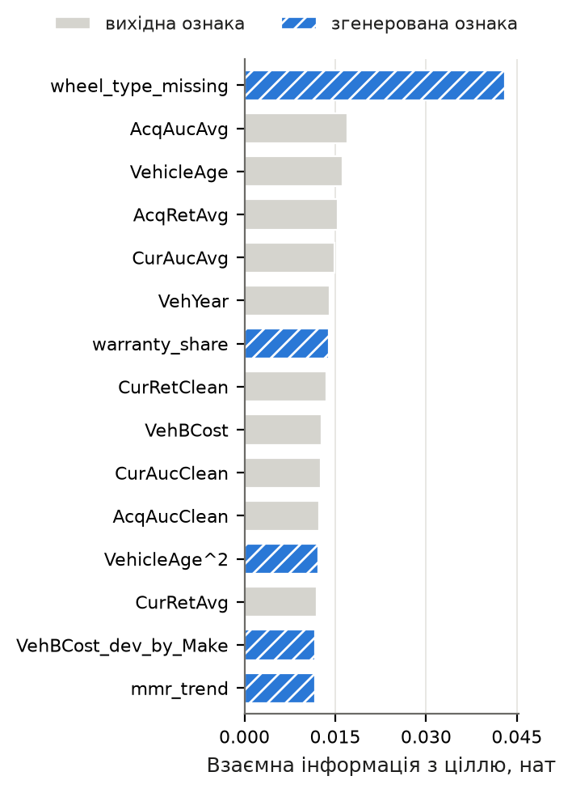

Смуги — MI з ціллю, штриховані — нові ознаки, показано топ-15. Беззаперечний лідер —
`wheel_type_missing` (0,043), більш ніж удвічі вище за найкращу вихідну ознаку (`AcqAucAvg`,
≈ 0,017 за графіком). Це той самий сигнал, що й
на кроці 3.1.

| Набір ознак | Ознак | PR-AUC | σ |
|---|---|---|---|
| Вихідні | 63 | 0,4324 | 0,0073 |
| + комбінації, дата, індикатори | 89 | 0,4371 | 0,0063 |
| + агрегації | 66 | 0,4330 | 0,0072 |
| + поліноміальні | 69 | 0,4334 | 0,0068 |
| + комбінації та агрегації (= `FULL`) | 92 | 0,4378 | 0,0059 |
| усі разом | 98 | 0,4391 | 0,0055 |

Ця таблиця описова: вона показує внесок кожної групи поверх вихідних ознак. **Рішення** ж
ухвалено інакше. Кожну групу перемикають в остаточному `FULL` («є» ↔ «немає»), а решту лишають
як є (`FeatureEngineeringBenchmark.full_toggles`, `feature_engineering.py:233-238`). Далі —
парне порівняння (`metrics.feature_engineering.decisions`, `preprocessing_summary.csv`):

| Група | `FULL` з групою проти без неї | Δ | s | Рішення |
|---|---|---|---|---|
| комбінації, дата, індикатори | 0,4378 проти 0,4330 | +0,0047 | 0,0021 | увімкнено |
| агрегації за категоріями | 0,4378 проти 0,4371 | +0,0007 | 0,0006 | **увімкнено** (на межі) |
| поліноміальні | 0,4391 проти 0,4378 | +0,0014 | 0,0021 | вимкнено |

Комбінації впевнено проходять: Δ більше за s удвічі. Агрегації пройшли ледь-ледь: Δ/s ≈ 1,08.
Виграш крихітний (+0,0007), але стабільний по фолдах, тому правило його приймає. За попередньою
версією правила агрегації були вимкнені, тож це рішення найчутливіше до методики й до seed.
Поліном не окупився: «усі разом» має найкращу середню цифру (0,4391), але це ті самі +0,0014 при
s = 0,0021 і 6 зайвих ознак.

Цікава деталь: `wheel_type_missing` у `FULL` **не подається**. Він дослівно дорівнює One-Hot
колонці `WheelType_MISSING`, яку вже дає категорія `MISSING`, а друга копія дала б нескінченний
VIF (`factory.py:350-366`; тест `tests/preprocessing/test_preprocessing_factory.py:94`). Тому
найінформативніша «нова» ознака нової інформації в `FULL` не додає. З індикаторів лишився
`mmr_missing`, чия MI ≈ 0: він входить у групу, яку правило оцінює цілком, а не поштучно.

**VIF у `FULL` лишається > 10.** `tables/full_pipeline_vif.csv` рахує VIF саме тих 15 числових
колонок, які отримує модель: після медіани й Yeo-Johnson, разом із відношеннями та відхиленнями
від групи. У 12 із 15 VIF > 10, найбільший — 141 (`AcqAucAvg`). Він вищий, ніж на сирих даних
(21). Причину пояснює docstring
`features.py:68-72`: Yeo-Johnson для додатних цін близький до логарифма, а логарифм відношення
дорівнює різниці логарифмів. Тож `cost_to_mmr` після перетворення майже лінійно виражається через
`VehBCost` і `AcqAucAvg`. Серед агрегацій є дивна ознака `VehOdo_dev_by_VehicleAge`: MI з ціллю
≈ 0,0000, а VIF 41,8. Вона майже дублює `VehOdo` і нової інформації не несе. До `FULL` вона
потрапила лише тому, що правило оцінює групу агрегацій цілком.

Чому це прийнятно:

- точних лінійних залежностей немає, це перевіряє тест `test_preprocessing_factory.py:119`;
- високий VIF робить нестійкими *окремі ваги*, але не прогноз. Логістична регресія з
  L2-регуляризацією штрафує великі ваги й ділить вагу між дублікатами;
- деревам у ЛР2 VIF байдужий;
- прибирати ознаки «заради VIF» ми якраз пробували (крок 2.1), і правило сказало ні.

### Крок 5. Підсумок препроцесингу та збереження даних

- **Що:** будує `tables/preprocessing_summary.csv` («Етап — Обрано — Підстава») і записує
  `data/processed/kick/`: `train.csv`, `test.csv`, `schema.json`, `preprocessing.json`.
- **Навіщо:** це «продукт» ЛР1 для ЛР2–3.
- **Як.** На диск ідуть дані **очищені, але не трансформовані**: без імп'ютації, кодування й
  масштабування (`src/mllabs/data/repository.py:56-80`). Якби ми зберегли готову матрицю, медіани
  й Target-кодування в ній уже були б пораховані на всьому train. Тоді чесна крос-валідація в ЛР2
  і вся ЛР3 стали б неможливими. Тож передається *рецепт*:
  - `PreprocessorFactory` повертає **нефітований** пайплайн для `MINIMAL` або `FULL`
    (`factory.py:304-328`);
  - `preprocessing.json` фіксує налаштування, з якими ЛР1 обґрунтувала `FULL`;
  - ЛР2–3 звірять із ним свою фабрику через `check_manifest` (`factory.py:277-301`). Якщо хтось
    змінить, наприклад, `mice_max_iter`, вони впадуть із `PreprocessingMismatchError`, а не
    тихо порахують інше.

  CSV не зберігає типів: поштовий індекс `33619` став би числом. Тому `ProcessedDatasetRepository`
  читає файли з типами за `schema.json` (`repository.py:143-162`).
- **Що вийшло** — підсумковий рецепт `FULL`:

| Етап | Обрано | Чому (з `preprocessing_summary.csv`) |
|---|---|---|
| Приховані пропуски | ціни ≤ 1 і `NOT AVAIL` → NaN | 5 423 клітинки |
| Мультиколінеарність | вилучено `VehYear` і 4 ціни `*Clean` | VIF 228 → 21; роздрібні ціни лишено: Δ = +0,0031, s = 0,0022 |
| Викиди | не видаляються, хвости стискає Yeo-Johnson | лише 0,08 % рядків — викиди для всіх методів |
| Числові пропуски | медіана | KNN Δ = +0,0001 (s 0,0013), MICE Δ = +0,0001 (s 0,0010) — Δ ≤ s |
| Категоріальні пропуски | категорія `MISSING` | **виняток**: «мода + індикатор» (88 ознак) рівноцінна (Δ = +0,0002, s = 0,0003), але тримає сигнал `WheelType` (70,4 % проти 9,6 %) лише в індикаторі з іншої групи; 92 ознаки |
| Висока кардинальність | Target Encoding | **виняток**: One-Hot Δ = +0,0082, s = 0,0028, але вимога завдання і 92 проти 680 ознак |
| Інші категорії | One-Hot / Ordinal 0/1 | ≤ 15 категорій на номінальну ознаку |
| Масштабування | Yeo-Johnson | |асиметрія| 0,61 → 0,04 |
| Аугментація | не входить, вмикається окремо | PR-AUC не росте, recall 0,23 → 0,36 |
| Нові ознаки | комбінації, дата, `mmr_missing`; агрегації за категоріями | комбінації Δ = +0,0047 (s 0,0021); агрегації Δ = +0,0007 (s 0,0006, межа); поліном Δ = +0,0014 ≤ s 0,0021 — вимкнено |

Підсумок `FULL`: 92 ознаки на вході моделі, PR-AUC 0,4378 (σ між фолдами 0,0059). Для порівняння:
випадковий класифікатор має ≈ 0,12.

Сценарій `MINIMAL` (`factory.py:160-170`) — медіана/мода, Ordinal для всіх категорій, без
масштабування і без вилучень. Це сценарій А для ЛР2.

## 5. Python очима Java-розробника

Те, що вже є в [`docs/python-for-java.md`](../../docs/python-for-java.md) (dataclass, Protocol,
comprehension, f-рядки, `with`), тут не повторюється.

| У Java ти б написав | У Python тут написано | Де |
|---|---|---|
| wither-метод `config.withAddRowFeatures(false)` для `record` | `replace(options, add_row_features=False)` — копія frozen-датакласу зі зміненими полями | `lab.py:507-512` |
| поле-колекцію в `record` з `new HashMap<>()` за замовчуванням | `field(default_factory=PreprocessingSettings)`: без фабрики всі екземпляри ділили б **один** об'єкт | `config.py:113`, пояснення `schema.py:57-59` |
| `map.putAll(other)` усередині літерала | `{"name": ..., **profile.to_metrics()}` — `**` розпаковує словник | `lab.py:168` |
| `switch` з pattern matching | `match kind: case ImputerKind.MEDIAN: ...` | `factory.py:463-479` |
| `enum Kind { MEDIAN("median") }` | `class ImputerKind(StrEnum)`: значення водночас є рядками, тому одразу йдуть у JSON | `factory.py:84-89` |
| `Stream.of(a, b).map(...)`, потім два `get` | генератор, одразу розпакований у дві змінні: `kept, dropped = (evaluate(...) for schema in (...))` | `correlation.py:232-241` |
| `Collectors.toMap(k -> k, k -> eval(k))` | `{kind: evaluator.evaluate(...) for kind in HighCardinalityEncoding}` — цикл по всіх значеннях enum | `encoding.py:147-154` |
| `Collections.max(map.entrySet(), comparingByValue()).getKey()` | `min(d, key=d.get)` — ключ із найменшим значенням | `imputation.py:242` |
| повертати `this` з типом самого класу | `-> Self` у `fit`: дозволяє `encoder.fit(x).transform(x)` | `encoders.py:33` |
| поле, яке з'являється лише після `init()` | атрибут із суфіксом `_` (`frequencies_`) — угода sklearn: «існує лише після `fit`» | `encoders.py:41-44` |
| `for` по рядках з `if` | булева маска як індекс: `series[mask]` лишає рядки, де `True` (≈ `WHERE`) | `cleaning.py:90`, `outliers.py:245` |
| `!` для булевого масиву | `~is_missing`: поелементне «НЕ» для масок pandas/NumPy (`not` тут не працює) | `imputation.py:227` |
| цикл по рядках із додаванням вектора | broadcasting: `matrix * vector` множить кожен рядок на вектор без циклу | `augmentation.py:76` (у `preprocessing/`) |
| `final` метод | `@final` з `typing`: перевіряє лінтер, не JVM | `core/lab.py:64` |
| імпорт лише для компілятора | `if TYPE_CHECKING:` — імпорт бачать IDE і перевірка типів, але не запуск | `core/artifacts.py:17-19` |
| `Collections.unmodifiableMap(...)` | `MappingProxyType({...})` | `features.py:91-93` |
| AOP-перехоплювач / анотація над методом | декоратор `@_styled`: функція, що обгортає іншу функцію | `plots.py:69-85` |
| тимчасово вимкнути логування попереджень у try-finally | `with warnings.catch_warnings(): ...` | `scaling.py:112-114` |
| `list.get(list.size() - 1)`, обхід задом наперед | `pipeline[-1]` — останній елемент; `.iloc[::-1]` — розвернути | `outliers.py:304`, `plots.py:540` |
| `HashMap<Options, Scores>` як кеш, де ключ — `record` | `cache: dict[PreprocessingOptions, CvScores]`: frozen-датаклас має `__hash__`/`__eq__` за полями, як `record`, тому годиться в ключі | `feature_engineering.py:211-219` |
| лямбда, що захоплює змінну з методу | вкладена функція `def evaluate(...)` всередині методу бачить `cache` зовнішньої (замикання) | `feature_engineering.py:213-219` |
| DTO-маппер для серіалізації | `set_output(transform="pandas")`: трансформер повертає таблицю з назвами колонок замість голого масиву | `scaling.py:76` |

## 6. Запусти й поекспериментуй

```bash
uv run mllabs run 1              # повний запуск; PLAN.md оцінює 1–2 хв (перший раз ще качає 16 МБ)
uv run mllabs run 1 --seed 7     # те саме з іншим зерном випадковості
uv run pytest tests/labs tests/data tests/preprocessing   # тести ЛР1 і спільних пакетів
```

Запуск **перезаписує** `labs/lab01/artifacts/` і `data/processed/kick/`, з яких пишеться звіт і
читатимуть ЛР2–3. Перед експериментами скопіюй ці каталоги, а після них поверни значення в
`config.py` і перезапусти. Командний рядок приймає лише `--seed`, тож інші параметри змінюються
значеннями за замовчуванням у `src/mllabs/labs/lab01/config.py:82-113`.

1. **`uv run mllabs run 1 --seed 7`** або **`proxy_cv_folds: 5 → 10`** (`config.py:102`).
   Подивись у `preprocessing_summary.csv`, чи з'явиться «УВАГА: у коді застосовано інший
   варіант». Найімовірніше кандидати — агрегації (Δ/s ≈ 1,08) і роздрібні ціни (Δ/s ≈ 1,4).
   Чому: ці рішення стоять близько до межі Δ = s, а нове розбиття на фолди дає інші d_k. Рішення
   про комбінації (Δ/s ≈ 2,2) і кодування мають бути стійкими. З 10 фолдами запуск триватиме
   приблизно вдвічі довше.
2. **`sampling_strategy: 0.5 → 1.0`** (`config.py:105`). Клас 1 доводиться до 50 %, синтетичних
   рядків стане ≈ 44 тис. Очікуй, що recall у `augmentation_comparison.csv` виросте ще, precision
   впаде ще, а PR-AUC не покращиться. Чому: аугментація зсуває ймовірності, тобто ефективний
   поріг, але не додає знань.
3. **`outlier_contamination: 0.03 → 0.10`** (`config.py:97`). Isolation Forest і LOF позначать по
   10 % рядків. Очікуй, що Жаккар Isolation Forest з IQR зросте (множини стали ближчими за
   розміром), а LOF усе одно лишиться окремо, бо шукає інший *тип* аномалій.
4. **`imputation_mask_share: 0.1 → 0.4`** (`config.py:101`). Очікуй, що RMSE KNN і MICE
   зростуть: у рядку лишається менше відомих сусідніх цін, з яких можна відновити значення.
   RMSE медіани лишиться ≈ 1, бо медіані сусіди не потрібні. На PR-AUC у таблиці це не вплине:
   маскування окреме від проксі-моделі.

Чого **не** варто чекати:

- Зміна `high_cardinality_threshold` (`config.py:85`) з 30 на, скажімо, 40 **не** перебудує
  пайплайн, а зупинить запуск на кроці 3.2 з `CardinalityMismatchError`: `Make` (33 категорії) і
  `VNST` (37) лишаються в `categorical_high` схеми (`schema.py:152`), але стають нижчими за поріг.
  Щоб змінити поділ, треба правити схему, а не лише поріг.
- Зміна полів `preprocessing` (`PreprocessingSettings`) запише новий `preprocessing.json`. ЛР2–3 з
  налаштуваннями за замовчуванням тоді відмовляться працювати з `PreprocessingMismatchError`. Так
  задумано.

## 7. Що може спитати викладач

1. **Чому accuracy тут погана метрика?** Модель «усі авто добрі» має accuracy 87,7 % і нульову
   користь. При 12 % позитивного класу дивимося на рідкісний клас. PR-AUC не залежить від порога
   й має чесну базову лінію: випадкова модель дає ≈ 0,12, ми маємо 0,438.
2. **Навіщо розбивати до аналізу, якщо EDA — це «просто подивитися»?** Подивившись, ми ухвалюємо
   рішення: яку імп'ютацію взяти, які ознаки прибрати. Якщо ці рішення бачили test, оцінка на
   test перестає бути незалежною. До розбиття робиться лише детерміноване очищення, яке нічого не
   вчить. Наслідки порушення — тема ЛР3.
3. **KNN і MICE відновлюють значення вдвічі точніше. Чому медіана?** Бо на моделі парна різниця
   (Δ = +0,0001) у 10 разів менша за її розкид (s = 0,0010–0,0013): числових пропусків лише
   ≈ 1 %. За єдиним правилом при однаковій якості беремо простіше й швидше.
4. **One-Hot дав кращий PR-AUC. Чому Target?** Це свідомий і задокументований виняток. Завдання
   вимагає Target/Frequency для високої кардинальності, а ознак у ≈ 7 разів менше (92 проти 680).
   Ціна — ≈ 0,008 PR-AUC.
5. **Target Encoding використовує ціль. Чи це не витік?** Був би, якби рахувати середні вручну на
   всіх даних. `TargetEncoder` стоїть у пайплайні, навчається лише на навчальних фолдах, а в
   `fit_transform` робить крос-фітинг: рядок кодується статистикою без себе самого.
6. **Аугментація ж не допомогла — навіщо вона?** PR-AUC вона не підняла, а recall підняла з 0,23
   до 0,36 ціною precision (0,73 → 0,46). Нових знань синтетичні точки не дають, вони зсувають
   поріг. Тому в базовий рецепт її не взято, а її вплив на різні моделі перевірить сценарій В
   ЛР2.
7. **Чому VIF > 10 у фінальному наборі — це нормально?** VIF шкодить стійкості окремих ваг, а не
   якості прогнозу. L2-регуляризація з цим справляється, точних залежностей немає (є тест), а
   спроба прибрати роздрібні ціни погіршила PR-AUC (Δ = +0,0031 > s = 0,0022 на користь цін).
8. **Чому LOF майже не збігається з іншими методами?** Інші три шукають глобальні аномалії:
   крайні значення, краї хмари. LOF шукає точки, самотні у своєму *околі*, навіть усередині
   хмари. Різні визначення «аномалії» дають різні множини, Жаккар 0,02–0,03.
9. **Чому не видалили викиди?** Тестові рядки не видалиш. Хвости — справжні дорогі авто. Серед
   викидів IQR «поганих» 17,5 %, тож видалення вибивало б рідкісний клас. Замість цього хвости
   стискає Yeo-Johnson.
10. **Чому ви порівнюєте варіанти парними різницями, а не середніми?** Усі варіанти оцінено на
    тих самих 5 фолдах. «Важкість» фолда спільна для всіх варіантів і в різниці скорочується. Так
    стабільну перевагу +0,0031 видно, хоча вона менша за σ кожного варіанта (0,0059). `ddof=1`,
    бо 5 фолдів — це вибірка, і ділення на n занижує розкид. Δ > s приблизно відповідає
    односторонньому парному t-тесту на рівні 5 %.
11. **Що слабке в обґрунтуванні?** Фолди не незалежні (їхні навчальні частини перекриваються),
    тож s трохи занижене. Агрегації пройшли правило ледь-ледь (Δ/s ≈ 1,08), а одна з них
    (`VehOdo_dev_by_VehicleAge`) має MI ≈ 0. Два рішення — свідомі винятки з правила (Target
    замість One-Hot, `MISSING` замість «моди + індикатора»). Маскування моделює лише випадкові пропуски, а справжні
    (`WheelType`) невипадкові. SMOTE створює дробові значення в One-Hot колонках.

## 8. Що почитати далі

1. **scikit-learn User Guide, «Common pitfalls and recommended practices»**, розділ «Data leakage»
   (scikit-learn.org/stable/common_pitfalls.html). Чому `fit` лише на train і як `Pipeline` від
   цього захищає. Найкраща підготовка до ЛР3.
2. **scikit-learn User Guide, «Target Encoder»** (розділ 6.3, preprocessing → TargetEncoder),
   підрозділ про internal cross fitting. Саме там пояснено, чому `fit_transform` ≠
   `fit().transform()`.
3. **imbalanced-learn User Guide, «Over-sampling»** (SMOTE, ADASYN, SMOTENC) і «Common pitfalls»
   про семплери в пайплайні (imbalanced-learn.org). Чому семплер має бути лише у `fit`.
4. **Saito, Rehmsmeier (2015), «The Precision-Recall Plot Is More Informative than the ROC Plot
   When Evaluating Binary Classifiers on Imbalanced Datasets»**, PLOS ONE. Коротко й з малюнками:
   чому PR-AUC, а не ROC-AUC при дисбалансі.
5. **Nadeau, Bengio (2003), «Inference for the Generalization Error»**, Machine Learning 52.
   Чому парний t-тест на фолдах крос-валідації занижує дисперсію і як це виправити (corrected
   resampled t-test). Пояснює, що саме лишається слабким у нашому правилі.
6. **Stef van Buuren, «Flexible Imputation of Missing Data»**, розділи 1.2 (MCAR/MAR/MNAR) і 4
   про MICE. Безкоштовно онлайн (stefvanbuuren.name/fimd). Пояснює, чому наше маскування MCAR не
   описує випадок `WheelType`.
