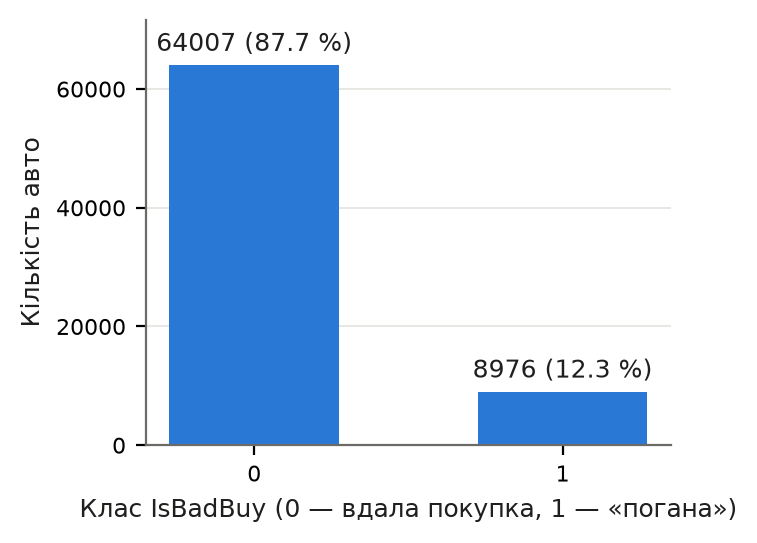
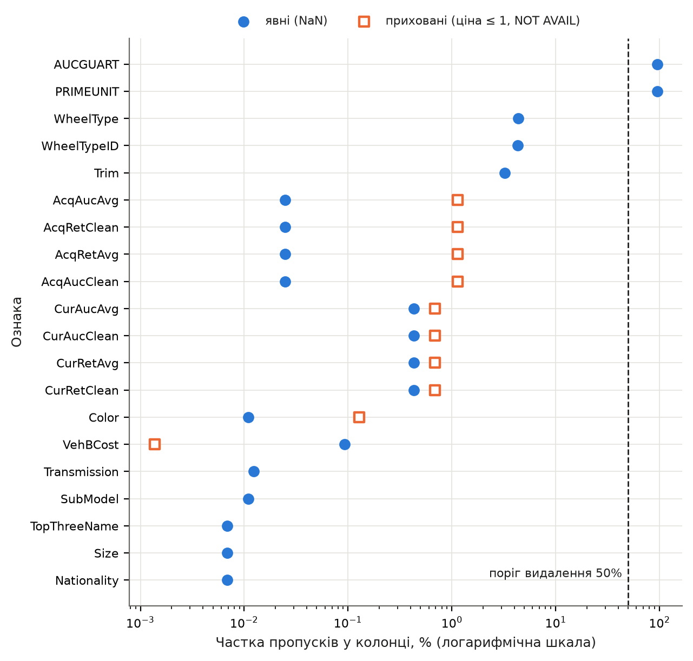
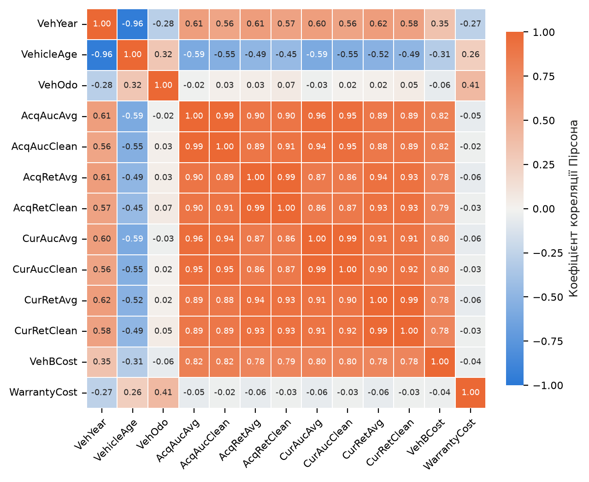
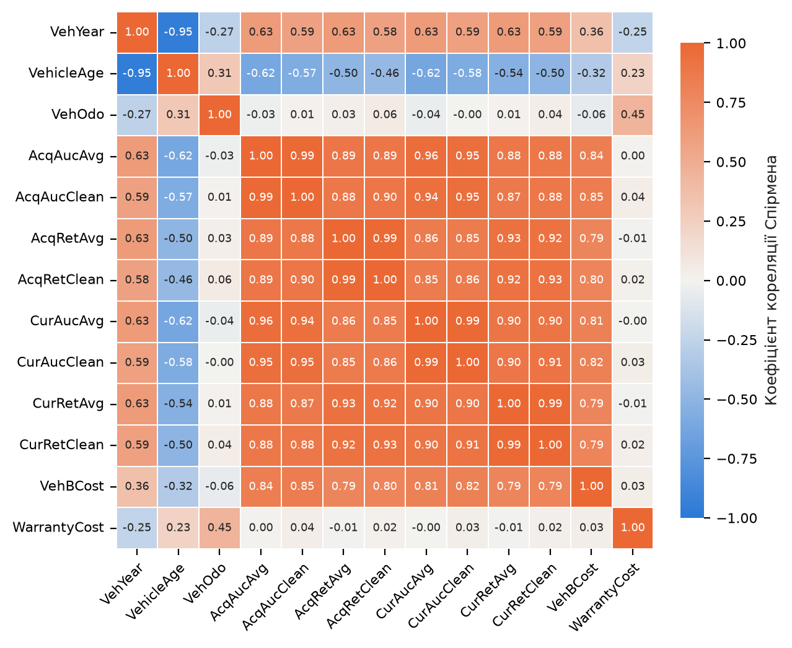
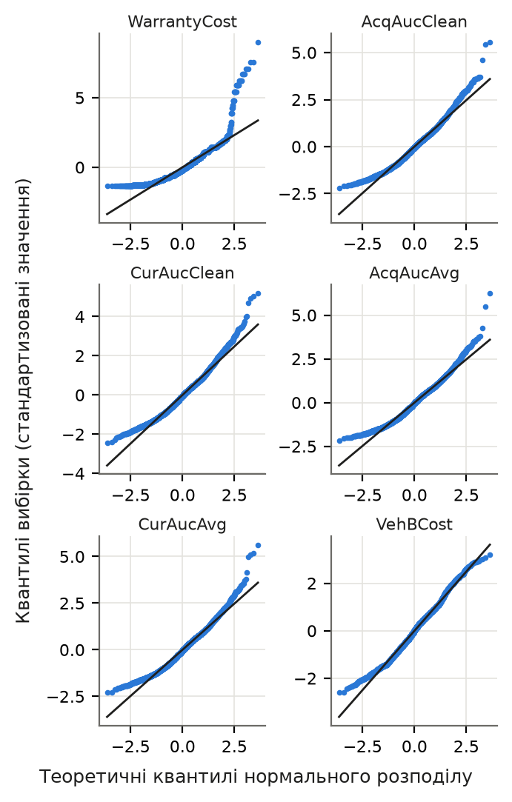
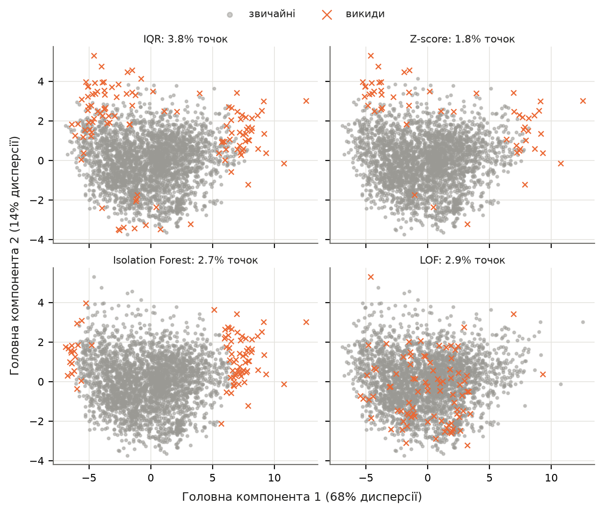
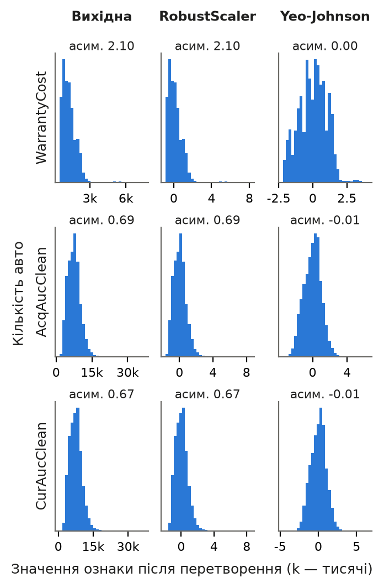
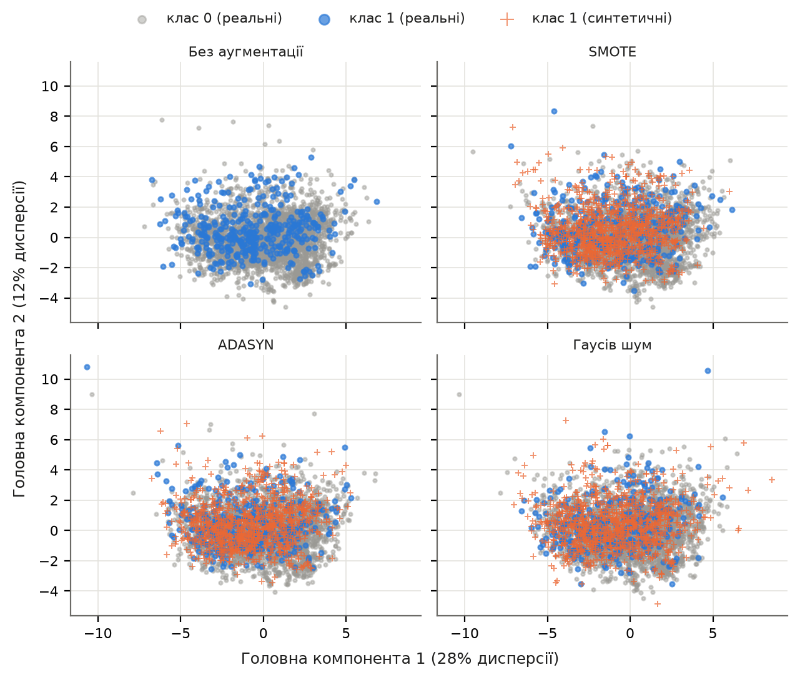
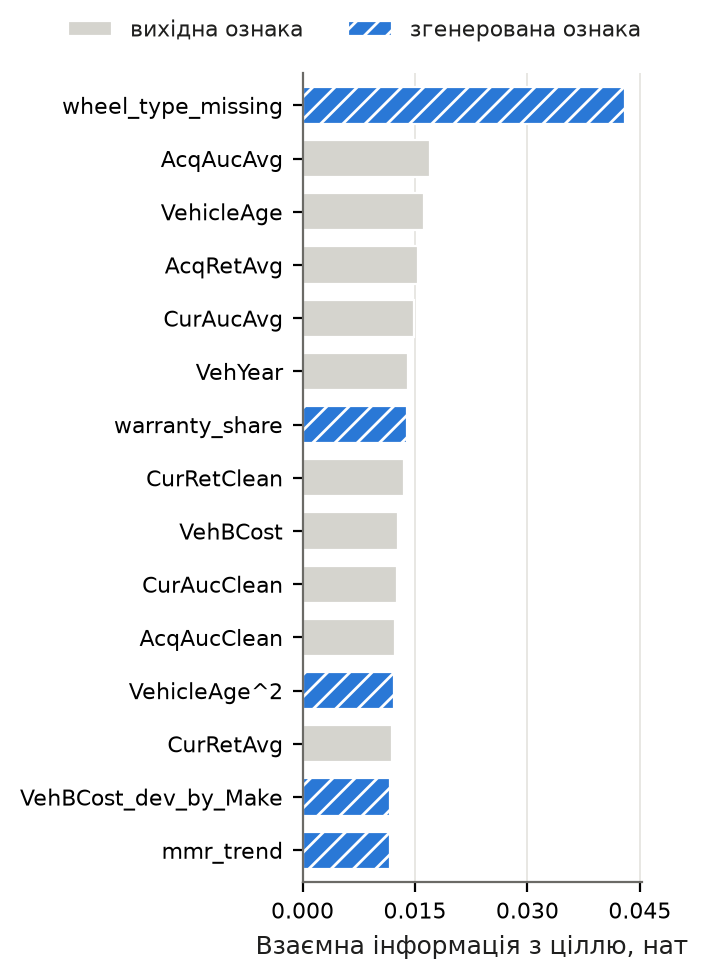

## 1. Постановка завдання

1. Обрати й обґрунтувати складний публічний табличний датасет (Kaggle або UCI): не менше 10 числових і категоріальних ознак, дисбаланс класів.
2. Виконати Advanced EDA: матриці кореляцій Пірсона та Спірмена, виявлення мультиколінеарності, перевірка нормальності візуально та тестами Шапіро-Уїлка й Д'Агостіно; порівняти методи виявлення викидів IQR, Z-score та Isolation Forest / Local Outlier Factor.
3. Порівняти базову імп'ютацію (медіана/мода) з просунутою (KNNImputer, IterativeImputer / MICE); закодувати категоріальні ознаки (Target або Frequency Encoding для високопотужних, One-Hot / Ordinal для інших); застосувати масштабування (RobustScaler, PowerTransformer / Box-Cox).
4. Синтезувати нові спостереження (SMOTE, ADASYN, гаусів шум) і згенерувати нові ознаки (нелінійні комбінації, поліноміальні ознаки, агрегації за категоріями).
5. Оформити звіт з описом датасету, результатами EDA та обґрунтуванням вибору методів імп'ютації, кодування й аугментації.

## 2. Опис проведеної роботи

### 2.1. Вибір та обґрунтування датасету

Обрано датасет Carvana «Don't Get Kicked!» зі змагання Kaggle [1], завантажений із дзеркала OpenML (id {{metrics.dataset.openml_id}}) [2] — це дає відтворюване завантаження без облікових даних Kaggle. Кожен рядок — автомобіль, придбаний дилером на аукціоні; цільова змінна `IsBadBuy` = 1, якщо покупка виявилася «поганою» (прихований дефект, проблеми з документами тощо).

Датасет відповідає вимогам завдання. Він містить {{metrics.dataset.n_rows}} рядків і {{metrics.dataset.n_raw_features}} ознаки в сирому вигляді; після очищення лишається {{metrics.dataset.n_features}} ознак: {{metrics.dataset.n_numeric}} числових (рік і вік авто, пробіг, вісім довідкових ринкових цін MMR (Manheim Market Report — оцінка вартості авто на момент купівлі та поточна, аукціонна й роздрібна), ціна купівлі `VehBCost`, вартість гарантії `WarrantyCost`), {{metrics.dataset.n_categorical}} категоріальних і дата покупки. Позитивний клас становить лише {{metrics.dataset.minority_share:.1%}}, дисбаланс {{metrics.dataset.imbalance_ratio:.1f}} : 1 (рис. {@target}).

{#target width=45%}

Складність датасету не обмежується дисбалансом: {{metrics.dataset.n_high_cardinality}} категоріальних ознак мають щонайменше 30 категорій (до {{metrics.dataset.max_cardinality}} у `Model`), вісім цін MMR сильно корельовані, а дані «брудні»: ціни 0 або 1 долар і позначки `NOT AVAIL` (приховані пропуски), різний регістр категорій (`Manual`/`MANUAL`), колонка-дублікат `WheelTypeID`. Структуру пропусків показано на рис. {@missing}.

{#missing width=62%}

На рис. {@missing} видно три групи. `PRIMEUNIT` і `AUCGUART` порожні майже повністю (крайні праві точки, далеко за порогом) — їх видалено за порогом 50%, бо заповнювати таку частку оціненими значеннями недоцільно: ознака складалася б переважно з припущень. У цінах MMR переважають приховані пропуски, які без очищення не було б помічено; загалом на пропуски перетворено {{metrics.dataset.hidden_missing_cells}} клітинок. Найбільше справжніх пропусків у категоріальних `WheelType` і `Trim`. Після очищення порожні лише {{metrics.dataset.missing_cells_share:.2%}} клітинок, але пропуск має {{metrics.dataset.rows_with_missing_share:.1%}} рядків.

### 2.2. Методика: розбиття та порівняння методів

Детерміноване очищення (правила без навчання: типи, регістр, приховані пропуски, дублікати) виконано на всьому датасеті, після чого дані стратифіковано поділено 80/20: {{metrics.split.train_rows}} рядків train і {{metrics.split.test_rows}} test з однаковою часткою позитивного класу ({{metrics.split.train_minority_share:.2%}} і {{metrics.split.test_minority_share:.2%}}). Усі аналізи, детектори, імп'ютери, енкодери й семплери навчено лише на train; тестову вибірку не використано для жодної оцінки — вона залишена для ЛР2–3.

Варіанти препроцесингу порівнювалися проксі-моделлю — логістичною регресією (L2-регуляризація) у 5-кратній стратифікованій крос-валідації на train, причому всі варіанти оцінюються на тих самих п'яти фолдах. Ланцюжок «препроцесор → [семплер] → модель» зібрано в один `imblearn.pipeline.Pipeline` [16], тож кожен фолд навчає імп'ютацію, кодування й аугментацію лише на своїй навчальній частині.

Головна метрика — PR-AUC (площа під кривою precision–recall, average precision) для позитивного класу. Accuracy при {{metrics.dataset.minority_share:.1%}} позитивних неінформативна: константна відповідь «добра покупка» дає частку правильних відповідей, рівну частці мажоритарного класу, не знайшовши жодного «поганого» авто. ROC-AUC при дисбалансі оптимістична, бо враховує легкий мажоритарний клас, а PR-AUC залежить саме від якості ранжування рідкісного класу [3]. Додатково наведено ROC-AUC, F1 і recall (поріг 0,5).

Усі рішення ухвалено за єдиним правилом. Для двох варіантів на кожному фолді $k$ береться парна різниця $d_k$ = PR-AUC складнішого мінус PR-AUC простішого варіанта, а далі

$$\Delta = \frac{1}{K}\sum_{k=1}^{K} d_k, \qquad s = \sqrt{\frac{1}{K-1}\sum_{k=1}^{K}\left(d_k-\Delta\right)^2}, \qquad K = 5.$$

Складніший варіант (більше ознак, сильніша мультиколінеарність, повільніший метод) обирається лише якщо $\Delta > s$, інакше — простіший. Парні різниці точніші за порівняння середніх: «важкий» фолд однаково впливає на обидва варіанти, і в різниці ця спільна мінливість скорочується. Обмеження правила: навчальні частини фолдів перекриваються, тому різниці $d_k$ не є незалежними, а $s$ дещо занижує справжню мінливість; відтак правило схиляється до складнішого варіанта, і рішення з невеликим запасом над $s$ слід вважати нестійкими. Відступ від правила допускається лише як явно оголошений виняток з обґрунтуванням (у звіті їх два: п. 2.6 і 2.7). Кожне рішення перевіряється відносно остаточного сценарію препроцесингу — сукупності всіх обраних у розділі 2 кроків (далі — сценарій FULL): змінюється рівно один його елемент, решта лишається як у FULL.

### 2.3. Кореляції та мультиколінеарність

Для {{metrics.dataset.n_numeric}} числових ознак train побудовано матриці кореляцій Пірсона (лінійний зв'язок, рис. {@pearson}) і Спірмена (рангова кореляція, що вловлює будь-який монотонний зв'язок і стійка до викидів, рис. {@spearman}).

{#pearson width=70%}

На рис. {@pearson} знайдено {{metrics.correlation.n_pairs_above_threshold}} пар із $|r| > 0{,}9$: усі вісім цін MMR утворюють щільний блок (у кожної «Average»-ціни з відповідною «Clean» коефіцієнт близький до найбільшого), а `VehYear` і `VehicleAge` майже точно протилежні — це найсильніша від'ємна кореляція в матриці. `WarrantyCost` з цінами практично не пов'язана, але помірно корелює з пробігом.

{#spearman width=70%}

Матриці майже збігаються: найбільший модуль коефіцієнта Пірсона {{metrics.correlation.max_abs_pearson:.3f}}, Спірмена — {{metrics.correlation.max_abs_spearman:.3f}}, а коефіцієнти для однакових пар на рис. {@pearson} і {@spearman} розходяться лише в другому знаку. Найпомітніша відмінність — у стовпці `WarrantyCost`: слабкі від'ємні коефіцієнти Пірсона з цінами за Спірменом стають практично нульовими, а зв'язок із пробігом дещо посилюється. Отже, зв'язки монотонні й близькі до лінійних, а викиди не спотворюють коефіцієнт Пірсона. Структура зв'язків та сама: блок цін MMR і протилежні `VehYear` та `VehicleAge`.

Мультиколінеарність кількісно оцінено коефіцієнтом інфляції дисперсії VIF (поріг 10). До відбору VIF > 10 мають {{metrics.correlation.n_vif_above_threshold_before}} ознак, найбільший — {{metrics.correlation.max_vif_before:.0f}}. Після вилучення `VehYear` (дублює `VehicleAge`) і чотирьох «Clean»-цін найбільший VIF знизився до {{metrics.correlation.max_vif_after:.1f}}, а ознак із VIF > 10 лишилося {{metrics.correlation.n_vif_above_threshold_after}}. Перевірено й вилучення роздрібних цін `AcqRetAvg` і `CurRetAvg`: VIF > 10 лишився б у {{metrics.correlation.n_vif_above_threshold_extra_drop}} ознак (найбільший {{metrics.correlation.max_vif_extra_drop:.1f}}), але PR-AUC повного сценарію впав би з {{metrics.correlation.pr_auc_full:.4f}} до {{metrics.correlation.pr_auc_full_extra_drop:.4f}}. Парна різниця $\Delta$ = {{metrics.selection.extra_collinear_drop.delta:+.4f}} при $s$ = {{metrics.selection.extra_collinear_drop.spread:.4f}}, тобто $\Delta > s$, і ціни залишено. Рішення на тонкій межі: запас над $s$ невеликий, а на одному з п'яти фолдів варіант без цих цін має вищий PR-AUC. Залишковий VIF > 10 визнано прийнятним, бо L2-регуляризація стабілізує коефіцієнти корельованих ознак.

### 2.4. Перевірка нормальності

Нормальність перевірено візуально (Q-Q графіки найбільш скошених ознак — рис. {@qq}) і тестами Шапіро-Уїлка [4] (підвибірка 5000 рядків, бо для більших вибірок p-значення в scipy ненадійне) та Д'Агостіно-Пірсона [5] на всьому train, рівень значущості 0,05.

{#qq width=50%}

Нормальною не визнано жодну ознаку ({{metrics.normality.n_normal_features}} з {{metrics.normality.n_features_tested}}): обидва тести дають $p < 0{,}0001$ для всіх ознак. На такій вибірці тести чутливі навіть до дрібних відхилень, але відхилення суттєві: `VehYear` і `VehicleAge` дискретні (набувають лише небагатьох цілих значень), а на Q-Q графіках ціни MMR і `VehBCost` мають важкий правий хвіст, а найбільш скошена ознака {{metrics.normality.most_skewed_feature}} (асиметрія {{metrics.normality.max_abs_skew:.2f}}) має різкий злам у верхніх квантилях. Висновок: потрібне степеневе перетворення, а Z-score, що припускає нормальність, слід інтерпретувати обережно.

### 2.5. Виявлення викидів

Порівняно чотири детектори на числових ознаках train: одновимірні IQR (правило Тьюкі, множник 1,5) і Z-score ($|z| > 3$) — рядок є викидом, якщо хоч одна ознака виходить за межі; багатовимірні Isolation Forest [6] (200 дерев) і Local Outlier Factor [7] (20 сусідів) з однаковою очікуваною часткою викидів 3%. Кількість позначених рядків наведено в табл. {@outliers}, узгодженість методів (коефіцієнт Жаккара — частка спільних викидів серед усіх позначених хоча б одним із двох методів) — у табл. {@overlap}.

{#outliers}

{#overlap}

IQR позначає {{metrics.outliers.iqr_share:.1%}} рядків, Z-score — удвічі менше ({{metrics.outliers.zscore_share:.1%}}), бо на важких хвостах поріг трьох сигм ширший за межі Тьюкі. Серед викидів IQR, Z-score та Isolation Forest «поганих» авто ({{metrics.outliers.positive_rate_in_outliers.iqr:.1%}}, {{metrics.outliers.positive_rate_in_outliers.zscore:.1%}}, {{metrics.outliers.positive_rate_in_outliers.isolation_forest:.1%}}) більше за середні {{metrics.split.train_minority_share:.1%}}: нетипові авто частіше проблемні. У LOF — {{metrics.outliers.positive_rate_in_outliers.lof:.1%}}, нижче за середню. Методи погано узгоджені (табл. {@overlap}): найбільше перекриваються IQR і Z-score, проте й у них спільна лише близько половини викидів; Isolation Forest збігається з ними помітно менше, а LOF з будь-яким іншим методом майже не перетинається. Усі чотири одночасно позначили лише {{metrics.outliers.all_methods_share:.2%}} рядків. Причину видно на проєкції головних компонент (рис. {@outliers_pca}); рисунок побудовано на випадковій підвибірці 3000 рядків train, тому частки викидів у заголовках панелей дещо відрізняються від часток на всьому train у табл. {@outliers}.

{#outliers_pca width=70%}

IQR, Z-score та Isolation Forest знаходять глобальні викиди — точки на краях хмари (дуже дешеві чи дорогі авто). LOF виявляє локальні аномалії: точки всередині хмари, несхожі на своїх найближчих сусідів, які на 2D-проєкції виглядають звичайними. Це інша постановка задачі, а не помилка методу. Рядки-викиди не видаляються: хвости цін описують реальні дорогі авто, із тестової вибірки рядки вилучати не можна, а втрата рідкісного класу шкодить моделі. Хвости пом'якшено степеневим перетворенням (п. 2.8); явно помилкові ціни (≤ 1) уже оброблено як пропуски.

### 2.6. Імп'ютація пропусків

Для числових ознак порівняно медіану, `KNNImputer` [8] (5 сусідів) і `IterativeImputer` (MICE [9], до 25 ітерацій) двома способами: експериментом із маскуванням (у 10 000 повних рядків приховано 10% значень і виміряно RMSE відновлення у стандартних відхиленнях ознаки) і впливом на проксі-модель (табл. {@imputation}).

{#imputation}

Просунуті методи відновлюють значення набагато точніше: середня RMSE медіани {{metrics.imputation.rmse_median:.2f}} (на рівні стандартного відхилення — медіана не використовує інформації про рядок), KNN — {{metrics.imputation.rmse_knn:.2f}}, MICE — {{metrics.imputation.rmse_mice:.2f}}. Такий виграш очікуваний: більшість числових ознак — сильно корельовані ціни MMR (п. 2.3), які добре передбачаються одна через одну. Однак на модель це не вплинуло: PR-AUC медіани {{metrics.imputation.pr_auc.median:.4f}}, KNN {{metrics.imputation.pr_auc.knn:.4f}}, MICE {{metrics.imputation.pr_auc.mice:.4f}} — парні різниці відносно медіани ({{metrics.selection.imputer_knn.delta:+.4f}} і {{metrics.selection.imputer_mice.delta:+.4f}}) менші за свій розкид ($s$ = {{metrics.selection.imputer_knn.spread:.4f}} і {{metrics.selection.imputer_mice.spread:.4f}}), бо числових пропусків дуже мало. За правилом вибору обрано **медіану** — найпростіший і найшвидший метод; медіану, а не середнє, — через асиметрію й важкі хвости (п. 2.4).

Пропуск у категоріальній ознаці `WheelType` дуже інформативний: серед авто з пропущеним `WheelType` «поганих» {{metrics.imputation.wheel_type_missing_positive_rate:.1%}}, серед решти — {{metrics.imputation.wheel_type_present_positive_rate:.1%}}. Порівняно окрему категорію `MISSING` ({{metrics.imputation.n_features_categorical.missing_category}} ознак у FULL: вона додає колонку `_MISSING` і в `Color`, `Size`, `Nationality`, `TopThreeAmericanName`) з простішим варіантом «мода + індикатор пропуску `wheel_type_missing`» ({{metrics.imputation.n_features_categorical.mode}} ознак; індикатор входить до згенерованих ознак). Якість практично однакова: PR-AUC {{metrics.imputation.pr_auc_categorical.missing_category:.4f}} і {{metrics.imputation.pr_auc_categorical.mode:.4f}}, $\Delta$ = {{metrics.selection.categorical_imputation.delta:+.4f}} при $s$ = {{metrics.selection.categorical_imputation.spread:.4f}}, тож за правилом слід було б обрати моду з індикатором. Попри це обрано **окрему категорію MISSING** — це перший свідомий виняток із правила. З модою інформація про невипадковий пропуск `WheelType`, найсильніший предиктор, існує лише в індикаторі з іншої групи ознак, і будь-яка конфігурація без цієї групи її втрачає: база аугментації (п. 2.9, 3.3) і сценарії ЛР2–3. Категорія MISSING зберігає цю інформацію в самій ознаці; ціна — кілька додаткових ознак.

Обмеження: маскування моделює повністю випадкові пропуски (MCAR), а справжні пропуски, як показує `WheelType`, бувають невипадковими, тож RMSE не переноситься на них напряму. Крім того, MICE в експерименті з маскуванням формально не сходиться (`ConvergenceWarning` навіть за 100 ітерацій): оцінки сильно корельованих цін коливаються біля розв'язку в межах допуску, що на результат практично не впливає.

### 2.7. Кодування категоріальних ознак

Метод кодування обрано за кардинальністю (кількістю різних категорій) на train: {{metrics.dataset.n_high_cardinality}} ознак із 30 і більше категоріями (`Model`, `SubModel`, `VNZIP1`, `Trim`, `BYRNO`, `VNST`, `Make`) вважаються високопотужними; номінальні ознаки з не більше ніж {{metrics.encoding.max_onehot_cardinality}} категоріями без природного порядку (`Color`, `Size`, `Auction`, `WheelType` тощо) кодуються One-Hot; бінарні `Transmission` і `IsOnlineSale` — Ordinal 0/1. Для високопотужних ознак порівняно чотири варіанти (табл. {@encoding}): Target Encoding (`TargetEncoder` [10, 11] із внутрішнім 5-кратним крос-фітингом, щоб рядок не бачив власної цілі), Frequency Encoding (частка категорії в train), One-Hot з об'єднанням категорій, рідших за 50 рядків, і Ordinal як нижню межу.

{#encoding}

Серед методів, яких вимагає завдання, найкращий — Target Encoding (PR-AUC {{metrics.encoding.pr_auc.target:.4f}} проти {{metrics.encoding.pr_auc.frequency:.4f}} у Frequency, що на рівні Ordinal): частота категорії слабко пов'язана з ризиком покупки, а середнє цілі за категорією несе саме цю інформацію. Перевага Target над Frequency суттєва: $\Delta$ = {{metrics.selection.encoding_frequency.delta:+.4f}} при $s$ = {{metrics.selection.encoding_frequency.spread:.4f}}. One-Hot дає найвищий PR-AUC ({{metrics.encoding.pr_auc.onehot:.4f}}), і його перевага над Target також перевищує розкид: $\Delta$ = {{metrics.selection.encoding_onehot.delta:+.4f}}, $s$ = {{metrics.selection.encoding_onehot.spread:.4f}}. Попри це обрано **Target Encoding** — другий свідомий виняток із правила вибору: завдання прямо вимагає Target або Frequency Encoding для високопотужних ознак, а One-Hot дає {{metrics.selection.encoding_onehot.n_features_complex}} ознак проти {{metrics.selection.encoding_onehot.n_features_simple}}, тобто в кілька разів більше, що суттєво здорожчує навчання моделей ЛР2 і вкладену крос-валідацію ЛР3. Ризик перенавчання Target Encoding реальний — у `Model` більше половини категорій трапляються в train менше 10 разів, — тому кодувальник застосовується лише всередині пайплайна з крос-фітингом.

### 2.8. Масштабування та степеневі перетворення

Порівняно `RobustScaler` (центрування за медіаною, ділення на IQR), `PowerTransformer` з перетворенням Yeo-Johnson [12] і Box-Cox [13] (рис. {@scaling}).

{#scaling width=50%}

`RobustScaler` лінійний і форми розподілу не змінює: середній модуль асиметрії {{metrics.scaling.mean_abs_skew_robust:.2f}}, як і у вихідних даних ({{metrics.scaling.mean_abs_skew_raw:.2f}}). Yeo-Johnson знижує його до {{metrics.scaling.mean_abs_skew_power:.3f}}, зокрема `WarrantyCost` стає практично симетричною. Box-Cox вимагає строго додатних значень і дав коректний результат лише для {{metrics.scaling.n_box_cox_features}} з {{metrics.dataset.n_numeric}} ознак (без `VehicleAge`, що містить нулі, і `VehYear`, для якої перетворення вироджується). Його середній модуль асиметрії ({{metrics.scaling.mean_abs_skew_box_cox:.3f}}) пораховано лише за цими ознаками, тому він не порівнюваний напряму із середнім Yeo-Johnson за всіма ознаками: на спільних ознаках обидва перетворення дають практично однакову асиметрію, а різницю середніх створюють дві ознаки, до яких Box-Cox не застосовано. Крім того, згенеровані ознаки (п. 2.10) бувають від'ємними. Тому обрано **PowerTransformer (Yeo-Johnson)** зі стандартизацією: він усуває скошеність і стискає важкі хвости, замінюючи видалення викидів.

### 2.9. Аугментація даних

Порівняно SMOTE [14], ADASYN [15] (інтерполяція між рядком рідкісного класу та одним із 5 найближчих сусідів; ADASYN генерує більше точок у складних ділянках) і власний `GaussianNoiseSampler` — копії рядків рідкісного класу з шумом $\mathcal{N}(0, (0{,}05\,\sigma_j)^2)$ для кожної ознаки $j$. Семплери розміщено в пайплайні після препроцесингу (FULL без згенерованих ознак), тож аугментується лише навчальна частина фолда. Рідкісний клас доводиться до 50% від мажоритарного: рядків стає {{metrics.augmentation.smote.train_rows}} замість {{metrics.augmentation.none.train_rows}}, частка позитивного класу — {{metrics.augmentation.smote.minority_share:.1%}}; повне вирівнювання 1 : 1 не застосовано, щоб синтетичні точки не переважали реальні. Розташування синтетичних точок показано на рис. {@aug_pca}.

{#aug_pca width=68%}

Синтетичні точки всіх методів розташовані в тій самій області, що й реальні рядки рідкісного класу, а вона майже повністю перекривається з мажоритарним класом: аугментація «згущує» рідкісний клас, але не робить класи краще роздільними, що пояснює результати п. 3.3.

### 2.10. Інженерія ознак

Згенеровано {{metrics.feature_engineering.n_new_features}} ознак: нелінійні комбінації (`cost_to_mmr` — ціна купівлі до ринкової, `mmr_trend` — зміна ринкової ціни, `miles_per_year`, `warranty_share`), частини дати покупки й індикатори пропусків (`wheel_type_missing`, `mmr_missing`); поліноміальні ознаки 2-го степеня для `VehicleAge`, `VehOdo`, `VehBCost`; агрегації за категоріями — відхилення ціни від середньої в межах `Make` і `Model` та пробігу від медіани свого віку (статистики навчаються лише на train і не використовують ціль). Інформативність вихідних числових і згенерованих ознак оцінено взаємною інформацією (mutual information, MI) з цільовою змінною; найінформативніші з них показано на рис. {@mi}.

{#mi width=41%}

Найінформативнішою серед числових і згенерованих ознак стала згенерована {{metrics.feature_engineering.top_feature_by_mi}} (MI = {{metrics.feature_engineering.top_feature_mi:.3f}} нат), що підтверджує невипадковість пропуску (п. 2.6). `warranty_share`, `VehicleAge^2`, `mmr_trend` і відхилення ціни в межах марки близькі до найкращих вихідних ознак; частини дати та поліноміальні ознаки з пробігом до показаних на рисунку найінформативніших не потрапили.

## 3. Результати

### 3.1. Підсумок обраного препроцесингу

Ключові рішення розділу 2 зведено в табл. {@summary}.

Таблиця: Обраний препроцесинг (сценарій FULL) {#summary}

| Етап | Обрано | Ключове число |
|---|---|---|
| Мультиколінеарність | відбір ознак | max VIF {{metrics.correlation.max_vif_before:.0f}} → {{metrics.correlation.max_vif_after:.1f}}; у FULL — {{metrics.feature_engineering.full_numeric_max_vif:.0f}} |
| Пропуски (числа) | медіана | KNN, MICE: Δ ≤ s |
| Пропуски (категорії) | MISSING (виняток) | {{metrics.imputation.n_features_categorical.missing_category}} проти {{metrics.imputation.n_features_categorical.mode}} ознак, Δ ≤ s |
| Кардинальність ≥ 30 | Target (виняток) | {{metrics.encoding.n_output_features.target}} ознаки проти {{metrics.encoding.n_output_features.onehot}} в One-Hot |
| Масштабування | Yeo-Johnson | \|асиметрія\| {{metrics.scaling.mean_abs_skew_raw:.2f}} → {{metrics.scaling.mean_abs_skew_power:.3f}} |
| Нові ознаки | комбінації, агрегації | PR-AUC {{metrics.feature_engineering.pr_auc_before:.4f}} → {{metrics.feature_engineering.pr_auc_full:.4f}} |
| Аугментація | опційно | recall {{metrics.augmentation.none.recall:.2f}} → {{metrics.augmentation.gaussian_noise.recall:.2f}} |

З табл. {@summary} видно, що всі рішення, крім двох позначених винятків, ухвалено за правилом $\Delta > s$. Найпомітніший ефект дали степеневе перетворення (асиметрія) і нові ознаки (PR-AUC). Відбір ознак знизив VIF лише серед вихідних числових ознак: у підсумковому сценарії FULL після додавання згенерованих ознак він знову високий (п. 3.2). Аугментація змінює recall, а не якість ранжування (п. 3.3).

### 3.2. Внесок згенерованих ознак

Внесок кожної групи нових ознак перевірено вимиканням її з остаточного FULL (PR-AUC {{metrics.feature_engineering.pr_auc_full:.4f}}). Без комбінацій, частин дати та індикаторів PR-AUC падає до {{metrics.feature_engineering.decisions.row_features.pr_auc_toggled:.4f}} ($\Delta$ = {{metrics.selection.feature_group_row_features.delta:+.4f}} при $s$ = {{metrics.selection.feature_group_row_features.spread:.4f}}), тому ця група увімкнена. Без агрегацій за категоріями PR-AUC становить {{metrics.feature_engineering.decisions.group_aggregates.pr_auc_toggled:.4f}}: виграш $\Delta$ = {{metrics.selection.feature_group_group_aggregates.delta:+.4f}} лише ледь перевищує $s$ = {{metrics.selection.feature_group_group_aggregates.spread:.4f}}, тож агрегації увімкнено на дуже тонкій межі. Додавання поліноміальних ознак (квадрати й попарні добутки `VehicleAge`, `VehOdo`, `VehBCost`) дає {{metrics.feature_engineering.decisions.polynomial.pr_auc_toggled:.4f}}, але $\Delta$ = {{metrics.selection.feature_group_polynomial.delta:+.4f}} менше за $s$ = {{metrics.selection.feature_group_polynomial.spread:.4f}}. Тому поліноміальні ознаки не включено. Ціна підсумкових {{metrics.feature_engineering.n_features_full}} ознак — повернення мультиколінеарності: у числовій частині FULL VIF > 10 мають {{metrics.feature_engineering.full_numeric_n_vif_above_threshold}} з {{metrics.feature_engineering.full_numeric_n_features}} ознак (найбільший {{metrics.feature_engineering.full_numeric_max_vif:.0f}} у {{metrics.feature_engineering.full_numeric_max_vif_feature}}). Отже, мультиколінеарність у FULL не усунено: її вплив на проксі-модель стримує лише L2-регуляризація, а для моделей, чутливих до корельованих ознак, цей набір потребуватиме додаткового відбору.

### 3.3. Результати аугментації

Вплив методів аугментації на проксі-модель наведено в табл. {@augmentation}.

{#augmentation}

Жоден метод не підвищив PR-AUC: без аугментації {{metrics.augmentation.none.pr_auc:.4f}}, SMOTE {{metrics.augmentation.smote.pr_auc:.4f}}, ADASYN {{metrics.augmentation.adasyn.pr_auc:.4f}}, гаусів шум {{metrics.augmentation.gaussian_noise.pr_auc:.4f}}. Водночас при порозі 0,5 recall зріс з {{metrics.augmentation.none.recall:.2f}} до {{metrics.augmentation.gaussian_noise.recall:.2f}}–{{metrics.augmentation.adasyn.recall:.2f}}, а F1 — з {{metrics.augmentation.none.f1:.3f}} до {{metrics.augmentation.gaussian_noise.f1:.3f}} коштом падіння precision. Аугментація зміщує ймовірності на користь рідкісного класу (як зсув порогу), але не додає інформації, тому якість ранжування не зростає (рис. {@aug_pca}). SMOTE і ADASYN дещо поступаються гаусовому шуму, ймовірно, через дробові значення One-Hot колонок після інтерполяції. Тому аугментація **не входить** у базовий сценарій і лишається опційним семплером для ЛР2.

## 4. Висновок

Підготовлено до моделювання датасет Carvana «Don't Get Kicked!» ({{metrics.dataset.n_rows}} рядків, {{metrics.dataset.minority_share:.1%}} позитивного класу). EDA виявив {{metrics.dataset.hidden_missing_cells}} прихованих пропусків, сильну мультиколінеарність цін MMR (VIF вихідних ознак до {{metrics.correlation.max_vif_before:.0f}}, після відбору — {{metrics.correlation.max_vif_after:.1f}}), ненормальність усіх числових ознак, а LOF, на відміну від інших детекторів, знаходить локальні викиди.

Методи обрано за PR-AUC проксі-моделі в 5-кратній крос-валідації на train і правилом парних різниць $\Delta > s$. Для числових пропусків обрано медіану: KNN і MICE точніші (RMSE {{metrics.imputation.rmse_mice:.2f}} проти {{metrics.imputation.rmse_median:.2f}}), але на модель не впливають. Два свідомі винятки з правила: категорія MISSING зберігає в самій ознаці найсильніший предиктор (пропуск `WheelType`) ціною кількох додаткових ознак, а Target Encoding обрано замість One-Hot із вищим PR-AUC через вимогу завдання та в кілька разів меншу кількість ознак. Yeo-Johnson знизив середню асиметрію з {{metrics.scaling.mean_abs_skew_raw:.2f}} до {{metrics.scaling.mean_abs_skew_power:.3f}}, нові ознаки підвищили PR-AUC з {{metrics.feature_engineering.pr_auc_before:.4f}} до {{metrics.feature_engineering.pr_auc_full:.4f}}.

Аугментація підвищила лише recall ({{metrics.augmentation.none.recall:.2f}} → {{metrics.augmentation.smote.recall:.2f}}), а не PR-AUC, тому вона опційна. Обмеження: мультиколінеарність знято лише серед вихідних ознак — у підсумковому сценарії FULL після додавання згенерованих ознак найбільший VIF становить {{metrics.feature_engineering.full_numeric_max_vif:.0f}}, а VIF > 10 мають {{metrics.feature_engineering.full_numeric_n_vif_above_threshold}} з {{metrics.feature_engineering.full_numeric_n_features}} числових ознак; маскування моделює лише випадкові пропуски; рішення залишити роздрібні ціни й увімкнути агрегації ухвалено з невеликим запасом над $s$, а саме $s$ є заниженою оцінкою мінливості (п. 2.2).

## 5. Список використаної літератури

1. Don't Get Kicked! [Електронний ресурс] // Kaggle. — 2011. — Режим доступу: https://www.kaggle.com/c/DontGetKicked.
2. Vanschoren J., van Rijn J. N., Bischl B., Torgo L. OpenML: networked science in machine learning // SIGKDD Explorations. — 2014. — Vol. 15, № 2. — P. 49–60. Датасет kick: https://www.openml.org/d/41162.
3. Saito T., Rehmsmeier M. The precision-recall plot is more informative than the ROC plot when evaluating binary classifiers on imbalanced datasets // PLoS ONE. — 2015. — Vol. 10, № 3. — e0118432.
4. Shapiro S. S., Wilk M. B. An analysis of variance test for normality (complete samples) // Biometrika. — 1965. — Vol. 52, № 3/4. — P. 591–611.
5. D'Agostino R. B., Pearson E. S. Tests for departure from normality // Biometrika. — 1973. — Vol. 60, № 3. — P. 613–622.
6. Liu F. T., Ting K. M., Zhou Z.-H. Isolation Forest // Proc. 8th IEEE International Conference on Data Mining. — 2008. — P. 413–422.
7. Breunig M. M., Kriegel H.-P., Ng R. T., Sander J. LOF: identifying density-based local outliers // Proc. ACM SIGMOD. — 2000. — P. 93–104.
8. Troyanskaya O. et al. Missing value estimation methods for DNA microarrays // Bioinformatics. — 2001. — Vol. 17, № 6. — P. 520–525.
9. van Buuren S., Groothuis-Oudshoorn K. mice: Multivariate Imputation by Chained Equations in R // Journal of Statistical Software. — 2011. — Vol. 45, № 3. — P. 1–67.
10. Micci-Barreca D. A preprocessing scheme for high-cardinality categorical attributes in classification and prediction problems // SIGKDD Explorations. — 2001. — Vol. 3, № 1. — P. 27–32.
11. Pedregosa F. et al. Scikit-learn: Machine Learning in Python // Journal of Machine Learning Research. — 2011. — Vol. 12. — P. 2825–2830.
12. Yeo I.-K., Johnson R. A. A new family of power transformations to improve normality or symmetry // Biometrika. — 2000. — Vol. 87, № 4. — P. 954–959.
13. Box G. E. P., Cox D. R. An analysis of transformations // Journal of the Royal Statistical Society: Series B. — 1964. — Vol. 26, № 2. — P. 211–252.
14. Chawla N. V., Bowyer K. W., Hall L. O., Kegelmeyer W. P. SMOTE: Synthetic Minority Over-sampling Technique // Journal of Artificial Intelligence Research. — 2002. — Vol. 16. — P. 321–357.
15. He H., Bai Y., Garcia E. A., Li S. ADASYN: Adaptive synthetic sampling approach for imbalanced learning // Proc. IEEE IJCNN. — 2008. — P. 1322–1328.
16. Lemaître G., Nogueira F., Aridas C. K. Imbalanced-learn: a Python toolbox to tackle the curse of imbalanced datasets in machine learning // Journal of Machine Learning Research. — 2017. — Vol. 18, № 17. — P. 1–5.
