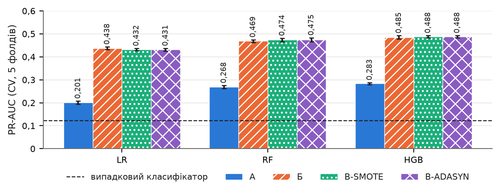
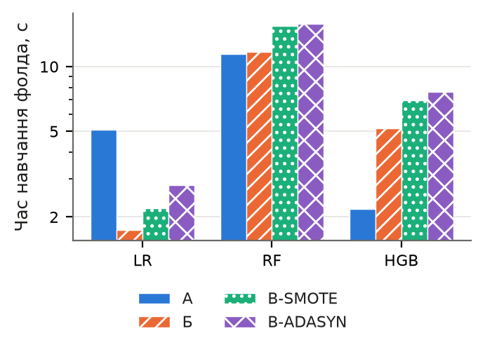
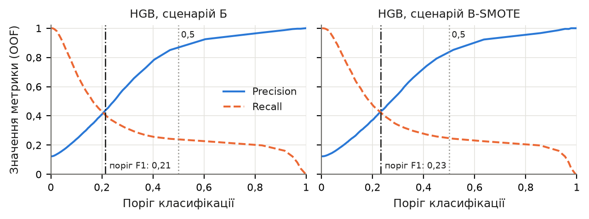
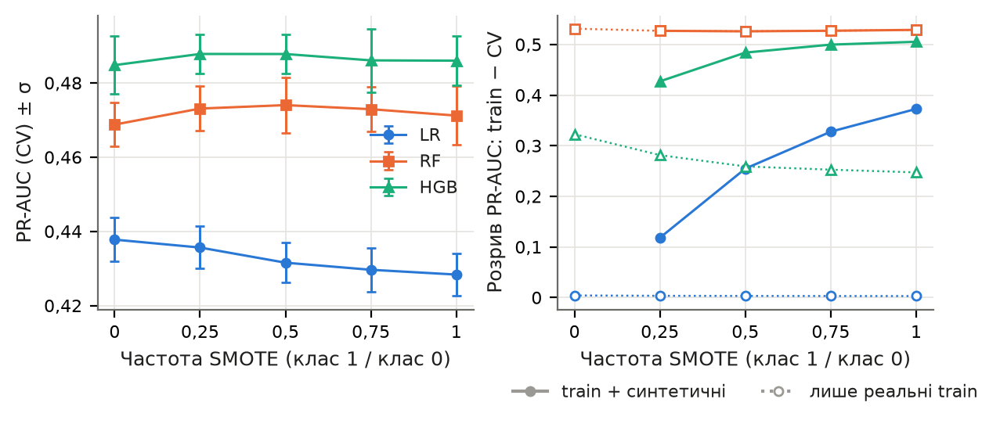
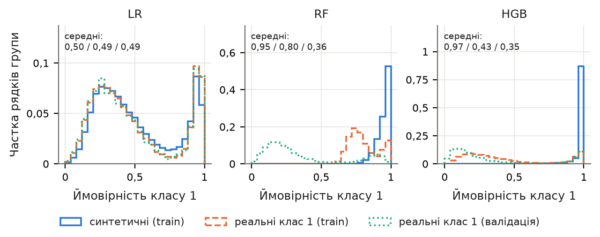
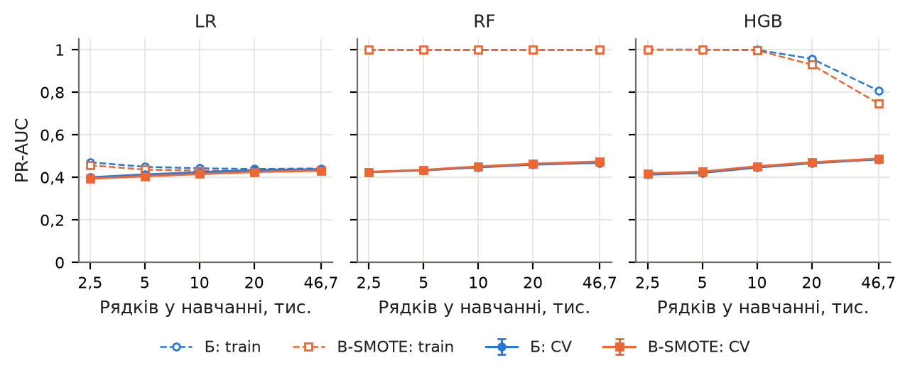
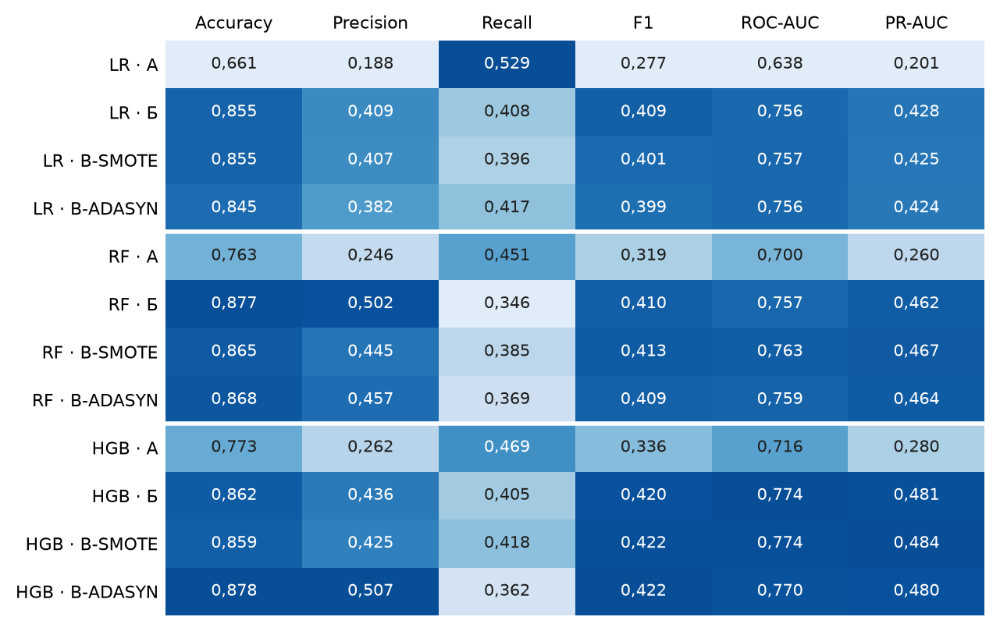
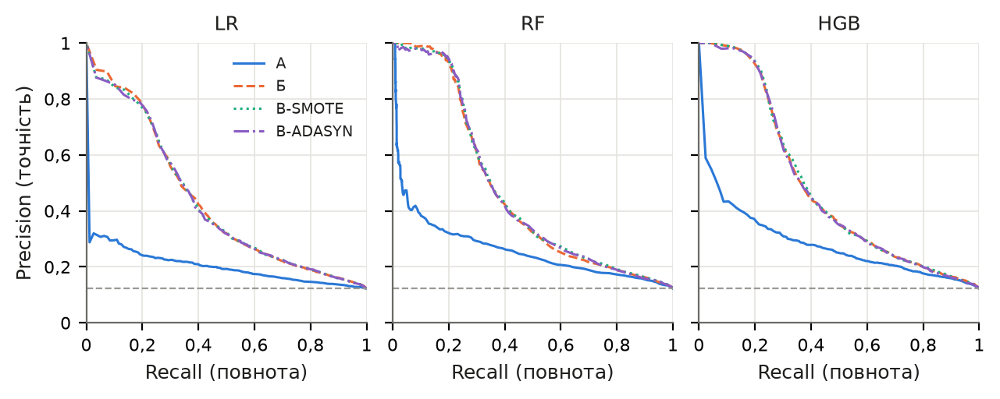
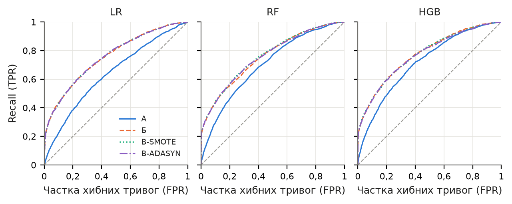
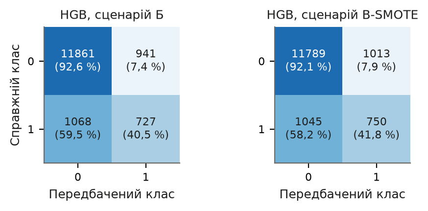

# ЛР №2 — Три моделі, три сценарії даних: конспект

## 1. Коротко

Узяли дані ЛР1 про «погані» покупки авто: 58 386 рядків train і 14 597 рядків test, клас 1 становить 12,3 %.
На них навчили три моделі різних сімейств: логістичну регресію (LR), випадковий ліс (RF) і
гістограмний градієнтний бустинг (HGB). Кожну оцінили на чотирьох варіантах даних. А — мінімальна
підготовка. Б — повний рецепт `FULL` з ЛР1. В — Б плюс синтез рідкісного класу (SMOTE або ADASYN).
Усі рішення ухвалено лише на 5-кратній крос-валідації всередині train. Test відкрито один раз,
наприкінці. Найкраща модель — HGB: PR-AUC 0,485 у CV і 0,481 на test (сценарій Б); «вгадування
навмання» дає 0,123. Повний препроцесинг піднімає PR-AUC кожної моделі на ≈ 0,20–0,24. Аугментація
PR-AUC майже не змінює: для LR вона навіть статистично значуще шкодить, а для RF дає +0,005, що
на test не підтверджується. Зате вона зсуває ймовірності, і через це «покращує» F1 при порозі
0,5. Окремо зловили тонку помилку вимірювання. Вона спотворювала розрив train−CV, і її виправлено
спільним кроком `FitInputRecorder`.

## 2. Навіщо це взагалі

У ЛР1 ми підготували дані й міряли їхню якість однією фіксованою «лінійкою», логістичною регресією.
Тепер питання навпаки: дані є, яка *модель* на них найкраща і чи залежить відповідь від того, як
дані підготовлено? Наївна відповідь «беремо найпотужнішу модель, а дані хай будуть які є»
перевіряється сценарієм А. Наївна відповідь «рідкісного класу мало, домалюємо його» перевіряється
сценарієм В.

Друга половина роботи — дисципліна оцінки. Якщо поріг, модель чи сценарій обирати, дивлячись на
test, оцінка на test перестає бути чесною: ти вже «підігнав» рішення під ці рядки. Тому в ЛР2
вперше з'являється повний протокол: вибір на крос-валідації → одна фінальна оцінка на test → довірчий
інтервал. Без нього висновок «SMOTE покращив модель на 0,005» не відрізнити від шуму.

Місце в ланцюжку:

- **ЛР1:** дані й рецепт підготовки (`MINIMAL`, `FULL`).
- **ЛР2 (ця):** порівняння моделей і сценаріїв. Новий спільний пакет `src/mllabs/modeling/`
  (моделі, метрики, крос-валідація, поріг, бутстреп) перейде в ЛР3 без змін.
- **ЛР3:** підбір гіперпараметрів (Grid/Random/Bayesian) і витік даних. Вона візьме RF або HGB з
  ЛР2 як точку відліку (`metrics.lab3_handoff`). Історію з `FitInputRecorder` (розділ 4.9) варто
  прочитати перед нею: це той самий тип витоку, тільки у вимірюванні, а не в моделі.

## 3. Словник

Базові терміни (ознака, ціль, train/test, крос-валідація, фолд, σ, парна різниця Δ і s, `Pipeline`,
`fit`/`transform`, precision, recall, F1, PR-AUC, ROC-AUC, SMOTE, ADASYN, Target Encoding, крос-фітинг,
логістична регресія) пояснено в [`labs/lab01/GUIDE.md`](../lab01/GUIDE.md), розділи 3 і 4.0. Python↔Java —
[`docs/python-for-java.md`](../../docs/python-for-java.md).

| Термін | Пояснення | Аналогія |
|---|---|---|
| Сценарій даних | Що відбувається з таблицею до моделі: А, Б, В (і діагностичні А_missing, Б_MICE) | профіль збірки: той самий код, різні налаштування |
| Дерево рішень (decision tree) | Модель-набір питань «ознака ≤ порогу?», що ділять рядки на групи-листки; прогноз — частка класу 1 у листку | вкладені `if/else`, побудовані автоматично |
| Ансамбль (ensemble) | Багато моделей, чиї прогнози усереднюються чи додаються | кворум реплік |
| Бегінг (bagging), випадковий ліс (random forest) | Багато незалежних дерев, кожне — на випадковій вибірці рядків і ознак; прогноз — середнє | паралельні незалежні воркери, результат — голосування |
| Бустинг (boosting), градієнтний бустинг | Дерева будуються по черзі; кожне наступне виправляє помилки суми попередніх | ітеративне доопрацювання: кожен патч закриває те, що лишилося |
| Місткість моделі (capacity) | Наскільки складну залежність модель здатна підігнати — і скільки окремих точок здатна «запам'ятати» | розмір кешу: великий кеш запам'ятає й сміття |
| Перенавчання (overfitting) | Модель вивчила особливості навчальних рядків, які не повторюються на нових | тест, що проходить лише на фікстурах розробника |
| Розрив train − CV (gap) | PR-AUC на рядках, на яких модель училася, мінус PR-AUC на валідації. Великий розрив — ознака запам'ятовування | — |
| OOF-прогноз (out-of-fold) | Ймовірність для кожного рядка train від моделі того фолда, де цей рядок був у валідації, тобто від моделі, що його не бачила | — |
| Поріг класифікації (threshold) | Число, з яким порівнюють ймовірність: ≥ поріг → «клас 1» | — |
| Матриця помилок (confusion matrix) | Таблиця 2×2 «справжній клас × передбачений»: TN, FP, FN, TP | — |
| Brier score | Середній квадрат різниці «ймовірність − справжня мітка 0/1». Менше — краще; міряє чесність ймовірностей | середньоквадратична похибка прогнозу погоди |
| Калібрування (calibration) | Чи збігається передбачена ймовірність із фактичною частотою: серед авто з p = 0,3 мають бути погані ≈ 30 % | — |
| Відкладена вибірка (holdout) | Test, який не бере участі в жодному рішенні | продакшн-трафік, на якому не дебажать |
| Бутстреп (bootstrap) | Багаторазова вибірка рядків *із поверненням* з наявних даних — імітує «інші вибірки того ж розміру» | Monte Carlo на власних даних |
| Довірчий інтервал (ДІ, confidence interval) | Діапазон, у якому з заданою впевненістю (95 %) лежить справжнє значення. ДІ різниці містить 0 → різниця не доведена | похибка вимірювання бенчмарку |
| Крива навчання (learning curve) | Якість від обсягу навчальних даних | профіль продуктивності від розміру входу |
| Синтетичний рядок | Рядок класу 1, створений SMOTE/ADASYN; існує лише в навчальній частині фолда | мок-об'єкт |

## 4. Як це зроблено — крок за кроком

### 4.0. Перед кроками: каркас, пакет `modeling` і протокол оцінки

**Каркас** той самий, що в ЛР1 (`labs/lab01/GUIDE.md`, розділ 4.0): `uv run mllabs run 2` створює
`Lab2`, а той повертає список кроків.

```python
# src/mllabs/labs/lab02/lab.py:86-95
return [
    Step("1. Дані ЛР1 і звірка препроцесингу", self._load_data),
    Step("2. Сценарії даних і стан даних", self._describe_scenarios),
    Step("3. Крос-валідація: моделі × сценарії", self._cross_validate),
    Step("4. Поріг класифікації на OOF-прогнозах", self._report_thresholds),
    Step("5. Аугментація: інтенсивність і синтетика", self._sweep_augmentation),
    Step("6. Аугментація: криві навчання", self._learning_curves),
    Step("7. Фінальна оцінка на тестовій вибірці", self._evaluate_on_test),
    Step("8. Порівняльна таблиця і профіль моделей", self._summarize),
]
```

`lab.py` лише оркеструє кроки. Усі числа-параметри лежать у `src/mllabs/labs/lab02/config.py:69-97`,
обчислення — в окремих модулях. **Кроки 1–6 працюють лише з train. Test уперше з'являється в
кроці 7** (docstring `lab.py:8-10`).

**Новий спільний пакет `src/mllabs/modeling/`.** У ЛР1 крос-валідацію робив `sklearn.cross_validate`.
Він повертає лише числа метрик, а для ЛР2–3 потрібно більше. Тому з'явився окремий пакет. Його
перевикористає ЛР3, тож тут — короткий огляд будови:

| Клас (файл) | Відповідальність | Java-аналогія |
|---|---|---|
| `ModelKind`, `ModelSettings`, `ModelFactory` (`models.py`) | Створює **нефітовану** модель за типом з фіксованими базовими параметрами (`models.py:110-136`) | Factory + `enum` |
| `MetricsCalculator`, `ClassificationMetrics` (`metrics.py`) | Усі метрики одного набору прогнозів при заданому порозі (`metrics.py:89-114`) | сервіс без стану + незмінний DTO |
| `CrossValidator`, `CrossValidationResult`, `FoldPrediction` (`validation.py`) | Ручний цикл по фолдах: OOF-прогнози, прогнози на train-рядках, час, «інспектор» фолда, паралельність | шаблонний метод з хуком |
| `FoldInspector` (`validation.py:37-56`) | Хук «що ще виміряти на навченому пайплайні фолда» (у ЛР2 — ймовірності на синтетичних рядках) | `@FunctionalInterface` |
| `F1ThresholdSelector` (`thresholds.py`) | Поріг з максимальним F1 на переданих (OOF) даних | стратегія |
| `PairedBootstrap`, `BootstrapInterval` (`bootstrap.py`) | 95 % ДІ різниці метрики двох моделей на тих самих рядках | — |
| `FitInputRecorder` і функції навколо (`fit_input.py`) | Прохідний крок пайплайна, що запам'ятовує матрицю, яку модель отримала у `fit` (розділ 4.9) | `Decorator`-перехоплювач |
| `CurveBuilder` (`curves.py`) | Криві PR, ROC і «метрика від порога», проріджені до 200 точок для графіків | — |

Над ним пакет лабораторної склеює все в одну «конфігурацію»: `ConfigurationRunner.run`
(`src/mllabs/labs/lab02/runner.py:278-295`) бере сценарій, модель і частоту SMOTE, збирає пайплайн,
проганяє `CrossValidator` і повертає незмінний `ConfigurationResult`. У ньому лежать OOF-вектор,
обраний поріг, метрики по фолдах, PR-AUC на train і ймовірності на синтетиці (`runner.py:163-208`).

**Протокол оцінки — одна схема на всю лабораторну:**

```
train (58 386)                                                    test (14 597)
 │                                                                  │
 ├─ 5 стратифікованих фолдів, ОДНАКОВІ для всіх конфігурацій          │
 │    на кожному: clone(пайплайн).fit(4/5) → ймовірності на 1/5      │
 │                                                                  │
 ├─ OOF-вектор: 58 386 ймовірностей, кожна від «сліпої» моделі       │
 │    └─ поріг = argmax F1 на OOF (F1ThresholdSelector)  ────────┐   │
 │                                                              │   │
 ├─ метрики по фолдах → середнє ± σ, парні Δ і s (правило ЛР1)    │   │
 │                                                              ▼   ▼
 └─ (крок 7) пайплайн.fit(весь train) ──────────────► ймовірності на test
                                                      метрики при 0,5 і при готовому порозі
                                                      парний бутстреп → 95 % ДІ різниць
```

*Чому test не можна використовувати для вибору.* Кожен вибір — порога, моделі, сценарію — теж
«навчання»: ти підганяєш рішення під дані. Обравши поріг за test, ти отримаєш на тому ж test
оптимістичне F1, бо поріг налаштовано саме на ці 14 597 рядків. Чесної оцінки тоді вже немає, а
інших відкладених даних у проєкті немає (ЛР3 оцінюватиме на тому самому test). Тому test
використовується один раз, для заздалегідь заданих 12 конфігурацій (3 моделі × А, Б, В-SMOTE,
В-ADASYN), і жодне рішення за ним не ухвалюється. Два тести це стережуть.
`test_threshold_is_chosen_without_test_data` (`tests/labs/test_lab02_runner.py:129`) перемішує мітки
test і перевіряє, що поріг не змінився. `test_runner_never_receives_test_rows` (`:166`)
перевіряє, що крос-валідатор отримує саме об'єкт `x_train`.

Чесне зауваження з `PLAN.md` (розділ 5): під час планування одна проба порахувала PR-AUC на test у
scratchpad. Жоден параметр за нею не налаштовано, і в артефакти вона не потрапила.

**Метрики.** PR-AUC — головна, як і в ЛР1. Решту найлегше показати на реальній матриці помилок:
HGB, сценарій Б, test, поріг 0,214 (`figures/test_confusion_matrices.png`).

|  | передбачено 0 | передбачено 1 |
|---|---|---|
| **справді 0** | 11 861 (TN, правильно «добрі») | 941 (FP, хибна тривога) |
| **справді 1** | 1 068 (FN, пропущена погана) | 727 (TP, знайдена погана) |

| Метрика | Формула на цьому прикладі | Значення | Що міряє |
|---|---|---|---|
| Accuracy | (727 + 11 861) / 14 597 | 0,862 | частку всіх правильних відповідей |
| Precision | 727 / (727 + 941) | 0,436 | скільки з позначених «поганими» справді погані |
| Recall | 727 / (727 + 1 068) | 0,405 | яку частку поганих знайшли |
| F1 | 2·P·R / (P + R) | 0,420 | баланс P і R; низький, якщо хоч одна мала |
| ROC-AUC | — | 0,774 | імовірність, що випадкова погана машина отримає вищий бал, ніж випадкова добра; навмання = 0,5 |
| PR-AUC | — | 0,481 | площа під кривою precision–recall; навмання = частка класу 1 ≈ 0,123 |
| Brier | середнє (p − y)² | 0,0837 | чесність ймовірностей, менше — краще |

Accuracy, Precision, Recall і F1 — *порогові* метрики: вони залежать від порога. ROC-AUC і PR-AUC —
*ранжувальні*: вони оцінюють порядок рядків за ймовірністю при всіх порогах одразу. Код усіх семи —
`src/mllabs/modeling/metrics.py:99-114`.

**Чому Accuracy тут оманлива.** «Модель», яка завжди відповідає «авто добре», має accuracy 0,877
(`metrics.test.majority_baseline_accuracy`). Наш найкращий HGB при робочому порозі має 0,862 — *менше*
за цю «модель», хоча знаходить 727 поганих авто з 1 795, а вона жодного. Ще наочніше: LR у сценарії А
при порозі 0,5 має accuracy рівно 0,877, а precision, recall і F1 = 0. Вона жодного разу не сказала «1».
Для Brier теж є опорна лінія: стала відповідь p = 0,123 дає 0,123 × 0,877 ≈ 0,108.

---

### Крок 1. Дані ЛР1 і звірка препроцесингу

- **Що:** читає `data/processed/kick/`, звіряє фабрику препроцесорів із `preprocessing.json` ЛР1,
  створює спільні об'єкти: каталог сценаріїв, фабрику моделей, калькулятор метрик, раннер.
- **Навіщо:** сценарії А і Б мають бути *рівно* тими рецептами, що обґрунтовані в ЛР1. Якщо хтось
  змінив параметр препроцесингу, `check_manifest` зупинить запуск з `PreprocessingMismatchError`,
  а не тихо порахує інше (`labs/lab01/GUIDE.md`, крок 5).
- **Як:** `lab.py:101-107` — завантаження й `check_manifest`. Далі `lab.py:117-129` збирає раннер.
  Усі конфігурації отримують **той самий** `CrossValidator`, тому й ті самі фолди.
- **Що вийшло** (`metrics.data`): 58 386 рядків train, 14 597 test, 29 вихідних ознак, частка класу 1
  в train 0,1230. Accuracy «завжди 0» на train 0,8770.

### Крок 2. Сценарії даних і стан даних

- **Що:** описує шість варіантів даних і рахує, що бачить модель у кожному: скільки ознак, рядків і
  яка частка класу 1.
- **Навіщо:** це пункт 6 завдання («звіт про стан даних та виконані перетворення»). Крім того,
  діагностичні варіанти дозволяють пояснити розрив А → Б числом, а не здогадкою.
- **Як.** Каталог сценаріїв — `src/mllabs/labs/lab02/scenarios.py:103-126`. Кожен сценарій — це
  незмінний `ScenarioSpec`: опції препроцесора ЛР1 плюс тип семплера.

```python
# src/mllabs/labs/lab02/scenarios.py:106-124 (скорочено)
(ScenarioSpec(ScenarioId.A, "А", minimal, SamplerKind.NONE, on_test=True),)
(
    ScenarioSpec(
        ScenarioId.A_MISSING,
        "А_missing",
        replace(minimal, categorical_imputation=CategoricalImputation.MISSING_CATEGORY),
        ...,
    ),
)
(ScenarioSpec(ScenarioId.B, "Б", full, SamplerKind.NONE, on_test=True),)
(ScenarioSpec(ScenarioId.B_MICE, "Б_MICE", replace(full, imputer=ImputerKind.MICE), ...),)
(ScenarioSpec(ScenarioId.C_SMOTE, "В-SMOTE", full, SamplerKind.SMOTE, on_test=True),)
(ScenarioSpec(ScenarioId.C_ADASYN, "В-ADASYN", full, SamplerKind.ADASYN, on_test=True),)
```

Кожен діагностичний варіант змінює **рівно одну цеглину** (`replace` — копія frozen-об'єкта з одним
зміненим полем; тест `test_diagnostic_variants_change_exactly_one_brick`):

- **А_missing** = А, але пропуск у категоріальній ознаці стає окремою категорією `MISSING`, а не
  модою. Питання, на яке він відповідає: яку частку розриву А → Б дає втрата сигналу «`WheelType`
  пропущено» (70,4 % поганих серед таких авто проти 9,6 % серед решти, ЛР1).
- **Б_MICE** = Б, але числові пропуски заповнює MICE, а не медіана. Він відповідає на букву
  завдання «просунута імп'ютація» (рішення D1 у `PLAN.md`, розділ 6).

Обидва рахуються лише в CV і лише для LR і HGB (`config.py:90-93`), на test не йдуть
(`on_test=False`).

Сценарій В будується так: семплер стоїть **усередині** `imblearn.pipeline.Pipeline` між
препроцесором і моделлю (`src/mllabs/preprocessing/pipelines.py:40-47`). Тому синтетичні рядки
з'являються лише під час `fit` навчальної частини фолда, а валідація й test завжди реальні.

- **Що вийшло** (`tables/data_state.csv`):

| Сценарій | Перетворення | Ознак | Рядків навчання | Синтетичних | Клас 1, % |
|---|---|---|---|---|---|
| А | медіана; мода; Ordinal; без масштабування | 28 | 58 386 | 0 | 12,30 |
| А_missing | медіана; **MISSING**; Ordinal; без масштабування | 28 | 58 386 | 0 | 12,30 |
| Б | медіана; MISSING; One-Hot/Target; Yeo-Johnson; нові ознаки; без колінеарних | 92 | 58 386 | 0 | 12,30 |
| Б_MICE | те саме, але **MICE** | 92 | 58 386 | 0 | 12,30 |
| В-SMOTE | Б + SMOTE до 0,5 : 1 | 92 | 76 807 | 18 421 | 33,33 |
| В-ADASYN | Б + ADASYN до 0,5 : 1 | 92 | 77 056 | 18 670 | 33,55 |

У А 28 ознак, а не 29, бо дата відкидається. ADASYN генерує трохи більше рядків, ніж задано: його
`sampling_strategy` наближений. Таблицю рахує `DataStateReporter` (`data_state.py:58-90`) на всьому
train, щоб описати дані. Метрик тут немає. Препроцесор MICE на всьому train видав одне
`ConvergenceWarning` (`metrics.scenarios.B_mice.preprocessor_convergence_warnings`): за ліміт
ітерацій MICE не зійшовся.

### Крок 3. Крос-валідація: моделі × сценарії

- **Що:** 3 моделі × 4 сценарії завдання + 4 діагностичні конфігурації, кожна у 5-кратній CV.
  Результат — PR-AUC ± σ, порогові метрики, Brier, розрив train − CV, час.
- **Навіщо:** це пункти 2–5 завдання: навчити моделі, порівняти сценарії, проаналізувати сильні й
  слабкі сторони.

**Три моделі «на пальцях»** (`src/mllabs/modeling/models.py:110-136`, параметри — `tables/models.csv`).

1. **Логістична регресія (LR)** — з ЛР1. Зважена сума ознак z = w₁x₁ + … + b, пропущена через
   сигмоїду 1/(1 + e⁻ᶻ), дає ймовірність. Оптимізатор `lbfgs` підбирає ваги ітераціями. L2-штраф
   (`C=1.0`) не дає вагам роздуватися. Модель бачить лише *монотонні* ефекти кожної ознаки: «що
   більше x, то більше (або менше) ризик». `max_iter=2000` замість стандартних 100, бо на
   немасштабованих ознаках сценарію А оптимізатор сходиться повільно.
2. **Випадковий ліс (RF)** — 200 дерев. Кожне дерево вчиться на *бутстреп-вибірці* рядків (тих
   самих 46 708, але витягнутих із поверненням). У кожному розгалуженні дерево розглядає випадкові
   √92 ≈ 9 ознак. Дерева ростуть без обмеження глибини (`max_depth=None`, `min_samples_leaf=1`),
   тобто кожне запам'ятовує свою вибірку майже дослівно. Прогноз — середнє 200 дерев. Помилки окремих дерев
   різні й при усередненні гасять одна одну. Цей ліс навмисно «сирий»: регуляризувати його — тема ЛР3.
3. **Гістограмний градієнтний бустинг (HGB)** — 200 невеликих дерев (до 31 листка), що будуються
   *по черзі*. Перше дерево дає грубий прогноз. Друге вчиться на його помилках (точніше, на градієнті
   функції втрат) і додається до суми з вагою `learning_rate=0.1`, третє виправляє суму перших двох,
   і так далі. «Гістограмний» означає, що кожна числова ознака заздалегідь розбивається на ≤ 255
   інтервалів, і дерево шукає поріг серед них, а не серед 46 тис. значень. Тому HGB швидкий. Це
   той самий алгоритм, що в LightGBM (рішення D3 у `PLAN.md`: XGBoost/LightGBM потребують системної
   `libomp`). Раннє зупинення вимкнене (`early_stopping=False`, `models.py:127-136`). Інакше HGB
   сам відрізав би 10 % навчальних рядків для контролю, а в сценарії В серед них були б синтетичні.

`class_weight` не задано жодній моделі (`models.py:93-94`): інакше ефект SMOTE змішався б з
переважуванням класів.

**Як влаштовано CV.** Головний цикл — `CrossValidator.evaluate` (`src/mllabs/modeling/validation.py:234-290`):

```python
# src/mllabs/modeling/validation.py:263-282 (скорочено)
for fold, (train_index, valid_index) in enumerate(self.splits(features, target)):
    used_index = train_index if train_size is None else self._subsample(...)
    tasks.append(
        delayed(_run_fold)(
            with_fit_input_recorder(clone(pipeline)),  # чиста копія + рекордер (розділ 4.9)
            features,
            target,
            fold,
            used_index,
            valid_index,
            ...,
        )
    )
```

`clone` дає ненавчену копію пайплайна, тож кожен фолд починає з нуля. `delayed(f)(args)` не
викликає функцію одразу, а пакує її в «завдання». `Parallel` виконує 5 завдань у 5 процесах
(`cv_n_jobs=5`, `config.py:79`) і повертає результати в порядку фолдів. У кожному фолді
`_run_fold` (`validation.py:305-346`) робить `fit`, рахує ймовірності для валідаційних рядків
(з них складеться OOF) і для власних навчальних рядків (для розриву train − CV), міряє час і
перехоплює `ConvergenceWarning` у список. OOF-вектор збирається з валідаційних шматків:

```python
# src/mllabs/modeling/validation.py:107-110
oof = np.full(len(self.target), np.nan)  # масив NaN на всі рядки train
for fold in self.folds:
    oof[fold.valid_index] = fold.valid_proba  # кожен рядок заповнюється рівно раз
return oof
```

Те, що кожен рядок заповнено рівно раз, перевіряє тест `test_oof_covers_every_row_exactly_once`
(`tests/modeling/test_modeling_validation.py:24`). Фолди однакові для всіх конфігурацій
(`splits`, `validation.py:221-232`, тест `test_folds_are_identical_between_calls`). На цьому стоять
парні різниці (`comparison.py:56-62`) — те саме правило Δ > s, що в ЛР1.

- **Що вийшло:**



Стовпці — середній PR-AUC за 5 фолдами, вуса — ± σ, пунктир — рівень випадкового класифікатора
(0,123). Групи — моделі, кольори й штрихування — сценарії.

| Модель | А | Б | В-SMOTE | В-ADASYN | ROC-AUC (Б) | Розрив train − CV (Б) | Навчання фолда, с (Б) |
|---|---|---|---|---|---|---|---|
| LR | 0,201 | 0,438 | 0,432 | 0,431 | 0,759 | 0,004 | 1,7 |
| RF | 0,268 | 0,469 | 0,474 | 0,475 | 0,756 | 0,531 | 11,7 |
| HGB | 0,283 | **0,485** | 0,488 | 0,488 | 0,772 | 0,323 | 5,2 |

(`tables/cv_results.csv`, `tables/model_profile.csv`; σ PR-AUC усюди 0,005–0,009.)

**Звідки розрив А → Б.** Парно Б − А дає Δ = +0,237 для LR, +0,200 для RF, +0,201 для HGB, усі з
s ≈ 0,006 (`metrics.cv.paired.*.B_vs_A`). Діагностичні варіанти розкладають цей розрив на частини
(`tables/scenario_decomposition.csv`):

| Перехід | LR: Δ (s) | HGB: Δ (s) |
|---|---|---|
| А → А_missing (лише мода → MISSING) | +0,0013 (0,0017) — **не покращує** | **+0,1897** (0,0067) |
| А_missing → Б (кодування, масштаб, нові ознаки) | **+0,2355** (0,0071) | +0,0117 (0,0053) |
| Б → Б_MICE (медіана → MICE) | +0,0001 (0,0010) — не покращує | +0,0024 (0,0032) — не покращує |

Для HGB ≈ 94 % розриву (0,190 з 0,201) дає одна зміна: пропуск у `WheelType` перестає зливатися з
модою. Для LR та сама зміна не дає нічого, а весь розрив дають кодування й масштабування. Чому так —
видно з того, як Ordinal кодує категорії. Він нумерує їх за абеткою: `Alloy` = 0, `Covers` = 1,
`MISSING` = 2, `Special` = 3. Сигнал «пропущено» опиняється *посередині* шкали, між двома звичайними
категоріями. Дерево вирізає код 2 двома розгалуженнями (> 1,5 і ≤ 2,5). Лінійна модель так не вміє:
її вага при `WheelType` може лише рівномірно підвищувати чи знижувати ризик від 0 до 3. У Б та сама
категорія стає окремою One-Hot колонкою `WheelType_MISSING`, і LR отримує її власну вагу. Крім того,
у А LR бачить немасштабовані ознаки (пробіг у десятках тисяч поруч із кодами 0–3) і порядкові номери
1 000 моделей авто, що не мають сенсу як числа. Оптимізатор не зійшовся у всіх 5 фолдах
(`metrics.models.logreg_convergence_warnings.A = 5`), і навчання вийшло втричі довшим, ніж у Б
(5,1 с проти 1,7 с). У Б попереджень 0.

MICE не допомагає жодній моделі, як і в ЛР1: числових пропусків ≈ 1–2 % рядків. Тому основний Б
лишається з медіаною.

**Сильні й слабкі сторони за вимірами** (`tables/model_profile.csv`, `figures/fit_time.png`):

| | LR | RF | HGB |
|---|---|---|---|
| Якість (найкращий PR-AUC CV) | 0,438 — найнижча | 0,475 | **0,488** |
| Чутливість до препроцесингу | найбільша: без масштабування і кодування не працює (F1@0,5 у А = 0) | велика | велика, майже вся — через MISSING |
| Перенавчання (розрив, Б) | 0,004 — практично немає | 0,531 — train PR-AUC = 1,0 | 0,323 |
| Стабільність (σ, Б) | 0,0059 | 0,0059 | 0,0078 |
| Час навчання фолда (Б) | 1,7 с | 11,7 с — найповільніша | 5,2 с |
| Реакція на SMOTE | шкодить (крок 7) | +0,005, проходить правило в CV | у межах шуму |



Вісь Y логарифмічна. Час виміряно при 5 паралельних фолдах, тож це порівняльні, а не абсолютні
числа. До того ж RF у кожному з 5 процесів запускає ще й власні потоки (`forest_n_jobs=-1`). Це
свідомий виняток із правила «паралелити один рівень», і заміри в docstring `config.py:39-45`
показують, що так усе одно швидше. LR у А повільніша, ніж у Б, хоча ознак утричі менше: оптимізатор упирається в 2 000 ітерацій.
HGB, навпаки, швидший у А, бо його час росте з кількістю ознак (28 проти 92). Аугментація всім додає
≈ 30 % рядків і часу.

RF має train PR-AUC = 1,0 при CV 0,469. Це класичне перенавчання глибоких дерев, але воно не
означає, що ліс поганий: він другий за якістю. Розрив показує, скільки місця для регуляризації
лишається ЛР3.

- **Чому саме ці моделі:** три різні сімейства — лінійна, бегінг і бустинг (рішення D2). SVM
  відхилено: навчання росте квадратично з кількістю рядків, а ймовірності дає лише дорогий
  `probability=True` (docstring `config.py:22-24`). Одне дерево рішень — частковий випадок лісу,
  нового воно мало б дало.

### Крок 4. Поріг класифікації на OOF-прогнозах

- **Що:** для кожної конфігурації обирає поріг, при якому F1 на OOF-прогнозах максимальний, і
  показує, як змінюються precision і recall.
- **Навіщо:** при 12 % класу 1 модель рідко дає ймовірність ≥ 0,5. Стандартний поріг 0,5 майже
  нікого не позначає: у А recall LR = 0, RF = 0,026, HGB = 0,038. Поріг — теж параметр, тож його
  обирають на даних, що не беруть участі у фінальній оцінці, тобто на OOF.
- **Як.** `precision_recall_curve` перебирає всі можливі пороги й повертає precision і recall для
  кожного. Лишається порахувати F1 у кожній точці й узяти найбільший:

```python
# src/mllabs/modeling/thresholds.py:34-48
precision, recall, thresholds = precision_recall_curve(target, proba, pos_label=...)
precision, recall = precision[:-1], recall[:-1]  # остання точка не має порога
denominator = precision + recall
f1 = np.divide(
    2 * precision * recall, denominator, out=np.zeros_like(denominator), where=denominator > 0
)
return float(thresholds[int(np.argmax(f1))])
```

`np.divide(..., where=...)` ділить лише там, де знаменник > 0, а решту лишає нулями з `out`. Так
ділення на нуль не виникає. Виклик — `runner.py:173`, на OOF-векторі всього train.

- **Що вийшло** (`tables/thresholds.csv`, `metrics.cv.*`):

| | Поріг Б | F1 Б при 0,5 → при порозі | Поріг В-SMOTE |
|---|---|---|---|
| LR | 0,194 | 0,357 → 0,413 | 0,469 |
| RF | 0,270 | 0,370 → 0,414 | 0,305 |
| HGB | 0,214 | 0,372 → 0,422 | 0,233 |



Вісь X — поріг, суцільна лінія — precision, пунктир — recall (OOF, HGB). Що вищий поріг, то менше
рядків позначено: precision росте, recall падає. Точковий вертикальний пунктир — 0,5, штрихпунктир — обраний поріг
(≈ там, де лінії перетинаються). Ліва (Б) і права (В-SMOTE) панелі майже однакові, лише криві
трохи зсунуті вправо: SMOTE підняв ймовірності, і оптимальний поріг переїхав з 0,21 на 0,23. Ця
картинка — головний аргумент кроку 5.

Пороги RF «круглі» (0,27, 0,305), бо ймовірність лісу — це частка 200 дерев, що проголосували за
клас 1, з кроком 1/200 = 0,005.

- **Обмеження:** F1 «при порозі» в CV трохи оптимістичний. Поріг обрано на тих самих OOF-рядках, на
  яких потім рахується F1 фолдів. Чесне число — F1 на test (крок 7). Для HGB-Б вони майже збігаються:
  0,422 у CV проти 0,420 на test.
- **Чому так:** альтернативи — лише 0,5 (тоді висновок про SMOTE хибний, див. крок 5) або поріг за test
  (витік). У новіших sklearn є готовий `TunedThresholdClassifierCV`. Тут потрібні були OOF-вектор і
  кілька метрик одночасно, тож вибір написано на 15 рядків.

### Крок 5. Аугментація: інтенсивність і запам'ятовування синтетики

- **Що:** для кожної моделі проганяє SMOTE з частотою 0 (= Б), 0,25, 0,5, 0,75 і 1,0 (частота — це
  відношення «клас 1 / клас 0» після аугментації). Для кожної точки міряє якість на валідації і те,
  як модель поводиться на синтетичних рядках.
- **Навіщо:** завдання вимагає відповісти, чи покращила аугментація якість і за яких умов вона
  перенавчає. Одного числа «В − Б» для цього мало: потрібні осі умов (рішення D6). Перша вісь —
  інтенсивність, друга — місткість моделі (LR мала, HGB середня, RF велика).
- **Як.** `RatioSweep.run` (`augmentation_analysis.py:90-99`) бере точки 0 і 0,5 з основної сітки,
  а 0,25, 0,75 і 1,0 рахує заново на тих самих фолдах. Щоб побачити синтетичні рядки, семплер
  обгорнуто класом `SyntheticRecorder` (`runner.py:39-73`). Обгортка викликає справжній SMOTE і
  відрізає «хвіст» результату: SMOTE повертає спершу всі реальні рядки, а синтетичні дописує в кінець.

```python
# src/mllabs/labs/lab02/runner.py:68-73
self.sampler_ = clone(self.sampler)
resampled_features, resampled_target = self.sampler_.fit_resample(X, y, **params)
n_real = len(y)
self.synthetic_features_ = np.asarray(resampled_features)[n_real:]  # зріз «з n_real до кінця»
self.synthetic_target_ = np.asarray(resampled_target)[n_real:]
return resampled_features, resampled_target
```

Модель бачить рівно ті самі рядки, що й без обгортки (тест
`test_recorder_does_not_change_what_the_model_learns`). Після `fit` фолда інспектор
`SyntheticFitProbe` (`runner.py:76-100`) просить модель оцінити ці синтетичні рядки. Потім
`from_cv` (`runner.py:176-187`) рахує PR-AUC на «реальні train + синтетичні» з міткою 1 для синтетики.

Порівнюються три групи ймовірностей класу 1:

1. на синтетичних рядках, на яких модель училася;
2. на реальних позитивних рядках train, на яких модель училася;
3. на реальних позитивних рядках валідації, яких модель не бачила.

Якщо (1) ≈ 1, а (3) значно нижче, модель «запам'ятала» точки, яких не існує.

- **Що вийшло.**



Ліва панель — PR-AUC у CV від частоти SMOTE (± σ). Лінії майже пласкі: HGB 0,485 → 0,488 → 0,486,
RF 0,469 → 0,474 → 0,471, LR повільно падає 0,438 → 0,428. Усі зміни — порядку σ. Права панель — два
розриви. Пунктир із порожніми маркерами — звичайний розрив на реальних train-рядках. Суцільна лінія
— розрив на «train + синтетичні».



Розподіли ймовірності класу 1 у сценарії В-SMOTE (частота 0,5). Вісь Y — частка рядків групи;
угорі — середні трьох груп (`metrics.augmentation.overfitting.*`):

| Модель | Синтетичні | Реальні клас 1 (train) | Реальні клас 1 (валідація) |
|---|---|---|---|
| LR | 0,50 | 0,49 | 0,49 |
| RF | 0,95 | 0,80 | 0,36 |
| HGB | **0,97** | 0,43 | 0,35 |

Як це читати:

- **LR** не відрізняє синтетику від реальних позитивних. Мала місткість — нічого запам'ятати
  вона не може.
- **RF** запам'ятовує все: і реальні (0,80), і синтетичні (0,95) рядки. Реальні train-рядки мають
  0,80, а не 1,0, бо кожен рядок потрапив у бутстреп-вибірку лише частини дерев. Решта дерев його
  не бачили й голосують «чесно».
- **HGB** — найцікавіший випадок. Реальні позитивні train-рядки він оцінює помірно (0,43), а
  синтетичні — майже напевно (0,97). Модель вивчила вигадані точки *краще*, ніж справжні. Зі
  зростанням частоти це посилюється: 0,946 при 0,25 і 0,985 при 1,0 (`tables/augmentation_ratio_sweep.csv`).
  Ймовірний механізм (окремо не вимірювався): SMOTE ставить точку на відрізку між двома сусідами,
  тож One-Hot колонки синтетики стають дробовими (обмеження з ЛР1, крок 4.1). У реальних даних таких значень
  немає, тож дерево може відокремити «синтетичні» рядки за самою дробовістю.

**Чому звичайний розрив train − CV цього не показує.** Він рахується лише на реальних рядках. У HGB
зі SMOTE цей розрив навіть *зменшується*: 0,323 → 0,259 → 0,247 (`train_gap_by_ratio`). Частину
місткості модель витрачає на синтетику, тож реальні рядки запам'ятовує слабше. З такого розриву
висновок «SMOTE зменшує перенавчання» — хибний. Перенавчання є, але воно на синтетичних
рядках, і побачити його можна лише на них.

**Обережно з суцільною лінією правої панелі.** Розрив «train + синтетичні − CV» росте в усіх
моделей до максимуму при частоті 1,0 (`max_gap_ratio = 1.0`). Навіть у LR він росте з 0,118 до
0,373, хоча LR, як видно з таблиці вище, синтетику не запам'ятовує. Причина: PR-AUC залежить від
частки класу 1. Випадковий класифікатор має PR-AUC 0,123 на валідації і ≈ 0,33 на навчальних даних
після SMOTE 0,5, де клас 1 становить 33 %. Тому цей розрив містить ще й зсув базової лінії. Надійний
індикатор запам'ятовування — порівняння ймовірностей у таблиці, а не цей розрив сам по собі. У RF
суцільна й пунктирна лінії збігаються, бо train PR-AUC уже дорівнює 1,0 і вище не росте.

**Зсув ймовірностей** (`tables/augmentation_ratio_calibration.csv`). Середня ймовірність LR на OOF
росте з 0,123 до 0,403 при частоті 1,0, хоча справжня частка класу 1 лишається 0,123. Brier
погіршується з 0,088 до 0,179, а оптимальний поріг переїжджає з 0,194 на 0,627. У RF і HGB зсув
значно менший: Brier 0,085 → 0,089 і 0,083 → 0,084. Правдоподібне пояснення: у LR зсув вільного
члена b змінює ймовірність усіх рядків одразу, а дерева «складають» синтетику у свої листки.

### Крок 6. Аугментація: криві навчання

- **Що:** зменшує навчальну частину кожного фолда до 2 500, 5 000, 10 000 і 20 000 рядків
  (стратифіковано). Валідацію лишає повною. Порівнює Б і В-SMOTE для всіх трьох моделей.
- **Навіщо:** третя вісь умов — обсяг даних. Гіпотеза плану: на малих даних синтетика шкодить
  сильніше. На 2 500 рядках лише 307 позитивних, тож SMOTE інтерполює між дуже рідкими точками.
- **Як:** `CrossValidator._subsample` (`validation.py:292-302`) бере стратифіковану підвибірку
  позицій навчальної частини. Тест `test_train_size_keeps_class_share_and_full_validation`
  перевіряє, що частка класу зберігається. Повний розмір (46 708) береться з основної сітки
  (`augmentation_analysis.py:211-222`).
- **Що вийшло:**



Вісь X — рядків у навчанні (тис., логарифмічна шкала). Суцільні лінії — CV, пунктир — train. Що
ближчі пунктир і суцільна, то менше перенавчання.

| Модель | PR-AUC CV Б: 2 500 → 46 708 | Train PR-AUC Б: 2 500 → 46 708 | Δ В − Б: 2 500 / 46 708 |
|---|---|---|---|
| LR | 0,400 → 0,438 | 0,471 → 0,442 | −0,0059 / −0,0062 |
| RF | 0,424 → 0,469 | 1,000 → 1,000 | +0,0011 / +0,0052 |
| HGB | 0,413 → 0,485 | 1,000 → 0,807 | +0,0054 / +0,0030 |

Більше даних допомагає всім, найбільше HGB (+0,072). HGB на ≤ 10 тис. рядків запам'ятовує train
повністю (PR-AUC 1,0), і лише на повному обсязі 200 дерев уже не встигають. Гіпотеза плану **не
підтвердилася**: на 2 500 рядках SMOTE не шкодить деревам, а HGB дає навіть трохи більший плюс, ніж
на повних даних. Але всі ці Δ менші за σ однієї точки (0,004–0,014), а парний s для них не рахувався.
Тож чесний висновок такий: в обраному діапазоні обсяг даних на ефект SMOTE помітно не впливає. LR
усюди трохи гірша зі SMOTE.

### Крок 7. Фінальна оцінка на тестовій вибірці

- **Що:** кожну з 12 конфігурацій навчає на всьому train. На test рахує метрики при 0,5 і при порозі
  з кроку 4, будує криві та матриці помилок. Для пар Б − А і В − Б рахує 95 % ДІ різниці PR-AUC
  парним бутстрепом.
- **Навіщо:** CV — це оцінка на тих самих 58 тис. рядках, на яких ухвалювалися рішення. Test —
  незалежна перевірка, що рішення не підігнані під train.
- **Як.** `HoldoutEvaluator.evaluate` (`test_evaluation.py:112-156`). Поріг береться готовим із CV:

```python
# src/mllabs/labs/lab02/test_evaluation.py:146-153
threshold = grid.get(model, spec.scenario_id).threshold  # з OOF train, не з test
predictions[(model, spec.scenario_id)] = HoldoutPrediction(
    ...,
    at_default=self._calculator.compute(y_test, proba),  # поріг 0,5
    at_threshold=self._calculator.compute(y_test, proba, threshold),
)
```

**Парний бутстреп** (`src/mllabs/modeling/bootstrap.py:65-100`). Ідея: якби test був іншим, PR-AUC
обох моделей трохи змінився б. Наскільки змінилася б *різниця*? Іншого test немає, тож ми його
імітуємо: витягуємо 14 597 рядків із поверненням (якісь рядки двічі, якісь жодного разу), рахуємо
PR-AUC обох моделей на **тій самій** вибірці й беремо різницю. Так 1 000 разів. 2,5-й і 97,5-й
перцентилі цих різниць і є 95 % ДІ.

```python
# src/mllabs/modeling/bootstrap.py:84-93
generator = np.random.default_rng(
    self._random_state
)  # те саме зерно → ті самі вибірки для всіх пар
for repeat in range(self._n_repeats):
    rows = generator.integers(0, n_rows, size=n_rows)  # вибір із поверненням
    differences[repeat] = metric(labels[rows], second[rows]) - metric(labels[rows], first[rows])
tail = (1 - self._confidence_level) / 2 * 100
low, high = np.percentile(differences, [tail, 100 - tail])
```

«Парний» означає те саме, що й у ЛР1: «важкі» рядки однаково впливають на обидві моделі й у
різниці скорочуються. Тест `test_bootstrap_of_identical_predictions_gives_zero_interval` перевіряє,
що однакові прогнози дають ДІ [0; 0].

- **Що вийшло** (`tables/test_results.csv`, при OOF-порозі):



Колір нормовано *в межах кожного стовпця*: темніше — краще серед 12 конфігурацій. Отже, колір
порівнює рядки, а не стовпці між собою. Уся група А світла в PR-AUC і ROC-AUC. Б і В всередині
моделі майже не відрізняються.




Панель на модель, лінія на сценарій. На PR-кривих (precision від recall) пунктир — частка класу 1
(0,123), рівень вгадування. Криві Б, В-SMOTE і В-ADASYN лежать одна на одній, А — помітно нижче.
На ROC-кривих (recall від частки хибних тривог) діагональ — вгадування. Розрив А і Б там скромніший,
бо ROC-AUC «добріша» до дисбалансу (ЛР1, ідея 1).

CV і test узгоджені (`tables/comparison.csv`): PR-AUC на test не вищий за CV і відстає від нього щонайбільше на 0,010, порядок
моделей той самий. HGB-Б: 0,485 у CV, 0,481 на test. RF-Б: 0,469 і 0,462. LR-Б: 0,438 і 0,428.
Отже, протокол не завищив оцінок.



Модель для матриць (HGB) обрано за CV, а не за test (`lab.py:301-302`). SMOTE переносить 23 рядки
з «пропущених поганих» у «знайдені» (727 → 750) і 72 «добрі» — у хибні тривоги (941 → 1 013).

**Чи покращила аугментація якість** (`tables/augmentation_effect.csv`):

| Модель | Метод | Δ PR-AUC CV (s) | Правило Δ > s | Δ PR-AUC test | 95 % ДІ test |
|---|---|---|---|---|---|
| LR | SMOTE | −0,0062 (0,0025) | ні | −0,0037 | [−0,0066; −0,0003] |
| LR | ADASYN | −0,0067 (0,0031) | ні | −0,0047 | [−0,0079; −0,0010] |
| RF | SMOTE | +0,0052 (0,0031) | **так** | +0,0050 | [−0,0009; 0,0115] |
| RF | ADASYN | +0,0059 (0,0037) | **так** | +0,0025 | [−0,0039; 0,0098] |
| HGB | SMOTE | +0,0030 (0,0035) | ні | +0,0026 | [−0,0037; 0,0090] |
| HGB | ADASYN | +0,0033 (0,0063) | ні | −0,0010 | [−0,0081; 0,0057] |

Чесний підсумок:

- **LR:** аугментація шкодить. ДІ на test цілком нижче нуля, тобто погіршення статистично значуще,
  хоч і мале.
- **RF:** у CV SMOTE і ADASYN проходять правило (Δ ≈ 1,6–1,7 s). На test різниця того самого знака й
  розміру (+0,005), але ДІ містить 0, тож test її не підтверджує. Обидва факти треба називати разом.
  Висновок «SMOTE покращує RF» був би перебільшенням, висновок «не впливає» — теж. Ефект малий і
  на межі виявлення.
- **HGB:** у межах шуму і в CV, і на test. Те, що за середнім CV найкраща конфігурація — HGB +
  ADASYN (0,488, `metrics.cv.best`), нічого не означає: за правилом вона не краща за Б.

**Чому PR-AUC не росте, а F1 при 0,5 росте** (`tables/augmentation_threshold_effect.csv`,
`tables/test_threshold_effect.csv`):

| Модель (SMOTE) | Поріг Б → В | Δ F1 при 0,5 (CV / test) | Δ F1 при своєму порозі (CV / test) |
|---|---|---|---|
| LR | 0,194 → 0,469 | **+0,051** / **+0,063** | +0,001 / −0,008 |
| RF | 0,270 → 0,305 | +0,012 / +0,017 | +0,005 / +0,003 |
| HGB | 0,214 → 0,233 | +0,010 / +0,014 | +0,006 / +0,002 |

PR-AUC міряє порядок рядків. Синтетичні точки — це інтерполяції між уже відомими позитивними
рядками, нового знання про машини вони не несуть, тож порядок майже не змінюється. Зате модель, що
бачила 33 % класу 1 замість 12 %, видає вищі ймовірності. При *фіксованому* порозі 0,5 це те саме,
що знизити поріг: recall LR на test росте на 0,14, і F1 виглядає кращим. Якщо ж кожній моделі
підібрати свій поріг на OOF, «покращення» F1 зникає (LR: +0,001 у CV, −0,008 на test). Тобто SMOTE
тут — дорогий спосіб зсунути поріг, і при цьому він псує калібрування (Brier LR +0,031). Так
закрито питання, яке ЛР1 залишила відкритим («Чи дав би той самий ефект простий зсув порогу»).

- **Обмеження бутстрепу:** він враховує лише випадковість test-вибірки. Моделі навчено один раз, тож
  мінливість самого навчання (інше зерно, інший train) в ДІ не входить.

### Крок 8. Порівняльна таблиця, профіль моделей, передача в ЛР3

- **Що:** зводить уже пораховане в `tables/comparison.csv` (CV і test поруч — вимога звіту),
  `tables/model_profile.csv`, `tables/augmentation_effect.csv` і розділи `profile`, `augmentation`,
  `lab3_handoff` у `metrics.json`. Нічого не навчає (docstring `summary.py:1-5`).
- **Що передається в ЛР3** (`summary.py:151-165`): сценарій `full`, 5 фолдів і для RF та HGB —
  PR-AUC CV, розрив і час фолда. HGB: 0,485, розрив 0,323, 5,2 с. RF: 0,469, розрив 0,531, 11,7 с.
  Обидві моделі мають великий розрив, тож підбору гіперпараметрів є що виправляти. Сценарій Б
  містить `TargetEncoder`, на якому ЛР3 будуватиме демонстрацію витоку.

### 4.9. Історія однієї помилки: як міряти «якість на train» з `TargetEncoder`

Помилку знайдено на рев'ю. Вона не змінила жодного висновку про моделі, але спотворила одне
з ключових чисел — розрив train − CV. Ось вона як урок.

**Як було.** Ймовірності на власних навчальних рядках фолда рахувалися «очевидно»:
`pipeline.predict_proba(x_train)`. Пайплайн проганяв `x_train` через препроцесор методом
`transform`, і модель оцінювала отриману матрицю.

**Що не так.** Модель училася не на цій матриці. Під час `fit` пайплайн викликає в проміжних
кроків `fit_transform`, і `TargetEncoder` у ньому робить крос-фітинг (ЛР1, крок 3.2): кожен
навчальний рядок кодується статистикою *інших* фолдів, без власної мітки. А `transform` кодує той
самий рядок статистикою *всіх* навчальних рядків, включно з його власною міткою. Приклад на пальцях:
модель авто трапляється в train 3 рази, 2 з них погані. Під час `fit` рядок «поганої» машини
отримує частку поганих серед *інших* машин цієї моделі. Під час `transform` — частку серед усіх
трьох, куди входить і він сам. Для рідкісних категорій власна мітка помітно зсуває значення:
ознака «підглядає» відповідь. Тобто `predict_proba(x_train)` давав моделі *інші* ознаки, ніж ті,
на яких вона вчилася.

**Наслідки йшли в різні боки** (старі числа — з протоколу рев'ю; в артефактах лишилися тільки
виправлені):

- **LR:** розрив вийшов 0,028 замість справжніх 0,004. Лінійна модель має додатну вагу на
  Target-колонках, а в `transform`-значеннях домішана власна мітка, тож «якість на train» штучно
  завищилася. Перенавчання LR виявилося артефактом вимірювання.
- **HGB:** розрив вийшов 0,245 замість 0,323, тобто занижений. Дерева вивчили пороги на
  крос-фітованих значеннях. На зсунутих `transform`-значеннях частина «запам'ятаних» розгалужень
  спрацьовує не так, і train-якість падає сильніше, ніж росте від домішаної мітки.

Обидва пояснення напрямку — інтерпретація. Виміряно лише самі числа «до» і «після».

**Як виправлено.** У пайплайн одразу після препроцесингу вставляється прохідний крок, що нічого не
змінює, а лише запам'ятовує, що через нього пройшло під час `fit`:

```python
# src/mllabs/modeling/fit_input.py:45-67 (без docstring)
class FitInputRecorder(TransformerMixin, BaseEstimator):
    def fit(self, X, y=None):
        self.fit_input_ = X  # запам'ятати матрицю
        self.n_features_in_ = X.shape[1]
        return self

    def fit_transform(self, X, y=None):  # саме його викликає Pipeline.fit
        self.fit(X, y)
        return X  # далі йде те саме, що прийшло

    def transform(self, X):  # на прогнозі — просто пропускає дані
        return X
```

`with_fit_input_recorder` (`fit_input.py:84-116`) робить копію пайплайна (`clone`) і вставляє рекордер
перед першим кроком, що має `fit_resample` (семплер), а якщо семплера немає — перед моделлю. Отже,
записана матриця — це рівно ті *реальні* рядки, на яких училася модель, у координатах крос-фітингу.
Синтетичні рядки додаються вже після рекордера. Якщо семплер є, одразу після нього стає другий
рекордер (`RESAMPLED_INPUT_STEP`). Ним `_model_matrix` (`fit_input.py:143-169`) перевіряє, що
реальні рядки дійшли до моделі першими й без змін. Якщо семплер їх видалив чи переставив (як
`SMOTEENN` чи андерсемплінг), функція кидає `FitInputMismatchError`, а не повертає мовчки хибне
число. `fit_input_proba` (`fit_input.py:177-195`) оцінює цю матрицю самою моделлю, без препроцесора.
У ЛР2 після семплера одразу йде модель, тож перевірка лише підтверджує, що SMOTE і ADASYN
реальних рядків не чіпають. У `_run_fold` це одна змінена строка:

```python
# src/mllabs/modeling/validation.py:331-332
# Не predict_proba(x_train): потрібні ознаки, які модель справді бачила під час fit.
train_proba = fit_input_proba(pipeline, x_train, positive_label)
```

Рекордер вставляється в кожну копію пайплайна в `CrossValidator.evaluate` (`validation.py:273`).
`with_fit_input_recorder` вміє заходити й в обгортки пошуку на кшталт `GridSearchCV`: це заділ на ЛР3.
Тест `test_train_proba_is_computed_on_the_matrix_seen_during_fit`
(`tests/modeling/test_modeling_fit_input.py:45`) фіксує саму суть помилки. Він перевіряє, що
`train_proba` збігається з прогнозом на матриці `fit_transform`, і що він **не** збігається з
наївним `predict_proba(x_train)`.

**Урок для ЛР3.** Витік буває не лише в моделі, а й у *вимірюванні*. Код запускався, числа виглядали
правдоподібно (0,028 — «LR трохи перенавчається»), і жоден тест метрик не падав. Помилку видає лише
питання «на яких саме даних модель училася і на яких я її міряю?». Будь-який трансформер, у якого
`fit_transform(X) ≠ fit(X).transform(X)` (`TargetEncoder`, будь-що з крос-фітингом), — кандидат на
таку пастку.

## 5. Python очима Java-розробника

Те, що вже є в [`docs/python-for-java.md`](../../docs/python-for-java.md) і в розділі 5
[`labs/lab01/GUIDE.md`](../lab01/GUIDE.md) (`replace`, `field(default_factory=...)`, `match`, `StrEnum`,
`-> Self`, атрибути з `_`, `catch_warnings`, `pipeline[-1]`, декоратори), тут не повторюється.

| У Java ти б написав | У Python тут написано | Де |
|---|---|---|
| `executor.invokeAll(List<Callable>)` і збір `Future` по порядку | `Parallel(n_jobs=5)(delayed(f)(args) for ...)`: `delayed` пакує виклик у завдання, `Parallel` виконує їх у процесах і повертає список у порядку подання | `validation.py:269-289` |
| try-with-resources для тимчасового налаштування пулу | `with parallel_config(backend="loky", inner_max_num_threads=...):` | `validation.py:288` |
| `@FunctionalInterface` з одним методом | `Protocol` з методом `__call__`: годиться будь-який об'єкт, який можна «викликати» як функцію | `validation.py:37-56` |
| статичний фабричний метод `ConfigurationResult.fromCv(...)` | `@classmethod def from_cv(cls, ...) -> Self` і `return cls(...)`: `cls` — сам клас, працює і для нащадків | `runner.py:163-208` |
| getter `getTrainGap()` | `@property def train_gap(self)`; викликається без дужок: `result.train_gap` | `runner.py:220-240` |
| `method(a, b, Options.builder().trainSize(5).build())` | `*` у сигнатурі: усе після нього передається лише за ім'ям (`train_size=...`) | `validation.py:239` |
| `System.nanoTime()` для заміру | `time.perf_counter()` | `validation.py:323-325` |
| паралельний обхід двох списків з перевіркою довжини | `zip(a, b, strict=True)`: кине `ValueError`, якщо довжини різні | `runner.py:184`, `test_evaluation.py:143-145` |
| `Collections.max(list, comparing(r -> r.prAuc))` | `max(candidates, key=lambda result: result.pr_auc)` | `comparison.py:68` |
| `map.computeIfAbsent(k, x -> new HashMap<>()).put(...)` | `metrics.setdefault(k, {})[key] = ...` | `test_evaluation.py:255` |
| локальна змінна всередині стріму | `for result in [grid.get(...)]` у comprehension — прийом «прив'язати значення до імені» | `comparison.py:130` |
| умовний `putAll` у літералі | `{..., **({...} if reference is not None else {})}` — розпакувати словник або порожній | `comparison.py:231-240` |
| generic-метод `<K, V> List<Entry<K,V>> f(Map<K,V> m)` | `def _in_model_order[K: tuple, V](results: Mapping[K, V])`, синтаксис Python 3.12 | `augmentation_analysis.py:429` |
| перехоплювач, що зберігає сигнатуру методу | `def styled[**P](f: Callable[P, Figure]) -> Callable[P, Figure]`: `P` — параметр типу для *усього списку аргументів* | `src/mllabs/plotting/style.py:64-80` |
| `obj instanceof Sampler` | `hasattr(step, "fit_resample")` — «качина типізація»: важливий метод, а не тип | `fit_input.py:79-81` |
| `IntStream.range(0, n).filter(i -> p(steps.get(i))).boxed().toList()` | `[index for index, (_, step) in enumerate(steps) if p(step)]` — `enumerate` дає пари «номер, елемент» | `fit_input.py:105` |
| `copy.toBuilder().steps(newSteps).build()` | `clone(estimator)`, потім `copied.set_params(steps=steps)` — копія з іншими кроками; переданий об'єкт не змінюється | `fit_input.py:103-112` |
| `list.subList(start + 1, list.size() - 1)` | зріз `pipeline.steps[start + 1 : -1]` — від'ємний індекс рахується з кінця | `fit_input.py:166` |
| `Arrays.copyOfRange(a, n, a.length)` | зріз `array[n_real:]` | `runner.py:71` |
| заповнити масив за списком індексів у циклі | `oof[fold.valid_index] = fold.valid_proba` — присвоєння за масивом індексів | `validation.py:109` |

Оформлення графіків спільне для всіх лабораторних і живе в пакеті `src/mllabs/plotting/` (`style.py`):
розміри під A4, палітра та ч/б-двійники кольорів (штрихування, тип лінії, маркер). Графіки ЛР2
(`src/mllabs/labs/lab02/plots.py`) лише приймають готові таблиці й повертають `Figure`. Самі вони нічого не
рахують і не зберігають.

## 6. Запусти й поекспериментуй

```bash
uv run mllabs run 2              # повний запуск; PLAN.md оцінює ≈ 9–11 хв на M1 Pro
uv run mllabs run 2 --seed 7     # інше зерно: інші фолди, інший SMOTE, інший бутстреп
uv run pytest tests/modeling tests/labs/test_lab02_lab.py tests/labs/test_lab02_runner.py tests/labs/test_lab02_scenarios.py
```

Перед запуском має бути виконана ЛР1 (`data/processed/kick/`). Запуск перезаписує
`labs/lab02/artifacts/`, а `metrics.json` між запусками не очищується (`PLAN.md`, розділ 4). Перед
експериментами скопіюй каталог `artifacts/`. Командний рядок приймає лише `--seed`, тож інші
параметри змінюються значеннями за замовчуванням у `src/mllabs/labs/lab02/config.py:69-97`.

1. **`sampling_strategy: 0.5 → 1.0`** (`config.py:80`). Сценарії В доведуть клас 1 до 50 %.
   Очікуй (за наявною точкою 1,0 у `augmentation_ratio_calibration.csv`): поріг LR ≈ 0,63, Brier
   LR ≈ 0,179, F1 LR при 0,5 *нижче*, ніж при 0,5 зараз (0,376 проти 0,408). Поріг 0,5 тепер
   «перестрибує» оптимум з іншого боку. PR-AUC: LR ≈ 0,428, RF ≈ 0,471, HGB ≈ 0,486. Перебір частот
   при цьому втратить точку 0,5, бо `ratio_sweep` (`config.py:83`) її не містить.
2. **`--seed 7`.** Подивись, чи RF зі SMOTE ще проходить правило: зараз Δ/s ≈ 1,7, це недалеко від межі.
   І чи тримається HGB «А_missing → Б» (Δ/s ≈ 2,2). Розклад «MISSING дає HGB ≈ 94 % розриву» має
   відтворитися майже точно, бо Δ = 0,19 при s = 0,007.
3. **`model_settings=ModelSettings(boosting_max_iter=50)`** (`config.py:76`, поля — `models.py:79-83`).
   Очікуй, що train PR-AUC HGB і розрив помітно впадуть: менше дерев — менше запам'ятовування. Як
   зміниться CV PR-AUC, наперед не скажу. Це і є питання ЛР3. Час фолда має скоротитися
   приблизно вчетверо.
4. **`cv_n_jobs: 5 → 1`** (`config.py:79`). Числа мають лишитися тими самими
   (`test_parallel_and_sequential_runs_agree`), а час — зрости. За замірами в docstring
   `config.py:30-38` послідовний HGB на завантаженій машині повільніший у десятки разів: усі потоки
   OpenMP змагаються за ядра.

Чого **не** варто чекати: зміна `preprocessing` у конфігурації не дасть «нового сценарію Б», а
зупинить запуск на кроці 1 з `PreprocessingMismatchError` (`lab.py:107`). Так задумано.

## 7. Що може спитати викладач

1. **Чому accuracy тут погана метрика?** «Завжди 0» дає 0,877. Наш HGB при робочому порозі має
   0,862 — менше, хоча знаходить 40 % поганих авто. LR у сценарії А при 0,5 має accuracy 0,877 і
   F1 = 0. Тому головна метрика — PR-AUC з базовою лінією 0,123. Порогові дивимося у зв'язці
   precision/recall/F1.
2. **Чому поріг обрано не на test?** Поріг — теж параметр. Обраний на test, він підігнаний під test,
   і F1 на test стає оптимістичним. Поріг обрано за максимумом F1 на OOF-прогнозах train, де кожен
   рядок оцінено моделлю, що його не бачила. На test його лише застосовано. Тест із перемішаними
   мітками test перевіряє, що поріг від них не залежить.
3. **Звідки розрив А → Б?** Для HGB ≈ 94 % дає категорія `MISSING` (А → А_missing: +0,190).
   Для LR вона нічого не дає, бо Ordinal ставить `MISSING` посередині шкали, і лінійна модель
   не може цей код виокремити. Розрив LR (+0,236) дають One-Hot/Target-кодування й масштабування. У А
   LR навіть не сходиться за 2 000 ітерацій.
4. **Де «просунута імп'ютація» зі сценарію Б?** Числова — медіана, бо ЛР1 показала, що KNN/MICE на
   моделі не впливають. Щоб відповісти числом, ми прогнали Б_MICE: Δ = +0,0001 (s 0,0010) для LR і
   +0,0024 (s 0,0032) для HGB, тобто не покращує. «Просунута» частина — категорія MISSING.
5. **Чи покращила аугментація якість?** Ні в сенсі ранжування. LR вона погіршує, і ДІ на test
   цілком нижче нуля. Для RF у CV правило проходить (+0,005), але на test ДІ [−0,0009; 0,0115]
   містить 0. Для HGB — шум. F1 при 0,5 росте (LR +0,05–0,06) лише тому, що SMOTE зсуває ймовірності
   вгору. З підібраним порогом приросту немає.
6. **За яких умов аугментація перенавчає?** Коли модель має велику місткість. RF і HGB дають
   синтетичним рядкам ймовірність 0,95–0,97, а реальним позитивним на валідації — 0,35–0,36. Що вища
   частота SMOTE, то сильніше: HGB 0,946 → 0,985. LR синтетику від реальних не відрізняє (0,50 проти
   0,49), зате в неї SMOTE ламає калібрування (Brier 0,088 → 0,179 при частоті 1,0). Залежності від обсягу
   даних у діапазоні 2,5–46,7 тис. рядків ми не побачили.
7. **Чому звичайний розрив train − CV цього не показує?** Він рахується на реальних рядках. У HGB
   зі SMOTE він навіть зменшується (0,323 → 0,247), бо місткість іде на синтетику. Треба дивитися на
   синтетичні рядки окремо. Розрив «train + синтетичні − CV» теж треба читати обережно: він росте й
   у LR, бо в аугментованих даних інша частка класу 1, а від неї залежить PR-AUC.
8. **RF має train PR-AUC 1,0. Це погано?** Це перенавчання глибоких дерев (розрив 0,53), але
   валідаційна якість у лісу друга (0,469). Усереднення 200 різних дерев гасить їхні індивідуальні
   помилки. Для ЛР3 це зручна відправна точка: є що регуляризувати (`max_depth`,
   `min_samples_leaf`).
9. **Як ви знаєте, що розрив train − CV виміряно правильно?** Спершу він був виміряний неправильно:
   `predict_proba(x_train)` пропускав рядки через `TargetEncoder.transform`, а модель училася на
   крос-фітованих значеннях з `fit_transform`. Розрив LR був артефактом (0,028 замість 0,004), розрив
   HGB занижено (0,245 замість 0,323). Тепер `FitInputRecorder` запам'ятовує саме матрицю `fit`, і
   тест порівнює з нею `train_proba`.
10. **Чому немає SVM і XGBoost?** SVM з RBF-ядром вчиться квадратично за кількістю рядків, а
    ймовірності дає лише з дорогим `probability=True`. На 58 тис. рядків це непропорційно дорого.
    XGBoost/LightGBM потребують системної бібліотеки `libomp`, тобто ручного кроку поза `uv`. HGB зі
    sklearn — той самий гістограмний градієнтний бустинг.

## 8. Що почитати далі

1. **James, Witten, Hastie, Tibshirani, «An Introduction to Statistical Learning» (2-ге вид.)**,
   розділ 8 «Tree-Based Methods» (8.2.1–8.2.3: bagging, random forests, boosting) і розділ 5
   «Resampling Methods» (5.1 — крос-валідація, 5.2 — бутстреп). Безкоштовно на statlearning.com.
   Найкраще пояснення «на пальцях», чому ліс усереднює, а бустинг додає.
2. **scikit-learn User Guide, «Tuning the decision threshold for class prediction»**
   (розділ про `TunedThresholdClassifierCV`). Чому 0,5 — довільний поріг і як його обирати в CV, а
   не на test. Порівняй із нашим `F1ThresholdSelector`.
3. **van den Goorbergh, van Smeden та ін. (2022), «The harm of class imbalance corrections for
   risk prediction models»**, JAMIA 29(9). Майже наш результат на медичних даних: SMOTE і
   переважування не покращують AUC, але псують калібрування. Шукай розділ про зсув ймовірностей.
4. **scikit-learn User Guide, «Probability calibration»** (Brier score, криві калібрування). Що
   означає «ймовірність 0,28 при частці 0,12» і як це лагодять.
5. **scikit-learn User Guide, «Target Encoder»**, підрозділ про internal cross fitting. Ще раз
   (уже згадано в ЛР1), але тепер із розумінням розділу 4.9: саме там пояснено, чому
   `fit_transform(X)` ≠ `fit(X).transform(X)`. Обов'язково перед ЛР3.
