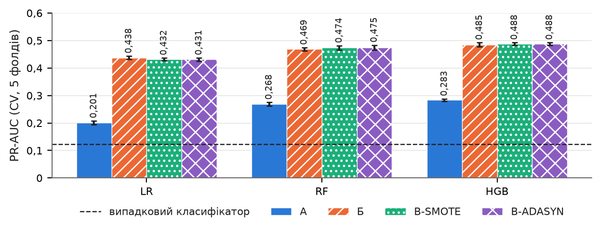
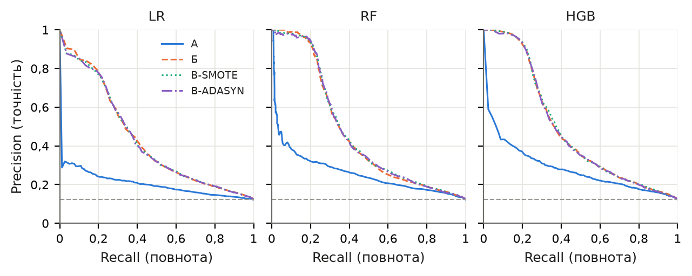
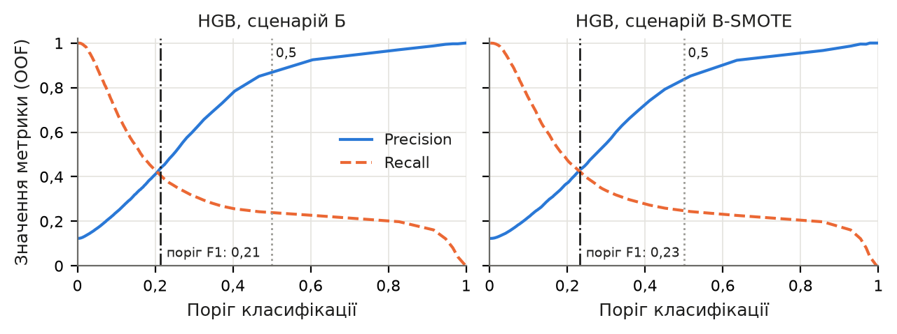
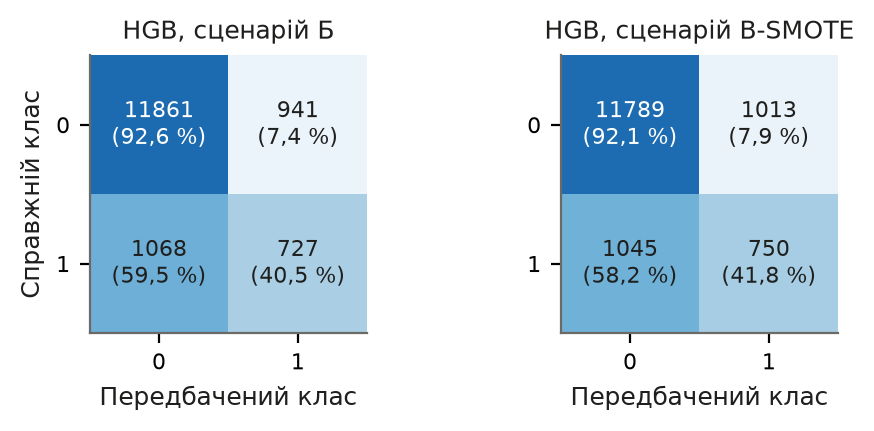
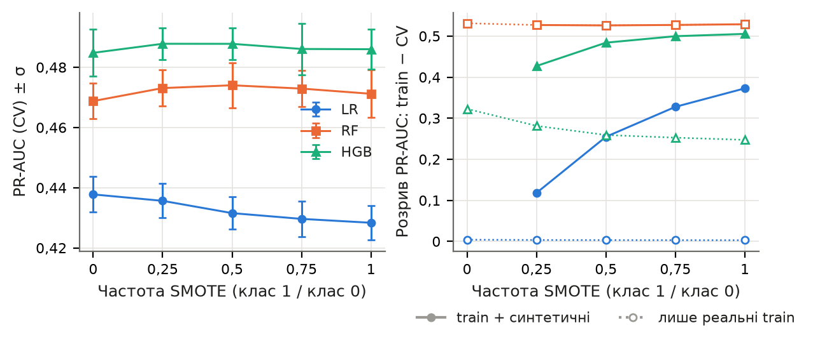
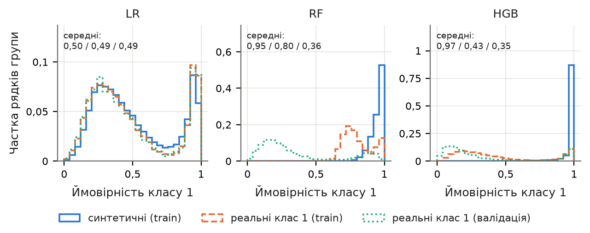
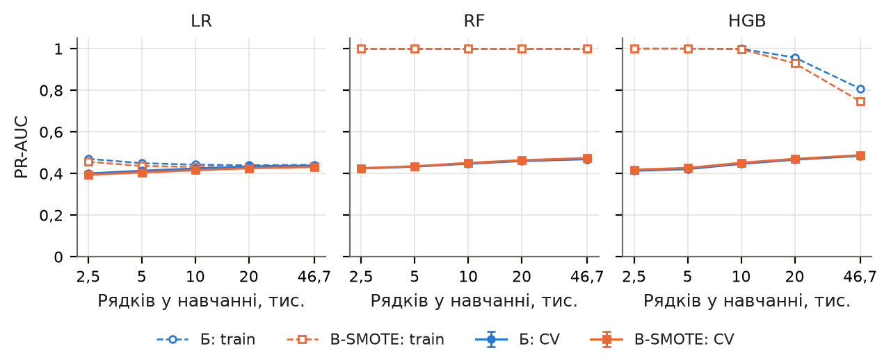

## 1. Постановка завдання

1. Використати підготовлений у ЛР № 1 датасет.
2. Навчити 2–3 різні моделі (логістична регресія, SVM, дерево рішень, випадковий ліс, градієнтний бустинг тощо) для задачі класифікації.
3. Провести порівняльні експерименти на трьох сценаріях даних: А — базові дані (мінімальне очищення); Б — повноцінно очищені дані (просунута імп'ютація, кодування, трансформація); В — очищені дані з аугментацією (SMOTE/ADASYN).
4. Оцінити продуктивність кожної моделі метриками Accuracy, Precision, Recall, F1-Score, ROC-AUC.
5. Проаналізувати сильні та слабкі сторони кожного алгоритму.
6. Сформувати підсумковий звіт про стан даних та виконані перетворення.

Звіт повинен містити порівняльну таблицю результатів моделювання на різних етапах підготовки даних і детальний аналіз того, чи покращила аугментація якість передбачення та за яких умов вона може викликати перенавчання (overfitting).

## 2. Опис проведеної роботи

### 2.1. Дані з ЛР № 1 і сценарії підготовки

Використано датасет Carvana «Don't Get Kicked!» [1, 2], очищений і розбитий у ЛР № 1: {{metrics.data.train_rows}} рядків навчальної вибірки (train) і {{metrics.data.test_rows}} рядків тестової (test), {{metrics.data.n_raw_features}} ознак. Задача — бінарна класифікація: передбачити, чи виявиться придбаний на аукціоні автомобіль «поганою покупкою» (`IsBadBuy` = 1). Позитивний клас становить {{metrics.data.train_minority_share:.1%}} train і {{metrics.test.minority_share:.1%}} test, тож константна відповідь «добра покупка» вже дає Accuracy {{metrics.test.majority_baseline_accuracy:.3f}} на test. Через це головною метрикою, як і в ЛР № 1, обрано PR-AUC (average precision) [3], а Accuracy наводиться лише для повноти.

«Підготовлений у ЛР № 1 датасет» — це очищені train/test разом із рецептами препроцесингу `PreprocessorFactory`; перед запуском код звіряє їхні параметри з маніфестом ЛР № 1 (`check_manifest`). Усі перетворення, що навчаються, зібрано разом із моделлю в один `imblearn.pipeline.Pipeline` [5] і навчаються лише на навчальній частині фолда; валідаційні й тестові рядки не аугментуються. Сценарії відповідають пунктам завдання так:

- **А — мінімальне очищення** (рецепт MINIMAL): детерміноване очищення ЛР № 1 (приховані пропуски, регістр категорій), медіана для числових і мода для категоріальних ознак, Ordinal-кодування всіх категорій, без масштабування й нових ознак; дата покупки відкидається, тому ознак {{metrics.scenarios.A.n_features}}.
- **Б — повний препроцесинг** (рецепт FULL з ЛР № 1): пропуск у категоріальній ознаці стає окремою категорією MISSING, Target Encoding [6] для ознак високої кардинальності (з внутрішнім крос-фітингом) і One-Hot для решти, перетворення Yeo-Johnson [7] зі стандартизацією, згенеровані ознаки (комбінації, частини дати, індикатори пропусків, агрегації за категоріями), вилучення п'яти колінеарних ознак — разом {{metrics.scenarios.B.n_features}} ознаки.
- **В — Б + аугментація**: SMOTE [8] (основний варіант) або ADASYN [9] з 5 сусідами доводять клас 1 до половини мажоритарного класу. До навчальної частини додається {{metrics.scenarios.C_smote.synthetic_rows}} (SMOTE) або {{metrics.scenarios.C_adasyn.synthetic_rows}} (ADASYN) синтетичних рядків, частка класу 1 зростає до {{metrics.scenarios.C_smote.minority_share_after_sampling:.1%}} (SMOTE) і {{metrics.scenarios.C_adasyn.minority_share_after_sampling:.1%}} (ADASYN).

Стан даних на вході моделі наведено в табл. {@data_state}.

Таблиця: Стан навчальних даних на вході моделі за сценаріями {#data_state}

| Сценарій | Перетворення | Ознак | Рядків навчання | Синтетичних | Частка класу 1 |
|---|---|---|---|---|---|
| А | медіана, мода, Ordinal | {{metrics.scenarios.A.n_features}} | {{metrics.scenarios.A.train_rows_after_sampling}} | {{metrics.scenarios.A.synthetic_rows}} | {{metrics.scenarios.A.minority_share_after_sampling:.1%}} |
| А_missing | медіана, MISSING, Ordinal | {{metrics.scenarios.A_missing.n_features}} | {{metrics.scenarios.A_missing.train_rows_after_sampling}} | {{metrics.scenarios.A_missing.synthetic_rows}} | {{metrics.scenarios.A_missing.minority_share_after_sampling:.1%}} |
| Б | FULL (медіана) | {{metrics.scenarios.B.n_features}} | {{metrics.scenarios.B.train_rows_after_sampling}} | {{metrics.scenarios.B.synthetic_rows}} | {{metrics.scenarios.B.minority_share_after_sampling:.1%}} |
| Б_MICE | FULL (MICE) | {{metrics.scenarios.B_mice.n_features}} | {{metrics.scenarios.B_mice.train_rows_after_sampling}} | {{metrics.scenarios.B_mice.synthetic_rows}} | {{metrics.scenarios.B_mice.minority_share_after_sampling:.1%}} |
| В-SMOTE | FULL + SMOTE | {{metrics.scenarios.C_smote.n_features}} | {{metrics.scenarios.C_smote.train_rows_after_sampling}} | {{metrics.scenarios.C_smote.synthetic_rows}} | {{metrics.scenarios.C_smote.minority_share_after_sampling:.1%}} |
| В-ADASYN | FULL + ADASYN | {{metrics.scenarios.C_adasyn.n_features}} | {{metrics.scenarios.C_adasyn.train_rows_after_sampling}} | {{metrics.scenarios.C_adasyn.synthetic_rows}} | {{metrics.scenarios.C_adasyn.minority_share_after_sampling:.1%}} |

Завдання для сценарію Б згадує «просунуту імп'ютацію», а FULL заповнює числові пропуски медіаною. Це свідоме рішення: у ЛР № 1 KNNImputer і MICE відновлювали значення точніше, але на якість моделі не впливали, бо числових пропусків дуже мало; «просунута» частина імп'ютації у FULL — категоріальна (пропуск `WheelType` як окрема категорія, найсильніший предиктор). Щоб підтвердити це числом, оцінено діагностичний варіант **Б_MICE** (FULL з MICE [10]), а для пояснення розриву між А і Б — **А_missing** (MINIMAL з категорією MISSING замість моди). Обидва — лише на CV для LR і HGB (п. 3.2). Обмеження сценарію В: SMOTE інтерполює вже закодовані ознаки, тож One-Hot колонки синтетичних рядків стають дробовими; SMOTENC на {{metrics.scenarios.B.n_features}} ознаках з високою кардинальністю надто повільний.

### 2.2. Моделі

Обрано три моделі різних сімейств (табл. {@models}): логістичну регресію (LR, лінійна модель) [11], випадковий ліс (RF, бегінг дерев) [12] і гістограмний градієнтний бустинг (HGB, бустинг дерев [13]; реалізація `HistGradientBoostingClassifier` бібліотеки scikit-learn [4] того самого алгоритму, що й LightGBM [14]).

{#models}

Гіперпараметри фіксовані (підбір — тема ЛР № 3): порівняння сценаріїв коректне лише за незмінних моделей. Ліс навмисно лишено без обмеження глибини, щоб схильність до перенавчання була видна. У HGB вимкнено раннє зупинення: інакше він відрізав би 10 % навчальних даних, і в сценарії В зупинка перевірялася б на синтетичних точках. `class_weight` не використано, щоб ефект аугментації не змішувався з переважуванням класів. SVM відхилено: навчання ядрового SVM квадратичне за кількістю рядків, а ймовірності він дає лише з дорогим `probability=True`. XGBoost/LightGBM потребують системної бібліотеки `libomp` (ручний крок); HGB реалізує той самий гістограмний бустинг.

### 2.3. Протокол оцінки

1. **Крос-валідація на train.** Стратифікована {{metrics.lab3_handoff.cv_folds}}-кратна CV з **однаковими фолдами** для всіх моделей, сценаріїв і частот аугментації; прогнози валідаційних частин збираються в OOF-вектор (out-of-fold).
2. **Метрики.** PR-AUC (головна), ROC-AUC, Accuracy, Precision, Recall, F1 для класу 1, а також Brier score (середній квадрат похибки ймовірності [15]) для оцінки калібрування.
3. **Поріг класифікації.** При {{metrics.data.train_minority_share:.1%}} позитивних поріг 0,5 майже нікого не відносить до класу 1, тому для кожної конфігурації поріг підібрано за максимумом F1 на OOF-прогнозах train. Порогові метрики наведено при 0,5 і при підібраному порозі, щоб відрізнити покращення ранжування від зсуву ймовірностей.
4. **Порівняння варіантів на CV** — правилом парних різниць із ЛР № 1 (формула нижче).
5. **Фінальна оцінка на test** — у проєкті вперше. Кожну з 12 конфігурацій (3 моделі × А, Б, В-SMOTE, В-ADASYN) навчено на всьому train й оцінено на test один раз, з порогом, обраним на OOF. Жодне рішення за результатами test не ухвалювалося.
6. **Невизначеність на test** — парний бутстреп [16] (1000 повторів, однакові індекси рядків для обох конфігурацій) для різниці PR-AUC; різниця вважається підтвердженою, якщо 95 % довірчий інтервал (ДІ) не містить нуля.

Для фолда $k$ береться $d_k$ = PR-AUC складнішого варіанта мінус PR-AUC простішого, далі

$$\Delta = \frac{1}{K}\sum_{k=1}^{K} d_k, \qquad s = \sqrt{\frac{1}{K-1}\sum_{k=1}^{K}\left(d_k-\Delta\right)^2},$$

і складніший варіант вважається кращим лише за $\Delta > s$.

Методологічна примітка. Розрив train − CV (міра перенавчання) рахується на тій самій матриці ознак, яку модель отримала під час `fit`. Це суттєво для Target Encoding: під час навчання він кодує кожен рядок статистикою інших внутрішніх фолдів (крос-фітинг), а звичайний `transform` закодував би рядок із урахуванням його власної мітки — модель отримала б ознаки, яких не бачила, і розрив був би спотворений. Тому матриця навчання запам'ятовується прохідним кроком пайплайна, і прогноз на train робиться саме на ній.

## 3. Результати

### 3.1. Порівняння сценаріїв на крос-валідації

Середній PR-AUC на п'яти фолдах для всіх моделей і сценаріїв показано на рис. {@cv_pr_auc}.

{#cv_pr_auc width=70%}

Головний результат — вирішальний внесок повного препроцесингу: перехід А → Б підвищує PR-AUC на {{metrics.cv.paired.logreg.B_vs_A.delta:.3f}} у LR, {{metrics.cv.paired.random_forest.B_vs_A.delta:.3f}} у RF і {{metrics.cv.paired.hist_gradient_boosting.B_vs_A.delta:.3f}} у HGB, що в десятки разів перевищує розкид парних різниць ($s$ ≤ {{metrics.cv.paired.hist_gradient_boosting.B_vs_A.spread:.4f}}). Аугментація (В проти Б) змінює PR-AUC лише в третьому знаку, і напрям залежить від моделі — детально це розібрано в п. 3.4. Порядок моделей однаковий у всіх сценаріях: HGB > RF > LR. Найвищий середній PR-AUC на CV має HGB · В-ADASYN ({{metrics.cv.best.pr_auc:.4f}}), але це вибір лише за середнім: за правилом парних різниць він від HGB · Б ({{metrics.cv.hist_gradient_boosting.B.pr_auc:.4f}}) не відрізняється ($\Delta$ = {{metrics.augmentation.effect.hist_gradient_boosting.adasyn.cv_delta:.4f}} < $s$ = {{metrics.augmentation.effect.hist_gradient_boosting.adasyn.cv_spread:.4f}}).

### 3.2. Декомпозиція різниці між сценаріями А і Б

Діагностичні варіанти дозволяють розкласти різницю А → Б (табл. {@decomposition}; $\Delta$ і $s$ — парні різниці з варіантом у колонці «Порівняно з»).

{#decomposition}

Для HGB майже весь розрив пояснює одна зміна — категорія MISSING замість моди: А_missing підвищує PR-AUC з {{metrics.cv.decomposition.hist_gradient_boosting.A.pr_auc:.4f}} до {{metrics.cv.decomposition.hist_gradient_boosting.A_missing.pr_auc:.4f}}, а решта рецепта FULL додає лише {{metrics.cv.decomposition.hist_gradient_boosting.B.delta:.4f}}. Заповнення модою стирає факт пропуску категоріальної ознаки — за результатами ЛР № 1, передусім `WheelType`, найсильнішого предиктора датасету. Для LR категорія MISSING сама по собі не допомагає ($\Delta$ = {{metrics.cv.decomposition.logreg.A_missing.delta:+.4f}} < $s$): при Ordinal-кодуванні це лише ще одне ціле число, яке лінійна модель не може виокремити; їй потрібен увесь рецепт FULL (+{{metrics.cv.decomposition.logreg.B.delta:.3f}}). У сценарії А логістична регресія при порозі 0,5 не позначає жодного рядка як клас 1 (F1 = {{metrics.cv.logreg.A.f1:.1f}}), а оптимізатор не збігся на всіх {{metrics.models.logreg_convergence_warnings.A}} фолдах через немасштабовані ознаки.

Варіант Б_MICE підтверджує рішення ЛР № 1 щодо числової імп'ютації: заміна медіани на MICE змінює PR-AUC на {{metrics.cv.decomposition.logreg.B_mice.delta:+.4f}} у LR і {{metrics.cv.decomposition.hist_gradient_boosting.B_mice.delta:+.4f}} у HGB, що менше за розкид в обох випадках ({{metrics.cv.decomposition.logreg.B_mice.spread:.4f}} і {{metrics.cv.decomposition.hist_gradient_boosting.B_mice.spread:.4f}}). Отже, «просунута» числова імп'ютація на цьому датасеті не дає вимірюваного виграшу, а основний сценарій Б з медіаною обґрунтований.

### 3.3. Фінальна оцінка на тестовій вибірці

Зведену порівняльну таблицю результатів на різних етапах підготовки даних наведено в табл. {@comparison}: PR-AUC, ROC-AUC і F1 (при порозі, обраному на OOF) на крос-валідації та на test.

{#comparison}

Результати test узгоджуються з CV: PR-AUC на test нижчий приблизно на 0,01 або менше, F1 відрізняється в межах 0,015 — ні поріг, ні вибір сценарію не «підігнано» під train. Зберігаються порядок моделей (HGB > RF > LR у кожному сценарії) і розрив між сценарієм А та сценаріями Б і В. Порядок усередині групи Б, В-SMOTE, В-ADASYN змінюється в межах похибки (п. 3.4): для RF і HGB на CV найвищий В-ADASYN, а на test — В-SMOTE, причому HGB · В-ADASYN на test нижчий за HGB · Б. Найвищий PR-AUC на test має HGB · В-SMOTE ({{metrics.test.hist_gradient_boosting.C_smote.pr_auc:.4f}}), але HGB · Б ({{metrics.test.hist_gradient_boosting.B.pr_auc:.4f}}) практично рівний йому. Усі метрики завдання на test наведено в табл. {@test_results}.

{#test_results}

Табл. {@test_results} показує, чому Accuracy тут вводить в оману. У сценарії А всі моделі мають найнижчу Accuracy (LR — {{metrics.test.logreg.A.accuracy:.3f}}) і водночас найвищий Recall: слабка модель із низьким F1-порогом позначає багато рядків. Найвища Accuracy (HGB · В-ADASYN, {{metrics.test.hist_gradient_boosting.C_adasyn.accuracy:.3f}}; RF · Б, {{metrics.test.random_forest.B.accuracy:.3f}}) лише на рівні константної відповіді ({{metrics.test.majority_baseline_accuracy:.3f}}), хоча ці моделі знаходять понад третину «поганих» авто. F1 у сценаріях Б і В для кожної моделі майже однаковий, а Precision і Recall різняться лише через різні пороги; без прив'язки до порога це видно на рис. {@pr_curves}.

{#pr_curves width=80%}

Криві Б, В-SMOTE і В-ADASYN для кожної моделі практично накладаються, а крива А лежить значно нижче на всьому діапазоні recall. Для RF і HGB у Б/В точність на початку кривої майже ідеальна, далі — різкий спад: невелика частина «поганих» авто має явні ознаки (за результатами ЛР № 1, передусім пропущений `WheelType`), а решта мало відрізняється від добрих покупок. За ROC-AUC (табл. {@comparison}) порядок моделей той самий, але розрив між А і Б менший (для RF ROC-AUC {{metrics.test.random_forest.A.roc_auc:.3f}} проти {{metrics.test.random_forest.B.roc_auc:.3f}}, тоді як PR-AUC зростає майже вдвічі): при дисбалансі ROC-AUC «розмита» легким мажоритарним класом [3].

### 3.4. Чи покращила аугментація якість передбачення

Ефект аугментації оцінено двома незалежними способами: парними різницями на CV (правило $\Delta > s$) і парним бутстрепом на test (табл. {@aug_effect}).

{#aug_effect}

Відповідь залежить від моделі, але для жодної з них аугментація не дала підтвердженого покращення:

- **LR — аугментація погіршує якість.** SMOTE змінює PR-AUC на CV на {{metrics.augmentation.effect.logreg.smote.cv_delta:+.4f}} (за модулем це більше за $s$ = {{metrics.augmentation.effect.logreg.smote.cv_spread:.4f}}), і на test погіршення підтверджене: 95 % ДІ [{{metrics.augmentation.effect.logreg.smote.test_ci_low:.4f}}; {{metrics.augmentation.effect.logreg.smote.test_ci_high:.4f}}] повністю лежить нижче нуля. ADASYN дає те саме.
- **RF — покращення на CV, не підтверджене на test.** На CV правило виконане для обох методів (SMOTE: $\Delta$ = {{metrics.augmentation.effect.random_forest.smote.cv_delta:.4f}} > $s$ = {{metrics.augmentation.effect.random_forest.smote.cv_spread:.4f}}), а на test різниця того самого розміру ({{metrics.augmentation.effect.random_forest.smote.test_delta:.4f}}), але ДІ [{{metrics.augmentation.effect.random_forest.smote.test_ci_low:.4f}}; {{metrics.augmentation.effect.random_forest.smote.test_ci_high:.4f}}] містить нуль. Ефект, якщо він є, у межах похибки тестової вибірки.
- **HGB — ефекту немає.** На CV $\Delta$ < $s$ для обох методів, на test обидва ДІ містять нуль, а для ADASYN різниця навіть від'ємна.

Водночас F1 при порозі 0,5 після аугментації помітно зростає. Причину показує табл. {@threshold_effect}: прирости F1 на CV при 0,5 і при підібраному порозі, зміна Brier score і самі пороги.

{#threshold_effect}

Для LR SMOTE підвищує F1 при 0,5 на {{metrics.augmentation.effect.logreg.smote.f1_delta_at_05:.3f}} (на test — на {{metrics.augmentation.effect.logreg.smote.test_f1_delta_at_05:.3f}}, recall при 0,5 зростає на {{metrics.augmentation.effect.logreg.smote.test_recall_delta_at_05:.3f}}), але при підібраному порозі приріст зникає ({{metrics.augmentation.effect.logreg.smote.f1_delta_tuned:+.4f}} на CV і {{metrics.augmentation.effect.logreg.smote.test_f1_delta_tuned:+.4f}} на test). Підібраний поріг LR зміщується з {{metrics.augmentation.effect.logreg.smote.threshold_base:.2f}} до {{metrics.augmentation.effect.logreg.smote.threshold_augmented:.2f}}, а Brier score погіршується на {{metrics.augmentation.effect.logreg.smote.brier_delta:.3f}}. Модель, навчена на вибірці з {{metrics.scenarios.C_smote.minority_share_after_sampling:.0%}} позитивних, завищує ймовірність класу 1 для реальних даних (середня ймовірність на OOF {{metrics.cv.logreg.B.mean_proba:.2f}} → {{metrics.cv.logreg.C_smote.mean_proba:.2f}}) — це рівнозначно зниженню порога, тож «покращення F1» є наслідком невдалого порога 0,5, а не кращого розрізнення класів. У RF і HGB ймовірності зсуваються менше, а приріст F1 при підібраному порозі на CV ({{metrics.augmentation.effect.random_forest.smote.f1_delta_tuned:.4f}} і {{metrics.augmentation.effect.hist_gradient_boosting.smote.f1_delta_tuned:.4f}} для SMOTE) малий, а на test ще менший ({{metrics.augmentation.effect.random_forest.smote.test_f1_delta_tuned:+.4f}} і {{metrics.augmentation.effect.hist_gradient_boosting.smote.test_f1_delta_tuned:+.4f}}).

Зсув порога для HGB показано на рис. {@threshold_shift}, а матриці помилок HGB на test при підібраних порогах — на рис. {@confusion}.

{#threshold_shift width=78%}

Криві в обох сценаріях майже однакові, у В-SMOTE лише трохи зсунуті праворуч разом із порогом. При порозі 0,5 обидві моделі працюють у зоні високої точності й низької повноти (recall на OOF {{metrics.cv.hist_gradient_boosting.B.recall:.3f}} і {{metrics.cv.hist_gradient_boosting.C_smote.recall:.3f}}), тобто 0,5 — невдалий поріг незалежно від аугментації.

{#confusion width=55%}

Матриці помилок на рис. {@confusion} близькі: у В-SMOTE модель знаходить трохи більше «поганих» авто (recall {{metrics.test.hist_gradient_boosting.C_smote.recall:.3f}} проти {{metrics.test.hist_gradient_boosting.B.recall:.3f}}), але додаткових хибних тривог (верхня права клітинка) з'являється більше, ніж додаткових знайдених «поганих» авто (нижня права), тому precision знижується з {{metrics.test.hist_gradient_boosting.B.precision:.3f}} до {{metrics.test.hist_gradient_boosting.C_smote.precision:.3f}}. Це рух уздовж тієї самої кривої precision–recall, а не її покращення.

**Висновок щодо якості.** Аугментація не покращила якість ранжування (PR-AUC, ROC-AUC) жодної моделі на рівні, підтвердженому і на CV, і на test; для LR вона статистично значуще шкодить і погіршує калібрування ймовірностей. Видиме зростання F1 і recall при порозі 0,5 є зсувом порога, якого так само досягає підбір порога без синтетичних даних.

### 3.5. За яких умов аугментація викликає перенавчання

Перенавчання на синтетиці досліджено за трьома осями: інтенсивність аугментації (частка SMOTE від 0 до 1 від мажоритарного класу), місткість моделі (LR — низька, HGB — середня, RF без обмеження глибини — висока) і обсяг навчальних даних. Результати першої осі показано на рис. {@ratio_sweep} і в табл. {@ratio_table}.

{#ratio_sweep width=80%}

Ліва панель рис. {@ratio_sweep} і табл. {@ratio_table}: для RF і HGB PR-AUC найвищий за частот 0,25–0,5, а за більших частот трохи нижчий (RF: {{metrics.cv.random_forest.C_smote.pr_auc:.4f}} при 0,5 і {{metrics.augmentation.overfitting.random_forest.pr_auc_by_ratio.1:.4f}} при 1,0; HGB: {{metrics.cv.hist_gradient_boosting.C_smote.pr_auc:.4f}} і {{metrics.augmentation.overfitting.hist_gradient_boosting.pr_auc_by_ratio.1:.4f}}). Це зниження на 0,002–0,003 менше за розкид між фолдами (планки похибок на рисунку; $\sigma$ = {{metrics.cv.random_forest.C_smote.pr_auc_std:.4f}} у RF і {{metrics.cv.hist_gradient_boosting.C_smote.pr_auc_std:.4f}} у HGB при 0,5) і не перевищує розкиду парних різниць $s$ із табл. {@aug_effect}, тому статистично не підтверджене; парні різниці між сусідніми частотами окремо не обчислювалися. Навіть за частоти 1,0 PR-AUC обох моделей вищий, ніж без аугментації ({{metrics.augmentation.overfitting.random_forest.pr_auc_by_ratio.0:.4f}} у RF і {{metrics.augmentation.overfitting.hist_gradient_boosting.pr_auc_by_ratio.0:.4f}} у HGB). Отже, для дерев із лівої панелі випливає лише те, що підвищення частоти понад 0,5 приросту не дає. Для LR картина інша: PR-AUC монотонно спадає на всьому діапазоні від {{metrics.augmentation.overfitting.logreg.pr_auc_by_ratio.0:.4f}} до {{metrics.augmentation.overfitting.logreg.pr_auc_by_ratio.1:.4f}} — уже при 0,5 спад перевищує $s$ і підтверджений на test (п. 3.4), а далі лише поглиблюється; Brier score зростає з {{metrics.augmentation.overfitting.logreg.brier_by_ratio.0:.4f}} до {{metrics.augmentation.overfitting.logreg.brier_by_ratio.1:.4f}}.

Права панель показує, чому звичайний розрив train − CV перенавчання на синтетиці не виявляє: на **реальних** навчальних рядках (пунктир) він не росте — у HGB навіть зменшується з {{metrics.augmentation.overfitting.hist_gradient_boosting.train_gap_by_ratio.0:.3f}} до {{metrics.augmentation.overfitting.hist_gradient_boosting.train_gap_by_ratio.1:.3f}}, бо частина місткості моделі йде на синтетичні точки; у RF він сталий (близько {{metrics.augmentation.overfitting.random_forest.train_gap_by_ratio.0:.2f}}: ліс і без аугментації запам'ятовує train); у LR близький до нуля. Натомість розрив на **аугментованому** train (з синтетичними рядками, суцільні лінії) зростає з частотою: у HGB до {{metrics.augmentation.overfitting.hist_gradient_boosting.gap_by_ratio.1:.3f}}, у LR до {{metrics.augmentation.overfitting.logreg.gap_by_ratio.1:.3f}}. Цей розрив не є прямою мірою перенавчання: він змішує запам'ятовування з часткою класу 1, від якої залежить PR-AUC (на аугментованому train {{metrics.scenarios.C_smote.minority_share_after_sampling:.0%}} проти {{metrics.data.train_minority_share:.0%}} на валідації). Тому він росте навіть у LR, яка синтетику не запам'ятовує (див. нижче). Надійний індикатор — ймовірності, які модель дає синтетичним і реальним рядкам класу 1 (рис. {@memorization}).

{#ratio_table}

{#memorization width=80%}

Рис. {@memorization} розділяє поведінку моделей за місткістю:

- **LR** дає синтетичним рядкам такі самі ймовірності, як реальним рядкам класу 1 і в train, і у валідації (середні {{metrics.augmentation.overfitting.logreg.synthetic_mean_proba:.2f}}, {{metrics.augmentation.overfitting.logreg.train_positive_mean_proba:.2f}} і {{metrics.augmentation.overfitting.logreg.real_val_positive_mean_proba:.2f}}). Перенавчання на синтетиці немає; погіршення від SMOTE — зміщення: коефіцієнти підлаштовуються під відмінний від реального розподіл синтетичних точок, і калібрування втрачається.
- **RF** оцінює синтетичні рядки в середньому в {{metrics.augmentation.overfitting.random_forest.synthetic_mean_proba:.2f}}, реальні навчальні позитивні — в {{metrics.augmentation.overfitting.random_forest.train_positive_mean_proba:.2f}}, а реальні позитивні з валідації — лише в {{metrics.augmentation.overfitting.random_forest.real_val_positive_mean_proba:.2f}}. Ліс без обмеження глибини запам'ятовує і реальні, і синтетичні точки.
- **HGB** — найпоказовіший випадок: синтетичні рядки отримують у середньому {{metrics.augmentation.overfitting.hist_gradient_boosting.synthetic_mean_proba:.2f}} (переважна більшість — біля 1), тоді як реальні навчальні позитивні — лише {{metrics.augmentation.overfitting.hist_gradient_boosting.train_positive_mean_proba:.2f}}, близько до валідаційних ({{metrics.augmentation.overfitting.hist_gradient_boosting.real_val_positive_mean_proba:.2f}}). Бустинг не запам'ятовує реальних даних, але вивчає синтетичні майже ідеально. Найімовірніше пояснення — синтетичні рядки відрізняються формою значень (дробові One-Hot колонки), і дерева знаходять правило «дробове значення → клас 1», яке на реальних даних не спрацьовує.

Третя вісь — обсяг даних — показана кривими навчання (рис. {@learning_curves}).

{#learning_curves width=78%}

PR-AUC на CV зростає з обсягом і для RF і HGB ще не виходить на плато; RF має PR-AUC на train, рівний 1, на всіх розмірах, HGB — практично 1 до 10 тис. рядків. Очікуване посилення шкоди від SMOTE на малих вибірках не підтвердилося: різниця В-SMOTE − Б для HGB на найменшому розмірі ({{metrics.augmentation.overfitting.hist_gradient_boosting.smallest_size}} рядків) становить {{metrics.augmentation.overfitting.hist_gradient_boosting.smallest_size_delta:+.4f}} проти {{metrics.augmentation.overfitting.hist_gradient_boosting.full_size_delta:+.4f}} на повному, а для RF — {{metrics.augmentation.overfitting.random_forest.smallest_size_delta:+.4f}} проти {{metrics.augmentation.overfitting.random_forest.full_size_delta:+.4f}}; на малих розмірах ці різниці менші за розкид між фолдами (планки похибок на рисунку). Для LR різниця від'ємна на всіх розмірах ({{metrics.augmentation.overfitting.logreg.smallest_size_delta:+.4f}} на найменшому і {{metrics.augmentation.overfitting.logreg.full_size_delta:+.4f}} на повному).

**Умови перенавчання на синтетиці.** На цих даних перенавчання від аугментації проявляється як запам'ятовування синтетичних точок і виникає за поєднання двох умов: (1) місткість моделі достатня, щоб виокремити окремі точки (дерева без обмежень, бустинг), і (2) частка синтетики висока. Тоді модель упевнено класифікує неіснуючі точки: середня ймовірність синтетичних рядків при частоті 0,5 становить {{metrics.augmentation.overfitting.random_forest.synthetic_mean_proba:.2f}} у RF і {{metrics.augmentation.overfitting.hist_gradient_boosting.synthetic_mean_proba:.2f}} у HGB і зростає на кожному кроці частоти від 0,25 до 1,0 (табл. {@ratio_table}), тоді як для реальних рядків класу 1 у валідації вона значно нижча. До вимірюваного погіршення якості на реальних даних це не призвело: зниження PR-AUC на CV після частоти 0,5 менше за розкид і статистично не підтверджене. Ознака перенавчання — розбіжність поведінки моделі на синтетичних і реальних рядках; звичайний розрив train − CV її не показує і навіть вводить в оману (у HGB він зменшується). Лінійна модель синтетику не запам'ятовує, але зміщується й втрачає калібрування, і лише для неї погіршення PR-AUC підтверджене. Практичний висновок: для дерев підвищувати частоту аугментації понад 0,5 недоцільно — приросту PR-AUC це не дає, а запам'ятовування синтетики посилюється; ймовірності на синтетичних рядках варто контролювати окремо, а з дисбалансом краще почати боротися підбором порога.

### 3.6. Сильні та слабкі сторони алгоритмів

Профіль кожної моделі за вимірюваннями наведено в табл. {@profile}: колонки «(Б)» стосуються сценарію Б, «Найкращий PR-AUC» — сценарію з найвищим середнім PR-AUC на CV (для RF і HGB це В-ADASYN, який для HGB за правилом $\Delta > s$ від Б не відрізняється), «Δ Б − А» і «Δ В − Б» — парні різниці PR-AUC на CV (для В — SMOTE).

{#profile}

За часом навчання одного фолда найдорожчий — RF ({{metrics.cv.random_forest.B.fit_seconds:.1f}} с у Б); у сценарії В-SMOTE навчання дерев подовжується (до {{metrics.cv.random_forest.C_smote.fit_seconds:.1f}} с у RF і з {{metrics.cv.hist_gradient_boosting.B.fit_seconds:.1f}} до {{metrics.cv.hist_gradient_boosting.C_smote.fit_seconds:.1f}} с у HGB) приблизно пропорційно до кількості рядків. LR у сценарії А навчається довше, ніж у Б ({{metrics.cv.logreg.A.fit_seconds:.1f}} с проти {{metrics.cv.logreg.B.fit_seconds:.1f}} с), і довше за HGB у тому самому сценарії ({{metrics.cv.hist_gradient_boosting.A.fit_seconds:.1f}} с), попри втричі меншу кількість ознак: без масштабування оптимізатор сходиться погано. Сильні та слабкі сторони, сформульовані на підставі п. 3.1–3.5 і табл. {@profile}, зведено в табл. {@pros_cons}.

Таблиця: Сильні та слабкі сторони алгоритмів на датасеті Carvana {#pros_cons}

| Модель | Сильні сторони | Слабкі сторони |
|---|---|---|
| LR | найшвидша у сценаріях Б і В; не перенавчається; інтерпретовані коефіцієнти; не запам'ятовує синтетику | найнижча якість (лише лінійна межа); повністю залежить від масштабування й One-Hot, без них повільна (сценарій А); аугментація шкодить і псує калібрування |
| RF | стійкий до немасштабованих ознак; значно кращий за LR; аугментація на CV трохи допомагає | найповільніший; повністю запам'ятовує train і синтетику; поступається HGB |
| HGB | найкраща якість у всіх сценаріях і на test; швидший за RF; багато важелів регуляризації | найсильніше вивчає синтетичні точки; перенавчається на малих вибірках; потребує підбору гіперпараметрів |

Для цієї задачі найкраще підходить HGB: найвища якість ({{metrics.profile.hist_gradient_boosting.best_pr_auc:.4f}} на CV) за помірного часу. RF — запасний варіант із найнаочнішим перенавчанням (розрив {{metrics.profile.random_forest.train_cv_gap:.3f}}), LR — швидка й інтерпретована базова лінія.

### 3.7. Підсумок про стан даних і виконані перетворення

Стан даних зведено в табл. {@data_state}: усі перетворення навчаються лише на train, синтетичні рядки додаються тільки в навчальну частину, а test ({{metrics.data.test_rows}} рядків) використаний один раз. Найцінніші перетворення, за вимірюваннями, — збереження факту пропуску категоріальних ознак (категорія MISSING) і, для лінійної моделі, масштабування з One-Hot/Target Encoding. Просунута числова імп'ютація (MICE) і аугментація SMOTE/ADASYN вимірюваного виграшу не дали. Для ЛР № 3 передається сценарій Б і протокол оцінки з однаковими фолдами.

## 4. Висновок

На підготовленому в ЛР № 1 датасеті Carvana ({{metrics.data.train_rows}} рядків train, {{metrics.data.train_minority_share:.1%}} позитивного класу) порівняно логістичну регресію, випадковий ліс і гістограмний градієнтний бустинг у трьох сценаріях підготовки даних за єдиним протоколом: {{metrics.lab3_handoff.cv_folds}}-кратна CV з однаковими фолдами, поріг F1 з OOF-прогнозів, одна фінальна оцінка на test і парний бутстреп. Найкраща модель — градієнтний бустинг: PR-AUC {{metrics.test.hist_gradient_boosting.B.pr_auc:.4f}} на test у сценарії Б проти {{metrics.test.random_forest.B.pr_auc:.4f}} у лісу і {{metrics.test.logreg.B.pr_auc:.4f}} у логістичної регресії. Проте вирішальним виявився препроцесинг: перехід від мінімального очищення до повного рецепта підвищив PR-AUC на {{metrics.cv.paired.random_forest.B_vs_A.delta:.2f}}–{{metrics.cv.paired.logreg.B_vs_A.delta:.2f}}, і для градієнтного бустингу майже весь приріст ({{metrics.cv.decomposition.hist_gradient_boosting.A_missing.delta:.2f}}) дає збереження пропусків категоріальних ознак як окремої категорії (передусім `WheelType`, за результатами ЛР № 1), тоді як логістичній регресії потрібен увесь рецепт; MICE замість медіани ефекту не дав.

Аугментація SMOTE/ADASYN не покращила якість ранжування: для логістичної регресії вона статистично значуще погіршила PR-AUC, для лісу покращення на CV не підтвердилося на test, для бустингу ефекту немає; зростання F1 при порозі 0,5 — лише зсув ймовірностей, рівноцінний підбору порога. Перенавчання на синтетиці проявляється в моделей високої місткості як запам'ятовування синтетичних точок: при частоті 0,5 бустинг і ліс приписують їм середню ймовірність {{metrics.augmentation.overfitting.hist_gradient_boosting.synthetic_mean_proba:.2f}} і {{metrics.augmentation.overfitting.random_forest.synthetic_mean_proba:.2f}}, і з частотою вона зростає. Зниження PR-AUC на CV після частоти 0,5 менше за розкид між фолдами і статистично не підтверджене, проте й приросту вища частота не дає, тому піднімати її понад 0,5 недоцільно. Звичайний розрив train − CV запам'ятовування синтетики не виявляє, тому поведінку моделі на синтетичних і реальних рядках слід контролювати окремо.

## 5. Список використаної літератури

1. Don't Get Kicked! [Електронний ресурс] // Kaggle. — 2011. — Режим доступу: https://www.kaggle.com/c/DontGetKicked.
2. Vanschoren J., van Rijn J. N., Bischl B., Torgo L. OpenML: networked science in machine learning // SIGKDD Explorations. — 2014. — Vol. 15, № 2. — P. 49–60. Датасет kick: https://www.openml.org/d/41162.
3. Saito T., Rehmsmeier M. The precision-recall plot is more informative than the ROC plot when evaluating binary classifiers on imbalanced datasets // PLoS ONE. — 2015. — Vol. 10, № 3. — e0118432.
4. Pedregosa F. et al. Scikit-learn: Machine Learning in Python // Journal of Machine Learning Research. — 2011. — Vol. 12. — P. 2825–2830.
5. Lemaître G., Nogueira F., Aridas C. K. Imbalanced-learn: a Python toolbox to tackle the curse of imbalanced datasets in machine learning // Journal of Machine Learning Research. — 2017. — Vol. 18, № 17. — P. 1–5.
6. Micci-Barreca D. A preprocessing scheme for high-cardinality categorical attributes in classification and prediction problems // SIGKDD Explorations. — 2001. — Vol. 3, № 1. — P. 27–32.
7. Yeo I.-K., Johnson R. A. A new family of power transformations to improve normality or symmetry // Biometrika. — 2000. — Vol. 87, № 4. — P. 954–959.
8. Chawla N. V., Bowyer K. W., Hall L. O., Kegelmeyer W. P. SMOTE: Synthetic Minority Over-sampling Technique // Journal of Artificial Intelligence Research. — 2002. — Vol. 16. — P. 321–357.
9. He H., Bai Y., Garcia E. A., Li S. ADASYN: Adaptive synthetic sampling approach for imbalanced learning // Proc. IEEE IJCNN. — 2008. — P. 1322–1328.
10. van Buuren S., Groothuis-Oudshoorn K. mice: Multivariate Imputation by Chained Equations in R // Journal of Statistical Software. — 2011. — Vol. 45, № 3. — P. 1–67.
11. Hosmer D. W., Lemeshow S., Sturdivant R. X. Applied Logistic Regression. — 3rd ed. — Hoboken : Wiley, 2013. — 528 p.
12. Breiman L. Random Forests // Machine Learning. — 2001. — Vol. 45, № 1. — P. 5–32.
13. Friedman J. H. Greedy function approximation: a gradient boosting machine // The Annals of Statistics. — 2001. — Vol. 29, № 5. — P. 1189–1232.
14. Ke G. et al. LightGBM: A Highly Efficient Gradient Boosting Decision Tree // Advances in Neural Information Processing Systems 30. — 2017. — P. 3146–3154.
15. Brier G. W. Verification of forecasts expressed in terms of probability // Monthly Weather Review. — 1950. — Vol. 78, № 1. — P. 1–3.
16. Efron B., Tibshirani R. J. An Introduction to the Bootstrap. — New York : Chapman & Hall, 1993. — 436 p.
