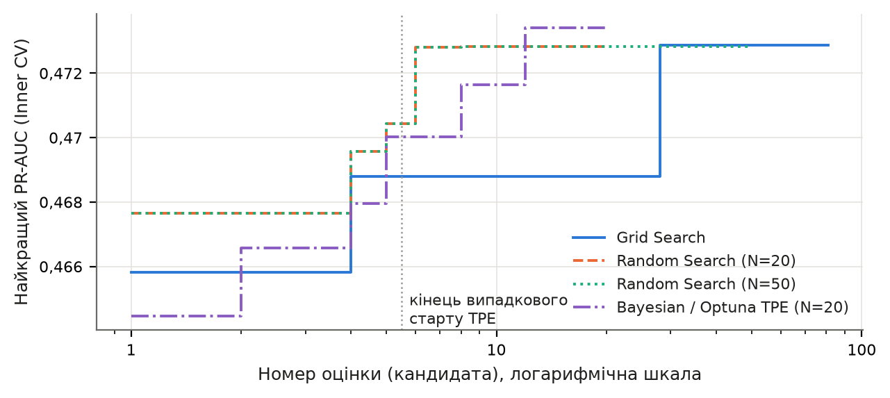
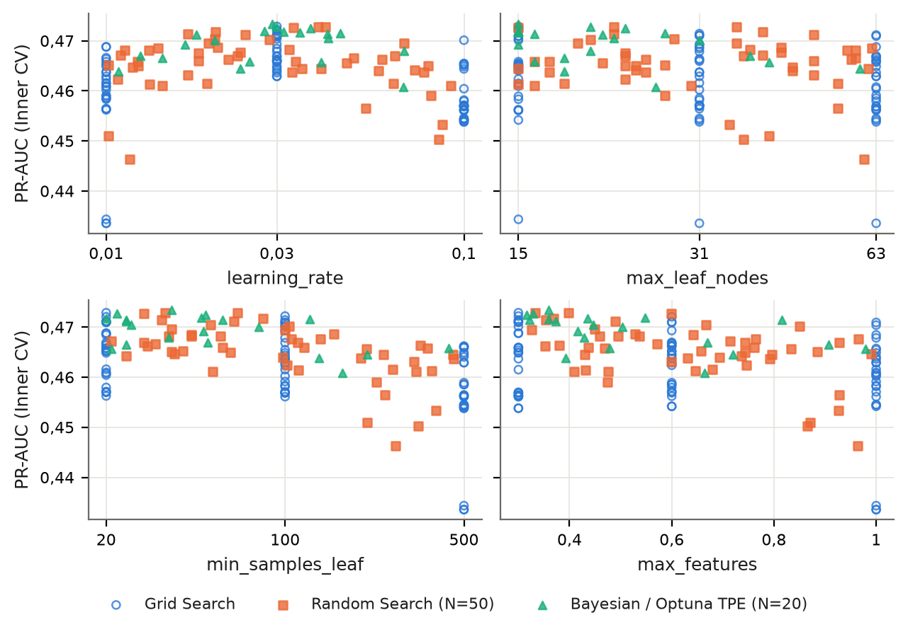
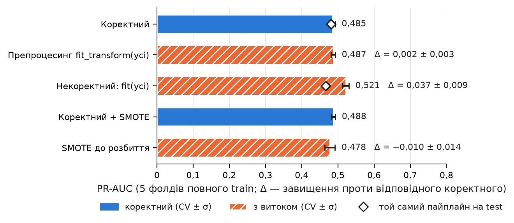
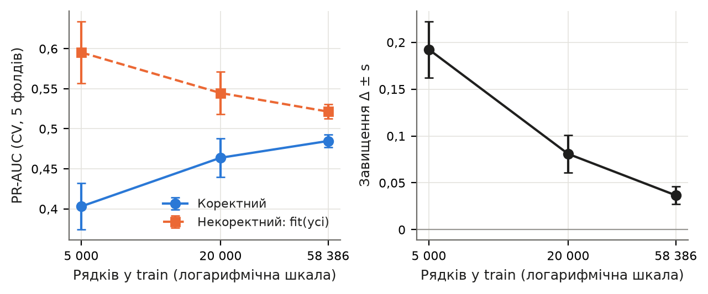
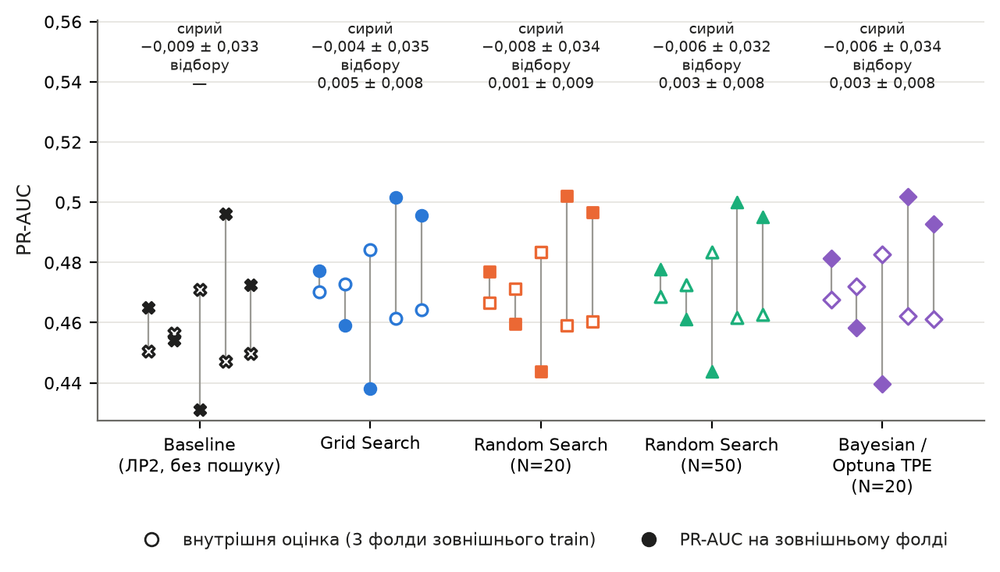
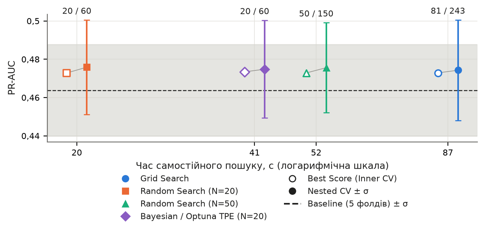

# ЛР №3 — Підбір гіперпараметрів, вкладена CV і витік даних: конспект

## 1. Коротко

Узяли найкращу модель ЛР2 — гістограмний градієнтний бустинг (HGB) на повному препроцесингу `FULL` —
і підібрали чотири його «налаштування» трьома способами: повним перебором сітки (Grid, 81 точка),
випадковим пошуком (Random, 20 і 50 точок) і байєсівською оптимізацією (Optuna TPE, 20 точок). Працювали
на стратифікованій підвибірці train із 20 000 рядків (12,3 % позитивних), бо інакше запуск не вкладався
б у бюджет часу. Чесну якість кожного методу оцінили вкладеною крос-валідацією 5×3. Підбір дає
**+0,010…+0,012 PR-AUC** над параметрами ЛР2 (0,464 → ≈ 0,475; Δ > s для всіх чотирьох методів). На test
приріст підтверджується: +0,013…+0,015, і жоден 95 % ДІ не містить нуля. **Між собою методи
нерозрізнимі** (0 з 6 пар проходять правило Δ > s), зате різняться за часом: Random з 20 точками
впорався за 20,4 с, Grid — за 86,8 с. Друга половина роботи — витік даних. Якщо навчити препроцесор із
`TargetEncoder` на всіх даних до розбиття на фолди, CV завищується на +0,037 (0,485 → 0,521). На test
така модель *гірша* за коректну: 0,466 проти 0,481. На 5 000 рядків той самий витік дає вже +0,19.

## 2. Навіщо це взагалі

У ЛР2 моделі брали «з коробки»: кількість дерев, швидкість навчання, розмір дерева задано вручну. Але
ці налаштування — теж вибір, і від нього залежить якість. Природне бажання — перепробувати багато
варіантів і взяти найкращий. Тут два питання.

**Як перебирати, щоб не згоріти?** Чотири параметри по три значення — це вже 3⁴ = 81 комбінація, кожна
на 3 фолдах, тобто 243 навчання. П'ять параметрів дали б 243 комбінації. Перебір росте
експоненційно, тож потрібні розумніші способи: брати точки випадково або «вчитися» на попередніх
спробах. Перше питання роботи: чи справді вони дають ту саму якість дешевше?

**Як чесно сказати, наскільки добра обрана модель?** Обрати найкращу з 81 і назвати її оцінку «якістю»
— це той самий гріх, що підбирати поріг на test (ЛР2): обирали за тими самими числами, якими міряємо.
Найкраща з багатьох шумних оцінок майже завжди трохи «пощастила». Вкладена крос-валідація
відокремлює *вибір* від *оцінки*.

**І найважливіше — витік даних.** Шпаргалка `docs/python-for-java.md` закінчується правилом «`fit` —
тільки на навчальних даних». Тут ми свідомо його порушуємо й міряємо, *скільки* коштує порушення. Без
цього правило лишається заклинанням. З ним ти бачиш конкретне число: на 20 тис. рядків оцінка
завищується на 0,08, тобто більше, ніж дає весь підбір гіперпараметрів.

Місце в ланцюжку:

- **ЛР1:** дані й рецепт препроцесингу `FULL` (з `TargetEncoder` і крос-фітингом).
- **ЛР2:** моделі LR/RF/HGB, протокол «CV → OOF → поріг → test → бутстреп», пакет `mllabs.modeling`.
  HGB передано сюди як найкращу модель (`metrics.lab3_handoff`).
- **ЛР3 (ця):** підбір гіперпараметрів HGB, вкладена CV, витік. Код пошуку лишається в `labs/lab03`:
  ЛР4–5 — нейромережі, перевикористання не передбачене (`PLAN.md`, розділ 3.1).

## 3. Словник

Базові терміни (ознака, train/test, CV, фолд, σ, парна різниця Δ і s, правило Δ > s, `Pipeline`,
`fit`/`transform`, PR-AUC, ROC-AUC, SMOTE, `TargetEncoder`, крос-фітинг, витік даних) пояснено в
[`labs/lab01/GUIDE.md`](../lab01/GUIDE.md), розділи 3 і 4.0, крок 3.2. Дерево, бустинг, перенавчання,
розрив train − CV, бутстреп, ДІ, `FitInputRecorder` пояснено в [`labs/lab02/GUIDE.md`](../lab02/GUIDE.md),
розділи 3 і 4.9.

| Термін | Пояснення | Аналогія |
|---|---|---|
| Параметр моделі (parameter) | Те, що модель *вивчає* з даних під час `fit`: пороги розгалужень дерев, значення в листках | поле об'єкта, яке заповнює сам алгоритм |
| Гіперпараметр (hyperparameter) | Те, що задає *людина* до `fit`: скільки листків у дереві, наскільки великий крок навчання | аргумент конструктора / налаштування JVM (`-Xmx`): алгоритм його не змінює |
| Простір пошуку (search space) | Які гіперпараметри перебираємо і в яких межах | область визначення функції, яку оптимізуємо |
| Кандидат, спроба (candidate, trial) | Одна точка простору — конкретний набір гіперпараметрів, оцінений на 3 фолдах | один прогін бенчмарку з певними прапорцями |
| Повний перебір сітки (Grid Search) | Кілька значень на кожну вісь, перебираються всі комбінації | вкладені цикли `for` по всіх осях |
| Випадковий пошук (Random Search) | N точок, вибраних випадково з розподілів у межах простору | fuzzing налаштувань |
| Байєсівська оптимізація (Bayesian optimization), TPE | Наступна точка обирається з огляду на результати попередніх; TPE (Tree-structured Parzen Estimator) — конкретний алгоритм такого вибору в Optuna | бінарний пошук, що «звужується» туди, де вже було добре, — але імовірнісний |
| Стартові випадкові спроби (startup trials) | Перші спроби TPE, які робляться навмання, щоб було з чого «вчитися» | прогрів перед вимірюванням |
| Лог-шкала (log scale) | Значення вибираються так, що 0,01–0,03 і 0,03–0,1 однаково ймовірні | рівномірно по *порядку* величини |
| Best Score (Inner CV) | Найкращий середній PR-AUC серед кандидатів на 3 внутрішніх фолдах | найкращий час із N прогонів бенчмарку |
| Вкладена крос-валідація (nested CV) | CV навколо всього підбору: зовнішні фолди оцінюють, внутрішні — обирають | інтеграційний тест усього CI-конвеєра, а не одного білда |
| Unbiased Score (Nested CV) | Середній PR-AUC на 5 зовнішніх фолдах, яких підбір не бачив | — |
| Оптимізм (optimism) | Наскільки внутрішня оцінка переможця вища за його зовнішню | «пощастило на бенчмарку» |
| Оптимізм відбору (selection optimism) | Оптимізм, з якого прибрано зсув, що є і без жодного вибору (розділ 4, крок 4) | — |
| Refit | Повторне навчання переможця на всіх доступних навчальних рядках | збірка релізу з обраними прапорцями |
| Dev-вибірка | Підвибірка train (20 000 рядків), на якій ідуть пошук, вкладена CV, baseline і refit | стенд розробки |
| Baseline | HGB з параметрами ЛР2, без підбору — точка відліку | поточна версія в продакшні |
| Wall-clock час | Реальний час від старту до фінішу, «за годинником на стіні» | `System.nanoTime()` навколо виклику |
| Сумарний час навчань (compute) | Сума тривалостей усіх навчань, ніби вони йшли одне за одним | CPU-time, але лише приблизно |
| Процес-працівник (worker), loky | Окремий процес Python, якому joblib роздає завдання; loky — бекенд, що ці процеси створює | окрема JVM у пулі |
| Потоки OpenMP | Нативні потоки, якими HGB паралелить побудову одного дерева всередині *одного* процесу | `ForkJoinPool` усередині кожної JVM |
| Перепідписка (oversubscription) | Потоків, що хочуть працювати, у рази більше, ніж ядер | 100 потоків на 10 ядрах: усі зайняті перемиканням |
| Завищення (inflation) | Δ = PR-AUC некоректного пайплайна − коректного на тих самих фолдах | — |

## 4. Як це зроблено — крок за кроком

### 4.0. Перед кроками: каркас і як читати цей розділ

Каркас той самий, що в ЛР1–2: `uv run mllabs run 3` створює `Lab3`, а той повертає список кроків.

```python
# src/mllabs/labs/lab03/lab.py:92-99
return [
    Step("1. Дані, метрика та baseline", timed("data_baseline", self._prepare)),
    Step("2. Дослідження 1: Grid, Random, Bayesian", timed("search", self._search)),
    Step("3. Дослідження 2: витік даних", timed("leakage", self._study_leakage)),
    Step("4. Дослідження 3: вкладена CV 5×3", timed("nested", self._nested_cv)),
    Step("5. Фінальна оцінка на test", timed("test", self._evaluate_on_test)),
    Step("6. Зведені таблиці та графіки", self._summarize),
]
```

Нове тут — обгортка `timed(...)` (`timing.py:22-31`). Вона повертає функцію, яка виконує крок і записує
його тривалість у словник, а звідти тривалості потрапляють у `metrics.timing`. Порядок кроків іде за
завданням, тому витік стоїть третім, хоча від пошуку не залежить.

`lab.py` лише оркеструє. Логіка розкладена по модулях: `search_space.py` (простір), `search.py` (три
методи), `baseline.py`, `nested.py`, `leakage.py`, `holdout.py`, `summary.py` (таблиці) і `plots.py`.
Усі числа-параметри лежать у `config.py:92-119`. Модель, метрики, `CrossValidator` і бутстреп узято зі
спільного `mllabs.modeling` без змін, препроцесор `FULL` — зі спільного `mllabs.preprocessing`.

Метрика всюди одна — PR-AUC (`scoring="average_precision"`, `config.py:97`). Вона головна з ЛР1:
при 12 % позитивних «вгадування навмання» дає ≈ 0,123. ROC-AUC рахується лише як допоміжна.

---

### Крок 1. Дані, метрика та baseline

- **Що:** завантажує дві версії train — dev-підвибірку на 20 000 рядків і повний train, — звіряє
  препроцесинг з ЛР1, будує пайплайн «`FULL` → HGB» і оцінює baseline.
- **Навіщо:** baseline — точка відліку. Без нього фраза «підбір дав 0,475» нічого не означає: може, і
  без підбору було 0,475.
- **Як.** Dev — це стратифікована підвибірка (`src/mllabs/data/repository.py:128-134`: `train_test_split`
  зі `stratify`), тому частка класу 1 та сама:

| Вибірка | Рядків | Позитивних | Частка |
|---|---|---|---|
| dev (пошук, Nested CV) | 20 000 | 2 460 | 0,123 |
| повний train (витік) | 58 386 | 7 181 | 0,123 |
| test | 14 597 | 1 795 | 0,123 |

(`tables/data_state.csv`)

**Чому 20 000, а не всі 58 тисяч.** Порахуймо навчання. Самостійний пошук — це (81 + 20 + 50 + 20)
кандидатів × 3 фолди = 513 навчань. Вкладена CV повторює кожен пошук ще 5 разів, тобто
2 565 навчань плюс 20 refit. Разом понад 3 000 навчань. На повному train план оцінював запуск у
60–70 хв, на 20 тис. — у 18–22 хв (`PLAN.md`, D4). Ціна — шум: у зовнішньому фолді лише ≈ 490
позитивних, і σ PR-AUC між фолдами ≈ 0,024 (див. нижче). Правило калібрування й фактичні заміри
записано в docstring `config.py:33-50`.

Baseline оцінюється **на тих самих розбиттях**, що й методи пошуку. Інакше порівнювали б різні
фолди, і парні різниці (ЛР1, розділ 4.0) втратили б сенс:

```python
# src/mllabs/labs/lab03/baseline.py:104-118
inner = self._inner_cv.evaluate(pipeline, features, target)      # 3 фолди dev — як Best Score
...
outer = self._outer_cv.evaluate(pipeline, features, target)      # 5 фолдів dev — як Nested
...
inner_in_outer = [                                               # 3 фолди ВСЕРЕДИНІ кожного
    float(                                                       # зовнішнього train — як у
        self._inner_cv.evaluate(pipeline, features.iloc[train], target.iloc[train])  # вкладеній CV
        .valid_pr_auc(self._calculator)
        .mean()
    )
    for train, _ in self._outer_cv.splits(features, target)
]
```

Третя оцінка (`inner_in_outer`) знадобиться в кроці 4: вона показує, як «внутрішня» оцінка
відрізняється від «зовнішньої», коли жодного вибору немає.

- **Що вийшло** (`tables/baseline.csv`): параметри ЛР2 — `max_iter=200`, `learning_rate=0.1`,
  `max_leaf_nodes=31`, `min_samples_leaf=20`, `max_features=1.0`, `l2_regularization=0`, раннє
  зупинення вимкнене.

| Показник | Значення |
|---|---|
| PR-AUC, 3 внутрішні фолди | 0,4571 ± 0,0113 |
| PR-AUC, 5 зовнішніх фолдів | 0,4638 ± 0,0239 |
| ROC-AUC, 5 зовнішніх фолдів | 0,7448 |
| PR-AUC на train-фолдах | 0,9872 |
| Розрив train − CV | 0,5234 (у ЛР2 на повному train — 0,3227) |

На 20 тис. рядків HGB перенавчається помітно сильніше, ніж на 58 тис.: train PR-AUC майже 1. Тобто
регуляризації є що робити. Train PR-AUC виміряно через `FitInputRecorder` (ЛР2, розділ 4.9).

- **Чому HGB, а не RF:** найкраща модель ЛР2, багато реальних «важелів», а одне навчання приблизно
  вдвічі дешевше, ніж у лісу. Без цього Grid з 81 точкою у вкладеній CV не вкладався б у бюджет
  (`PLAN.md`, D1).

---

### Крок 2. Дослідження 1: Grid, Random, Bayesian

- **Що:** чотири методи пошуку (Grid, RS20, RS50, Optuna20) по черзі на всій dev-вибірці, на **тих самих**
  3 внутрішніх фолдах (`lab.py:186`: розбиття обчислюються один раз і передаються всім).
- **Навіщо:** знайти кращі за ЛР2 гіперпараметри і порівняти, скільки коштує кожен метод.

**Параметри vs гіперпараметри.** Під час `fit` HGB сам вирішує, за якою ознакою і з яким порогом
розгалужуватися, і яке число писати в листок. Це параметри: їх тисячі, і людина їх не задає. А от
скільки листків дозволено дереву, скільки рядків мінімум у листку, наскільки сильно кожне нове дерево
виправляє попередні — це вирішуєш ти, до `fit`. Це гіперпараметри. Модель їх не вчить, тож обрати їх
можна лише так: спробувати й поміряти на валідації.

**Простір пошуку** — 4 гіперпараметри (`tables/search_space.csv`):

| Параметр | Що регулює | Сітка (Grid) | Межі (Random, Optuna) | Шкала |
|---|---|---|---|---|
| `learning_rate` | внесок кожного дерева: менший — повільніше вчиться, менше перенавчається | 0,01; 0,03; 0,1 | [0,01; 0,1] | лог |
| `max_leaf_nodes` | складність одного дерева | 15; 31; 63 | [15; 63] | лог, ціле |
| `min_samples_leaf` | мінімум рядків у листку — регуляризація | 20; 100; 500 | [20; 500] | лог, ціле |
| `max_features` | частка ознак, доступна кожному розбиттю (як у випадковому лісі) | 0,3; 0,6; 1,0 | [0,3; 1,0] | лінійна |

`max_iter=200` і вимкнене раннє зупинення **не** змінюються: кількість дерев однакова, і час однієї
оцінки передбачуваний (`config.py:26-29`). Межі `learning_rate` звужено за пробою плану на
train-підвибірці, а не на test: 0,3 стабільно гірше (`search_space.py:221-222`). У звіті це названо
відкрито.

**Однакові межі для всіх методів — клас `SearchSpace`.** Якщо задати сітку Grid, розподіли Random і
виклики Optuna тричі вручну, рано чи пізно вони розійдуться, і порівняння методів стане нечесним. Тому
межі задано один раз, а три «подання» для трьох бібліотек генеруються з одного об'єкта:

```python
# src/mllabs/labs/lab03/search_space.py:82-95 (один параметр — три подання)
def distribution(self) -> Distribution | None:          # для RandomizedSearchCV
    if self.integer:
        return IntLogUniform(int(self.low), int(self.high)) if self.log else None
    if self.log:
        return loguniform(self.low, self.high)
    return uniform(loc=self.low, scale=self.high - self.low)   # рівномірний на [low, high]

def suggest(self, trial: optuna.Trial) -> int | float:  # для Optuna
    if self.integer:
        return trial.suggest_int(self.name, int(self.low), int(self.high), log=self.log)
    return trial.suggest_float(self.name, self.low, self.high, log=self.log)
```

Сітку для `GridSearchCV` дає `param_grid` (`search_space.py:153-155`). Ключі мають вигляд
`"model__learning_rate"`: так `Pipeline` адресує параметр кроку `model` (подвійне підкреслення —
роздільник). Конструктор `ParameterRange` перевіряє, що сітка лежить у межах і містить обидві межі
(`__post_init__`, `search_space.py:63-72`). Тест `test_full_grid_has_81_points_within_bounds`
(`tests/labs/test_lab03_search_space.py:16`) стежить, щоб сітка мала рівно 81 точку в межах.

У SciPy немає готового *цілого* лог-рівномірного розподілу, тому є власний `IntLogUniform`
(`search_space.py:98-126`). Він бере неперервне лог-рівномірне число на [low, high + 1) і округлює вниз.
sklearn від розподілу вимагає лише методу `rvs`, наслідувати нічого не треба (розділ 5).

**Три методи «на пальцях».** Уяви, що шукаєш найвищу точку пагорба в тумані, а кожен замір висоти
коштує 3 навчання.

- **Grid** ставить по 3 кілочки на кожну вісь і міряє всі 81 перетин. Простий, повністю
  паралельний, але бачить лише 3 значення кожного параметра. Якщо важливий лише `learning_rate`, з 81
  замірів корисних насправді 3, а решта повторюють їх з іншими значеннями неважливих осей.
- **Random** кидає N точок навмання в той самий прямокутник. За ті самі 81 замір кожен параметр
  отримав би 81 *різне* значення. Тому на важливій осі випадковий пошук частіше потрапляє близько до
  оптимуму (Bergstra & Bengio, 2012; docstring `search.py:6-9`).
- **Bayesian/TPE** спершу робить 5 випадкових замірів (`n_startup_trials=5`, `config.py:104`). Далі
  ділить усі виконані спроби на «добрі» (верхня частка за PR-AUC) і «погані» та будує для кожної групи
  оцінку щільності: «де в просторі густо добрих точок» і «де густо поганих». Кандидатів TPE бере з
  щільності добрих і обирає того, в кого відношення «щільність добрих / щільність поганих»
  найбільше. Простіше: «шукай там, де вже бувало добре, а не там, де бувало погано».
  `multivariate=True` моделює параметри разом, а не кожен окремо, бо пара `learning_rate` ×
  `max_leaf_nodes` взаємодіє. Ціна такого підходу — спроби **послідовні**: наступна чекає на результати
  попередніх.

**Як.** Grid і Random — це стандартні `GridSearchCV` / `RandomizedSearchCV` з однаковими налаштуваннями:

```python
# src/mllabs/labs/lab03/search.py:324-334
return RandomizedSearchCV(
    pipeline,
    self._space.distributions(self._prefix),
    n_iter=self._n_iter,
    scoring=self._scoring,            # "average_precision"
    cv=list(splits),                  # ТІ САМІ 3 розбиття, що в Grid і Optuna
    refit=False,                      # час = лише оцінювання кандидатів
    n_jobs=self._n_jobs,              # −1: усі ядра
    random_state=self._random_state,
    error_score="raise",              # упала оцінка — падає весь пошук, а не тихий NaN
)
```

Для Optuna готової обгортки sklearn не встановлено, тому є тонкий власний цикл. `study.optimize`
викликає функцію-ціль 20 разів поспіль. Ціль бере точку з `suggest`, клонує пайплайн із цими
параметрами й рахує 3 фолди паралельно:

```python
# src/mllabs/labs/lab03/search.py:459-470 (скорочено)
params = self._space.suggest(trial)
candidate = clone(pipeline).set_params(**SearchSpace.prefixed(params, self._prefix))
results = parallel(
    delayed(score_fold)(candidate, features, target, train, valid, self._scoring)
    for train, valid in splits
)
scores = [score for score, _ in results]
mean, spread = mean_and_std(scores)
trial.set_user_attr("fold_scores", scores)   # Optuna зберігає довільні атрибути спроби
...
return mean                                   # Optuna максимізує це число
```

`score_fold` (`search.py:473-489`) рахує метрику тим самим `get_scorer(scoring)`, що й `GridSearchCV`.
Тест `test_optuna_and_grid_score_the_same_point_identically` (`tests/labs/test_lab03_search.py:82`)
перевіряє, що одна й та сама точка в обох методах отримує однакову оцінку. Спроби йдуть строго
послідовно: так TPE з фіксованим `seed` відтворюваний (тест `test_optuna_with_same_seed_reproduces_history`,
`test_lab03_search.py:73`). Прунера (раннього відкидання поганих спроб) немає: кожна спроба проходить
усі 3 фолди, інакше «кількість оцінок» не можна було б порівняти з Grid і Random (`search.py:346-348`).

Усі чотири методи повертають однаковий `SearchOutcome` (`search.py:76-114`) з історією всіх оцінок. Це
патерн «Стратегія»: `nested.py` викликає `strategy.run(...)`, не знаючи, який метод усередині.

**Чому RS20 — префікс RS50.** `RandomizedSearchCV` з тим самим цілим `random_state` генерує ту саму
послідовність точок, тож перші 20 кандидатів RS50 **дослівно** збігаються з RS20 (тест
`test_random_search_with_more_iterations_extends_the_same_sequence`, `test_lab03_search.py:51`). Це
свідомо (`search.py:282-284`): різниця між рядками таблиці — рівно «ще 30 ітерацій», а не везіння
іншого зерна. Інакше порівняння RS20 і RS50 змішувало б два ефекти: кількість точок і удачу зерна.

- **Що вийшло** (`tables/optimization_methods.csv`, `tables/best_params.csv`):

| Метод | Кандидатів / навчань | Час, с | Best Score (Inner CV) | Найкращі параметри (lr; leaves; min_leaf; feat) |
|---|---|---|---|---|
| Baseline (ЛР2) | 1 / 3 | 4,0 | 0,4571 ± 0,0113 | 0,1; 31; 20; 1,0 |
| Grid | 81 / 243 | 86,8 | 0,4729 ± 0,0202 | 0,03; 15; 20; 0,3 |
| Random N=20 | 20 / 60 | 20,4 | 0,4728 ± 0,0152 | 0,039; 36; 34; 0,33 |
| Random N=50 | 50 / 150 | 52,0 | 0,4728 ± 0,0152 | те саме, що N=20 |
| Optuna TPE N=20 | 20 / 60 | 40,9 | 0,4734 ± 0,0183 | 0,029; 15; 36; 0,36 |

Усі методи знайшли одне й те саме «плато»: `learning_rate` ≈ 0,03 (утричі менше, ніж у ЛР2),
`max_features` ≈ 0,3 і невеликий `min_samples_leaf`. Тобто підбір *регуляризує* модель: повільніше
навчання, кожне розбиття бачить лише третину ознак. Best Score чотирьох методів відрізняються в
четвертому знаку. RS50 не знайшов нічого кращого за свою 6-ту точку: 30 додаткових кандидатів нічого
не дали.



Вісь X — номер оцінки (лог-шкала), вісь Y — найкращий PR-AUC серед перших k оцінок («біжучий
максимум», `best_so_far`, `search.py:111-114`). Що раніше крива виходить на плато, то швидше метод
знаходить добру точку. Grid сходинковий і довго стоїть на 0,4688: `ParameterGrid` перебирає точки
лексикографічно, тож усі 27 точок з `learning_rate=0,01` йдуть першими, і переможець трапляється лише
28-м — це перша точка з 0,03 (`tables/search_history.csv`). Порядок перебору тут випадковий щодо
якості, тому порівнювати слід кінцеві точки кривих, а не форму. Random вийшов на 0,4728 уже на 6-й
оцінці. Optuna після 5 стартових випадкових спроб (пунктир) поліпшувалась на 8-й і 12-й спробах і
дійшла до 0,4734.



Кожна точка — оцінений кандидат. Вісь X — значення одного параметра, вісь Y — його PR-AUC, колір —
метод. Grid (кружечки) стоїть трьома вертикальними стовпчиками: це і є «лише 3 значення на вісь». Random
(квадрати) розкиданий по всьому діапазону. TPE (трикутники) згущується біля `learning_rate` ≈ 0,02–0,045,
`max_leaf_nodes` ≈ 15–27 і `max_features` ≈ 0,3–0,55: це видно, як алгоритм «вчиться». Видно й
погані зони: поєднання `min_samples_leaf` = 500 з `learning_rate` = 0,01 дає найнижчі оцінки
(мінімум Grid — 0,4336).

- **Чому саме ці методи:** їх вимагає завдання. Optuna обрано замість `BayesSearchCV` (scikit-optimize),
  бо Optuna вже в залежностях, а scikit-optimize не встановлено (`PLAN.md`, D6). Стартових спроб 5, а
  не стандартні 10: інакше з 20 спроб половина була б чисто випадковою, і «Bayesian» перетворився б на
  RS10 + 10 кроків TPE (`config.py:56-58`).

---

### Крок 3. Дослідження 2: витік даних

> **Увага.** `src/mllabs/labs/lab03/leakage.py` — єдине місце в проєкті з **навмисно некоректним**
> кодом. Класи `LeakyMatrixBuilder`, `SmoteBeforeSplitEvaluator` і некоректна гілка
> `LeakageHoldoutCheck` показують, як *не треба* робити. Ніде більше вони не використовуються
> (docstring `leakage.py:1-6`).

- **Що:** п'ять варіантів того самого пайплайна «`FULL` → HGB з параметрами ЛР2» на **повному** train
  (58 386 рядків), на тих самих 5 фолдах. Потім головна пара «коректний / некоректний» на 5 тис. і
  20 тис. рядків, а також на test.
- **Навіщо:** виміряти, наскільки «зламане» налаштування препроцесингу роздуває оцінку, і показати,
  що на нових даних це роздування зникає.
- **Як.** Варіанти (`leakage.py:18-29`, `tables/leakage_comparison.csv`):

| Варіант | Що протікає у валідацію | Як побудовано |
|---|---|---|
| Коректний | нічого | препроцесор у `Pipeline`, `fit` лише на train-частині фолда |
| `fit_transform(усі)` | медіани, параметри Yeo-Johnson і скейлера, агрегати, пораховані з участю val-рядків | `pre.fit_transform(X, y)` на всіх даних до розбиття; CV лише моделі на готовій матриці |
| **Некоректний: `fit(усі)`** | усе попереднє + `TargetEncoder` кодує кожен рядок статистикою з **його власною міткою** | `pre.fit(X, y)`, потім **окремо** `pre.transform(X)` |
| Коректний + SMOTE | нічого | SMOTE усередині `imblearn.Pipeline`, лише на train-частині |
| SMOTE до розбиття | синтетичні точки, інтерпольовані з val-позитивів, потрапляють у train | препроцесор, як у `fit_transform(усі)` → SMOTE на всіх рядках → CV |

Серце демонстрації — два рядки, різниця між якими ледь помітна оку:

```python
# src/mllabs/labs/lab03/leakage.py:131-154 (без docstring)
def fit_transform_all(preprocessor, features, target):
    return clone(preprocessor).fit_transform(features, target)    # TE: крос-фітинг, без власної мітки

def fit_all_then_transform(preprocessor, features, target):
    fitted = clone(preprocessor).fit(features, target)
    return fitted.transform(features)                              # TE: З власною міткою
```

Чому це різне, розібрано в ЛР1 (крок 3.2) і ЛР2 (розділ 4.9). `TargetEncoder.fit_transform` кодує
кожен рядок статистикою *інших* підвибірок (крос-фітинг), а `fit(...).transform(...)` — статистикою
*всіх* рядків, включно з ним самим. Приклад на пальцях: модель авто трапляється в усьому train
один раз, і ця машина погана. Після `fit(усі).transform(усі)` її код — згладжена частка поганих серед
«усіх машин цієї моделі», тобто серед неї самої: число помітно вище середніх 0,123. Для одиничної
доброї машини код буде нижче середнього. Модель швидко вчить правило «рідкісна категорія з високим
кодом → погана», і на валідації це правило спрацьовує, бо валідаційні рядки закодовано так само, з
власною міткою. У коректному пайплайні енкодер навчається лише на train-частині фолда. Для категорії,
якої там немає, валідаційний рядок отримує загальну частку — жодної підказки.

Матриці «з витоком» оцінюються тим самим `CrossValidator` (`leakage.py:340-347`). Фолди залежать лише
від міток і зерна, тож вони ті самі, що в коректного варіанта, і різницю можна брати парно.

SMOTE до розбиття потребує власного циклу (`leakage.py:198-216`). SMOTE додає синтетичні рядки в кінець
таблиці. Реальні рядки зберігають свої фолди, а синтетичні розкидаються по фолдах випадково, як
розкидала б їх звичайна CV на «розширеному» наборі. Оцінка рахується двічі:

- лише на реальних валідаційних рядках — чесне порівняння;
- на валідаційних разом із синтетичними — так «оцінив» би новачок.

Тест `test_smote_before_split_keeps_real_rows_in_their_folds` (`tests/labs/test_lab03_leakage.py:89`)
перевіряє, що реальні рядки лишились на своїх місцях.

Що витік справді протікає, перевіряє синтетичний тест: категорія-ідентифікатор унікальна для кожного
рядка, а ціль — чистий шум. `fit(усі)` дає PR-AUC ≈ 1, коректний варіант — рівень частки класу
(`test_fit_all_leaks_own_label_while_correct_and_unsupervised_do_not`, `test_lab03_leakage.py:64`).

**Перевірка реальністю — test.** Обидва пайплайни навчаються на всьому train і прогнозують test. Для
некоректного: `pre.fit(train)` → `transform(train)` → модель, а test кодується статистикою train, як
було б у продакшні (`leakage.py:450-452`). Різниця — парний бутстреп з 1 000 повторів (ЛР2, крок 7).

- **Що вийшло:**



Стовпці — PR-AUC у CV ± σ (синій — коректні, оранжевий зі штрихуванням — з витоком). Підпис Δ —
завищення проти відповідного коректного. Ромби — той самий пайплайн на test.

| Варіант | PR-AUC CV ± σ | ROC-AUC CV | Завищення Δ ± s | Δ > s? |
|---|---|---|---|---|
| Коректний | 0,4848 ± 0,0078 | 0,7718 | — | — |
| `fit_transform(усі)` | 0,4871 ± 0,0057 | 0,7727 | +0,0023 ± 0,0031 | ні |
| **Некоректний: `fit(усі)`** | **0,5214 ± 0,0090** | 0,7989 | **+0,0367 ± 0,0094** | **так** |
| Коректний + SMOTE | 0,4878 ± 0,0052 | 0,7732 | — | — |
| SMOTE до розбиття (реальні val) | 0,4777 ± 0,0144 | 0,7663 | −0,0100 ± 0,0138 | ні |

1. **Головний витік — `TargetEncoder` з власною міткою: +0,037**, причому в *кожному* з 5 фолдів
   (від +0,025 до +0,048, `tables/leakage_folds.csv`). Це не шум, а систематичне роздування.
2. **«Безучительські» кроки на всіх даних майже нічого не завищують** (+0,002 при s = 0,003).
   Медіана чи параметри скейлера, пораховані на 58 тис. рядків замість 46,7 тис., майже не
   змінюються, а `TargetEncoder` у `fit_transform` власної мітки не бачить. Це не означає, що так
   можна робити: на малих даних чи з іншими кроками ефект буде іншим. Просто тут найнебезпечніший
   крок — той, що бачить ціль.
3. **SMOTE до розбиття на реальних рядках оцінку не завищив** (−0,010 ± 0,014, у межах шуму). Чому —
   у коді не з'ясовано. Можлива причина: HGB із `min_samples_leaf=20` не будує окремих листків під
   одиничні синтетичні точки (це гіпотеза, не вимірювання). Зате «наївна» оцінка, де у валідацію
   потрапили синтетичні рядки, дає **PR-AUC 0,925**. Цю PR-AUC не можна порівнювати з рештою: частка
   класу 1 у такій валідації ≈ 1/3, а не 0,123, бо `sampling_strategy=0.5` вирівнює класи до 1 : 2.
   Але й ROC-AUC, яка від частки класів не залежить, стрибає з 0,766 до **0,933**. Модель
   «впізнає» синтетичні точки, чиї «близнюки» були в train.

| Пайплайн | PR-AUC CV | PR-AUC test | CV − test | ROC-AUC test |
|---|---|---|---|---|
| Коректний | 0,4848 | 0,4815 | 0,0033 | 0,7740 |
| Некоректний: `fit(усі)` | 0,5214 | **0,4655** | **0,0559** | 0,7509 |

(`tables/leakage_holdout.csv`)

Коректний пайплайн обіцяв у CV 0,485 і дав на test 0,481 — чесна оцінка. Некоректний обіцяв 0,521, а
дав 0,466: перебільшення на 0,056. Більше того, він **гірший за коректний** на test: Δ = −0,016,
95 % ДІ [−0,024; −0,008], нуля не містить. Модель навчилася надто довіряти Target-колонкам, бо на train
у них була домішка власної мітки. На test цієї підказки немає (кодування — лише за train), а «звичка»
лишилася. Витік шкодить двічі: бреше про якість і псує саму модель.



Ліворуч — PR-AUC коректного (синій) і некоректного (оранжевий) пайплайнів від кількості рядків
(лог-шкала). Праворуч — їхня різниця ± s.

| Рядків | Позитивних | Коректний | Некоректний | Завищення Δ ± s |
|---|---|---|---|---|
| 5 000 | 615 | 0,4030 ± 0,0290 | 0,5954 ± 0,0389 | **+0,1924 ± 0,0301** |
| 20 000 | 2 460 | 0,4638 ± 0,0239 | 0,5447 ± 0,0264 | +0,0809 ± 0,0201 |
| 58 386 | 7 181 | 0,4848 ± 0,0078 | 0,5214 ± 0,0090 | +0,0367 ± 0,0094 |

(`tables/leakage_by_size.csv`)

Що менше даних, то сильніший витік. На 5 тис. рядків модель з витоком виглядає *кращою*, ніж
коректна на всіх 58 тис. Причина: що менше рядків, то більше категорій `Model`/`SubModel` мають
1–3 рядки, і власна мітка важить у середньому своєї категорії тим більше. Це пояснення
механізму: частоти категорій на кожному обсязі в цій роботі окремо не міряли. На 20 тис. рядків, де
працюють пошук і вкладена CV, завищення становить 0,081. Це **у 7 разів більше**, ніж увесь приріст
від підбору гіперпараметрів (крок 4). Друге спостереження — криві навчання коректного пайплайна:
5 тис. → 0,403, 20 тис. → 0,464, 58 тис. → 0,485. Більше даних дає набагато більше, ніж тюнінг.
Знадобиться в кроці 4.

Зверни увагу на збіги: рядок «20 000, коректний» (0,4638) — це рівно зовнішня оцінка baseline з кроку
1, а «58 386, коректний» (0,4848) — рівно CV HGB у ЛР2 (`metrics.lab2_reference.hgb_full_cv_pr_auc`).
Ті самі дані, ті самі фолди, те саме зерно, тож і числа ті самі. Це хороша перевірка цілісності.

**Зв'язок з історією помилки ЛР2.** У ЛР2 (розділ 4.9) асиметрія `fit_transform ≠ fit().transform`
спотворила *вимірювання*: train PR-AUC HGB рахувався на `transform`-значеннях, і розрив вийшов 0,245
замість 0,323. Тут той самий механізм свідомо перенесено на *навчання*: модель вчиться і валідується на
`transform`-значеннях з власною міткою. Урок той самий: з будь-яким трансформером, що дивиться на ціль,
питай «на яких рядках він навчався і на яких я його застосовую».

- **Чому саме так:** завдання вимагає двох пайплайнів, а зроблено п'ять. Лише «коректний проти
  некоректного» не пояснює, *що саме* протікає і чому завищення саме таке. Розклад показує, що не кожен
  «витік» однаково шкідливий. Дослідження йде на повному train: воно дешеве (≈ 30 навчань) і
  реалістичніше (`PLAN.md`, D7).

---

### Крок 4. Дослідження 3: вкладена крос-валідація 5×3

- **Що:** для кожного методу пошуку — зовнішня 5-кратна CV на dev, і всередині кожного зовнішнього
  фолда — **увесь** пошук зі своєю 3-кратною CV.
- **Навіщо:** Best Score з кроку 2 не можна чесно назвати якістю моделі. Ось чому.

**Чому Best Score оптимістичний у теорії.** Кожна оцінка кандидата на 3 фолдах — це справжня якість
плюс шум (σ ≈ 0,01–0,02). Обираючи максимум із N таких чисел, ти систематично обираєш кандидата, якому
шум *допоміг*. Аналогія: кинь кубик 81 раз і візьми найбільше — майже напевно 6, хоча середнє 3,5. Що
більше кандидатів, то більший цей ефект: Grid з 81 точкою має бути оптимістичнішим за RS20
(docstring `nested.py:3-6`).

**Як влаштована вкладена CV:**

```
dev (20 000)
├─ зовнішній фолд 1: train 16 000 │ val 4 000 (≈ 490 позитивних) ← пошук його НЕ бачить
│    └─ на train 16 000 — увесь метод пошуку:
│         3 внутрішні фолди (вчаться на ≈ 10 700, оцінка на ≈ 5 300)
│         → найкращі параметри → refit на всіх 16 000 → PR-AUC на val 4 000
├─ зовнішній фолд 2 … 5 — те саме
└─ Unbiased Score = середнє 5 зовнішніх PR-AUC ± σ
```

```python
# src/mllabs/labs/lab03/nested.py:200-215 (скорочено)
x_train, y_train = features.iloc[train_index], target.iloc[train_index]
x_valid, y_valid = features.iloc[valid_index], target.iloc[valid_index]
# Внутрішні розбиття — позиції ВСЕРЕДИНІ x_train: зовнішній val пошук не бачить.
inner_splits = self._inner_cv.splits(x_train, y_train)
outcome = strategy.run(pipeline, x_train, y_train, inner_splits)

winner = clone(pipeline).set_params(**SearchSpace.prefixed(outcome.best_params, self._prefix))
with threadpool_limits(self._refit_threads):
    winner.fit(x_train, y_train)
    proba = positive_proba(winner, x_valid, self._calculator.positive_label)
metrics = self._calculator.compute(y_valid, proba)
```

`strategy` — той самий об'єкт, що в кроці 2. Вкладена CV оцінює не «одну модель», а **процедуру**
«метод пошуку + refit», бо саме її ти застосуєш на реальних даних. Тому в різних зовнішніх фолдах
переможці різні (`tables/nested_folds.csv`), і це нормально. Тест-«шпигун»
`test_outer_validation_rows_never_reach_the_inner_search` (`tests/labs/test_lab03_nested.py:42`)
підставляє фальшивий метод, що запам'ятовує, які рядки йому дали, і перевіряє, що серед них немає
жодного зовнішнього валідаційного.

- **Що вийшло — головна таблиця завдання** (`tables/optimization_methods.csv`, колонки дослівно із
  завдання):

| Метод оптимізації | Кількість ітерацій / оцінок | Час виконання (сек) | Best Score (Inner CV) | Unbiased Score (Nested CV) |
|---|---|---|---|---|
| Baseline (ЛР2, без пошуку) | 1 / 3 | 4,0 | 0,4571 ± 0,0113 | 0,4638 ± 0,0239 |
| Grid Search | 81 / 243 | 86,8 | 0,4729 ± 0,0202 | 0,4743 ± 0,0263 |
| Random Search (N=20) | 20 / 60 | 20,4 | 0,4728 ± 0,0152 | 0,4759 ± 0,0246 |
| Random Search (N=50) | 50 / 150 | 52,0 | 0,4728 ± 0,0152 | 0,4756 ± 0,0235 |
| Bayesian / Optuna TPE (N=20) | 20 / 60 | 40,9 | 0,4734 ± 0,0183 | 0,4748 ± 0,0255 |

Несподіванка: Best Score у *кожному* рядку **нижчий** за Unbiased Score. Теорія обіцяла протилежне.
Чи означає це, що внутрішня CV песимістична? Ні. Розберімося.



Кожна «гантель» — один зовнішній фолд: порожній маркер — внутрішня оцінка переможця, заповнений —
його PR-AUC на зовнішньому фолді. Групи — методи і baseline. Над групами — середній оптимізм.

**Сирий оптимізм** = «inner best − outer» по фолдах, середнє ± s (`nested.py:58-61, 105-112`): Grid
−0,0037 ± 0,0351, RS20 −0,0077 ± 0,0343, RS50 −0,0057 ± 0,0322, Optuna −0,0056 ± 0,0341. Тобто
від'ємний. Його змішують два ефекти, і обидва є навіть без жодного вибору.

1. **Внутрішні моделі вчаться на меншому обсязі.** Внутрішній кандидат вчиться на 2/3 зовнішнього
   train (≈ 10,7 тис. рядків), а зовнішній переможець — на всіх 16 тис. Крива навчання з кроку 3
   (5 тис. → 0,403, 20 тис. → 0,464) показує, що в цьому діапазоні кожна тисяча рядків помітна. Тож
   внутрішня оцінка *систематично нижча*.
2. **Шум складності фолдів.** Зовнішній валідаційний фолд — лише ≈ 490 позитивних. Одні фолди
   «легкі», інші «важкі»: baseline на фолді 3 має 0,431, на фолді 4 — 0,496. Внутрішня оцінка
   рахується на *інших* рядках і цю складність не «бачить». На гантелях це видно: у всіх п'яти групах
   фолд 3 (третя гантель) має outer ≈ 0,44 і великий додатний «оптимізм», а фолд 4 — outer ≈ 0,50 і
   великий від'ємний. Звідси s ≈ 0,03.

Обидва ефекти можна виміряти без вибору: рядок baseline — це одна фіксована конфігурація, оцінена
тими самими внутрішніми фолдами в кожному зовнішньому train (`inner_in_outer`, крок 1). Її
«inner − outer» по фолдах — −0,0144; +0,0022; +0,0398; −0,0491; −0,0229, тобто в середньому
**−0,0089 ± 0,0329** (`metrics.baseline.inner_minus_outer_mean`). Це і є зсув «без відбору».

**Оптимізм відбору** — сирий оптимізм методу мінус зсув baseline *на тому самому фолді*:

```python
# src/mllabs/labs/lab03/nested.py:124
return mean_and_std(self.fold_optimism - np.asarray(baseline_shift))
```

Віднімання по фолдах прибирає обидва ефекти, бо на одному фолді вони однакові для всіх методів. Це
та сама логіка, що в парних різницях ЛР1. Тест `test_selection_optimism_subtracts_baseline_shift_on_the_same_fold`
(`tests/labs/test_lab03_summary.py:51`) перевіряє саме це віднімання.

| Метод | Кандидатів | Оптимізм відбору ± s | Δ > s? |
|---|---|---|---|
| Grid | 81 | **+0,0052** ± 0,0079 | ні |
| Optuna TPE | 20 | +0,0033 ± 0,0080 | ні |
| Random N=50 | 50 | +0,0031 ± 0,0082 | ні |
| Random N=20 | 20 | +0,0012 ± 0,0089 | ні |

(`tables/optimization_quality.csv`)

Після корекції оптимізм став додатним, і порядок **Grid > RS50 ≈ Optuna > RS20** — саме той, що
передбачає теорія: більше кандидатів → більше шансів на «щасливий» шум. Optuna з 20 спробами
наздоганяє RS50. Можливе пояснення (інтерпретація, не вимірювання): TPE зосереджує спроби на плато, де
багато майже однаково добрих кандидатів, тож максимум серед них сильніше «тягне» шум. **Але жодне
значення не проходить правило Δ > s**: порядок узгоджений із теорією, проте довести його на 5 фолдах
неможливо. Чесне формулювання: «узгоджується з теорією, але в межах шуму».

Від'ємна різниця «Best Score − Unbiased» у головній таблиці (−0,001…−0,003, `metrics.methods.*.best_minus_nested`)
має ту саму природу. Самостійний пошук вчиться на 13,3 тис. рядків (2/3 від 20 тис.), а зовнішні
моделі — на 16 тис. Baseline без жодного вибору показує те саме: 0,4571 на 3 фолдах проти 0,4638 на 5.

**Приріст від тюнінгу** — парна різниця зовнішніх PR-AUC «метод − baseline» на тих самих 5 фолдах
(`summary.py:290`, `tables/nested_pairwise.csv`):

| Пара | Δ | s | \|Δ\| > s? |
|---|---|---|---|
| Baseline → Grid | +0,0104 | 0,0076 | **так** |
| Baseline → RS20 | +0,0120 | 0,0075 | **так** |
| Baseline → RS50 | +0,0118 | 0,0071 | **так** |
| Baseline → Optuna | +0,0110 | 0,0070 | **так** |
| будь-який метод ↔ будь-який метод (6 пар) | від −0,0010 до +0,0016 | 0,0016–0,0035 | ні в жодній |

Підбір гіперпараметрів реально допомагає (4 з 4 пар проти baseline), але **вибір методу — ні** (0 з 6
пар між методами, `metrics.methods_summary.pairs_between_methods_distinguishable = 0`). Приріст
≈ +0,011 — це ≈ 2,4 % відносно 0,464. Для порівняння: перехід від 20 тис. до 58 тис. рядків дав +0,021
(крок 3).

- **Чому вкладена CV, а не просто «Best Score»:** без неї ми не знали б, що приріст над baseline
  реальний (його довелося б міряти на тих самих фолдах, де обирали). Не знали б і того, що методи
  нерозрізнимі. Ціна — вкладена CV у ≈ 4–5 разів дорожча за сам пошук (крок 6).

---

### Крок 5. Фінальна оцінка на test

- **Що:** baseline і найкращі параметри самостійного пошуку кожного методу → refit на всій dev
  (20 тис.) → один прогноз на test → парний бутстреп «метод − baseline».
- **Навіщо:** незалежно підтвердити, що приріст ≈ 0,01 — не артефакт dev-вибірки.
- **Як.** Test уже використовувався в ЛР2 для інших конфігурацій. Повторно використати його можна лише
  тоді, коли за ним **нічого не обирається**: перелік із 5 моделей визначено до запуску, і кожна
  оцінюється один раз (docstring `holdout.py:1-7`).

```python
# src/mllabs/labs/lab03/lab.py:310-312
candidates = {BASELINE_KEY: {}} | {
    outcome.key: outcome.best_params for outcome in self._outcomes
}
```

Порожній словник для baseline означає «нічого не змінювати». `holdout.py:84-88` клонує пайплайн,
підставляє параметри, навчає на dev і прогнозує test.

- **Що вийшло** (`tables/test_results.csv`):

| Модель | PR-AUC test | ROC-AUC test | Δ проти baseline | 95 % ДІ |
|---|---|---|---|---|
| Baseline (ЛР2) | 0,4562 | 0,7482 | — | — |
| Grid | 0,4707 | 0,7668 | +0,0144 | [0,0066; 0,0216] |
| Random N=20 | 0,4715 | 0,7657 | +0,0152 | [0,0084; 0,0217] |
| Random N=50 | 0,4715 | 0,7657 | +0,0152 | [0,0084; 0,0217] |
| Optuna TPE | 0,4688 | 0,7655 | +0,0126 | [0,0051; 0,0200] |

Жоден ДІ не містить нуля: приріст від тюнінгу підтверджено на незалежних даних, і він близький до
вкладеної оцінки. RS20 і RS50 мають однакові рядки, бо в них той самий переможець (крок 2). Різниці
між методами на test (≤ 0,003) значно менші за ширину ДІ, тож нічого не доводять.

Чесне обмеження: HGB ЛР2 **без** підбору, навчений на повному train (58 тис.), дав на test 0,4815
(`metrics.lab2_reference.hgb_full_test_pr_auc`). Це більше, ніж будь-яка налаштована модель на 20 тис.
(≤ 0,4715). Пряме порівняння некоректне, бо обсяг інший, і тому число записане лише як довідка. Але
практичний висновок очевидний: обсяг даних тут важить більше за тюнінг.

---

### Крок 6. Зведені таблиці та графіки

- **Що:** збирає `optimization_methods.csv` (рівно 5 колонок завдання — тест
  `test_methods_table_keeps_exactly_the_five_assignment_columns`, `test_lab03_summary.py:73`),
  `optimization_cost.csv`, `optimization_quality.csv`, `nested_pairwise.csv`, `best_params.csv`, усі
  графіки і `metrics.timing`. Нічого не навчає.
- **Навіщо:** висновок «який метод обрати» вимагає поставити поруч якість і ціну.

**Графік «Якість / Час»** (вимога завдання):



Вісь X — wall-clock самостійного пошуку (лог-шкала), вісь Y — PR-AUC. Порожній маркер — Best Score,
заповнений — Nested ± σ. Пунктир і сіра смуга — baseline на тих самих 5 зовнішніх фолдах ± σ. Над
кожною точкою підписано «кандидатів / навчань». Усі чотири методи на одній висоті (0,474–0,476), а
по горизонталі розкидані в 4,25 раза. Найкращий за «ціною» — лівий, RS20.

Підступ графіка: вуса ± σ (≈ 0,024) налазять на смугу baseline, і може здатися, що приросту немає.
Але σ тут — розкид *між фолдами*, спільний для всіх методів (легкий фолд легкий для всіх). Парна
різниця цей спільний розкид прибирає, і її s ≈ 0,007 — утричі менше. Тому Δ ≈ 0,011 > s. Саме для
цього в ЛР1 і запроваджено парні різниці.

**Вартість** (`tables/optimization_cost.csv`):

| Метод | Навчань | Процесів × потоків | Wall-clock, с | Сумарний час навчань, с | Навчань/с | Вкладена CV, с |
|---|---|---|---|---|---|---|
| Grid | 243 | 10 × 1 | 86,8 | 806,6 | 2,80 | 341,7 |
| Random N=20 | 60 | 10 × 1 | 20,4 | 189,0 | 2,94 | 96,5 |
| Random N=50 | 150 | 10 × 1 | 52,0 | 489,0 | 2,89 | 239,7 |
| Optuna TPE | 60 | 3 × 3 | 40,9 | 112,4 | 1,47 | 181,8 |

**Wall-clock проти «процесів × потоків».** Методи порівнюються за wall-clock, бо всі вони займають
≈ усі 10 ядер: Grid і Random — 10 процесів по 1 потоку OpenMP, Optuna — 3 процеси по 3 потоки (9 ядер).
«Сумарний час навчань» між методами **не** порівнянний: навчання Optuna йде в 3 потоки, тому воно
коротше (112,4 / 60 ≈ 1,9 с), ніж однопотокове навчання Grid (806,6 / 243 ≈ 3,3 с), хоча займає
втричі більше ядер (`search.py:91-95`, `summary.py:241-246`). Так само в Java CPU-time потоку не
скаже, скільки чекав користувач.

**Чому Optuna вдвічі повільніша за RS20 при тих самих 60 навчаннях.** Кількість навчань однакова, а
режим різний.

- Спроби TPE строго послідовні: точка №7 залежить від результатів №1–6. Одночасно можуть іти лише
  3 фолди однієї спроби, а `RandomizedSearchCV` усі 60 завдань знає наперед і роздає їх 10 процесам.
- 3 потоки на одне навчання не дають 3-кратного прискорення. Заміри в `config.py:72-75`: 1 потік —
  2,0 с, 3 потоки — 1,26 с, 8 — 1,30 с. Бустинг паралелиться всередині погано.
- Кожна спроба чекає найповільнішого з 3 фолдів, і лише тоді TPE пропонує наступну точку.

Груба перевірка: 10 процесів / 3,2 с на навчання ≈ 3,1 навчання/с (виміряно 2,94); 3 процеси / 1,9 с
≈ 1,6 навчання/с (виміряно 1,47). Тобто TPE програє не через «повільний алгоритм», а через те, що
його *природа послідовна*. Ця перевага Random («паралелиться ідеально») — окремий аргумент для висновків.

Вкладена CV коштує в 3,9–4,7 раза більше за самостійний пошук. Не в 5, бо внутрішні моделі вчаться на
меншому обсязі (10,7 тис. проти 13,3 тис.). На неї припадає 859,6 с із 1 166 с усього запуску
(≈ 74 %, `metrics.timing`). Весь запуск займає ≈ 19,4 хв на 10 ядрах.

---

### 4.7. Урок про паралелізм: чому запуск ішов годину

Ранні запуски ЛР3 тривали понад годину замість ≈ 20 хв (docstring `config.py:47-49`). Причина —
**перепідписка**, і її варто розібрати як інженерну історію.

У Python «справжній» паралелізм для обчислень дають *процеси*. joblib (бекенд loky) запускає N
процесів-працівників і роздає їм завдання — у нас пари «кандидат × фолд». Але HGB *усередині*
кожного навчання ще й запускає нативні потоки OpenMP, за замовчуванням — скільки ядер. У Java-термінах
це 10 JVM на 10-ядерній машині, і в кожній `ForkJoinPool` на 10 потоків: 100 потоків хочуть 10 ядер.
Ядра зайняті перемиканням контексту, кеш процесора постійно «холодний». Потоки OpenMP, чекаючи
інших на бар'єрі синхронізації, зазвичай якийсь час крутяться в активному очікуванні (spin-wait) і
займають ядро, поки потік, на якого вони чекають, витіснений. У пробі плану на завантаженій
машині одне навчання тривало 54 с замість 2,5 с (`PLAN.md`, D5). Додатково машину вантажили паралельні
важкі запуски інших задач (`PLAN.md`, «Прийняті рішення»).

Виправлення — правило «паралельним має бути лише **один** рівень» (docstring
`src/mllabs/modeling/validation.py:178-191`) і явні ліміти в конфігурації:

```python
# src/mllabs/labs/lab03/config.py:106-113
search_n_jobs: int = -1                # Grid/Random: 10 процесів...
search_threads_per_worker: int = 1     # ...по 1 потоку OpenMP = 10 ядер
optuna_fold_n_jobs: int = 3            # Optuna: 3 фолди паралельно...
optuna_threads_per_worker: int = 3     # ...по 3 потоки = 9 ядер
main_process_threads: int = 4          # refit і фінальні моделі в головному процесі
leakage_folds: int = 5
cv_n_jobs: int = 5                     # звичайна CV: 5 процесів...
cv_threads_per_worker: int = 2         # ...по 2 потоки = 10 ядер
```

Ліміт для процесів-працівників задає `parallel_config(backend="loky", inner_max_num_threads=...)`
(`search.py:215`), а для головного процесу — `threadpool_limits(...)` (`nested.py:210`, `holdout.py:84`).
Обидва — менеджери контексту `with`, тобто ліміт діє лише всередині блоку (розділ 5). Контрольний
запуск на вільній машині вклався в ≈ 19 хв.

## 5. Python очима Java-розробника

Уже пояснене в [`docs/python-for-java.md`](../../docs/python-for-java.md), розділах 5
[ЛР1](../lab01/GUIDE.md) і [ЛР2](../lab02/GUIDE.md) (`Parallel`/`delayed`, `parallel_config`,
`@property`, `*` у сигнатурі, `zip(strict=True)`, `max(key=...)`, `clone`/`set_params`,
`field(default_factory=...)`, `match`, `StrEnum`, качина типізація через `hasattr`) тут не
повторюється.

| У Java ти б написав | У Python тут написано | Де |
|---|---|---|
| `class OptunaSearch implements HyperparameterSearch` | `HyperparameterSearch(Protocol)` — структурний інтерфейс: `OptunaSearchStrategy` нічого не оголошує, але підходить, бо має `key`, `label`, `run`. Перевіряє лише тайпчекер, як інтерфейси в Go | `search.py:117-134`, `search.py:337` |
| `public abstract String getKey();` | `@property` + `@abstractmethod` одне над одним: абстрактний геттер, який нащадок мусить реалізувати | `search.py:195-197` |
| перевірка аргументів у конструкторі `record` | `__post_init__` у `@dataclass`: викликається одразу після згенерованого конструктора | `search_space.py:63-72` |
| `toString()` | `__repr__` — текстове подання для журналу й налагодження | `search_space.py:128-130` |
| `method(Map<String,Object> opts)` з розпакуванням у named-аргументи | `set_params(**params)`: `**` перетворює словник на іменовані аргументи `learning_rate=0.03, ...` | `nested.py:206-208` |
| `Function<Trial, Double>` з лямбдою-адаптером | `lambda trial: self._objective(trial, parallel, pipeline, ...)` — лямбда «замикає» зайві аргументи, щоб сигнатура підійшла Optuna | `search.py:422-425` |
| вкладений клас-обгортка, що замикає змінні | вкладена функція `wrapper` бачить `key` і `action` з охопної функції (замикання) і повертається як значення | `timing.py:22-31` |
| try-with-resources на два ресурси | `with (A, B as parallel):` — кілька менеджерів контексту в дужках; закриваються у зворотному порядку | `search.py:416-420` |
| тимчасово змінити налаштування й гарантовано повернути | `with threadpool_limits(4):` — ліміт потоків OpenMP діє лише всередині блоку | `nested.py:210` |
| `var first = list.get(0); var last = list.get(n-1); var middle = list.subList(1, n-1);` | `grid, *randoms, optuna = self._outcomes` — розпакування із «зірочкою»: середина потрапляє у список | `lab.py:383` |
| `stream().filter(s -> s instanceof X).findFirst().get()` | `next(s for s in strategies if isinstance(s, X))` — перший елемент генератора | `lab.py:378` |
| `var m = new HashMap<>(a); m.putAll(b);` | `a \| b` — новий словник, ключі `b` перекривають `a` | `lab.py:219-221`, `lab.py:310-312` |
| `var a = pair.first(); var b = pair.second();` для вкладених пар | `(x_train, y_train), (x_test, y_test) = train, test` — розпакування вкладених кортежів | `holdout.py:82` |
| транспонування `List<Row>` у кілька колонок | `zip(*folds)` — `*` розгортає список як аргументи, `zip` збирає «колонки» | `leakage.py:238` |
| подвійний цикл `for i, for j > i` | `itertools.combinations(scores, 2)` — усі невпорядковані пари | `summary.py:315` |
| цикл з `running = max(running, x)` | `np.maximum.accumulate([...])` — біжучий максимум одним викликом | `search.py:114` |
| `IntStream.range(0, n).map(i -> i < k ? 1 : 0)` | `np.arange(n) < n_real` — масив `True/False`; `matrix[mask]` бере рядки, де `True` (булева маска) | `leakage.py:221`, `leakage.py:260` |
| `typedef`-подібний псевдонім функціонального типу | `MatrixBuilder = Callable[[BaseEstimator, pd.DataFrame, pd.Series], np.ndarray]` | `leakage.py:56` |
| `String.format("%." + digits + "f", v)` | вкладений формат у f-рядку: `f"{mean:.{digits}f}"` | `summary.py:55` |
| `int` з підкресленнями `20_000` | так само: `20_000` (з Java 7 теж можна) | `config.py:98` |

## 6. Запусти й поекспериментуй

```bash
uv run mllabs run 3                     # повний запуск: ≈ 19–20 хв на 10 ядрах (metrics.timing)
uv run mllabs run 3 --seed 7            # інша підвибірка dev, інші фолди, інші випадкові точки
uv run pytest tests/labs/test_lab03_*.py
```

Перед запуском мають бути виконані ЛР1 (`data/processed/kick/`) і, бажано, ЛР2. Без метрик ЛР2 у
журналі буде попередження, і довідку `lab2_reference` буде пропущено (`lab.py:142-143`). Запуск
перезаписує `labs/lab03/artifacts/`, тому перед експериментами скопіюй каталог. Не запускай поруч інші
важкі процеси, інакше заміри часу втратять сенс (розділ 4.7). Командний рядок приймає лише `--seed`,
тож інші параметри змінюються значеннями за замовчуванням у `src/mllabs/labs/lab03/config.py:92-119`.

1. **`dev_sample_size: 20_000 → 10_000`** (`config.py:98`). Очікуй, що весь запуск скоротиться приблизно
   вдвічі: час навчання HGB росте з кількістю рядків, а пошук і вкладена CV — ≈ 90 % часу. Baseline на
   5 зовнішніх фолдах опуститься десь між 0,403 (5 тис.) і 0,464 (20 тис.) — за кривою з
   `leakage_by_size.csv`. σ між фолдами зросте, тож пари «метод ↔ метод» тим паче лишаться
   нерозрізнимими, а приріст над baseline може перестати проходити Δ > s. Рядок «20 000» у дослідженні
   витоку не зміниться: його обсяги задає окреме поле.
2. **`random_iterations: (20, 50) → (20, 50, 100)`** (`config.py:102`). З'явиться рядок
   «Random Search (N=100)»: 300 навчань, wall-clock ≈ 2 × RS50 (≈ 100 с), вкладена CV ≈ 480 с. Best Score
   буде **не нижчим** за 0,4728: перші 50 точок RS100 — це RS50 (властивість префікса). Unbiased Score
   найпевніше лишиться в межах шуму від решти. Оптимізм відбору, за теорією, має бути не меншим, ніж у
   RS50. Графік `search_space_samples.png` покаже RS100: він бере останній Random (`lab.py:381-384`).
3. **`optuna_startup_trials: 5 → 10`** (`config.py:104`). Половина з 20 спроб стане випадковою, пунктир
   на графіку збіжності зсунеться на 10,5. Очікуй, що трикутники Optuna на `search_space_samples.png`
   стануть менш скупченими. Час не зміниться (ті самі 60 навчань у тому самому режимі). Чи впаде Best
   Score, наперед не скажу: різниці тут менші за шум.
4. **`search_threads_per_worker: 1 → 10`** (`config.py:107`). Це навмисна перепідписка: 10 процесів ×
   10 потоків. Очікуй, що wall-clock Grid і Random зросте в рази, а «навчань за секунду» впаде нижче,
   ніж в Optuna. Точний множник залежить від навантаження машини. Якість майже не має змінитися, бо
   кількість потоків не впливає на те, що вчить модель. Це експеримент для розділу 4.7.
5. **`leakage_sample_sizes: (5_000, 20_000) → (2_000, 5_000, 20_000)`** (`config.py:114`). Очікуй завищення
   понад 0,19: на 2 тис. рядків більшість категорій `Model` будуть одиничними. s теж зросте.

## 7. Що може спитати викладач

1. **Чим гіперпараметр відрізняється від параметра?** Параметри модель вчить у `fit` (пороги й
   значення в листках дерев). Гіперпараметри задаємо до `fit` (`learning_rate`, `max_leaf_nodes`,
   `min_samples_leaf`, `max_features`). Їх обирають лише перебором з оцінкою на валідації.
2. **Чому Best Score не можна звітувати як якість?** Це максимум із N шумних оцінок на тих самих
   фолдах, де обирали. Максимум систематично завищений («найкращий із 81 кидків кубика»). Чесну оцінку
   дає вкладена CV: зовнішній фолд пошук не бачить.
3. **У вас Best Score нижчий за Nested. Отже, внутрішня CV песимістична?** Ні. Сирий оптимізм
   змішує три речі: оптимізм відбору (> 0), зсув від меншого обсягу навчання внутрішніх моделей (2/3 від
   16 тис.) і шум складності фолдів. Baseline без вибору показує зсув −0,0089 ± 0,0329. Після
   віднімання його по фолдах оптимізм відбору додатний: Grid 0,0052 > RS50 0,0031 ≈ Optuna 0,0033 >
   RS20 0,0012. Але все це в межах шуму (Δ < s).
4. **Який метод найкращий?** За якістю — жоден: 0 з 6 пар методів проходять Δ > s, на test різниці
   ≤ 0,003 при ДІ шириною ≈ 0,015. За часом — Random N=20: 20,4 с проти 86,8 с у Grid за ту саму
   якість. Найвищий Best Score в Optuna (0,4734) — це різниця в четвертому знаку, переможцем його не
   оголошено свідомо (`summary.py:470-473`).
5. **Чому Optuna повільніша за RS20 при тих самих 60 навчаннях?** Спроби TPE послідовні: одночасно
   йдуть лише 3 фолди однієї спроби, по 3 потоки. Бустинг на 3 потоках пришвидшується лише в ≈ 1,6
   раза (2,0 → 1,26 с). Random роздає всі 60 навчань 10 однопотоковим процесам одразу. 1,47 проти 2,94
   навчання/с.
6. **Навіщо RS20 і RS50 з одним зерном?** Щоб RS20 був дослівним префіксом RS50. Тоді різниця між ними —
   рівно ефект 30 додаткових точок, а не удача іншого зерна. Тут ці 30 точок не дали нічого: переможець
   — 6-та точка, спільна для обох.
7. **Скільки дає тюнінг і чи це реально?** +0,010…+0,012 на зовнішніх фолдах (Δ > s у всіх 4 методів)
   і +0,013…+0,015 на test (ДІ без нуля). Реально, але скромно: перехід з 20 тис. на 58 тис. рядків дає
   +0,021, а HGB ЛР2 без тюнінгу на повному train має на test 0,4815 проти 0,4715 у найкращого
   налаштованого на 20 тис.
8. **Чому некоректний пайплайн на test гірший, а не просто «такий самий»?** На train його
   Target-колонки містили домішку власної мітки рядка, і модель навчилася надто на них покладатися.
   На test кодування рахується лише за train, підказки немає, а надмірна довіра лишилася:
   0,466 проти 0,481, ДІ різниці [−0,024; −0,008].
9. **Чому завищення залежить від обсягу даних?** Витік іде через рідкісні категорії: що менше рядків
   у категорії, то більше власна мітка важить у її середньому. На 5 тис. рядків рідкісних категорій
   більше, тож +0,19; на 58 тис. — +0,037.
10. **SMOTE до розбиття дав «наївні» 0,925 — це ж просто інша частка класів?** Частково: у валідації з
    синтетикою ≈ 1/3 позитивних, і PR-AUC непорівнянна. Але ROC-AUC від частки не залежить, і вона
    теж стрибає з 0,766 до 0,933. Модель впізнає синтетичні точки, чиї «батьки» були в train. На
    реальних рядках завищення немає (−0,010 ± 0,014).
11. **Ви повторно використали test після ЛР2. Хіба так можна?** Можна, якщо за ним нічого не
    обирається. Перелік із 5 моделей і 2 пайплайнів витоку фіксовано до запуску, кожну оцінено один
    раз, різниці подано з бутстреп-ДІ. Межі простору звужено пробою на train-підвибірці, а не на test.

## 8. Що почитати далі

1. **Bergstra & Bengio (2012), «Random Search for Hyper-Parameter Optimization»**, JMLR 13. Рисунок 1
   («Grid and random search of nine trials») — найкраща ілюстрація того, чому сітка бачить лише 3
   значення важливого параметра. Наш `search_space_samples.png` — той самий рисунок на реальних даних.
2. **Документація Optuna: `optuna.samplers.TPESampler`** (параметри `n_startup_trials`, `multivariate`)
   і стаття Akiba et al. (2019), «Optuna: A Next-generation Hyperparameter Optimization Framework», KDD.
   Шукай, як TPE ділить спроби на «добрі» й «погані» і навіщо прунери. Прунер — наступний крок економії,
   який ми свідомо не вмикали.
3. **Cawley & Talbot (2010), «On Over-fitting in Model Selection and Subsequent Selection Bias in
   Performance Evaluation»**, JMLR 11. Теорія «оптимізму відбору» і того, чому вкладена CV потрібна
   навіть тоді, коли гіперпараметрів мало.
4. **scikit-learn User Guide: приклад «Nested versus non-nested cross-validation»** і розділ «Common
   pitfalls and recommended practices» → «Data leakage». Перший — та сама схема 5×3 у 30 рядках коду.
   Другий — канонічний список джерел витоку з прикладами `fit` до розбиття.
5. **scikit-learn User Guide: «Parallelism, resource management, and configuration»** (підрозділ
   «Oversubscription: spawning too many threads»). Офіційне пояснення історії з розділу 4.7: як
   joblib обмежує потоки OpenMP у процесах і навіщо `threadpoolctl`.
