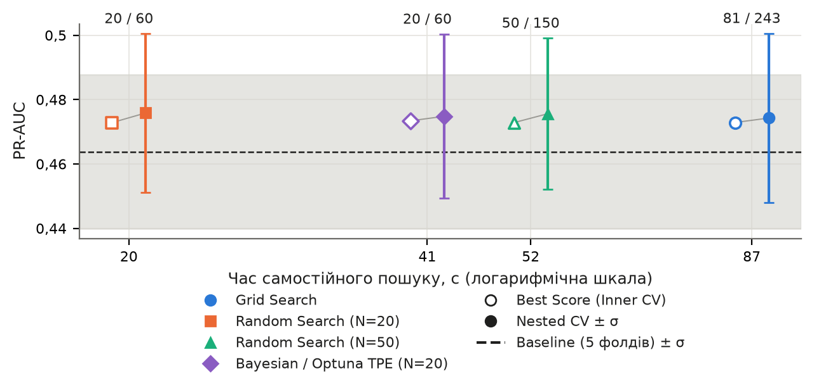
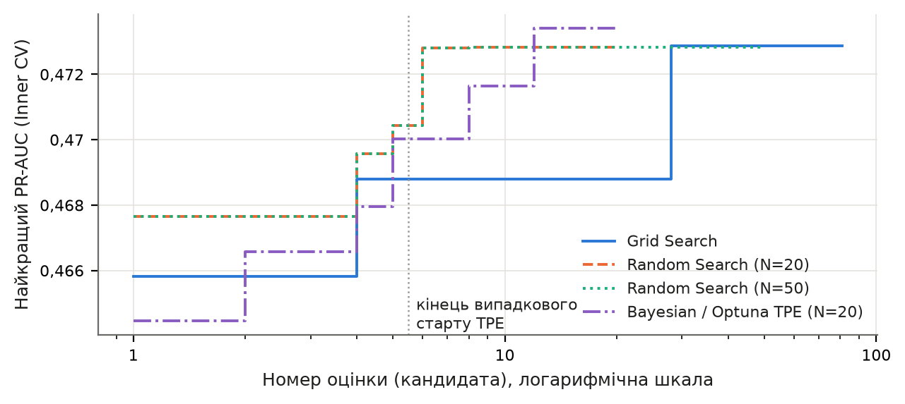
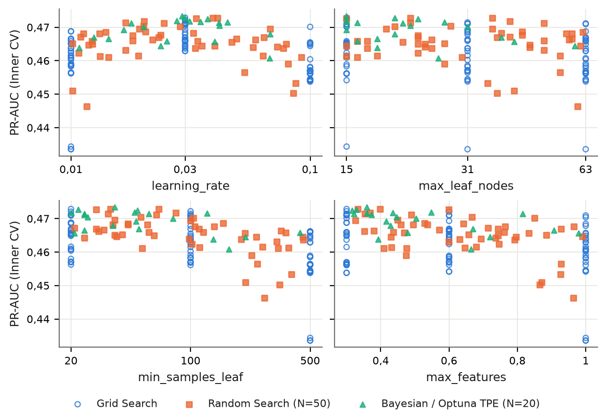
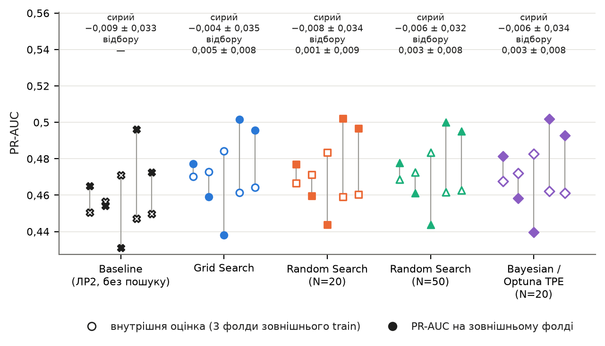
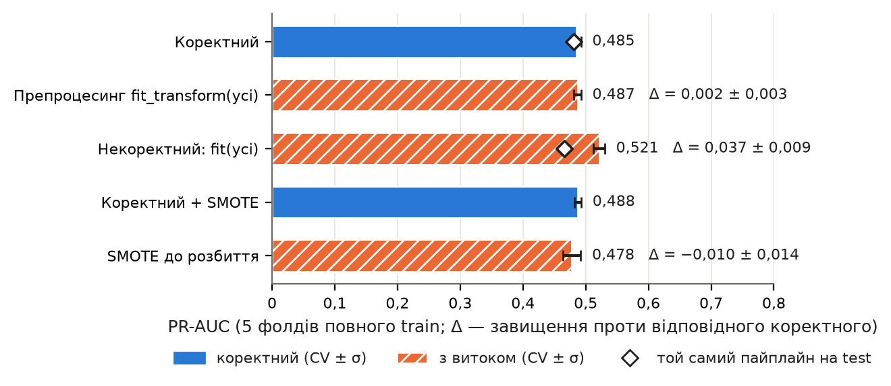
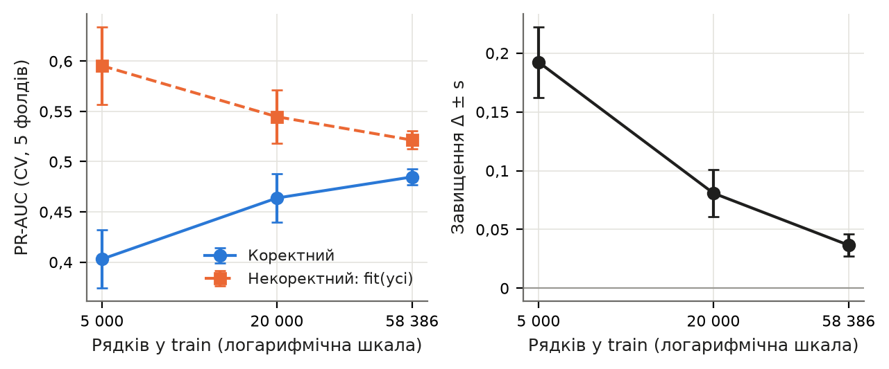

## 1. Постановка завдання

1. Обрати модель з ЛР № 2 з великою кількістю гіперпараметрів або схильну до перенавчання, зафіксувати метрику якості, підготувати дані й побудувати baseline-модель.
2. Визначити простір гіперпараметрів (не менше 3–4 параметрів) і провести оптимізацію методами Grid Search (`GridSearchCV`), Random Search (`RandomizedSearchCV`, N = 20 і 50) і Bayesian Optimization (Optuna, N = 20); зафіксувати час виконання і найкраще значення валідаційної метрики.
3. Побудувати некоректний (з витоком) і коректний (без витоку) пайплайни, порівняти валідаційні метрики й оцінити штучне завищення якості.
4. Реалізувати вкладену крос-валідацію (зовнішня петля K = 5, внутрішня K = 3) і порівняти оцінку внутрішньої CV з незміщеною оцінкою зовнішньої.

Звіт повинен містити порівняльну таблицю методів оптимізації з колонками «Метод оптимізації», «Кількість ітерацій / оцінок», «Час виконання (сек)», «Best Score (Inner CV)», «Unbiased Score (Nested CV)»; порівняння метрик коректного й некоректного препроцесингу; графік «Якість моделі / Час обчислень»; висновки щодо вибору методу оптимізації за обмежених обчислювальних ресурсів.

## 2. Опис проведеної роботи

### 2.1. Дані, модель і метрика

Використано датасет Carvana «Don't Get Kicked!» [1], очищений і розбитий у ЛР № 1: задача бінарної класифікації «чи виявиться придбаний на аукціоні автомобіль поганою покупкою» (`IsBadBuy` = 1), частка позитивного класу {{metrics.data.dev_minority_share:.1%}}. Параметри препроцесингу перед запуском звірено з маніфестом ЛР № 1 (`check_manifest`). Використано сценарій Б з ЛР № 2 (повний препроцесинг: категорія MISSING для пропусків, Target Encoding [2] для ознак високої кардинальності, One-Hot для решти, Yeo-Johnson зі стандартизацією, згенеровані ознаки). Усі перетворення разом із моделлю зібрано в один `Pipeline` і навчаються лише на навчальній частині кожного фолда.

Пошук гіперпараметрів і вкладена крос-валідація виконувалися на стратифікованій «робочій» підвибірці train (далі — dev) з {{metrics.data.dev_rows}} рядків ({{metrics.data.dev_positives}} позитивних); дослідження витоку — на повному train ({{metrics.data.full_train_rows}} рядків), фінальна перевірка — на test ({{metrics.data.test_rows}} рядків); частка класу 1 в усіх трьох однакова (`data_state.csv`). Обсяг dev обрано з обчислювального бюджету: у вкладеній CV кожен метод пошуку повторюється в п'яти зовнішніх фолдах, разом із самостійними пошуками це понад три тисячі навчань пайплайна. З підвибіркою вся лабораторна виконується за {{metrics.timing.total_seconds:.0f}} с на {{metrics.timing.n_cpu}} ядрах, на повному train — у кілька разів довше (калібрувальні заміри й правило вибору обсягу задокументовано в `config.py`). Ціна рішення — шум: у кожному зовнішньому фолді лише п'ята частина з {{metrics.data.dev_positives}} позитивних рядків dev, тож σ PR-AUC між фолдами становить кілька сотих. Пошук, вкладена CV, baseline і фінальні моделі для test використовують ту саму dev-вибірку, інакше Best Score і Nested-оцінка стосувалися б різних обсягів даних.

**Модель.** Обрано гістограмний градієнтний бустинг (`HistGradientBoostingClassifier` [3, 4]) — найкращу модель ЛР № 2: він має багато реальних «важелів» складності й помітно перенавчається (розрив PR-AUC train − CV у ЛР № 2 — {{metrics.model.lab2_train_cv_gap:.3f}}). Випадковий ліс відхилено: одне його навчання вдвічі дорожче, і повна сітка у вкладеній CV не вклалася б у бюджет. Кількість дерев фіксовано (`max_iter` = {{metrics.model.params.max_iter}}, раннє зупинення вимкнено) і в пошуку, щоб вона була однаковою для всіх кандидатів.

**Метрика.** Як і в ЛР № 1–2, оптимізується PR-AUC (average precision) [5]: вона чутлива саме до якості на рідкісному класі й не залежить від порога (F1 змішав би підбір гіперпараметрів із підбором порога); ROC-AUC — допоміжна.

**Baseline** — HGB з параметрами ЛР № 2 (`learning_rate` = {{metrics.model.params.learning_rate}}, `max_leaf_nodes` = {{metrics.model.params.max_leaf_nodes}}, `min_samples_leaf` = {{metrics.model.params.min_samples_leaf}}, `max_features` = {{metrics.model.params.max_features}}) у тому самому пайплайні, оцінений на тих самих 3 внутрішніх і 5 зовнішніх розбиттях dev, що й методи пошуку (повні дані — `baseline.csv`): PR-AUC {{metrics.baseline.inner_pr_auc:.4f}} ± {{metrics.baseline.inner_pr_auc_std:.4f}} на внутрішніх і {{metrics.baseline.outer_pr_auc:.4f}} ± {{metrics.baseline.outer_pr_auc_std:.4f}} на зовнішніх фолдах. На dev-вибірці модель перенавчається сильніше, ніж у ЛР № 2: PR-AUC на train {{metrics.baseline.train_pr_auc:.3f}}, розрив train − CV зростає до {{metrics.baseline.train_cv_gap:.3f}}. Отже, параметри ЛР № 2 для меншої вибірки не оптимальні, і підбір гіперпараметрів має сенс.

### 2.2. Простір гіперпараметрів

Простір складається з чотирьох параметрів (табл. {@space}). Для всіх методів межі однакові: Grid Search отримує по три значення на вісь (обидві межі й середину, разом $3^4$ = {{metrics.search_space.grid_size}} комбінація), Random Search і Optuna — неперервні розподіли в тих самих межах (лог-рівномірні для перших трьох параметрів). Простори формально не тотожні — дискретний і неперервний, — але саме в цьому полягає класична відмінність методів [6]: за той самий бюджет випадковий пошук бачить N різних значень кожного параметра, а сітка — лише три. Усі межі генеруються з одного об'єкта `SearchSpace`, тож розбіжність меж між методами неможлива.

{#space}

Чотири параметри охоплюють різні механізми регуляризації: швидкість навчання ансамблю, складність дерева, мінімальний обсяг листка і випадковий відбір ознак у розбитті. Відкинуто `l2_regularization` (слабкий ефект у HGB, нуль не вкладається в лог-шкалу), `max_iter` (лінійно множить час і дублює `learning_rate`) і п'ятий параметр загалом (сітка з $3^5$ точок не вкладається в бюджет). Межі простору звужено попередньою пробою **на train-підвибірці** (не на test): `learning_rate` = 0,3 було стабільно гіршим на внутрішніх фолдах, а найкращі комбінації мали швидкість навчання, нижчу за 0,1, тому верхню межу встановлено на 0,1. Це легітимне попереднє дослідження, але простір через нього вже частково «підігнаний» під дані.

### 2.3. Методи оптимізації та вимірювання часу

Усі методи використовують ті самі три внутрішні розбиття dev (`StratifiedKFold(3, shuffle=True)` з однаковим зерном), ту саму метрику, і жоден не робить остаточного навчання (`refit=False`), тож заміряний час — лише оцінювання кандидатів.

- **Grid Search** — `GridSearchCV`, усі {{metrics.methods.grid.n_candidates}} комбінація сітки.
- **Random Search** — `RandomizedSearchCV` з N = 20 і N = 50. Однаковий `random_state` робить перші 20 кандидатів RS50 тими самими, що в RS20: різниця між рядками таблиці — рівно «ще 30 ітерацій», а не везіння іншого зерна. Пошуки виконано окремо, з окремим заміром часу.
- **Bayesian Optimization** — Optuna [7] із семплером TPE (Tree-structured Parzen Estimator [8]): наступна точка обирається за результатами попередніх як максимум відношення щільностей «добрих» і «поганих» точок. 20 спроб, `seed` = {{metrics.config.seed}}, перші {{metrics.config.optuna_startup_trials}} спроб випадкові (типові 10 зробили б половину бюджету випадковим пошуком), `multivariate=True` (параметри моделюються спільно). Прунер не використовується, щоб кількість оцінок була порівнянна з Grid і Random.

Час — це **wall-clock** (`time.perf_counter()` навколо всього пошуку), тобто реальний час очікування результату. Grid і Random паралеляться ідеально: усі пари «кандидат × фолд» незалежні й розкладаються на {{metrics.methods.grid.workers}} процесів по {{metrics.methods.grid.threads_per_fit}} потоку. Спроби TPE за побудовою послідовні (з паралельними спробами історія стала б невідтворюваною), тож паралельно рахуються лише 3 фолди однієї спроби: {{metrics.methods.optuna_20.workers}} процеси по {{metrics.methods.optuna_20.threads_per_fit}} потоки. Обидва режими завантажують практично всі ядра, тому wall-clock між методами порівнянний.

### 2.4. Вкладена крос-валідація і правило порівняння

Зовнішня петля — `StratifiedKFold(5)` на dev, однакова для всіх методів і baseline. У кожному зовнішньому фолді метод пошуку запускається на зовнішньому train із власними трьома внутрішніми фолдами; найкращі параметри застосовуються до пайплайна, який навчається на всьому зовнішньому train й оцінюється на зовнішньому val, що не брав участі в пошуку. Середнє за п'ятьма зовнішніми фолдами — незміщена оцінка (Unbiased Score, Nested CV) [9, 10].

Для зовнішнього фолда $k$ позначимо $I_k$ — Best Score внутрішнього пошуку, $E_k$ — PR-AUC на зовнішньому val, а $I_k^0$, $E_k^0$ — те саме для baseline (його «внутрішня» оцінка — 3-фолдова CV на тому самому зовнішньому train, без жодного відбору). Оптимізм внутрішньої оцінки обчислено у двох формах:

$$O_k^{\text{сир}} = I_k - E_k, \qquad O_k^{\text{відб}} = (I_k - E_k) - (I_k^0 - E_k^0).$$

Сирий оптимізм містить, крім ефекту відбору, систематичний зсув, який є і без пошуку (внутрішні моделі навчаються на 2/3 зовнішнього train, а фінальна — на всьому); оптимізм відбору віднімає цей зсув, виміряний на baseline, і лишає лише ефект «найкращий із N шумних оцінок».

Порівняння варіантів — правилом парних різниць з ЛР № 1–2: $d_k$ — різниця PR-AUC двох варіантів на тому самому фолді, $\Delta$ — середнє $d_k$, $s$ — їхнє вибіркове стандартне відхилення; різниця вважається реальною лише за $|\Delta| > s$.

### 2.5. Пайплайни для дослідження витоку

Досліджено п'ять пайплайнів з однаковою моделлю (HGB ЛР № 2) на тих самих п'яти фолдах повного train [13]:

- **Коректний** — препроцесор і модель в одному `Pipeline`, `fit` лише на навчальній частині фолда.
- **Препроцесинг `fit_transform` на всіх даних** — препроцесор навчено на всьому train до розбиття. Витікають статистики імп'ютерів, скейлерів, агрегатів за категоріями; Target Encoder кодує з внутрішнім крос-фітингом, тож власна мітка рядка в його код не потрапляє.
- **Некоректний (головний)** — `fit` препроцесора на всіх даних, потім `transform` усіх даних: тепер Target Encoder кодує кожен рядок середнім цілі, у яке входить **власна мітка цього рядка**. Це типова помилка «препроцесинг до розбиття».
- **Коректний + SMOTE** — SMOTE [11] (частота 0,5, 5 сусідів) усередині пайплайна, як у сценарії В ЛР № 2.
- **SMOTE до розбиття** — синтетичні рядки генеруються на всьому train і розподіляються по фолдах, тож точки, інтерпольовані з валідаційних позитивів, потрапляють у навчання. Оцінка — на реальних валідаційних рядках (основна) і, як зробив би новачок, на валідації разом із синтетичними («наївна»).

Варіанти без SMOTE порівнюються з коректним, «SMOTE до розбиття» — з коректним + SMOTE. Головну пару додатково оцінено на підвибірках різного обсягу і на test. 

### 2.6. Використання тестової вибірки

Test ({{metrics.data.test_rows}} рядків) уже використовувався в ЛР № 2 для 12 фіксованих конфігурацій, тож він не є «незайманим». Повторне використання тут допустиме за умови, що за ним **нічого не обирається**: перелік моделей визначено заздалегідь (baseline; чотири налаштовані моделі — найкращі параметри самостійного пошуку кожного методу, навчені на всій dev-вибірці; два пайплайни витоку, навчені на повному train), і кожна оцінюється один раз. Одна пробна оцінка під час планування торкнулася test, але за нею нічого не налаштовувалося, і в звіт вона не входить. Різниці на test оцінюються парним бутстрепом [12] (1000 повторів, 95 % довірчий інтервал, ДІ).

## 3. Результати

### 3.1. Порівняльна таблиця методів оптимізації

Порівняльну таблицю методів у формі, вимаганій завданням, наведено в табл. {@methods}.

{#methods}

«Кількість ітерацій / оцінок» — кандидатів / навчань моделі; «Час виконання» — wall-clock самостійного пошуку; «Best Score» — PR-AUC найкращого кандидата на 3 внутрішніх фолдах ± σ; «Unbiased Score» — PR-AUC на 5 зовнішніх фолдах вкладеної CV ± σ; baseline — HGB ЛР № 2 без пошуку. Усі чотири методи знайшли конфігурації практично однакової якості: Best Score від {{metrics.methods.random_20.best_score_inner:.4f}} до {{metrics.methods.optuna_20.best_score_inner:.4f}}, Nested-оцінки від {{metrics.methods.grid.nested_mean:.4f}} до {{metrics.methods.random_20.nested_mean:.4f}} — різниці в четвертому знаку за σ між зовнішніми фолдами близько {{metrics.methods.random_20.nested_std:.3f}}. Best Score RS20 і RS50 збігається: найкращий кандидат RS50 опинився серед перших 20 точок, спільних з RS20, і ще 30 ітерацій кращого не знайшли. Натомість за часом методи різняться в рази: Grid Search тривав {{metrics.methods.grid.wall_seconds:.1f}} с, RS20 — {{metrics.methods.random_20.wall_seconds:.1f}} с, тобто у {{metrics.methods_summary.wall_ratio_slowest_to_fastest:.1f}} раза довше за ту саму якість. Деталі обчислювальної вартості наведено в табл. {@cost}.

{#cost}

Для Grid і Random час пропорційний кількості навчань (близько трьох навчань за секунду). Optuna з тими самими {{metrics.methods.optuna_20.n_fits}} навчаннями, що й RS20, працювала вдвічі довше. Причина не в обчисленнях TPE (вибір наступної точки займає частки секунди), а в паралелізмі (колонка «Процесів × потоків»): послідовні спроби дозволяють одночасно рахувати лише 3 фолди, і кожне навчання отримує 3 потоки замість 10 незалежних процесів по одному. Бустинг погано масштабується за потоками — 3 потоки прискорюють одне навчання значно менше ніж утричі. Тому сумарний час навчань у Optuna найменший (кожне навчання швидше), а пропускна здатність удвічі нижча ({{metrics.methods.optuna_20.evals_per_second:.2f}} проти {{metrics.methods.random_20.evals_per_second:.2f}} навчань за секунду). Це властивість самого методу: на машині з десятками ядер Random Search прискорюється майже лінійно, а TPE — ні.

### 3.2. Якість і час обчислень

Графік «Якість моделі / Час обчислень» показано на рис. {@quality_time}: по осі абсцис — wall-clock самостійного пошуку (логарифмічна шкала), порожній маркер — Best Score (Inner CV), заповнений — Nested-оцінка ± σ, пунктир і сіра смуга — baseline на тих самих зовнішніх фолдах ± σ.

{#quality_time width=85%}

Точки всіх методів лежать на одній горизонталі: зростання часу від {{metrics.methods.random_20.wall_seconds:.0f}} до {{metrics.methods.grid.wall_seconds:.0f}} с не дає приросту якості. Інтервали ± σ Nested-оцінок перекриваються між собою і зі смугою baseline, тому перевагу над baseline на графіку не видно; її виявляють лише парні різниці на тих самих фолдах (п. 3.3). Найкраще співвідношення «якість / час» має найлівіша точка — RS20. Як швидко методи знаходять добру конфігурацію, показують криві збіжності (рис. {@convergence}).

{#convergence width=75%}

Random Search досягає кінцевого результату вже серед перших десяти кандидатів, і решта кандидатів RS20 і RS50 його не покращує. Крива Grid сходинкова і залежить від порядку обходу сітки (`ParameterGrid` починає з `learning_rate` = 0,01), тож порівнювати слід кінцеві точки. Optuna після п'яти випадкових спроб двічі покращує результат керованими TPE спробами й дає найвищий Best Score ({{metrics.methods.optuna_20.best_score_inner:.4f}}), але перевага над Random Search — у четвертому знаку: з 20 спробами TPE має замало історії, щоб систематично випередити випадковий пошук. Причину рівності методів пояснює рис. {@samples}.

{#samples width=72%}

Grid бачить лише три значення кожного параметра, Random розкиданий по всьому діапазону, а точки Optuna згущуються біля `learning_rate` ≈ 0,03, малих `max_features` і `min_samples_leaf`. Поверхня якості має широке плато: помітно гірші лише крайні комбінації (`learning_rate` = 0,01 з `min_samples_leaf` = 500; великі `max_features` з великим `min_samples_leaf`), а десятки конфігурацій лежать у вузькій смузі біля максимуму. На такій поверхні будь-який метод із кількома десятками точок потрапляє на плато. Найкращі параметри (`best_params.csv`; порядок — `learning_rate`, `max_leaf_nodes`, `min_samples_leaf`, `max_features`): Grid — {{metrics.methods.grid.best_params.learning_rate:.3f}}, {{metrics.methods.grid.best_params.max_leaf_nodes}}, {{metrics.methods.grid.best_params.min_samples_leaf}}, {{metrics.methods.grid.best_params.max_features:.2f}}; RS20 і RS50 — {{metrics.methods.random_20.best_params.learning_rate:.3f}}, {{metrics.methods.random_20.best_params.max_leaf_nodes}}, {{metrics.methods.random_20.best_params.min_samples_leaf}}, {{metrics.methods.random_20.best_params.max_features:.2f}}; Optuna — {{metrics.methods.optuna_20.best_params.learning_rate:.3f}}, {{metrics.methods.optuna_20.best_params.max_leaf_nodes}}, {{metrics.methods.optuna_20.best_params.min_samples_leaf}}, {{metrics.methods.optuna_20.best_params.max_features:.2f}}. Усі методи узгоджено зменшують швидкість навчання і частку ознак у розбитті порівняно з baseline ({{metrics.model.params.learning_rate}} і {{metrics.model.params.max_features}}) — це регуляризація проти перенавчання, поміченого в п. 2.1. Grid обрав нижню межу одразу трьох параметрів, а Random і Optuna — `max_features` біля нижньої межі, тож оптимум за `max_features` може лежати за межами простору; розширення меж — природний наступний крок, у цій роботі не виконаний.

### 3.3. Вкладена крос-валідація: внутрішня і незміщена оцінки

Пари «внутрішня оцінка → PR-AUC на зовнішньому фолді» для кожного з п'яти зовнішніх фолдів показано на рис. {@nested} (над групами — сирий оптимізм і оптимізм відбору, середнє ± s), числові підсумки — у табл. {@quality}.

{#nested width=78%}

{#quality}

Розкид між зовнішніми фолдами (PR-AUC приблизно від 0,43 до 0,50, `nested_folds.csv`) набагато більший за різниці між методами і однаковий для всіх груп, включно з baseline.

**Сирий оптимізм від'ємний** для всіх методів (від {{metrics.methods.random_20.optimism_raw_mean:.4f}} до {{metrics.methods.grid.optimism_raw_mean:.4f}}): у середньому внутрішня оцінка навіть нижча за зовнішню. Це не означає, що відбір нічого не завищує: такий самий зсув має baseline, який нічого не обирає ({{metrics.baseline.inner_minus_outer_mean:.4f}} ± {{metrics.baseline.inner_minus_outer_std:.4f}}), бо внутрішні моделі навчаються на 2/3 зовнішнього train, а PR-AUC на цьому датасеті помітно зростає з обсягом даних (рис. {@leak_size}).

**Оптимізм відбору**, з якого цей зсув вилучено, додатний для всіх методів: від {{metrics.methods.random_20.optimism_selection_mean:.4f}} (RS20) до {{metrics.methods.grid.optimism_selection_mean:.4f}} (Grid). Це узгоджується з теорією [10]: що більше кандидатів, то сильніше максимум шумних оцінок завищує якість. Проте для жодного методу оптимізм відбору не перевищує свого розкиду, а Best Score самостійного пошуку майже збігається з Nested-оцінкою (різниця від {{metrics.methods.random_20.best_minus_nested:.4f}} до {{metrics.methods.optuna_20.best_minus_nested:.4f}}): на широкому плато завищення через відбір менше за похибку оцінювання.

**Приріст від підбору гіперпараметрів** реальний: кожен метод покращує зовнішній PR-AUC відносно baseline на тих самих фолдах (від {{metrics.methods.grid.gain_vs_baseline:+.4f}} у Grid до {{metrics.methods.random_20.gain_vs_baseline:+.4f}} у RS20), і в усіх чотирьох випадках $\Delta > s$. Серед {{metrics.methods_summary.pairs_total}} попарних порівнянь (`nested_pairwise.csv`) розрізненні лише {{metrics.methods_summary.pairs_distinguishable}} — усі «метод проти baseline»; з {{metrics.methods_summary.pairs_between_methods_total}} пар «метод проти методу» розрізненних {{metrics.methods_summary.pairs_between_methods_distinguishable}} (|Δ| не більше 0,0016 при s від 0,0016 до 0,0035). Тому «переможця» за якістю серед методів немає, і вирішальним критерієм вибору стає час.

### 3.4. Перевірка на тестовій вибірці

Результати заздалегідь визначених моделей на test (найкращі параметри самостійного пошуку, навчені на всій dev-вибірці) наведено в табл. {@test}.

{#test}

Test підтверджує висновки вкладеної CV: усі налаштовані моделі кращі за baseline ({{metrics.baseline.test_pr_auc:.4f}}), і для кожної 95 % ДІ різниці не містить нуля. PR-AUC на test ({{metrics.methods.optuna_20.test_pr_auc:.4f}}–{{metrics.methods.random_20.test_pr_auc:.4f}}) близький до Nested-оцінок ({{metrics.methods.grid.nested_mean:.4f}}–{{metrics.methods.random_20.nested_mean:.4f}}), тобто вкладена CV дала реалістичний прогноз. Між методами різниці на test мізерні (RS20 і RS50 обрали ту саму конфігурацію). Для довідки: HGB ЛР № 2, навчений на всьому train, має на test PR-AUC {{metrics.lab2_reference.hgb_full_test_pr_auc:.4f}} — більше, ніж налаштовані на 20 тис. рядків моделі; порівняння непряме, але показує, що обсяг даних тут важить більше за підбір гіперпараметрів.

### 3.5. Вплив витоку даних

Порівняння п'яти пайплайнів показано на рис. {@leakage_fig} (повна таблиця з ROC-AUC і PR-AUC на train — `leakage_comparison.csv`): стовпчики — PR-AUC на CV ± σ, підписи Δ ± s — завищення відносно відповідного коректного пайплайна на тих самих фолдах, ромби — оцінка того самого пайплайна на test.

{#leakage_fig width=90%}

Різні види витоку діють дуже по-різному:

- **Некоректний пайплайн** (`fit` на всіх даних) завищує PR-AUC з {{metrics.leakage.headline.correct_cv:.4f}} до {{metrics.leakage.headline.incorrect_cv:.4f}}: $\Delta$ = {{metrics.leakage.headline.inflation_cv:.4f}} ± {{metrics.leakage.headline.inflation_cv_std:.4f}} — у кілька разів більше за розкид і за весь приріст від підбору гіперпараметрів (п. 3.3), у кожному з п'яти фолдів (`leakage_folds.csv`); ROC-AUC зростає з {{metrics.leakage.correct.roc_auc:.4f}} до {{metrics.leakage.leak_fit_all.roc_auc:.4f}}. Джерело — Target Encoding ознак високої кардинальності: у рідкісних категоріях середнє цілі з урахуванням власної мітки рядка фактично містить цю мітку.
- **Препроцесинг `fit_transform` на всіх даних** практично не завищує ($\Delta$ = {{metrics.leakage.leak_unsupervised.delta:.4f}} ± {{metrics.leakage.leak_unsupervised.delta_std:.4f}}, у межах шуму): статистики імп'ютерів і скейлерів майже не змінюються від додавання валідаційних рядків, а крос-фітинг не дає рядку побачити власну мітку. Шкідливий не будь-який препроцесинг «до розбиття», а той, що навчається на цілі без захисту.
- **SMOTE до розбиття** на реальних валідаційних рядках не завищує ($\Delta$ = {{metrics.leakage.leak_smote.delta:.4f}} ± {{metrics.leakage.leak_smote.delta_std:.4f}}, у межах шуму). Однак «наївна» оцінка, коли синтетичні рядки лишаються у валідації, дає PR-AUC {{metrics.leakage.leak_smote.naive_pr_auc:.4f}}. PR-AUC тут непорівнянна (частка класу 1 у такій валідації зростає приблизно до третини), але й ROC-AUC, що від частки класів не залежить, зростає з {{metrics.leakage.correct_smote.roc_auc:.4f}} до {{metrics.leakage.leak_smote.naive_roc_auc:.4f}}: модель легко впізнає синтетичні точки — інтерполяції сусідів, яких вона бачила в навчанні. Це найгрубіша форма витоку.

Перевірка «реальністю» (`leakage_holdout.csv`): обидва головні пайплайни навчено на всьому train й оцінено на test (у некоректному test кодується статистикою train, як буде в експлуатації). Коректний дав на test практично ту саму оцінку, що й на CV ({{metrics.leakage.headline.correct_test:.4f}} проти {{metrics.leakage.headline.correct_cv:.4f}}; це та сама модель, що й HGB · Б у ЛР № 2). Некоректний упав до {{metrics.leakage.headline.incorrect_test:.4f}}: його CV-оцінка завищена відносно реальної якості на {{metrics.leakage.headline.inflation_vs_test:.4f}}. Більше того, модель з витоком на нових даних **гірша** за коректну: різниця на test {{metrics.leakage.headline.test_delta:.4f}}, 95 % ДІ [{{metrics.leakage.headline.test_delta_low:.4f}}; {{metrics.leakage.headline.test_delta_high:.4f}}] повністю нижче нуля — вона навчилася довіряти кодуванню з власною міткою рядка, якого на нових даних немає. Залежність завищення від обсягу даних показано на рис. {@leak_size}.

{#leak_size width=85%}

Що менше даних, то сильніший витік: завищення зростає з {{metrics.leakage.by_size.58386.delta:.3f}} на повному train до {{metrics.leakage.by_size.20000.delta:.3f}} на 20 тис. і {{metrics.leakage.by_size.5000.delta:.3f}} на 5 тис. рядків, де некоректна оцінка ({{metrics.leakage.by_size.5000.incorrect:.3f}}) перевищує навіть коректну на повному train (числа — `leakage_by_size.csv`). У малій вибірці більше категорій із кількома рядками, де кодування цілі майже дорівнює мітці. Водночас коректна оцінка з обсягом зростає (з {{metrics.leakage.by_size.5000.correct:.3f}} до {{metrics.leakage.by_size.58386.correct:.3f}}), що й пояснює від'ємний сирий оптимізм у вкладеній CV. Витік найнебезпечніший саме на малих датасетах.

### 3.6. Вибір методу оптимізації за обмежених ресурсів

Оскільки підбір дає реальний приріст, а методи нерозрізнимі за якістю й різняться в рази за часом (п. 3.1–3.4), для задач з обмеженими обчислювальними ресурсами доцільно:

1. **Random Search з невеликим N** — розумний вибір за замовчуванням: знаходить конфігурацію на плато за кілька десятків оцінок, ідеально паралелиться, а вартість задається бюджетом N, а не кількістю параметрів. Збільшення N до 50 тут нічого не дало.
2. **Bayesian Optimization (Optuna/TPE)** доцільна, коли одне навчання дороге, а паралельних ресурсів мало: вона зосереджує бюджет у перспективних областях (рис. {@samples}), її перевага зростає з кількістю спроб і параметрів, а прунер (`MedianPruner`) може додатково заощадити час. Ціна — послідовна природа: на багатоядерній машині вона програє випадковому пошуку за wall-clock.
3. **Grid Search** не дає виграшу при в ~4 рази більшому часі й масштабується найгірше (кожен параметр множить кількість точок, а важливі параметри отримують лише по 3 значення); доречний для 1–2 параметрів або уточнення навколо знайденої точки.

## 4. Висновок

Для гістограмного градієнтного бустингу з ЛР № 2 на датасеті Carvana порівняно Grid Search, Random Search (N = 20 і 50) і Optuna/TPE (N = 20) за однакового простору з чотирьох гіперпараметрів і однакових фолдів, з незміщеною оцінкою вкладеною CV 5 × 3. Підбір гіперпараметрів реально покращив модель: Nested-оцінка зросла з {{metrics.baseline.outer_pr_auc:.4f}} у baseline до {{metrics.methods.grid.nested_mean:.4f}}–{{metrics.methods.random_20.nested_mean:.4f}}, і на test усі налаштовані моделі кращі за baseline з ДІ без нуля. Проте методи між собою нерозрізнимі (жодна з {{metrics.methods_summary.pairs_between_methods_total}} парних різниць не перевищує розкиду), а за часом відрізняються в {{metrics.methods_summary.wall_ratio_slowest_to_fastest:.1f}} раза: Random Search з 20 ітераціями виконався за {{metrics.methods.random_20.wall_seconds:.1f}} с, Grid Search — за {{metrics.methods.grid.wall_seconds:.1f}} с. Тому за обмежених ресурсів доцільно обирати Random Search з невеликим N або Optuna (якщо навчання дороге, а паралелізм обмежений); Grid Search виграшу не дає.

Оптимізм відбору Best Score виявився невеликим (до {{metrics.methods.grid.optimism_selection_mean:.4f}}, у межах розкиду), а сирий оптимізм — навіть від'ємним через зсув «менше даних у внутрішніх фолдах». Навчання препроцесора з Target Encoding на всіх даних до розбиття завищує PR-AUC на {{metrics.leakage.headline.inflation_cv:.3f}} на повному train і на {{metrics.leakage.by_size.5000.delta:.3f}} на 5 тис. рядків, а на test така модель гірша за коректну; SMOTE до розбиття з валідацією на синтетичних рядках дає нереалістичний ROC-AUC {{metrics.leakage.leak_smote.naive_roc_auc:.3f}}. Витік спотворює оцінку значно сильніше, ніж вибір методу оптимізації, тому коректний пайплайн і вкладена CV важливіші за вибір алгоритму пошуку.

## 5. Список використаної літератури

1. Don't Get Kicked! [Електронний ресурс] // Kaggle. — 2011. — Режим доступу: https://www.kaggle.com/c/DontGetKicked.
2. Micci-Barreca D. A preprocessing scheme for high-cardinality categorical attributes in classification and prediction problems // SIGKDD Explorations. — 2001. — Vol. 3, № 1. — P. 27–32.
3. Pedregosa F. et al. Scikit-learn: Machine Learning in Python // Journal of Machine Learning Research. — 2011. — Vol. 12. — P. 2825–2830.
4. Ke G. et al. LightGBM: A Highly Efficient Gradient Boosting Decision Tree // Advances in Neural Information Processing Systems 30. — 2017. — P. 3146–3154.
5. Saito T., Rehmsmeier M. The precision-recall plot is more informative than the ROC plot when evaluating binary classifiers on imbalanced datasets // PLoS ONE. — 2015. — Vol. 10, № 3. — e0118432.
6. Bergstra J., Bengio Y. Random Search for Hyper-Parameter Optimization // Journal of Machine Learning Research. — 2012. — Vol. 13. — P. 281–305.
7. Akiba T., Sano S., Yanase T., Ohta T., Koyama M. Optuna: A Next-generation Hyperparameter Optimization Framework // Proc. 25th ACM SIGKDD International Conference on Knowledge Discovery & Data Mining. — 2019. — P. 2623–2631.
8. Bergstra J., Bardenet R., Bengio Y., Kégl B. Algorithms for Hyper-Parameter Optimization // Advances in Neural Information Processing Systems 24. — 2011. — P. 2546–2554.
9. Varma S., Simon R. Bias in error estimation when using cross-validation for model selection // BMC Bioinformatics. — 2006. — Vol. 7. — Art. 91.
10. Cawley G. C., Talbot N. L. C. On Over-fitting in Model Selection and Subsequent Selection Bias in Performance Evaluation // Journal of Machine Learning Research. — 2010. — Vol. 11. — P. 2079–2107.
11. Chawla N. V., Bowyer K. W., Hall L. O., Kegelmeyer W. P. SMOTE: Synthetic Minority Over-sampling Technique // Journal of Artificial Intelligence Research. — 2002. — Vol. 16. — P. 321–357.
12. Efron B., Tibshirani R. J. An Introduction to the Bootstrap. — New York : Chapman & Hall, 1993. — 436 p.
13. Kaufman S., Rosset S., Perlich C., Stitelman O. Leakage in data mining: Formulation, detection, and avoidance // ACM Transactions on Knowledge Discovery from Data. — 2012. — Vol. 6, № 4. — Art. 15.
