# ЛР №4 — Шукаємо дефекти на фото, не маючи прикладів дефектів: конспект

## 1. Коротко

Завдання — промислова інспекція: за фотографією знайти, *де саме* на виробі дефект (подряпина, скол,
бульбашка), причому вчитися можна **лише на фото нормальних виробів**. Дані — датасет VisA, три
категорії: `macaroni2` (макарони на текстурованому тлі), `capsules` (купа капсул у випадкових
позиціях), `pcb4` (друкована плата). Власна модель — **Feature Autoencoder (FAE)**: переднавчена
на ImageNet мережа EfficientNetB0 перетворює кожну клітинку 8×8 пікселів на вектор ознак, а
невеликий автоенкодер (296 тис. параметрів) вчиться ці вектори «стискати й відновлювати». Погано
відновлений вектор означає підозрілу ділянку. На test FAE дає Pixel AUROC **0,981 / 0,966 / 0,971**
(macaroni2 / capsules / pcb4). Реімплементована на тих самих ознаках PaDiM гірша на macaroni2 і capsules
(0,950 / 0,925), а на pcb4 — нарівні (0,972). PatchCore краща скрізь (0,985 / 0,984 / 0,983). Зате FAE у 6,8 раза дешевша
за PatchCore за FLOPs (1,32 проти 8,93 GFLOPs на зображення з EfficientNetB0), у 1,6 раза швидша
(20,6 проти 33,7 мс на CPU) і займає 1,1 МБ пам'яті замість 15,3 МБ. На графіку «якість — вартість»
вона лежить на фронті Парето. Слабке місце всіх трьох методів — Pixel AP на `macaroni2`
(0,036 / 0,004 / 0,071): дефекти там у середньому менші за одну клітинку сітки.

## 2. Навіщо це взагалі

Уяви конвеєр, яким їдуть друковані плати. Камера фотографує кожну. Бракованих — одиниці на тисячу,
і кожен брак свій: тут подряпина, там зайва крапля припою, там деталь не на місці. Зібрати тисячі
розмічених фото *кожного* виду браку нереально: частину видів ти ще навіть не бачив. Зате нормальних
плат — скільки завгодно.

Звідси постановка **без учителя** (unsupervised), точніше «навчання на одному класі». Модель бачить
лише норму і має навчитися відповідати на питання «наскільки ця ділянка схожа на те, що я бачила?».
Відповідь — число для кожного пікселя, тобто **карта аномалій**. Ділянка з високим числом — кандидат
у дефекти.

Без цієї роботи лишаються два варіанти. Перший — класифікатор із ЛР2, але йому потрібні тисячі
прикладів кожного дефекту. Другий — ручні правила («пляма темніша за X»), які ламаються від зміни
освітлення чи положення об'єкта. Саме тому в завданні наголос на «високій дисперсії тла»: якщо
об'єкти щоразу лежать по-різному, порівняти фото з еталоном піксель-у-піксель не вийде.

Друга половина завдання — **вартість**. Детектор має працювати на лінії в реальному часі, часто на
слабкому пристрої (edge). Тому міряємо не лише якість, а й кількість операцій (FLOPs), час на одне
зображення (latency) і пам'ять. Найточніший метод може виявитися задорогим.

Місце в ланцюжку:

- **ЛР1–3:** табличні дані `kick`, класичні моделі, CV, метрики PR-AUC/ROC-AUC, бутстреп, витік,
  підбір гіперпараметрів. Звідти беремо *протокол*: `fit` лише на train, пороги — не на test, ДІ.
- **ЛР4 (ця):** новий датасет VisA, перші нейромережі (TensorFlow/Keras), спільний пакет
  `src/mllabs/anomaly/`.
- **ЛР5:** аналіз цієї самої моделі: Integrated Gradients, Grad-CAM, дрейф даних, розбір помилок,
  перенесення на edge. Тому модель ЛР4 зроблена **диференційовною від пікселя до оцінки** і
  зберігається на диск (розділ 4.11).

## 3. Словник

Протокол train/val/test, стратифікацію, витік, precision/recall/F1, PR-AUC (= AP), ROC-AUC пояснено
в [`labs/lab01/GUIDE.md`](../lab01/GUIDE.md) (розділи 3 і 4.0). Перенавчання, розрив train − CV,
поріг із максимальним F1, бутстреп і ДІ, парну різницю — у [`labs/lab02/GUIDE.md`](../lab02/GUIDE.md)
(розділи 3, кроки 4 і 7). Гіперпараметр, простір пошуку, потоки й перепідписку — у
[`labs/lab03/GUIDE.md`](../lab03/GUIDE.md) (розділ 3 і 4.7). Нижче — лише нові терміни; детальніше
кожен розібрано в розділі 4.0.

**Зображення й нейромережі**

| Термін | Пояснення | Аналогія |
|---|---|---|
| Тензор (tensor) | Багатовимірний масив чисел із формою (shape). Пакет зображень — `(B, H, W, C)`: кількість, висота, ширина, канали | `float[B][H][W][C]`, але одним суцільним блоком пам'яті з метаданими форми |
| Канал (channel) | Остання вісь тензора. У фото — R, G, B; усередині мережі — сотні «детекторів» якоїсь властивості | колонка таблиці, що є в кожній клітинці |
| Згортка (convolution) | Маленьке вікно ваг (напр. 3×3) ковзає зображенням; у кожній позиції — зважена сума пікселів під вікном | фільтр у фоторедакторі (різкість, контур) |
| Згорткова мережа (CNN) | Стос згорток із нелінійностями між ними; ваги вікон не задані вручну, а *вивчені* | конвеєр фільтрів, які налаштувалися самі |
| Крок (stride) | На скільки пікселів зсувається вікно. Крок 2 зменшує роздільність удвічі | вибирати кожен другий елемент |
| Рецептивне поле (receptive field) | Ділянка вхідного фото, від якої залежить одне число глибокого шару | «скільки контексту бачить нейрон» |
| Карта ознак (feature map) | Вихід проміжного шару: сітка `h × w`, у кожній клітинці вектор із `C` чисел | таблиця `h·w` рядків × `C` колонок |
| Backbone | Велика мережа, з якої беруть проміжні шари як «екстрактор ознак» (ResNet50, MobileNetV2, EfficientNetB0) | готова бібліотека, яку не переписуєш |
| ImageNet, переднавчені ваги (pretrained) | 1,2 млн фото 1000 класів; мережу вже навчили на них, ми беремо ваги як є | JAR зі скомпільованими класами |
| Перенесення навчання (transfer learning) | Використання ваг, навчених на одній задачі, для іншої. Тут ваги **заморожені**: не змінюються | бібліотека, від якої ти лише викликаєш методи |
| Патч (patch) | Клітинка сітки 32×32 на зображенні 256×256 (8×8 пікс.) і її вектор ознак | рядок таблиці «позиція → вектор» |
| Тайл (tile) | Явно вирізана частина зображення (тут 2×2 тайли), кожну обробляють окремо | шардування картинки |
| Шар (layer), `Dense` | Будівельний блок мережі. `Dense(n)`: кожен вихід — зважена сума всіх входів плюс зсув | лінійна функція `y = W·x + b` |
| Функція активації (activation), ReLU / LeakyReLU | Нелінійність після шару: ReLU обнуляє від'ємні, LeakyReLU множить їх на мале число | `Math.max(0, x)` |
| Автоенкодер (autoencoder) | Мережа, що вчиться відтворювати свій вхід через вузьке місце: кодувальник стискає, декодувальник відновлює | кодек із втратами, налаштований на «типові» дані |
| Латент, «пляшкове горло» (latent, bottleneck) | Найвужчий шар автоенкодера, тут `k = 64` числа замість 512 | стиснутий формат |
| Помилка відновлення (reconstruction error) | Середній квадрат різниці «вхід − відновлене». Тут це і є оцінка аномальності патча | наскільки JPEG спотворив картинку |
| Функція втрат (loss), MSE | Число, яке навчання мінімізує. MSE — середній квадрат помилки | цільова функція оптимізатора |
| Епоха, пакет (epoch, batch) | Пакет — порція прикладів на один крок оновлення ваг. Епоха — серія пакетів; тут 25 000 випадкових векторів | одна ітерація зовнішнього циклу |
| Оптимізатор Adam, крок навчання (learning rate) | Алгоритм, що за градієнтом підправляє ваги. Крок 0,001 — масштаб правки | стратегія `Strategy` для оновлення стану |
| Градієнт (gradient) | Наскільки зміниться втрата (чи оцінка), якщо трохи змінити вагу (чи піксель) | похідна; знадобиться в ЛР5 |
| Dropout, L2, шум входу | Регуляризатори: випадково вимикати частину нейронів; штрафувати великі ваги; додавати шум до входу | заважати моделі «зазубрити» |
| Раннє зупинення (early stopping) | Зупинити навчання, якщо валідаційна втрата не покращується `patience` епох | таймаут без прогресу |
| Колбек (callback) | Об'єкт, методи якого Keras викликає на подіях навчання (кінець епохи тощо) | listener / observer |

**Детекція аномалій і метрики**

| Термін | Пояснення | Аналогія |
|---|---|---|
| Навчання без учителя, одного класу (unsupervised, one-class) | Модель бачить лише норму; мітки аномалій не використовуються для навчання | антивірус за поведінкою, а не за сигнатурами |
| Карта аномалій (anomaly map) | Число на кожен піксель 256×256: що більше, то підозріліше | теплова карта |
| Оцінка зображення (image score) | Максимум карти: одне число на все фото | найгірший рядок звіту |
| Маска (mask) | Розмітка: `True` на пікселях дефекту. Лише для оцінки, не для навчання | правильна відповідь у тесті |
| Pixel AUROC / Image AUROC | ROC-AUC з ЛР1, але «рядки» — усі пікселі всіх фото / усі фото | — |
| Pixel AP | PR-AUC з ЛР1 по пікселях; чутлива до хибних тривог при рідкісних дефектах | — |
| Pixel F1 / Image F1 | F1 за фіксованим порогом, обраним на розміченому val | — |
| Oracle F1 | Найкращий можливий F1 на *самому test*. Лише для зіставлення зі статтями | «відповідь, підглянута в ключі» |
| PaDiM | Метод-еталон: для кожної позиції сітки — нормальний розподіл ознак; оцінка — відстань Махаланобіса | «норма для цієї клітинки» |
| Відстань Махаланобіса | Відстань, виміряна «в стандартних відхиленнях» з урахуванням кореляцій ознак | z-оцінка, узагальнена на вектори |
| PatchCore | Метод-еталон: банк пам'яті нормальних патчів; оцінка — відстань до найближчого | пошук найближчого сусіда в індексі |
| Coreset | Мала підмножина банку (1 %), що рівномірно покриває всі нормальні вектори | вибірка-«покриття» |
| Реімплементація (reimplementation) | Власне відтворення алгоритму за статтею, а не бібліотечний код | порт із PyTorch на TF |
| SOTA (state of the art) | Найкращі відомі методи задачі | — |

**Вартість**

| Термін | Пояснення | Аналогія |
|---|---|---|
| FLOPs, MAC | FLOPs — кількість операцій з рухомою комою на одне зображення. MAC — «помножити й додати» `a += w·x` = 2 FLOPs | лічильник інструкцій |
| GFLOPs | Мільярд FLOPs. **Не плутати** з FLOPS (з великою S) — операціями за секунду | — |
| Latency | Реальний час обробки одного зображення, мс | час відповіді сервісу |
| Медіана, p90 | Середнє «типове» значення й межа, за яку виходять 10 % найповільніших запусків | p50/p90 у моніторингу |
| Фронт Парето (Pareto front) | Варіанти, для яких немає іншого, що і не дорожчий, і не гірший | «нема сенсу брати гірше за дорожче» |

## 4. Як це зроблено — крок за кроком

### 4.0. Перед кроками: каркас, нові поняття і як міряємо

#### 4.0.1. Каркас і спільний пакет `anomaly`

Каркас той самий, що в ЛР1–3: `uv run mllabs run 4` створює `Lab4`, і той повертає кроки.

```python
# src/mllabs/labs/lab04/lab.py:132-143
return [
    Step("1. Дані VisA: розбиття, стан даних", timed("data", self._prepare_data)),
    Step("2. Патчі та ознаки backbone (кеш)", timed("features", self._extract_features)),
    Step("3. Дослідження екстракторів", timed("study_backbones", self._study_backbones)),
    Step("4. Дослідження розміру патчів", timed("study_patch_size", self._study_patches)),
    Step("5. Дослідження регуляризації", timed("study_regularization", self._study_reg)),
    Step("6. Навчання фінальної моделі", timed("final_training", self._train_final)),
    Step("7. SOTA: PaDiM і PatchCore (реімплементації)", timed("sota", self._fit_sota)),
    Step("8. Оцінка на test", timed("evaluation", self._evaluate)),
    Step("9. Профілювання FLOPs і latency", timed("profiling", self._profile)),
    Step("10. Зведення", self._summarize),
]
```

`timed` — той самий `StepTimer` з ЛР3, тепер у `src/mllabs/core/timing.py:22-31`. Повний запуск
тривав 1743 с ≈ 29 хв (`metrics.timing.total_seconds`). Найдовші кроки — SOTA (418 с) і
регуляризація (414 с).

Нове архітектурне рішення: уся «математика» живе не в `labs/lab04`, а в спільному пакеті
`src/mllabs/anomaly/`, бо ЛР5 працюватиме з тією самою моделлю. `labs/lab04` лише оркеструє
дослідження й будує таблиці.

| Модуль `anomaly/` | Що в ньому | Аналогія |
|---|---|---|
| `visa.py` | завантаження архіву (докачування, SHA-256), безпечне розпакування, читання `1cls.csv` | репозиторій сирих даних |
| `splits.py` | розбиття train / val_normal / val / test | — |
| `images.py` | зменшення до 256×256, маски, кеш `uint8` | кеш-шар |
| `backbones.py` | Keras-модель «зображення → сітка ознак 32×32×512» | адаптер над `keras.applications` |
| `features.py` | кеш ознак на диску, агрегація p×p | memoization на диску |
| `workspace.py` | фасад: «дай ознаки train категорії X з p = 1» | `Facade` |
| `fae.py` | власна модель, її навчання, колбеки | — |
| `padim.py`, `patchcore.py` | реімплементації еталонів | — |
| `detector.py` | спільний інтерфейс головок, наскрізна модель, збереження/завантаження | `interface` + фабрика |
| `postprocess.py` | збільшення карти до 256 і згладжування | — |
| `metrics.py` | Pixel/Image AUROC, AP, F1, бутстреп по зображеннях | — |
| `profiling.py`, `runtime.py` | FLOPs, latency, потоки TF | мікробенчмарк (JMH) |

`anomaly/__init__.py` навмисно нічого не реекспортує: кожен модуль імпортує TensorFlow (кілька
секунд), тому імпортуєш лише потрібне (`__init__.py:1-4`).

#### 4.0.2. Зображення як тензор

Фото для комп'ютера — це таблиця пікселів, а кожен піксель — три числа 0–255 (червоний, зелений,
синій). Зображення 256×256 — масив форми `(256, 256, 3)`, 196 608 чисел. Пакет із 16 фото —
`(16, 256, 256, 3)`. Такий багатовимірний масив називають **тензором**, а кортеж розмірів — його
**формою** (shape). Остання вісь — **канали**.

Маска дефекту — такий самий масив, але `(256, 256)` з `True/False`. Уся робота зводиться до операцій
над тензорами: NumPy на CPU для підготовки, TensorFlow для мережі.

#### 4.0.3. Згортка і згорткова мережа

Як мережа «бачить» подряпину? Візьмемо вікно 3×3 з вагами й прикладемо до фрагмента зображення
(яскравість, один канал):

```
фрагмент        ваги (вертикальний контур)    результат
10 10 200       -1  0  1                       (-10+0+200)·3 рядки = 570
10 10 200       -1  0  1                       → великий відгук: тут межа
10 10 200       -1  0  1                       темне → світле
```

На рівній ділянці (усі 10) та сама сума дорівнює 0. Ковзаючи вікном по всьому фото, отримуємо нову
«картинку», яка світиться там, де є вертикальні межі. Це **згортка** (convolution). Шар згортки
має десятки–сотні таких вікон одночасно, і кожне дає свій вихідний **канал**.

**Згорткова мережа** (CNN) — стос таких шарів із нелінійністю (ReLU) між ними. Ваги вікон ніхто не
пише вручну: їх підбирають під час навчання. Перші шари вчаться ловити краї й кольорові плями,
глибші — текстури, далі частини об'єктів. Деякі шари мають **крок** (stride) 2, тобто беруть кожну
другу позицію. Після трьох таких шарів роздільність зменшується у 2³ = 8 разів: з 256×256 лишається
сітка 32×32. Що глибше шар, то більшу ділянку фото «бачить» одне його число — це **рецептивне поле**.

#### 4.0.4. Переднавчений backbone, карта ознак і «патч»

Навчити велику CNN з нуля на 765 фото макаронів неможливо: замало даних. Тому беремо мережу, яку вже
навчили на ImageNet (1,2 млн фото), і використовуємо її **проміжні шари** як готовий опис зображення.
Таку мережу називають **backbone**, а сам прийом — **перенесенням навчання** (transfer learning).
Ваги **заморожено**: на макаронах вони не змінюються. Класифікаційну «верхівку» (`include_top=False`)
відкидаємо.

Вихід проміжного шару — **карта ознак**: сітка, у кожній клітинці якої лежить вектор. Беремо два шари:

- з кроком 8 (сітка 32×32) — дрібні текстури;
- з кроком 16 (сітка 16×16) — ширший контекст. Цей шар збільшуємо вдвічі до 32×32.

Обидва склеюємо по каналах (для EfficientNetB0: 240 + 672 = 912 каналів) і зводимо до **D = 512**
фіксованим усередненням сусідніх каналів, без навчання (`backbones.py:124-135`). Навіщо зводити? Щоб
головка-детектор мала однаковий вхід для всіх трьох backbone і порівнювалися саме екстрактори.

```python
# src/mllabs/anomaly/backbones.py:302-310
spec = BACKBONE_SPECS[kind]
tiles = TileSplit(tile_grid, name="tile_split")(images)
prepared = BackbonePreprocessing(str(spec.preprocess), name="preprocess")(tiles)
shallow, deep = self.build_backbone(kind)(prepared)
deep_up = keras.layers.UpSampling2D(2, interpolation="bilinear", name="upsample")(deep)
stacked = keras.layers.Concatenate(name="concat")([shallow, deep_up])
pooled = ChannelPooling(self._feature_dim, name="channel_pooling")(stacked)
merged = TileMerge(tile_grid, name="tile_merge")(pooled)
return FeatureTensors(merged, shallow, deep)
```

Кожен рядок — шар Keras, застосований до результату попереднього. `BackbonePreprocessing`
переводить пікселі 0–255 у масштаб, на якому backbone навчався (`backbones.py:111-117`): ResNet50
хоче BGR мінус середні ImageNet, MobileNetV2 — діапазон [−1, 1], EfficientNetB0 нормалізує сам.

Підсумок: зображення 256×256 перетворюється на **1024 вектори по 512 чисел**, по одному на клітинку
8×8 пікселів. Цей вектор і є **патч** у цій роботі. Фото ми на шматки не ріжемо: «розбиття на патчі»
відбувається на рівні карти ознак. Буквальне розрізання на тайли досліджено окремо в кроці 4.

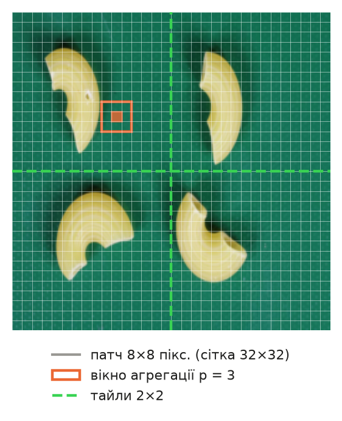

Тонкі білі лінії — сітка 32×32 (одна клітинка = 8×8 пікс.). Помаранчевий квадрат — вікно агрегації
p = 3 навколо однієї клітинки (крок 4). Зелений пунктир — поділ на тайли 2×2.

#### 4.0.5. Keras очима Java-розробника

Keras — високорівневий API над TensorFlow. Його будова добре лягає на знайомі патерни.

| Поняття Keras | Що це | Аналогія з Java |
|---|---|---|
| `keras.layers.Layer` | Об'єкт зі станом (ваги) і методом `call(x)`. Ваги створюються ліниво в `build(input_shape)`, коли стала відома форма входу | клас, що реалізує `Function<Tensor, Tensor>`, з лінивою ініціалізацією полів |
| `get_config()` + `@register_keras_serializable` | Словник аргументів конструктора, з якого шар відновлюють після `load_model` | `@JsonCreator` + реєстрація підтипу для поліморфної десеріалізації |
| `keras.Model` | Граф шарів із входами й виходами. Модель — **теж шар**, її можна вкласти в іншу модель | патерн Composite |
| Функціональний API: `keras.Input(...)`, `y = Layer()(x)`, `keras.Model(x, y)` | Спершу описуєш граф на «символьних» тензорах, рахується він пізніше | лінивий `Stream`: конвеєр описано, виконання — на термінальній операції |
| `model.compile(optimizer, loss)` | Задати, *що* мінімізувати й *чим* | налаштувати стратегії перед запуском |
| `model.fit(data, epochs, callbacks)` | Цикл навчання належить фреймворку, ти лише підключаєш хуки | Template Method / інверсія керування |
| `keras.callbacks.Callback.on_epoch_end(epoch, logs)` | Хук після епохи; `logs` — спільний змінний словник: один колбек пише, наступний читає | `ApplicationListener`; порядок реєстрації важливий |
| `keras.utils.PyDataset` | Джерело пакетів: `__len__`, `__getitem__(i)`, `on_epoch_end()` | `RandomAccess`-список пакетів + хук |
| `tf.function` | Один раз «трасує» Python-функцію в граф TensorFlow, далі виконує граф | `PreparedStatement`: компіляція раз, виконання багато разів |
| `training=True/False` | Режим виклику: Dropout і шум діють лише під час навчання | прапорець `debug`, що вмикає інструментацію |

Приклад цілого циклу — у кроці 3 (`fae.py:389-415`).

#### 4.0.6. Як міряємо якість: маски і чотири метрики

У VisA до кожного аномального фото є **маска** дефекту. Вона потрібна лише для *оцінки*: модель
масок не бачить.

- **Pixel AUROC** — головна метрика завдання. Беремо всі пікселі всіх фото як «рядки»: для test macaroni2 це
  100 × 65 536 ≈ 6,6 млн, а значення карти — як «ймовірності». Далі це звичайний ROC-AUC з ЛР1:
  ймовірність, що випадковий піксель дефекту отримав вищу оцінку, ніж випадковий нормальний піксель.
- **Pixel AP** — PR-AUC з ЛР1, теж по пікселях. Чому вона потрібна поруч, видно з числового прикладу.
  У `macaroni2` аномальних пікселів 0,029 % (`metrics.data.macaroni2.anomalous_pixel_share`), тобто
  ≈ 1 900 з 6,6 млн. Хибна тривога на 1 % нормальних пікселів — це ≈ 65 500 пікселів. Навіть якщо
  модель знайде всі 1 900 дефектних, точність буде 1 900 / (1 900 + 65 500) ≈ 3 %. ROC при цьому
  майже ідеальний: FPR = 0,01, TPR = 1. AUROC «не помічає» хибних тривог у сотнях тисяч пікселів,
  а AP помічає. Випадковий детектор має AP, що дорівнює частці позитивних, тобто ≈ 0,0003.
- **Image AUROC** — ROC-AUC по фото; оцінка фото — максимум його карти (`postprocess.py:103-105`).
- **F1** (Pixel і Image) — за порогом, обраним на розміченому val (крок 8).

Pixel AUROC і AP рахуються двома способами. Точні значення дає `sklearn`
(`metrics.py:90-103`). Швидкий спосіб — через гістограми (`metrics.py:115-202`): він потрібен для
метрик по епохах і бутстрепу, де сортувати 6,6 млн пікселів тисячу разів задорого. Тест
`test_histogram_metrics_match_sklearn` (`tests/anomaly/test_anomaly_models.py:104`) перевіряє, що
обидва способи збігаються.

---

### Крок 1. Дані VisA: розбиття, стан даних

**Що.** Завантажує архів VisA (1,93 ГБ) з офіційного S3 і перевіряє SHA-256. Розпаковує три категорії
повністю й по 50 нормальних фото з решти дев'яти. Будує розбиття, зменшує зображення до 256×256 і
рахує «паспорт» даних: кількості, дисперсію тла, площі дефектів.

**Навіщо.** Завдання вимагає «складного датасету з високою дисперсією тла або незбалансованістю».
Тут обидві властивості не декларуються, а **вимірюються** (`data_overview.py:1-11`).

**Як.** Офіційне розбиття VisA «1 клас» має лише train (норма) і test (норма + аномалії),
валідації немає. Тому кожну частину ділимо ще надвоє:

```python
# src/mllabs/anomaly/splits.py:74-83
train, val_normal = train_test_split(
    official_train, train_size=self._train_fraction, random_state=self._random_state
)
# stratify — однакова частка аномалій у val і test.
val, test = train_test_split(
    official_test,
    train_size=self._val_fraction,
    random_state=self._random_state,
    stratify=official_test["label"],
)
```

| Частина | Звідки | Склад (macaroni2) | Для чого |
|---|---|---|---|
| `train` | 85 % офіційного train | 765 норм | навчання FAE, PaDiM, PatchCore |
| `val_normal` | 15 % офіційного train | 135 норм | втрата на валідації, раннє зупинення (міток не треба) |
| `val` (розмічений) | 50 % офіційного test, стратифіковано | 50 норм + 50 аномалій | вибір конфігурації, пороги F1, метрики по епохах |
| `test` | решта 50 % | 50 норм + 50 аномалій | лише фінальна оцінка, один раз |

Чому саме так. Без розміченого val гіперпараметри довелося б обирати за втратою відновлення. А
низька втрата ≠ кращий детектор: широкий автоенкодер чудово відновить і дефект. Обирати на test
заборонено (ЛР2–3). Отже, частину офіційного test віддано у val. Чесно назвемо це: навчання
**без учителя**, а вибір конфігурації й порогів — **напівнаглядовий**, бо використовує мітки val
(`splits.py:11-12`). `validate_split` (`splits.py:97-107`) падає, якщо в train чи val_normal
потрапила аномалія або одне фото опинилося у двох частинах.

Зображення зменшуються **цілком**, без обрізання, щоб не загубити дефекти біля країв. Фото — білінійно,
маска — найближчим сусідом із бінаризацією `> 0`, бо у VisA значення маски — номер дефекту
(`images.py:42-53`). Пропорції 1500×1000 → 256×256 спотворюються, але однаково для train і test.

**Що вийшло.**

| Категорія | train | val_normal | val: норма / аномалії | test: норма / аномалії |
|---|---|---|---|---|
| macaroni2 | 765 | 135 | 50 / 50 | 50 / 50 |
| capsules | 460 | 82 | 30 / 50 | 30 / 50 |
| pcb4 | 768 | 136 | 50 / 50 | 51 / 50 |

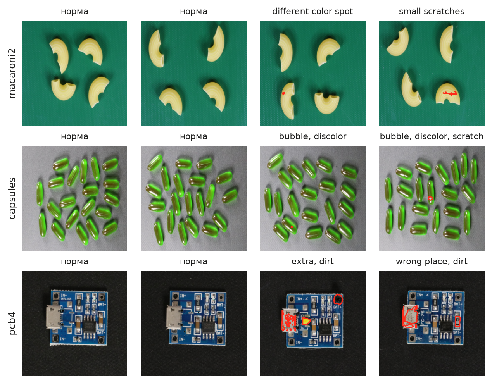

По два нормальних і два аномальних фото test кожної категорії, червоний контур — маска. Помітно,
наскільки дрібні дефекти макаронів і капсул.

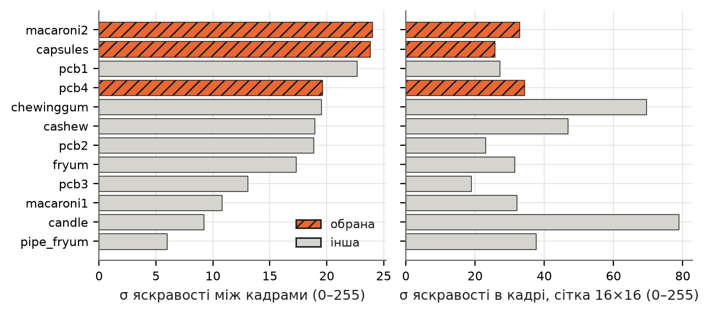

Ліва панель — σ яскравості **між кадрами** в кожному пікселі (`images.py:139-142`): наскільки сцена
змінюється від фото до фото (об'єкти лежать по-різному). Тут обрані категорії на 1-му (macaroni2,
24,0), 2-му (capsules, 23,8) і 4-му (pcb4, 19,6) місцях з 12. Права панель — σ яскравості **всередині**
кадру на сітці 16×16 (`images.py:117-136`). За нею лідирують candle (78,9) і chewinggum (69,5),
але ця міра ловить і просто контраст «об'єкт — тло». Тож головний аргумент — ліва панель.

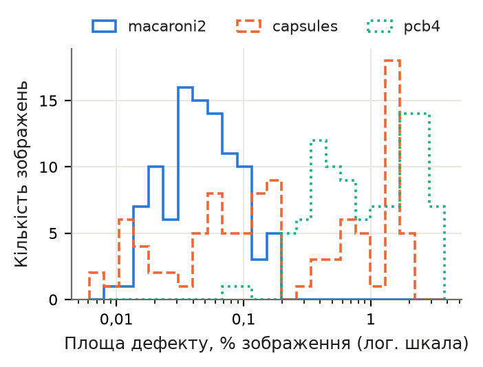

Вісь X — частка площі фото, яку займає дефект (лог. шкала), вісь Y — кількість фото. Медіани:
macaroni2 **0,047 %**, capsules 0,153 %, pcb4 0,929 % (`tables/defect_area.csv`). Переведімо в
пікселі на 256×256: це ≈ 31, 100 і 609 пікселів. **Клітинка сітки має 8 × 8 = 64 пікселі**, тож
типовий дефект макаронів удвічі менший за один патч. Це головна причина низької Pixel AP на
macaroni2 (крок 8). Жодна маска після зменшення не стала порожньою
(`metrics.data.*.masks_empty_after_resize = 0`).

**Чому VisA.** MVTec AD (класичний бенчмарк) офіційно доступний лише через форму на сайті, а
автопосилання Anomalib мертве; до того ж тло там здебільшого однорідне. У VisA є пряме посилання,
маски і категорії з кількома об'єктами у випадкових позиціях (`PLAN.md`, D1).

---

### Крок 2. Патчі та ознаки backbone (кеш)

**Що.** Проганяє всі 1 100 фото macaroni2 через три backbone і зберігає ознаки на диск. Рахує
таблицю backbone (шари, канали, параметри, GFLOPs).

**Навіщо.** Прохід backbone — найдорожча операція, а ознаки фото не залежать від головки. Їх
рахують **один раз** і далі лише читають (`features.py:1-10`). Без кешу кожне з 11 навчань у
дослідженнях заново ганяло б ResNet50 по всіх фото.

**Як.** `FeatureCache.get_or_compute` (`features.py:37-72`) пише ознаки у `float16` через
`np.lib.format.open_memmap`. Це файл на диску, з яким працюють як зі звичайним масивом, не
вантажачи його в пам'ять цілком. Поруч лежить JSON-маніфест (backbone, шари, D, список файлів, версії
TF/Keras). Якщо маніфест не збігся, кеш перераховується. Ознаки зберігаються **до** агрегації p×p:
вона дешева й робиться на льоту.

Агрегація — це середнє по вікну p×p навколо кожної клітинки. Сітка лишається 32×32, але кожен
вектор «бачить» ширшу ділянку, приблизно на 8·p пікселів більше (визначення «розміру патча» з
PatchCore):

```python
# src/mllabs/anomaly/features.py:107-112
return keras.layers.AveragePooling2D(
    self._patch_size,
    strides=1,
    padding="same",
    name=f"patch_aggregation_p{self._patch_size}",
)
```

`strides=1` — вікно зсувається на одну клітинку, тому сітка не зменшується. `padding="same"` — на
краях усереднюються лише наявні сусіди.

**Що вийшло** (`tables/backbones.csv`):

| Backbone | Шари (крок 8 + 16) | Канали | Параметри, млн | GFLOPs |
|---|---|---|---|---|
| MobileNetV2 | `block_6_expand_relu` + `block_13_expand_relu` | 768 | 0,616 | 0,595 |
| EfficientNetB0 | `block4a_expand_activation` + `block6a_expand_activation` | 912 | 0,946 | 0,714 |
| ResNet50 | `conv3_block4_out` + `conv4_block6_out` | 1536 | 8,589 | 8,211 |

ResNet50 обрізана до двох проміжних шарів, і все одно в 11,5 раза дорожча за EfficientNetB0. Крок
тривав 4,5 с, бо кеш уже існував з попереднього запуску. Перший запуск рахує ознаки хвилини.

**Чому ці три.** ResNet50 — аналог стандартного для PaDiM/PatchCore WideResNet50, якого немає в
`keras.applications`. MobileNetV2 і EfficientNetB0 — легкі мережі, орієнтовані на edge, що
важливо для ЛР5.

---

### Крок 3. Дослідження екстракторів (і перше знайомство з FAE)

**Що.** Навчає однакову FAE (p = 3, базові гіперпараметри) на ознаках кожного з трьох backbone
(macaroni2) і порівнює Pixel AUROC на розміченому val.

**Навіщо.** Частина завдання — «порівняння різних моделей-екстракторів». Детектор не кращий за
ознаки, які отримує.

**Як: модель.** Ідея FAE запозичена з DFR (Shi et al., 2021). Автоенкодер вчиться стискати вектор
нормального патча 512 → 64 і відновлювати назад. Після навчання на нормі він добре відновлює
«знайомі» вектори й погано — незнайомі. Аналогія — кодек із втратами, налаштований лише на нормальні
картинки: нетипову картинку він стисне погано. **Помилка відновлення** патча (середній квадрат
різниці по 512 каналах) і є його оцінкою аномальності.

```python
# src/mllabs/anomaly/fae.py:116-123
inputs = keras.Input((None, None, settings.feature_dim), name="normalized_features")
hidden = keras.layers.GaussianNoise(settings.input_noise, name="input_noise")(inputs)
hidden = dense(settings.hidden, "leaky_relu", "encoder_hidden")(hidden)
hidden = keras.layers.Dropout(settings.dropout, name="dropout")(hidden)
latent = dense(settings.latent, None, "latent")(hidden)
hidden = dense(settings.hidden, "leaky_relu", "decoder_hidden")(latent)
outputs = dense(settings.feature_dim, None, "reconstruction")(hidden)
return keras.Model(inputs, outputs, name=CORE_NAME)
```

Вхід має форму `(None, None, 512)`: висота й ширина не задані. `Dense` у Keras діє на **останню
вісь**, тобто однаково на кожну клітинку. Тому та сама модель навчається на окремих векторах
(кожен подано як «карту» 1×1, `fae.py:185`) і застосовується до цілої карти 32×32. Згортка 1×1
робила б те саме. `GaussianNoise` і `Dropout` активні лише в режимі навчання; у базовій конфігурації
обидва нульові.

Ядро загорнуте в **головку** — модель, що приймає сирі ознаки й повертає карту помилок:

```python
# src/mllabs/anomaly/fae.py:133-139
features = keras.Input((None, None, self._settings.feature_dim), name="features")
normalized = keras.layers.Normalization(mean=mean, variance=variance, name="normalization")(
    features
)
reconstruction = core(normalized)
errors = PatchReconstructionError(name="reconstruction_error")([reconstruction, normalized])
return keras.Model(features, errors, name="fae_head")
```

`Normalization` переводить кожен канал у z-оцінку («скільки σ від середнього»). Середнє й дисперсію
пораховано **лише на train** (`fae.py:384`, функція `channel_statistics` у `fae.py:433-446`), як
`StandardScaler` у ЛР1. Без нормалізації канали з великими значеннями домінували б у MSE.
`PatchReconstructionError` (`fae.py:80-87`) — власний шар: `mean((відновлене − вхід)²)` по каналах.
Вихід головки — `(B, 32, 32)`.

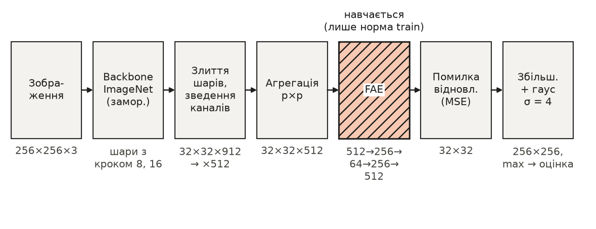

Схема конвеєра з розмірностями для обраної конфігурації. Навчається лише заштрихований блок FAE,
backbone заморожено. Шари й параметри (`tables/model_architecture.csv`):

| Шар | Вихід | Параметри |
|---|---|---|
| `normalization` | 512 | 0 (середні/дисперсії не навчаються) |
| `encoder_hidden` (Dense, LeakyReLU) | 256 | 131 328 = 512·256 + 256 |
| `latent` (Dense) | 64 | 16 448 |
| `decoder_hidden` (Dense, LeakyReLU) | 256 | 16 640 |
| `reconstruction` (Dense) | 512 | 131 584 |
| **Разом** | | **296 000** |

**Як: навчання.**

```python
# src/mllabs/anomaly/fae.py:389-415 (скорочено)
core.compile(optimizer=keras.optimizers.Adam(settings.learning_rate), loss="mse")
...
all_callbacks = [ReconstructionMseCallback(core, train_sample, validation)]
if metrics_factory is not None:
    all_callbacks.append(metrics_factory(head))
all_callbacks.extend(callbacks or [])
all_callbacks.append(keras.callbacks.EarlyStopping(
    monitor="val_mse", mode="min", patience=settings.patience, restore_best_weights=True))
history = core.fit(
    RandomVectorDataset(train_vectors, mean, std, settings, self._seed),
    epochs=settings.max_epochs, callbacks=all_callbacks, verbose=0)
```

Розбір по рядку:

- `compile` — мінімізувати MSE оптимізатором Adam із кроком 0,001. Ціль автоенкодера — його ж вхід
  (`return batch, batch`, `fae.py:186`).
- `RandomVectorDataset` (`fae.py:142-191`) — на кожну епоху нові випадкові 25 000 векторів із
  783 360 векторів train (765 фото × 1024 клітинки), пакетами по 512. Зерно — `seed + номер епохи`,
  тож запуск відтворюваний. Так епоха коротка, а за 60 епох модель бачить різні вектори.
- `ReconstructionMseCallback` після кожної епохи рахує **однакову** MSE на фіксованих 20 000
  векторах train і 20 000 векторах val_normal (`fae.py:227-240`). Чому не взяти втрату Keras — у
  кроці 5.
- `EpochMetricsCallback` (`fae.py:258-308`) рахує Pixel AUROC, Pixel AP, Image AUROC на розміченому
  val. Для train він пише 99-й перцентиль оцінок патчів: AUROC на train не визначений, бо там лише
  норма.
- `EarlyStopping` — зупинитися, якщо `val_mse` не покращується 5 епох, і відновити найкращі ваги.
  Він читає `val_mse` з `logs`, тому стоїть **після** колбека, що цей ключ пише (`fae.py:393-394`).

Карту патчів 32×32 потім збільшують до 256×256 і згладжують гаусовим ядром σ = 4 пікс., як у
PaDiM/PatchCore (`postprocess.py:53-66`). Згладжування прибирає «сходинки» сітки й поодинокі
шумові піки. Ядро сепарабельне: замість одного 2-D вікна 33×33 — два 1-D проходи (по стовпцях, потім
по рядках). Краї доповнюються дзеркально (`REFLECT`), щоб нулі не «затемнювали» межі. Усе зроблено
операціями TensorFlow, а не SciPy, щоб крізь пост-обробку проходив градієнт (ЛР5).

**Що вийшло** (`tables/study_backbones.csv`, val, macaroni2, p = 3):

| Backbone | Pixel AUROC | Pixel AP | Image AUROC | Latency backbone, мс |
|---|---|---|---|---|
| MobileNetV2 | 0,964 | 0,011 | 0,794 | 12,3 |
| **EfficientNetB0** | **0,973** | 0,017 | 0,737 | 16,5 |
| ResNet50 | 0,964 | 0,017 | 0,686 | 33,4 |

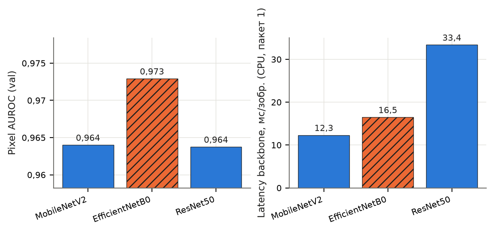

Ліва панель — Pixel AUROC на val (вісь Y обрізана, щоб різниці в тисячних було видно), права —
latency backbone. Обрано EfficientNetB0: відрив 0,009 більший за допуск нічиєї 0,002. Найдорожча
ResNet50 не дала переваги. Image AUROC ранжує backbone інакше (MobileNetV2 найкраща), але вибір іде
за головною метрикою.

**Чому FAE, а не інше.** Альтернативи з `PLAN.md` (D6): згортковий автоенкодер на пікселях слабкий
на складному тлі й дорогий на CPU. Student–Teacher (STFPM) потребує годин навчання CNN на CPU. Гаусова
модель ознак — це вже PaDiM, тобто еталон, а не власна мережа. FAE — справжня мережа з втратами
train/val, дешева, з константною пам'яттю, а її помилка відновлення — саме той сигнал, з яким
працюватиме ЛР5.

---

### Крок 4. Дослідження розміру патча

**Що.** На ознаках EfficientNetB0 навчає FAE з агрегацією p ∈ {1, 3, 5}. Потім для найкращого p —
варіант із тайлами 2×2.

**Навіщо.** Розмір патча — це компроміс. Більше вікно дає більше контексту, але «розмиває» дрібні
дефекти. Тайли дають удвічі вищу роздільність (кожна чверть фото окремо збільшується до 256×256),
але вчетверо дорожчі.

**Як.** `run_patch_sizes` (`studies.py:236-255`) змінює лише `patch_size`. Варіант p = 3 уже
навчено в кроці 3, тож його не повторюють, лише перепідписують (`_reuse_or_run`, `studies.py:294-298`).
Тайли: зображення 512×512 → 4 тайли 256×256 → ознаки кожного → склеєна карта 64×64
(`TileSplit` і `TileMerge`, `backbones.py:187-240`). Метрики завжди рахуються на сітці 256×256, щоб
порівнювати однакові пікселі. Правило вибору — `select_best`:

```python
# src/mllabs/labs/lab04/studies.py:178-181
def select_best(runs: Sequence[FaeRun], tolerance: float) -> FaeRun:
    """Найкращий за Pixel AUROC на val; при нічиїй (< ``tolerance``) — перший у переліку."""
    best = max(run.val_pixel_auroc for run in runs)
    return next(run for run in runs if run.val_pixel_auroc >= best - tolerance)
```

Переліки впорядковано «від простішого»: дешевший backbone, менший p, без тайлів. Тому за різниці,
меншої за 0,002, перемагає простіший. 0,002 — приблизно півширина ДІ на val (`config.py:121-122`):
дрібніші різниці — шум.

**Що вийшло** (`tables/study_patch_size.csv`):

| Варіант | Pixel AUROC | Pixel AP | Image AUROC | Час, с |
|---|---|---|---|---|
| **p = 1** | **0,981** | **0,028** | 0,754 | 74 |
| p = 3 | 0,973 | 0,017 | 0,737 | 75 |
| p = 5 | 0,960 | 0,012 | 0,694 | 73 |
| p = 1, тайли 2×2 | 0,980 | 0,015 | 0,632 | 123 |

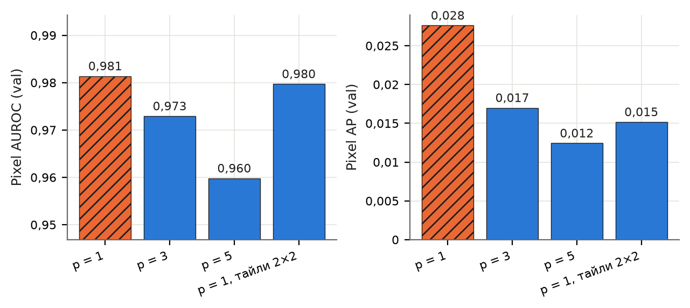

Що менше вікно, то краще: p = 1 перемагає за обома піксельними метриками. Це узгоджується з кроком 1,
бо дефекти macaroni2 менші за клітинку, і усереднення з сусідами їх розчиняє. Тайли майже
наздогнали p = 1 за AUROC (різниця 0,0017 < 0,002), але Pixel AP і Image AUROC у них гірші, а
навчання на 66 % довше. Обрано p = 1 без тайлів.

**Чому так.** Альтернатива — вища вхідна роздільність без тайлів, але тоді змінилися б і сітка, і
рецептивне поле backbone. Тайли — типова практика для інспекції фото високої роздільності, і саме
це «розбиття на патчі» в буквальному сенсі просить завдання.

---

### Крок 5. Дослідження регуляризації

**Що.** Від бази (EfficientNetB0, p = 1, k = 64, без Dropout, L2 і шуму) змінює **по одному**
фактору: латент k ∈ {16, 256}, Dropout 0,2, L2 = 1e-4, шум входу σ = 0,2.

**Навіщо.** Регуляризація бореться з перенавчанням. Для автоенкодера-детектора є ще й специфічний
ризик: занадто «здібна» модель навчиться відновлювати *будь-що*, зокрема дефекти. Тоді помилка
відновлення перестане їх розрізняти. Ширина латенту k — головний регулятор цієї здібності.

**Як.** `run_regularization` (`studies.py:257-282`) будує варіанти через `replace(settings, latent=k)`
тощо. Кожен — окреме навчання з тим самим seed. Це **жадібний координатний пошук**: кожне з
досліджень 3→4→5 стартує з найкращого варіанта попереднього. Він дешевий (11 навчань замість
повної сітки), але пропускає взаємодії факторів. Приклад такої взаємодії — у кроці 9.

**Що вийшло** (`tables/study_regularization.csv`, `metrics.studies.regularization`):

| Варіант | Pixel AUROC | Pixel AP | Image AUROC | Розрив `val_mse − train_mse` |
|---|---|---|---|---|
| **база (k = 64)** | **0,9814** | 0,0276 | 0,754 | −0,00045 |
| латент k = 16 | 0,9799 | 0,0240 | 0,739 | −0,00178 |
| латент k = 256 | 0,9820 | 0,0284 | 0,794 | −0,00019 |
| Dropout 0,2 | 0,9793 | 0,0259 | 0,778 | −0,00059 |
| L2 = 0,0001 | 0,9797 | 0,0246 | 0,754 | −0,00056 |
| шум σ = 0,2 | 0,9803 | 0,0253 | 0,771 | −0,00048 |

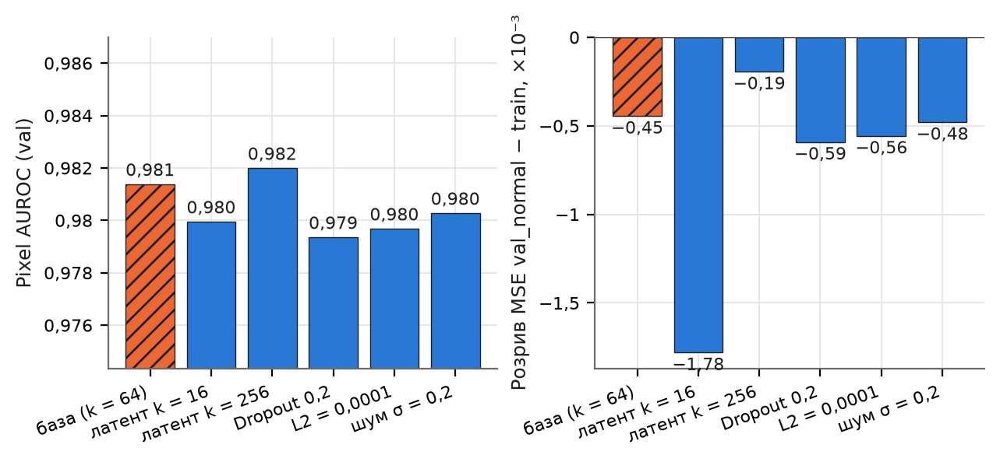

Ліва панель — Pixel AUROC на val, права — розрив MSE val_normal − train у тисячних.

Усі шість варіантів лежать у смузі 0,9793–0,9820, тобто в межах 0,0027. k = 256 найкращий на
0,0006, що менше за допуск 0,002, тож обрано базу. Розрив скрізь мізерний (|Δ| < 0,002 при MSE
≈ 0,09) і навіть від'ємний: на val_normal відновлення трохи *краще*, ніж на train. **Перенавчання
немає, тож регуляризаторам нема з чим боротися.** Це чесний результат, а не провал дослідження:
783 тис. векторів train проти 296 тис. параметрів — модель не здатна їх «зазубрити».

Окремо: Image AUROC у k = 256 помітно вищий (0,794 проти 0,754). Вибір іде лише за Pixel AUROC,
тож ця перевага не врахована. Інший критерій дав би інший вибір.

**Урок 1: втрату Keras у режимі навчання не можна порівнювати з валідаційною.** Під час `fit` Keras
пише в історію `loss` — втрату на пакетах **у режимі навчання**: з увімкненим шумом, Dropout і з
доданим штрафом L2. Валідаційна втрата рахується без них. Подивимося на 60-ту епоху
(`tables/training_history.csv`):

| Варіант | `loss` Keras (режим навчання) | `train_mse` (колбек) | `val_mse` (колбек) |
|---|---|---|---|
| L2 = 0,0001 | 0,137 | 0,0958 | 0,0953 |
| Dropout 0,2 | 0,122 | 0,0989 | 0,0984 |

Якщо рахувати розрив як «`val_loss` − `loss`», для L2 вийде −0,042. Виглядає так, ніби модель на
валідації в рази краща, ніж на train, але це просто доданок L2 і шум Dropout, а не якість. Тому
`ReconstructionMseCallback` рахує **обидві** величини однаково: прогін `training=False`, чиста MSE
без штрафу, фіксовані підвибірки (`fae.py:199-240`). Розрив `val_mse − train_mse` — чесна міра
перенавчання. Це той самий принцип, що й в історії з `TargetEncoder` у ЛР2 (розділ 4.9): міряти
train і val **в однакових умовах**. Тест `test_training_history_has_comparable_losses`
(`tests/labs/test_lab04_lab.py:243`) перевіряє, що обидві колонки є в історії.

**Урок 2: раннє зупинення так і не спрацювало.** У першій версії було 30 епох по 50 тис. векторів.
Найкраща епоха щоразу дорівнювала максимуму, і зупинка не спрацювала в жодному з 13 навчань
(`config.py:112-116`). Тому зробили 60 епох по 25 тис.: стільки ж векторів, але зупинка мала б шанс.
Не допомогло: в усіх 11 навчаннях досліджень і 2 фінальних пройдено всі 60 епох. Найкраща епоха —
60 скрізь, крім EfficientNetB0 з p = 3, де вона 58-ма (`tables/study_runs_full.csv`). `val_mse`
повільно, але монотонно падає до кінця. Висновок: модель **недонавчена** відносно бюджету, а не
перенавчена, і `patience = 5` ні на що не вплинула. У Keras 3.15 `restore_best_weights=True`
відновлює найкращі ваги в кінці навчання навіть без зупинки (перевірено в
`keras/src/callbacks/early_stopping.py`, метод `on_train_end`). Тож для EfficientNetB0 з p = 3
взято ваги 58-ї епохи.

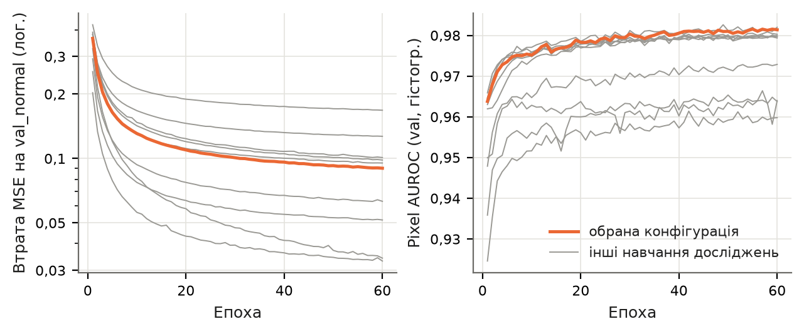

Ліва панель — `val_mse` по епохах (лог. шкала), права — Pixel AUROC на val (гістограмний).
Помаранчева — обрана конфігурація, сірі — решта навчань. Жодна крива MSE не розвертається вгору.
AUROC після ≈ 20-ї епохи майже не росте: подальше навчання покращує відновлення, але не детекцію.

---

### Крок 6. Навчання фінальної моделі (3 категорії)

**Що.** Переносить обрану конфігурацію (EfficientNetB0, p = 1, k = 64, без регуляризаторів) на
capsules і pcb4 **без повторного підбору**. Для macaroni2 бере вже навчену в дослідженні модель.
Зберігає історію навчання, таблицю архітектури й схему.

**Навіщо.** Перевірити, чи узагальнюється вибір, зроблений на одній категорії. Підбирати
гіперпараметри для кожної категорії окремо — утричі дорожче і з більшим ризиком «підігнати під val».

**Як.** `FinalTrainer.train_all` (`final_training.py:33-42`): для `study_category` —
`replace(selected, variant=...)` (лише нова назва), для інших — `experiment.run(...)`.

**Що вийшло** (`metrics.training`):

| Категорія | Епох | Найкраща | `train_mse` | `val_mse` | Pixel AUROC (val) | Image AUROC (val) | Час, с |
|---|---|---|---|---|---|---|---|
| macaroni2 | 60 | 60 | 0,0905 | 0,0901 | 0,981 | 0,754 | 74 |
| capsules | 60 | 60 | 0,1419 | 0,1421 | 0,945 | 0,793 | 65 |
| pcb4 | 60 | 60 | 0,0875 | 0,0895 | 0,959 | 0,914 | 75 |

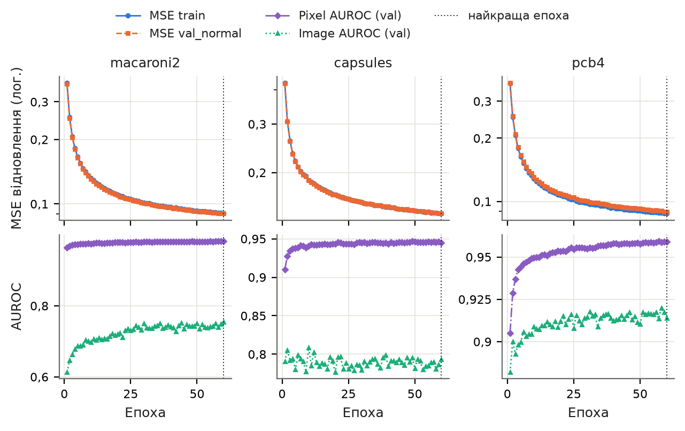

Верхній ряд — MSE train (суцільна) і val_normal (пунктир) по епохах; вони майже збігаються.
Нижній — Pixel AUROC і Image AUROC на val. Пунктирна вертикаль — найкраща епоха, скрізь остання.
На capsules Image AUROC не росте з навчанням і коливається навколо 0,79, хоча Pixel AUROC і MSE
покращуються.

---

### Крок 7. SOTA: PaDiM і PatchCore (реімплементації)

**Що.** Навчає дві класичні головки на **тих самих** ознаках (EfficientNetB0, p = 1) і рахує їхні
карти на val і test. Окремо рахує Pixel AUROC на val для всіх дев'яти пар «головка × backbone»
(для графіка вартості в кроці 9).

**Навіщо.** Завдання просить порівняння з SOTA (Anomalib: PaDiM, PatchCore). Чесне порівняння — «за
інших рівних». Якщо backbone, розбиття, пост-обробка й метрики однакові, різниця якості пояснюється
саме головкою.

**Чому реімплементації, а не Anomalib.** Anomalib — це PyTorch: +1,1 ГБ залежностей, другий
фреймворк, ризик конфлікту OpenMP з TF в одному процесі. Він використовує інші backbone (WRN50) і
свій конвеєр. Тоді порівнювалися б *конвеєри*, а не головки (`PLAN.md`, D9). Тому обидва
алгоритми відтворено за статтями (≈ 100–170 рядків кожен) і чесно названо реімплементаціями.
Опубліковані числа — лише довідка (крок 8): інший backbone, роздільність, розбиття на повному test.
Обидві головки реалізують той самий інтерфейс `PatchScorer`, що й FAE (`detector.py:30-43`).

**PaDiM на пальцях.** Для кожної з 1024 позицій сітки збираємо вектори цієї позиції з усіх 765
фото train. Вважаємо, що вони розподілені нормально, і рахуємо середнє μ та коваріацію Σ.
Коваріація — матриця «як канали змінюються разом». Щоб матриці були невеликими, беремо випадкові
d = 100 каналів з 512, як у статті. Нова клітинка оцінюється **відстанню Махаланобіса**
√((x − μ)ᵀ Σ⁻¹ (x − μ)). Це «на скільки стандартних відхилень вектор далекий від звичайного для цього
місця вигляду» з урахуванням кореляцій. Для одного каналу це просто |x − μ| / σ, тобто z-оцінка.

```python
# src/mllabs/anomaly/padim.py:95-101
chunk = np.asarray(flat[:, start : start + _POSITION_CHUNK][..., channels], np.float64)
chunk_mean = chunk.mean(axis=0)
centered = chunk - chunk_mean
covariance = np.einsum("npi,npj->pij", centered, centered) / max(n_images - 1, 1)
covariance += self._epsilon * np.eye(len(channels))
mean[start : start + len(chunk_mean)] = chunk_mean
inverse[start : start + len(chunk_mean)] = np.linalg.inv(covariance)
```

`einsum("npi,npj->pij", ...)` читається так: «для кожної позиції p підсумуй по фото n добутки
каналів i та j». Це коваріаційна матриця 100×100 на кожну позицію. `+ ε·I` (ε = 0,01) гарантує
оборотність матриці. Слабке місце PaDiM: він прив'язаний до **позиції**. Якщо об'єкти лежать
щоразу інакше (macaroni2, capsules), «звичайний вигляд клітинки (5, 7)» — це суміш тла й
макаронів, і гаусіан погано її описує.

**PatchCore на пальцях.** Кладемо в «банк пам'яті» всі вектори нормальних патчів train
(783 360). Оцінка нового патча — відстань до **найближчого** вектора банку: якщо такого вигляду серед
норми не траплялося, відстань велика. Позиція не важлива, тому зсунуті об'єкти не заважають.
Проблема — розмір: шукати найближчого серед 783 тис. для кожного з 1024 патчів задорого. Тому банк
проріджують **жадібним k-center coreset** до 1 %. Перша точка випадкова, далі щоразу додається
вектор, *найдальший* від уже обраних. Так 7 834 вектори рівномірно покривають увесь «простір
норми».

```python
# src/mllabs/anomaly/patchcore.py:62-69
selected = tf.TensorArray(tf.int32, size=count)
selected = selected.write(0, tf.cast(start, tf.int32))
min_distance = squared_distance(start)
for step in tf.range(1, count):  # у tf.function цикл по tf.range стає графовим циклом
    index = tf.cast(tf.argmax(min_distance), tf.int32)
    selected = selected.write(step, index)
    min_distance = tf.minimum(min_distance, squared_distance(index))
return selected.stack()
```

`min_distance[i]` — відстань від точки i до найближчої вже обраної. Відстань рахується як
‖x‖² − 2·x·c + ‖c‖²: одне множення матриці на вектор (`patchcore.py:56-60`). Для швидкості вектори
перед coreset проєктуються випадковою матрицею 512 → 128 (проєкція Джонсона–Лінденштраусса: відстані
зберігаються приблизно, `patchcore.py:40-44`). У банк кладуться **оригінальні** 512-вимірні вектори.
Перезважування оцінки за сусідами зі статті вимкнено (`patchcore.py:9`).

**Що вийшло** (`metrics.sota_fit`): PaDiM навчається за 1,7–3,1 с і займає 39,5 МБ (середні +
обернені коваріації 1024 × 100 × 100). PatchCore — 14–36 с, банк 15,3 МБ
для macaroni2 і pcb4, 9,2 МБ для capsules (менше фото train).

---

### Крок 8. Оцінка на test

**Що.** Для кожного методу й категорії: пороги з val → метрики test → бутстреп-ДІ → парні різниці
«FAE − еталон». Зберігає прогнози з позначками TP/FP/FN/TN і детектори для ЛР5.

**Навіщо.** Це єдине місце, де торкаємося test, і лише для фіксованого переліку з трьох моделей.

**Як.**

```python
# src/mllabs/labs/lab04/evaluation.py:108-121
val_scores = image_scores(maps.val_maps)
threshold_image = self._selector.select(truth.val_labels, val_scores)
threshold_pixel = self._selector.select(
    truth.val_masks.reshape(-1), maps.val_maps.reshape(-1)
)
test_scores = image_scores(maps.test_maps)
metrics = self._calculator.evaluate(
    maps.test_maps,
    truth.test_masks,
    truth.test_labels,
    test_scores,
    threshold_image,
    threshold_pixel,
)
```

`F1ThresholdSelector` — той самий клас з ЛР2 (`src/mllabs/modeling/thresholds.py:17`). Він обирає
поріг із максимальним F1, але тепер на розміченому val, і застосовує до test без змін. Порогів два:
для оцінки фото й для пікселя. Карти різних методів мають різні одиниці (MSE у FAE, «сигми» в
PaDiM, відстань у PatchCore), тому кожен має свої пороги.

Бутстреп-ДІ рахується **по зображеннях**, а не по пікселях: пікселі одного фото сильно залежні, і
перевибірка пікселів дала б оманливо вузькі ДІ. Усі методи оцінюються на **однакових** перевибірках
(генератор з тим самим зерном, `metrics.py:239-245`), тому різниці парні, як у ЛР2.

**Що вийшло** (`tables/test_metrics.csv`):

| Категорія | Метод | Image AUROC | Pixel AUROC | Pixel AP | Pixel F1 | Image F1 |
|---|---|---|---|---|---|---|
| macaroni2 | **FAE** | 0,763 | 0,981 | 0,036 | 0,079 | 0,676 |
| | PaDiM | 0,553 | 0,950 | 0,004 | 0,011 | 0,690 |
| | PatchCore | 0,826 | 0,985 | 0,071 | 0,110 | 0,775 |
| capsules | **FAE** | 0,799 | 0,966 | 0,369 | 0,460 | 0,771 |
| | PaDiM | 0,583 | 0,925 | 0,054 | 0,129 | 0,709 |
| | PatchCore | 0,821 | 0,984 | 0,589 | 0,595 | 0,770 |
| pcb4 | **FAE** | 0,960 | 0,971 | 0,202 | 0,289 | 0,920 |
| | PaDiM | 0,953 | 0,972 | 0,207 | 0,241 | 0,889 |
| | PatchCore | 0,998 | 0,983 | 0,317 | 0,384 | 0,969 |

Середні по трьох категоріях (`metrics.test.*.mean`): Pixel AUROC FAE 0,973, PaDiM 0,949,
PatchCore 0,984; Pixel AP — 0,202 / 0,088 / 0,326.

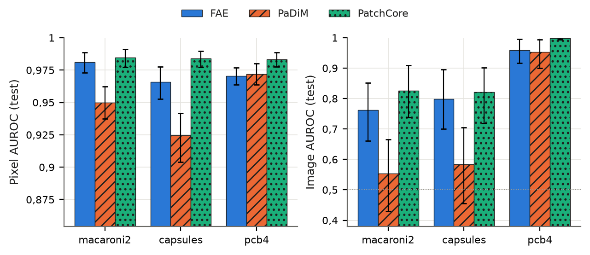

Стовпці — значення на test, вуса — 95 % бутстреп-ДІ. Пунктир на правій панелі — Image AUROC 0,5
(вгадування). ДІ Image AUROC широкі: усього 50 аномальних фото на категорію. Для FAE на macaroni2
це [0,661; 0,852].

Парні різниці (`tables/sota_bootstrap.csv`; «так» — 95 % ДІ не містить нуля):

| Категорія | FAE − PaDiM, Pixel AUROC | FAE − PatchCore, Pixel AUROC | FAE − PatchCore, Pixel AP |
|---|---|---|---|
| macaroni2 | +0,031 [0,021; 0,041] так | −0,003 [−0,009; 0,002] ні | −0,035 [−0,080; −0,019] так |
| capsules | +0,041 [0,024; 0,060] так | −0,018 [−0,028; −0,010] так | −0,220 [−0,280; −0,149] так |
| pcb4 | −0,001 [−0,011; 0,007] ні | −0,013 [−0,022; −0,005] так | −0,116 [−0,181; −0,062] так |

Як читати. FAE достовірно краща за PaDiM там, де об'єкти лежать по-різному (macaroni2, capsules).
На pcb4 (плата завжди на одному місці) вони рівні: це «рідна» умова PaDiM. PatchCore достовірно
краща за FAE за Pixel AP у всіх трьох категоріях. За Pixel AUROC на macaroni2 різниця з PatchCore
не доведена.

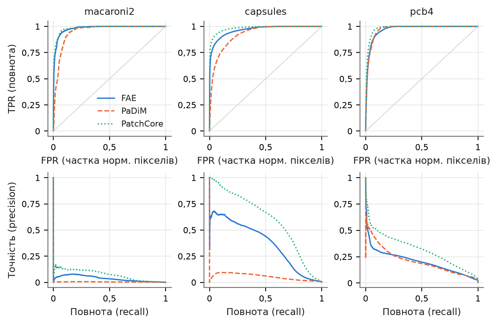

Верхній ряд — піксельні ROC-криві (X — частка нормальних пікселів із хибною тривогою, Y — частка
знайдених пікселів дефекту), нижній — PR-криві. Що вище й лівіше ROC і що вище PR, то краще. На
macaroni2 ROC усіх трьох методів притиснуті до кута, а PR лежать біля нуля. Це і є ситуація з
розділу 4.0.6.

**Чому Pixel AP на macaroni2 така низька.** Три причини складаються:
1. Частка аномальних пікселів 0,029 %, тож випадковий рівень AP ≈ 0,0003. FAE з 0,036 — приблизно
   у 120 разів вище за випадковий, PatchCore з 0,071 — у ≈ 250. Низька абсолютна величина —
   властивість даних, а не лише моделі.
2. Медіанний дефект (≈ 31 пікс.) менший за клітинку 8×8. Після збільшення 32 → 256 і гаусового
   згладжування σ = 4 пляма підозри завжди ширша за дефект. Кожен «зайвий» піксель навколо —
   хибна тривога.
3. Неоднорідне тло (текстура, тіні) дає піки на нормальних ділянках.

Опублікована PaDiM на macaroni2 теж має Pixel AP 0,008 при Pixel AUROC 0,956 (Zou et al., Table 8),
тож це не артефакт нашої реалізації.

**Незручна правда про Image F1.** Якщо оголосити аномальними *всі* фото test, F1 = 0,667 на
macaroni2 (50/50), 0,769 на capsules (50 аномалій з 80) і 0,662 на pcb4. FAE дає 0,676 / 0,771 /
0,920. Отже, на macaroni2 і capsules Image F1 FAE практично дорівнює тривіальній стратегії. Із
`tables/test_predictions.csv`: на macaroni2 FAE позначила аномальними 42 з 50 нормальних фото (FP),
PaDiM — 45 з 50. Причина: при слабкому Image AUROC поріг із максимальним F1 на val «сповзає» вниз,
бо F1 не винагороджує правильні «норма» (TN). На pcb4, де Image AUROC 0,96, Image F1 змістовна.
Тому дивимося на AUROC/AP, а F1 сприймаємо як «що вийде з цим порогом».

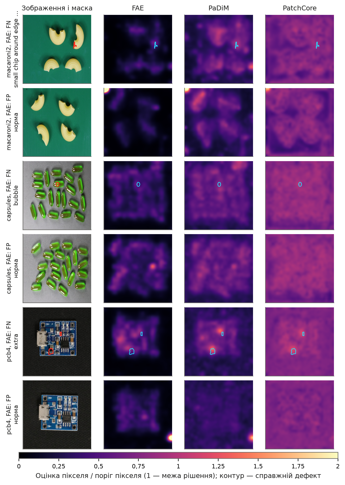

По два фото на категорію: пропущена аномалія FAE (FN) з найбільшою площею дефекту і найвпевненіша
хибна тривога (FP) (`evaluation.py:252-272`). Колонки — фото з маскою і карти трьох методів, поділені
на поріг пікселя свого методу. 1 — межа рішення, блакитний контур — справжній дефект. Видно:
- FN macaroni2 («small chip around edge»): дефект на краю макаронини, жоден метод не підсвітив його
  вище порога.
- FP macaroni2 і FP pcb4: найяскравіша точка карти FAE (і PaDiM) — **у кутку кадру**, далеко від
  об'єкта. Причину тут не встановлено. Аналіз «гарячих кутів» заплановано в ЛР5 (`labs/lab05/PLAN.md`,
  R4).

**Опубліковані числа — лише довідка** (`tables/published_reference.csv`, `tables/sota_benchmark.csv`).
PaDiM у Zou et al. (ECCV 2022, Tables 7–8): Pixel AUROC 0,956 / 0,838 / 0,884; у нас 0,950 / 0,925 /
0,972. PatchCore (CCAD, Table 8, WRN50): Image AUROC 0,472 / 0,688 / 0,697; у нас 0,826 / 0,821 /
0,998. Розбіжність у рази пояснюється різними протоколами: інший backbone і роздільність, повний
офіційний test замість нашої половини. Навіть між статтями PatchCore на macaroni2 «гуляє» від
≈ 0,47 до ≈ 0,78 (`PLAN.md`, D9). Тому порівнюємо лише якісно, а прямий висновок робимо з наших
реімплементацій.

---

### Крок 9. Профілювання FLOPs і latency

**Що.** Для всіх 9 пар «головка × backbone» рахує FLOPs, параметри, пам'ять і latency. Будує графік
«якість — вартість» із фронтом Парето.

**Навіщо.** Друга половина мети: компроміс точності й обчислювальної складності. Для edge-пристрою
питання не «хто точніший», а «хто найточніший у межах 30 мс і 10 МБ».

**Як: FLOPs.** Рахуються профайлером TensorFlow:

```python
# src/mllabs/anomaly/profiling.py:45-51
function = tf.function(lambda inputs: model(inputs, training=False))
concrete = function.get_concrete_function(tf.TensorSpec(tuple(input_shape), tf.float32))
frozen = convert_variables_to_constants_v2(concrete)
options = option_builder.ProfileOptionBuilder.float_operation()
options["output"] = "none"  # без друку таблиці в консоль
profile = model_analyzer.profile(graph=frozen.graph, options=options)
return int(profile.total_float_ops)
```

Модель Keras 3 виконується «на льоту» (eager), а профайлеру потрібен статичний граф. Тому
`tf.function` трасує модель у граф для конкретної форми входу `(1, 256, 256, 3)`: FLOPs згорток
залежать від розмірів. `convert_variables_to_constants_v2` «заморожує» граф: змінні-ваги стають
константами, і граф стає самодостатнім. Профайлер підсумовує операції з рухомою комою за правилом
**FLOPs = 2 × MAC** (множення + додавання).

Перевірка на пальцях для FAE. Шар `Dense` in → out робить in·out MAC на позицію, тобто 2·in·out
FLOPs. На позицію: 2·(512·256 + 256·64 + 64·256 + 256·512) = 589 824. На 1024 позиції —
**0,604 GFLOPs** (аналітично, `fae.py:449-453`). Профайлер дав **0,608**
(`metrics.profiling.fae_gflops_profiler`). Різниця 0,6 % — зсуви, активації, нормалізація й
обчислення помилки, яких формула не враховує. Для PaDiM і PatchCore FLOPs головки рахуються
аналітично (`profiling_study.py:87-110`): PaDiM — (2d² + 2d) на позицію, PatchCore — 2·M·D (скалярний
добуток із кожним із M векторів банку). FLOPs від пристрою не залежать.

**Як: latency.** Лише CPU (Apple M1 Pro, 10 ядер). `tensorflow-metal` несумісний із TF 2.21, імпорт
TF із ним падає, тож GPU для TensorFlow тут немає (`metrics.profiling.device.gpu_available = false`).
Протокол (`profiling.py:81-93`): 5 прогрівальних запусків (трасування графа, кеші), потім 30
вимірювань для пакета 1 і 10 для пакета 16. Записуються медіана й p90 у мс **на одне зображення**.

Кількість потоків TensorFlow можна задати лише **до першої операції** в процесі (`runtime.py:16-33`).
Тому кожен режим потоків міряється в **окремому процесі**:

```python
# src/mllabs/anomaly/profiling.py:179-181
context = multiprocessing.get_context("spawn")
with ProcessPoolExecutor(max_workers=1, mp_context=context) as pool:
    return pool.submit(_latency_worker, job).result()
```

`spawn` запускає чистий інтерпретатор (як нова JVM), а не копію поточного процесу. Перше, що
робить робітник, — `configure_tf_threads` (`profiling.py:213-214`). Режими: 1 потік (наближення до
слабкого edge-пристрою) і всі ядра. Ваги в робітнику випадкові: швидкість залежить від форм тензорів,
а не від значень (`profiling.py:13-14`). Розмір банку PatchCore взято з навченої моделі (7 834).

**Що вийшло** (`tables/flops.csv`, `metrics.profiling`, наскрізно «зображення → карта», медіана):

| Backbone + головка | GFLOPs | Пам'ять головки, МБ | Latency, мс (усі ядра, пакет 1) | 1 потік | пакет 16, мс/зобр. |
|---|---|---|---|---|---|
| EfficientNetB0 + **FAE** | 1,32 | 1,1 | 20,6 | 56,3 | 10,1 |
| EfficientNetB0 + PaDiM | 0,73 | 39,5 | 19,3 | 51,4 | 9,5 |
| EfficientNetB0 + PatchCore | 8,93 | 15,3 | 33,7 | 154,1 | 22,8 |
| MobileNetV2 + FAE | 1,20 | 1,1 | 16,6 | 43,8 | 7,7 |
| ResNet50 + FAE | 8,82 | 1,1 | 38,0 | 149,0 | 22,4 |
| ResNet50 + PatchCore | 16,43 | 15,3 | 51,8 | 246,5 | 33,6 |

Декодування JPG і зменшення до 256 — ще 7,1 мс на фото (`metrics.profiling.decode_resize_ms`).

Що з цього видно:
- **Головка PatchCore дорожча за весь backbone**: 8,21 GFLOPs проти 0,71 в EfficientNetB0. Пошук
  сусіда — це 1024 × 7 834 скалярних добутки довжини 512. Головка FAE — 0,61 GFLOPs, PaDiM —
  0,02 GFLOPs.
- **FLOPs ≠ latency.** ResNet50 у 11,5 раза «важча» за EfficientNetB0 за FLOPs, але повільніша лише
  вдвічі (33,4 проти 16,5 мс backbone). Ймовірна причина — архітектура EfficientNet: depthwise-згортки
  й поелементні операції мають мало FLOPs, але погано завантажують CPU. Тут це не досліджувалося.
- **Потоки:** перехід з 1 потоку на 10 ядер прискорює FAE + EfficientNetB0 лише в 2,7 раза. Частина
  операцій погано паралелиться, а пакет 1 малий. Пакет 16 дає ще вдвічі менше мс на зображення
  (пропускна здатність), але гірший час відповіді для одного кадру.
- **Пам'ять:** FAE має константні 1,1 МБ (296 тис. float32). PaDiM — 39,5 МБ (10,3 млн чисел), бо
  зберігає коваріацію на кожну позицію. PatchCore — 15,3 МБ, і банк росте з кількістю фото train.

**Обмеження вимірювань.** Машина не була вільною: load average перед вимірюванням latency — 10,6, після —
20,9 (за 1 хв) на 10 логічних ядрах (`metrics.profiling.device`). Абсолютні мілісекунди можуть бути
завищені. Відносний порядок методів вимірювався в однакових умовах.

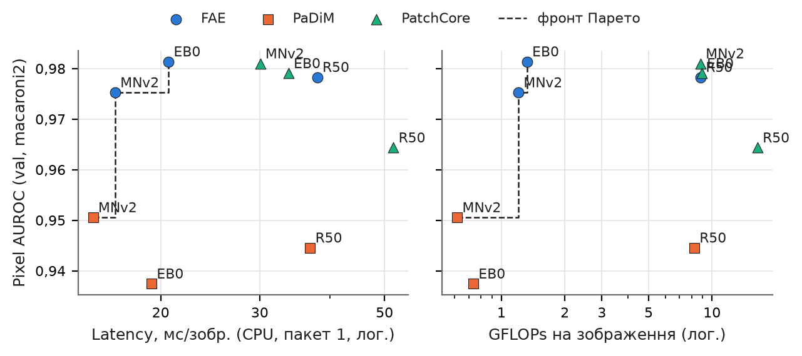

Вісь Y — Pixel AUROC на **val macaroni2**, X — latency (ліворуч) і GFLOPs (праворуч), обидві в лог.
шкалі. Маркер — головка, підпис — backbone. Пунктир — фронт Парето (`profiling_study.py:288-295`):
точки, для яких немає іншої, що не дорожча й не гірша.

```python
# src/mllabs/labs/lab04/profiling_study.py:290-294
mask = np.ones(len(cost), dtype=bool)
for index in range(len(cost)):
    dominated = (cost <= cost[index]) & (quality >= quality[index])
    strictly = (cost < cost[index]) | (quality > quality[index])
    mask[index] = not np.any(dominated & strictly)
```

На фронті три точки, і за latency, і за FLOPs: PaDiM + MobileNetV2 (0,951; 15,2 мс), FAE +
MobileNetV2 (0,975; 16,6 мс), FAE + EfficientNetB0 (0,981; 20,6 мс). PatchCore + MobileNetV2 (0,981;
30,1 мс) «домінований»: FAE + EfficientNetB0 так само точна на val і на третину швидша.

Два застереження, щоб не перехвалити FAE. Перше: графік побудовано на **val однієї категорії**
(`benchmark.py:139-161`). На test PatchCore достовірно краща за Pixel AP в усіх трьох категоріях, а
на capsules — і за Pixel AUROC (крок 8). Тож «FAE домінує» правильно лише для Pixel AUROC на
macaroni2. Друге: тут видно ціну жадібного пошуку. У кроці 3 (p = 3) MobileNetV2 відставала від
EfficientNetB0 на 0,009. При p = 1 відставання 0,006 (0,975 проти 0,981), а ResNet50 при p = 1
дає 0,978. Порядок backbone залежить від p, тобто фактори взаємодіють.

---

### Крок 10. Зведення

Записує в `metrics.json` усі параметри запуску (`metrics.config`, включно з seed = 42) і тривалість
кроків (`metrics.timing`). Нових обчислень немає.

---

### 4.11. Що передається в ЛР5

ЛР5 не перенавчає модель, а аналізує її. Тому в кроці 8 для кожної категорії зберігається
**пакет детектора** (`detector.py:156-163`):

- `labs/lab04/artifacts/models/<категорія>/fae_head.keras` — лише головка FAE, без стану Adam.
  Backbone не зберігається: його відновлюють з `keras.applications` за назвою.
- `labs/lab04/artifacts/models/<категорія>/detector.json` — `DetectorConfig`: backbone, шари, D, p, g,
  σ згладжування, пороги з val, seed, версії. Для macaroni2: `efficientnet_b0`, `patch_size = 1`,
  `threshold_image = 0,460`, `threshold_pixel = 0,689`.
- `data/processed/visa/splits.csv` — розбиття, щоб ЛР5 працювала з тим самим test.
- `labs/lab04/artifacts/tables/test_predictions.csv` — оцінка, поріг, рішення, TP/FP/FN/TN, тип і
  площа дефекту, σ яскравості тла кожного фото test (для розбору помилок).

Каталог `models/` у `.gitignore`, тому ЛР5 вимагає попереднього `uv run mllabs run 4`.

API, на який спирається ЛР5 (`anomaly/__init__.py:6-34`):

```python
from mllabs.anomaly.detector import load_bundle

config, detector = load_bundle(models_dir / "macaroni2", expose_backbone=True)
outputs = detector(images)        # images: (B, 256, 256, 3), float32, 0–255
outputs["anomaly_map"]            # (B, 256, 256)
outputs["image_score"]            # (B,)  > config.threshold_image → аномалія
outputs["patch_scores"]           # (B, 32, 32) помилка відновлення FAE
outputs["backbone_shallow"]       # активації шару кроку 8 — для Grad-CAM
outputs["backbone_deep"]          # активації шару кроку 16
```

`load_bundle` (`detector.py:166-182`) читає конфіг і головку, а потім викликає `build_detector`. Той
збирає **наскрізну** модель «пікселі → карта» з тих самих шарів, що й кешований шлях:

```python
# src/mllabs/anomaly/detector.py:136-148
factory = FeatureExtractorFactory(config.image_size, config.feature_dim, weights)
images = keras.Input((config.input_size, config.input_size, 3), name="image")
tensors = factory.wire(images, BackboneKind(config.backbone), config.tile_grid)
aggregated = PatchAggregator(config.patch_size).layer()(tensors.features)
patch_scores = scoring_layer(aggregated)
anomaly_map = AnomalyMapPostprocessing(config.eval_size, config.blur_sigma, name="postprocess")(
    patch_scores
)
image_score = keras.ops.max(anomaly_map, axis=(1, 2))
outputs = {"anomaly_map": anomaly_map, "image_score": image_score, "patch_scores": patch_scores}
if expose_backbone:
    outputs |= {"backbone_shallow": tensors.shallow, "backbone_deep": tensors.deep}
```

Чому `wire`, а не готова модель-екстрактор: шари backbone вбудовуються в зовнішню модель
**напряму**, без вкладеної моделі. Тоді проміжні активації доступні як виходи, а Grad-CAM потребує
саме градієнта оцінки за ними (`backbones.py:295-301`). `expose_backbone=True` додає два виходи.
Без нього модель повертає лише карту, оцінку й патчі.

Три тести гарантують, що ЛР5 отримає те, що треба (`tests/anomaly/test_anomaly_models.py`):
- `test_end_to_end_detector_matches_cached_feature_path` (рядок 231) — наскрізна модель дає ту саму
  карту, що й шлях «кеш ознак → головка → пост-обробка» (з допуском на кеш у `float16`);
- `test_detector_gives_nonzero_gradient_of_score_wrt_image` (рядок 249) — градієнт оцінки за пікселями
  ненульовий (передумова Integrated Gradients);
- `test_exposed_backbone_activations_support_grad_cam` (рядок 262) — градієнти за обома виходами
  backbone ненульові.

А `test_models_learn_only_from_normal_train_rows` (`tests/labs/test_lab04_lab.py:232`) підміняє
`fit`/`train` трьох методів і перевіряє, що вони отримували **лише** train (FAE — ще й val_normal).
Тобто test і розмічений val у навчання не потрапляють.

## 5. Python очима Java-розробника

Уже пояснене в [`docs/python-for-java.md`](../../docs/python-for-java.md) і в розділах 5
[ЛР1](../lab01/GUIDE.md), [ЛР2](../lab02/GUIDE.md), [ЛР3](../lab03/GUIDE.md) (`dataclass`, `replace`,
`Protocol`, `StrEnum`, `@property`, `@classmethod`, `**` для словників, `zip(strict=True)`, замикання,
`perf_counter`, `a | b` для словників, розпакування із `*`) тут не повторюється.

| У Java ти б написав | У Python тут написано | Де |
|---|---|---|
| `@Override` | `@override` з `typing`: перевіряє тайпчекер, не інтерпретатор | `backbones.py:110` |
| реєстрація підтипу для десеріалізації (`@JsonTypeName`) | декоратор `@keras.saving.register_keras_serializable(package="mllabs")` + `get_config()` | `backbones.py:97`, `backbones.py:119-121` |
| `super(...)` з передачею решти параметрів | `def __init__(self, mode, **kwargs)` і `super().__init__(**kwargs)`: невідомі іменовані аргументи (`name=...`) ідуть батьку | `backbones.py:106-108` |
| поле класу, оголошене без ініціалізації | анотація на рівні класу `_splits: pd.DataFrame`. Значення немає, це лише тип для IDE | `lab.py:91-101` |
| `while ((chunk = in.read(buf)) > 0)` | «морж» `while chunk := response.read(_CHUNK):` — присвоєння всередині умови | `visa.py`, методи `_download` і `file_sha256` |
| `Math.ceilDiv(a, b)` | `-(-a // b)`: `//` округлює вниз, подвійна зміна знака дає стелю | `fae.py:180`, `backbones.py:133` |
| ковзні пари `(w[i], w[i+1])` у циклі | `itertools.pairwise(widths)` | `fae.py:77` |
| `Iterator` з довжиною і доступом за індексом | клас із `__len__` і `__getitem__` — Python викликає їх для `len(x)` і `x[i]` | `fae.py:179-186` |
| додати вимір масиву (reshape `n×D → n×1×1×D`) | `batch[:, None, None, :]`: `None` в індексі вставляє вісь довжини 1 | `fae.py:185` |
| `ExecutorService` з пулом потоків | `with ThreadPoolExecutor(8) as pool: pool.map(f, items)`. Потоки допомагають, бо Pillow відпускає GIL (глобальне блокування інтерпретатора) під час декодування JPEG | `images.py:99-101` |
| запуск окремої JVM | `ProcessPoolExecutor(mp_context=multiprocessing.get_context("spawn"))`: новий інтерпретатор з нуля | `profiling.py:179-181` |
| захоплення змінної в лямбді в циклі (effectively final копія) | `lambda f=head_fn: f(features)`: значення за замовчуванням фіксується **в момент створення** лямбди. Без `f=` усі лямбди циклу бачили б останнє `head_fn` | `profiling.py:276-281` |
| `import` усередині методу | імпорт TensorFlow у тілі функції: дорогий модуль вантажиться лише коли треба, а в робітнику — **після** налаштування потоків | `profiling.py:39-43`, `profiling.py:211-216` |
| імпорт заради статичного блоку класу | `from mllabs.anomaly import fae  # noqa: F401` — імпорт лише заради побічного ефекту (реєстрації шарів) | `detector.py:178` |
| `MappedByteBuffer` | `np.lib.format.open_memmap(...)` — масив, відображений на файл; `del target` закриває файл | `features.py:65-70` |
| `map.put(k, v)` для кількох ключів | `outputs \|= {...}` — оновити словник на місці | `detector.py:147` |
| `LinkedHashSet` для унікальних у порядку появи | `dict.fromkeys(series)`: ключі словника унікальні й зберігають порядок | `evaluation.py:361` |
| вкладені цикли по групах | генератор у генераторі `(run for group in groups for run in group)` — «сплющення» | `studies.py:304` |
| `switch` над масивами | `np.select([умова1, умова2, ...], [значення1, ...], default=...)` поелементно | `evaluation.py:151-159` |
| `counts[idx[i]]++` у циклі з повторами | `np.add.at(weights, indices, 1)`: коректно додає й тоді, коли індекси повторюються | `metrics.py:244` |
| три вкладені цикли сум добутків | `np.einsum("npi,npj->pij", a, a)`: літери — осі, відсутні в результаті (`n`) підсумовуються | `padim.py:98`, `padim.py:55` |
| цикл, який має виконатися у графі TF | `@tf.function` + `for step in tf.range(...)`: AutoGraph перетворює Python-цикл на графовий `while` | `patchcore.py:49`, `patchcore.py:65` |
| приховати клас від JUnit | `__test__ = False`: pytest не вважатиме `TestEvaluator` тестом через префікс `Test` | `evaluation.py:98` |

## 6. Запусти й поекспериментуй

```bash
uv run mllabs run 4                     # ≈ 29 хв на 10 ядрах (metrics.timing), без урахування завантаження
uv run mllabs run 4 --seed 7            # інше розбиття, інші випадкові вектори епох, канали PaDiM, coreset
uv run pytest tests/anomaly tests/labs/test_lab04_*.py   # на синтетичних даних, без мережі
```

Перший запуск качає архів VisA (1,93 ГБ, з докачуванням обірваного файлу) у `data/raw/visa/` і ваги
ImageNet у `~/.keras/models`, потім рахує ознаки. Повторні запуски беруть кеш зображень і ознак з
`data/processed/visa/`. Запуск перезаписує `labs/lab04/artifacts/` (і моделі для ЛР5!), тож перед
експериментами скопіюй каталог. Не запускай поруч важкі процеси: latency втратить сенс. Параметри
змінюються в `src/mllabs/labs/lab04/config.py`.

1. **`selection_tolerance: 0.002 → 0.0`** (`config.py:186`). Нічиїх більше немає. Крок 4 так само
   обере p = 1 (він і так найкращий), але крок 5 обере **латент k = 256** (0,9820 > 0,9814). Очікуй:
   параметрів головки 394 496 замість 296 000, GFLOPs головки ≈ 0,81 замість 0,61 (порахуй за
   формулою 2·in·out). На test Pixel AUROC зміниться в третьому знаку, напрям наперед не відомий.
   Image AUROC на val у k = 256 був вищим (0,794 проти 0,754), тож Image AUROC на test, найпевніше,
   теж підросте. Це наочно покаже, що правило нічиєї — свідомий вибір простішого.
2. **`fae = FaeSettings(vectors_per_epoch=25_000, max_epochs=120)`** (`config.py:179-181`). Кожне
   навчання триватиме ≈ 150 с замість ≈ 74. Навчань FAE за запуск 15 (11 досліджень, 2 фінальні,
   2 для графіка вартості), тож запуск подовжиться на ≈ 15–20 хв. `val_mse` продовжить
   повільно падати. Можливо, раннє зупинення нарешті спрацює, але гарантувати не можна. Pixel AUROC
   на val, судячи з кривих (плато після ≈ 20-ї епохи), зміниться в межах ±0,002.
3. **`blur_sigma: 4.0 → 0.0`** (`config.py:168`). Карти стануть «квадратними»: блоки 8×8 після
   білінійного збільшення без згладжування. Очікуй падіння Pixel AUROC/AP і більш шумний максимум
   (оцінку фото), отже гірший Image AUROC. Поодинокий шумовий патч тепер сам визначатиме оцінку.
   FLOPs пост-обробки (0,009 GFLOPs) майже зникнуть, але це крапля в морі.
4. **`patchcore_coreset_ratio: 0.01 → 0.001`** (`config.py:189`). Банк зменшиться з 7 834 до 784
   векторів. Головка PatchCore стане вдесятеро дешевшою (≈ 0,82 GFLOPs), пам'ять ≈ 1,5 МБ, latency
   головки впаде. Якість, найпевніше, трохи знизиться, бо грубіше покриття норми. Це найпростіший
   спосіб побачити компроміс «якість — вартість» усередині одного методу. Coreset при цьому
   рахуватиметься швидше.
5. **`study_category: "macaroni2" → "capsules"`** (`config.py:147`). Усі дослідження підуть на
   капсулах. Висновок про p (на капсулах дефекти більші, медіана ≈ 100 пікс.) може змінитися на
   p = 3. Порівняй, чи обереться той самий backbone.

## 7. Що може спитати викладач

**1. Pixel AUROC 0,98, а Pixel AP 0,036. Модель добра чи погана?**
На macaroni2 — обидва чесні. AUROC каже, що пікселі дефектів у середньому оцінено вище за нормальні.
AP каже, що серед найпідозріліших пікселів дефектних мало, бо аномальних пікселів 0,029 %, і
навіть 1 % хибних тривог їх «топить». Випадковий рівень AP ≈ 0,0003, тож 0,036 — у ≈ 120 разів
краще за вгадування, але для практичної сегментації цього мало. Тому в роботі обидві метрики стоять
поруч.

**2. Де тут «без учителя», якщо ви обирали конфігурацію й пороги за мітками?**
Моделі **навчаються** лише на нормі: `fit` бачить тільки train (і val_normal для зупинки), що
перевіряє тест `tests/labs/test_lab04_lab.py:232`. Мітки розміченого val використано для вибору 11
конфігурацій і двох порогів. Це напівнаглядова селекція, і в коді й звіті її так і названо
(`splits.py:11-12`). Повністю без міток довелося б обирати за втратою відновлення, а вона погано
пов'язана з якістю детекції. Приклад: p = 5 має `val_mse` 0,052 проти 0,090 у p = 1, але Pixel AUROC
0,960 проти 0,981.

**3. Image F1 на macaroni2 — 0,676. Це добре?**
Ні. Стратегія «все аномальне» дає 0,667. Поріг із максимальним F1 на val зсунувся так низько, що FAE
позначила аномальними 42 з 50 нормальних фото test. F1 не винагороджує правильні «норма», а при
слабкому Image AUROC (0,763) максимум F1 майже збігається з тривіальним. Змістовна Image F1 — лише на
pcb4 (0,920 проти тривіальних 0,662).

**4. FAE програє PatchCore. Навіщо вона тоді?**
За якістю PatchCore краща (Pixel AP скрізь, Pixel AUROC на capsules і pcb4). Але FAE: у 6,8 раза
менше FLOPs (1,32 проти 8,93 GFLOPs з EfficientNetB0); 20,6 проти 33,7 мс; 1,1 МБ проти 15,3 МБ;
пам'ять не росте з кількістю фото train; на val macaroni2 вона на фронті Парето. Для edge-пристрою
це реальний компроміс. До того ж FAE — справжня мережа з помилкою відновлення, яку ЛР5 розбиратиме
по каналах і шарах.

**5. Чому не Anomalib? І чому ваші числа не збігаються з опублікованими?**
Anomalib — PyTorch з іншими backbone і конвеєром, і порівнювалися б конвеєри. Реімплементації на
тих самих ознаках порівнюють саме головки. Опубліковані числа отримано з іншим backbone,
роздільністю й на повному офіційному test, тому вони лише довідка. Навіть між статтями PatchCore на
macaroni2 розходиться від ≈ 0,47 до ≈ 0,78 Image AUROC.

**6. Раннє зупинення не спрацювало жодного разу. Ви щось зробили не так?**
Ні, це результат. `val_mse` монотонно падала всі 60 епох, а розрив з train — менше 0,002 при MSE
≈ 0,09. Перенавчання немає: 783 тис. векторів проти 296 тис. параметрів. Тому й Dropout, L2 та шум
змінили Pixel AUROC в межах шуму (0,979–0,982). Ми спробували дати зупинці шанс (60 коротших епох
замість 30) і чесно фіксуємо, що вона не знадобилася.

**7. Чому розрив втрат рахуєте своїм колбеком, а не з `history["loss"]`?**
`loss` Keras рахує в режимі навчання: з Dropout, шумом і штрафом L2. У варіанті L2 це 0,137 проти
чистої MSE 0,096. Різниця з валідаційною втратою відображала б регуляризатор, а не перенавчання.
Колбек рахує train і val в однакових умовах (`fae.py:199-240`).

**8. ResNet50 має в 11,5 раза більше FLOPs, а latency лише вдвічі більша. Як так?**
FLOPs — кількість арифметики, latency — реальний час, який залежить від того, наскільки добре
операції завантажують процесор і пам'ять. Ймовірно, в EfficientNet багато «дешевих за FLOPs, але
неефективних на CPU» операцій (depthwise-згортки, поелементні активації). Ми це не профілювали
детально, тому й міряли обидві величини.

**9. Чому бутстреп по зображеннях, а не по пікселях?**
Пікселі одного фото не незалежні: сусідні належать тому самому дефекту чи тлу. Перевибірка
пікселів удавала б, що даних мільйони, і давала б надто вузькі ДІ. Незалежні одиниці тут — фото
(`metrics.py:12-14`).

**10. Чому backbone заморожено, а не донавчено на макаронах?**
Аномалій для навчання немає, а на нормі донавчання вчило б мережу «стискати» саме нормальний
вигляд. Ознаки могли б стати нечутливими до дефектів (колапс), а 765 фото замало для мільйонів
ваг. Крім того, заморожений backbone дозволяє кешувати ознаки один раз, і 11 навчань FAE тривають
по ≈ 75 с.

## 8. Що почитати далі

1. **Stanford CS231n, конспект «Convolutional Neural Networks»** (cs231n.github.io/convolutional-networks/)
   — згортка, крок, рецептивне поле з картинками. Шукай розділ «Convolutional Layer» і приклад із
   двома фільтрами.
2. **Keras guides**: «The Functional API», «Making new layers and models via subclassing», «Writing
   your own callbacks» (keras.io/guides/). Це три стовпи коду `anomaly/`: функціональні моделі
   (`detector.py`), власні шари з `build`/`call`/`get_config` (`backbones.py`), колбеки (`fae.py`).
3. **Defard et al., «PaDiM: a Patch Distribution Modeling Framework…» (2020, arXiv 2011.08785)** —
   розділ 3: гаусіан на позицію й відстань Махаланобіса. **Roth et al., «Towards Total Recall in
   Industrial Anomaly Detection» (CVPR 2022, arXiv 2106.08265)** — розділ 3.2 про агрегацію p×p і
   3.3 про жадібний coreset.
4. **Zou et al., «SPot-the-Difference Self-Supervised Pre-training for Anomaly Detection and
   Segmentation» (ECCV 2022, arXiv 2207.14315)** — опис датасету VisA і Tables 6–8, звідки взято
   довідкові числа. Зверни увагу на піксельний AU-PR PaDiM на macaroni2 (< 1 %).
5. **Shi, Yang, Qi, «Unsupervised anomaly segmentation via deep feature reconstruction»
   (Neurocomputing, 2021)** — DFR, звідки ідея FAE: автоенкодер над багатошаровими ознаками CNN.
