## 1. Постановка завдання

1. Обрати складний датасет із високою дисперсією тла або незбалансованістю цілей; розбити зображення на патчі й вилучити ознаки переднавченими backbone-мережами (ResNet, MobileNet тощо).
2. Запропонувати та реалізувати модель нейронної мережі.
3. Дослідити гіперпараметри: регуляризацію, розмір патчів і різні моделі-екстрактори.
4. Навчити модель, відстежуючи втрати й метрики на навчальному і валідаційному наборах.
5. Профілювати швидкодію: крім метрик якості (Pixel AUROC, F1-Score), виміряти затримку (latency, мс/зобр.) і підрахувати FLOPs на CPU/GPU.
6. Порівняти отриману модель із SOTA-рішеннями (PaDiM, PatchCore).
7. Сформувати підсумковий звіт про стан даних і виконані перетворення.

## 2. Опис проведеної роботи

### 2.1. Датасет VisA і вибір категорій

Використано датасет VisA (Visual Anomaly) [1, 2]: 12 категорій промислових об'єктів, зображення близько 1500×1000 пікселів із піксельними масками дефектів. Архів завантажується кодом з офіційного посилання й перевіряється за SHA-256. Ліцензія в офіційному репозиторії й у файлі `LICENSE-DATASET` архіву — CC BY 4.0, тоді як бібліотека Anomalib [3] вказує CC BY-NC-SA 4.0; для навчальної роботи з посиланням на джерело придатні обидві. MVTec AD відхилено: його можна отримати лише через вебформу, а тло в більшості категорій однорідне.

Обрано три категорії з різними видами складності: `macaroni2` (кілька об'єктів на текстурованому тлі; за літературою одна з найважчих категорій VisA), `capsules` (десятки капсул у випадкових положеннях) і `pcb4` (плата складної структури). Приклади наведено на рис. {@samples}.

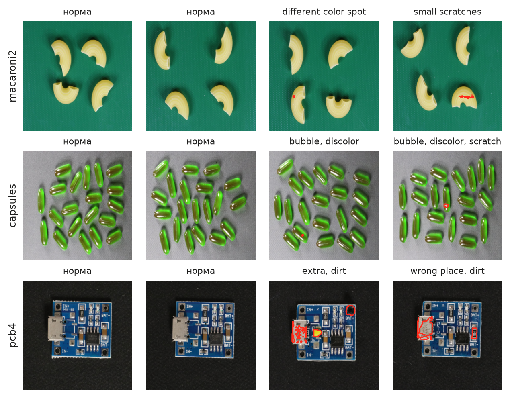{#samples width=60%}

Складність даних виміряно на 50 нормальних зображеннях кожної з 12 категорій (рис. {@bg_fig}, числа — `background_variance.csv`). Перший показник, σ між кадрами, — стандартне відхилення яскравості пікселя між різними нормальними зображеннями, усереднене по пікселях: наскільки сцена змінюється від кадру до кадру. Другий, σ яскравості в кадрі, — розкид середньої яскравості блоків сітки 16×16 усередині зображення, тобто неоднорідність тла.

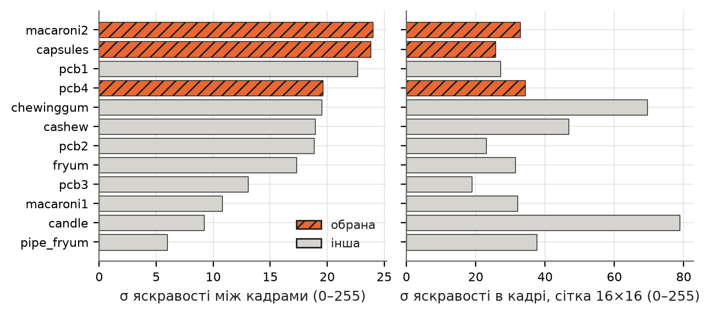{#bg_fig width=85%}

За σ між кадрами `macaroni2` ({{metrics.data.macaroni2.background_std:.1f}}) і `capsules` ({{metrics.data.capsules.background_std:.1f}}) займають перше і друге місця з 12, `pcb4` ({{metrics.data.pcb4.background_std:.1f}}) — {{metrics.data.pcb4.background_rank}}-те: об'єкти щоразу лежать по-іншому, тож кожен піксель буває то об'єктом, то тлом. За σ яскравості в кадрі обрані категорії не лідирують: першість мають `candle`, `chewinggum` і `cashew`, де розкид створює один великий світлий об'єкт на темному тлі. Отже, вибір обґрунтовано мінливістю сцени між кадрами і піксельною незбалансованістю (табл. {@area}), а не неоднорідністю тла в кадрі.

{#area}

Аномальні пікселі становлять лише {{metrics.data.macaroni2.anomalous_pixel_share:.3%}} пікселів val і test у `macaroni2`, {{metrics.data.capsules.anomalous_pixel_share:.2%}} у `capsules` і {{metrics.data.pcb4.anomalous_pixel_share:.2%}} у `pcb4`. Медіанний дефект `macaroni2` займає {{metrics.data.macaroni2.defect_area_median:.3%}} зображення: близько трьох десятків пікселів на зображенні 256×256, тобто менше за один патч 8×8. Після зменшення роздільності жодна маска не стала порожньою.

### 2.2. Розбиття і ізоляція даних

Офіційне розбиття `1cls.csv` не має валідаційної частини, тому його доповнено (seed {{metrics.config.seed}}). Офіційний train, що містить лише норму, поділено на `train` ({{metrics.config.train_fraction:.0%}}) і `val_normal`, а офіційний test стратифіковано навпіл — на розмічений `val` і `test` (табл. {@splits}).

{#splits}

- **train** — нормалізація ознак, навчання FAE, статистики PaDiM, банк PatchCore. Мітки аномалій не використовуються, тобто навчання unsupervised.
- **val_normal** — втрата відновлення на валідації і раннє зупинення.
- **val** — вибір конфігурації, метрики детекції по епохах, пороги F1. Вибір за мітками — це «напівнаглядова» селекція: моделі навчаються без міток, але конфігурацію обрано за якістю детекції.
- **test** — використано один раз для заздалегідь визначеного переліку моделей; жодне рішення за ним не ухвалювалося.

### 2.3. Патчі та вилучення ознак

Зображення цілком (без кадрування, щоб не втратити дефекти біля країв) зменшується до 256×256 білінійно, маска — методом найближчого сусіда. Патчі виділено на двох рівнях (рис. {@patches}). **Патч на рівні ознак** — комірка сітки 32×32 з кроком 8 пікселів; його ознака — вектор backbone, усереднений у вікні p×p, як у PatchCore [4]. **Явні тайли** 2×2 обробляються окремо, кожен у роздільності 256×256 (ефективна роздільність 512); цей варіант досліджено як альтернативу.

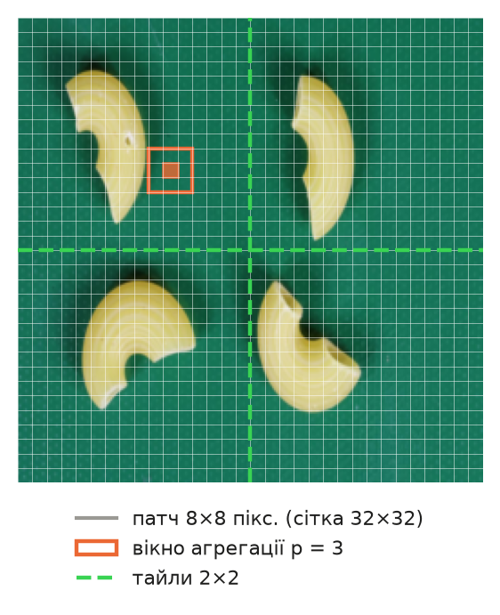{#patches width=36%}

Ознаки вилучено переднавченими на ImageNet [5] екстракторами з `keras.applications` [6]: ResNet50 [7], MobileNetV2 [8] і EfficientNetB0 [9] (табл. {@backbones}). З кожного взято два проміжні шари з кроком 8 і 16 (аналог `layer2` + `layer3` у PaDiM і PatchCore). Глибший шар збільшено до 32×32, шари конкатеновано, а канали зведено фіксованим усередненням до D = {{metrics.model.feature_dim}}. Однакове D робить головки ідентичними, тож різниться лише backbone. Ваги заморожено, ознаки кешуються у `float16`. WideResNet50, стандартного для PaDiM і PatchCore, у `keras.applications` немає — це відмінність від оригінальних налаштувань.

{#backbones}

### 2.4. Архітектура запропонованої моделі

Запропоновано **Feature Autoencoder (FAE)** — денойзинговий автоенкодер [10] з «пляшковим горлом», що відновлює ознаки нормальних патчів (ідея DFR [11]). Незнайомі патчі (дефекти) відновлюються погано, тому помилка відновлення слугує оцінкою аномальності. Конвеєр показано на рис. {@diagram} (шари з параметрами — `model_architecture.csv`).

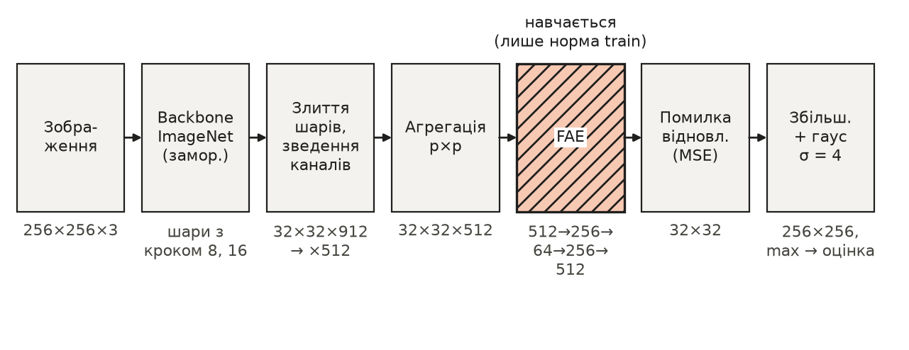{#diagram width=90%}

Для ознаки патча $x$ спершу обчислюється z-оцінка каналів $z = (x - \mu)/\sigma$ (статистики з train), далі автоенкодер відновлює $\hat z = g(z)$. Оцінка патча:

$$s_{ij} = \frac{1}{D}\sum_{c=1}^{D}\left(\hat z_{ij,c} - z_{ij,c}\right)^2.$$

Будова головки: `Normalization` → `GaussianNoise` → `Dense(256)` → `Dropout` → `Dense(k)` → `Dense(256)` → `Dense(512)`. Шари `Dense` діють на останню вісь (згортки 1×1), тому модель навчається на окремих векторах, а застосовується до карти `(B, 32, 32, 512)`. Головка має {{metrics.model.head_params}} параметрів. Навчання: MSE, Adam (крок {{metrics.model.learning_rate}}), пакет {{metrics.model.batch_size}}, щоепохи нова підвибірка з {{metrics.model.vectors_per_epoch}} векторів train, до {{metrics.model.max_epochs}} епох, раннє зупинення за MSE на `val_normal` (patience {{metrics.model.patience}}) з відновленням найкращих ваг.

**Пост-обробка** спільна для всіх головок: карта 32×32 білінійно збільшується до 256×256 і згладжується гаусовим ядром σ = {{metrics.config.blur_sigma:.0f}} пікс.; оцінка зображення — максимум карти. Усе реалізовано в TensorFlow, тож модель «зображення → карта» диференційовна, що потрібно для ЛР № 5. Альтернативи відхилено: піксельний згортковий автоенкодер слабкий на складному тлі й не використовує backbone; Student–Teacher потребує годин навчання CNN на CPU; гаусова модель ознак — це вже PaDiM.

### 2.5. Реімплементації PaDiM і PatchCore

Обидва SOTA-методи **реімплементовано за статтями** на тих самих ознаках, розбитті, пост-обробці й метриках, що й FAE; різниться лише головка:

- **PaDiM** [12] — для кожної з 1024 позицій сітки рахуються середнє і коваріація {{metrics.config.padim_channels}} випадкових каналів (+ ε·I, ε = {{metrics.config.padim_epsilon}}); оцінка — відстань Махаланобіса;
- **PatchCore** [4] — банк нормальних патчів train, проріджений жадібним k-center coreset до {{metrics.config.patchcore_coreset_ratio:.0%}}; оцінка — відстань до найближчого сусіда (без перезважування зі статті).

Anomalib [3] не використано. Він потребує PyTorch (другий фреймворк, понад 1 ГБ залежностей, окремий процес через конфлікт OpenMP з TensorFlow) і має власні backbone, препроцесинг і розбиття VisA. Отже, порівнювалися б цілі конвеєри, і відмінності backbone змішалися б із відмінностями методів. Порівняння «головок» на спільному backbone чесніше: воно показує, чи краща сама модель FAE за інших рівних. Ціна — це не бібліотечні реалізації, тому опубліковані числа наводяться лише для довідки.

**Методична примітка.** Обидві асиметрії порівняння працюють на користь FAE. Для FAE виконано {{metrics.studies.selected.n_trainings}} навчань підбору на val `macaroni2`, тоді як PaDiM і PatchCore отримали параметри зі статей. Крім того, PatchCore працює з обраним для FAE p = {{metrics.studies.selected.patch_size}}, а в статті використано p = 3. Тому висновок «PatchCore не гірший за FAE» надійніший, ніж за симетричних умов.

### 2.6. Метрики й протокол досліджень

**Pixel AUROC** — головна метрика. Аномальних пікселів менше 1 %, тому AUROC оптимістичний, і поруч наведено **Pixel AP** (площа під PR-кривою [13]). **F1** обчислюється на двох рівнях — Image F1 і Pixel F1 — за порогами, що максимізують F1 на val і без змін застосовуються до test. **ДІ** отримано бутстрепом по зображеннях test [14] ({{metrics.config.bootstrap_repeats}} повторів, 95 %). Вибірки однакові для всіх методів, тож ДІ різниць парні; різниця значуща, якщо ДІ не містить нуля.

Дослідження гіперпараметрів проведено лише на `macaroni2` з вибором за Pixel AUROC на val. Пошук жадібний координатний, тобто кожен етап стартує з найкращого варіанта попереднього: (1) екстрактори (база: p = {{metrics.config.default_patch_size}}, k = 64, без регуляризації); (2) p ∈ {1, 3, 5} і тайли 2×2; (3) по одному фактору регуляризації: k ∈ {16, 256}, Dropout 0,2, L2 = 10⁻⁴, шум входу σ = 0,2. **Правило нічиєї:** різниця, менша за {{metrics.config.selection_tolerance}} (приблизно півширина ДІ на val), вважається шумом, і обирається простіший варіант. Обрану конфігурацію без повторного підбору застосовано до `capsules` і `pcb4`. Жадібний пошук не бачить взаємодії факторів — це його обмеження (п. 3.2).

### 2.7. Методика профілювання

**FLOPs** (FLOPs = 2 × MAC, на одне зображення) підраховано профайлером TensorFlow на «замороженому» графі моделі. Для головки FAE профайлер дав {{metrics.profiling.fae_gflops_profiler:.4f}} GFLOPs, що підтверджує аналітична формула:

$$2 \cdot 1024 \cdot (512 \cdot 256 + 256 \cdot 64 + 64 \cdot 256 + 256 \cdot 512) \approx {{metrics.profiling.fae_gflops_analytic:.4f}} \cdot 10^{9}.$$

Різниця менша за 1 % і припадає на нормалізацію та обчислення помилки. Головки PaDiM і PatchCore пораховано аналітично: $2d^2 + 2d$ і $2|M|D$ на позицію, де $|M|$ — розмір банку ({{metrics.profiling.patchcore_bank}} векторів для `macaroni2`).

**Latency** виміряно для наскрізного конвеєра: {{metrics.config.latency_warmup}} прогрівальних і {{metrics.config.latency_runs}} вимірювальних запусків, медіана і p90. Режими: пакет 1 і пакет {{metrics.config.latency_batch}}; усі {{metrics.profiling.device.logical_cores}} ядер і 1 потік (кожен режим — в окремому процесі). **Пристрій — лише CPU** ({{metrics.profiling.device.cpu}}, TensorFlow {{metrics.profiling.device.tf_version}}). GPU для TensorFlow недоступний: `tensorflow-metal` несумісний з TensorFlow 2.21 (імпорт падає), а відкат версії заради вимірювань не виправданий. FLOPs від пристрою не залежать. Машина не була повністю вільною: load average становив 10,6 перед вимірюваннями latency і 20,9 після них на 10 ядрах (`metrics.json`; по окремих вимірах — `latency_raw.csv`). Тому абсолютні значення latency можуть бути завищені, а співвідношення між методами надійніші.

## 3. Результати

### 3.1. Екстрактори ознак

Результати FAE на трьох backbone наведено в табл. {@st_bb}; розрив втрат — MSE на `val_normal` мінус MSE на train, latency — лише backbone.

{#st_bb}

EfficientNetB0 дав найвищий Pixel AUROC ({{metrics.studies.backbones.efficientnet_b0.pixel_auroc:.4f}} проти {{metrics.studies.backbones.mobilenet_v2.pixel_auroc:.4f}} у MobileNetV2 і {{metrics.studies.backbones.resnet50.pixel_auroc:.4f}} у ResNet50) з відривом, більшим за поріг нічиєї. Найважчий ResNet50 ({{metrics.features.resnet50.gflops:.1f}} GFLOPs проти {{metrics.features.efficientnet_b0.gflops:.2f}}) не кращий за легкі мережі: для дрібних дефектів глибина важить менше, ніж якість ознак середнього рівня. За Image AUROC лідирує MobileNetV2, але критерієм обрано піксельну метрику. Розрив втрат усюди близький до нуля.

### 3.2. Розмір патчів і тайли

Вплив p і тайлів показано на рис. {@st_patch_fig} (повна таблиця — `study_patch_size.csv`).

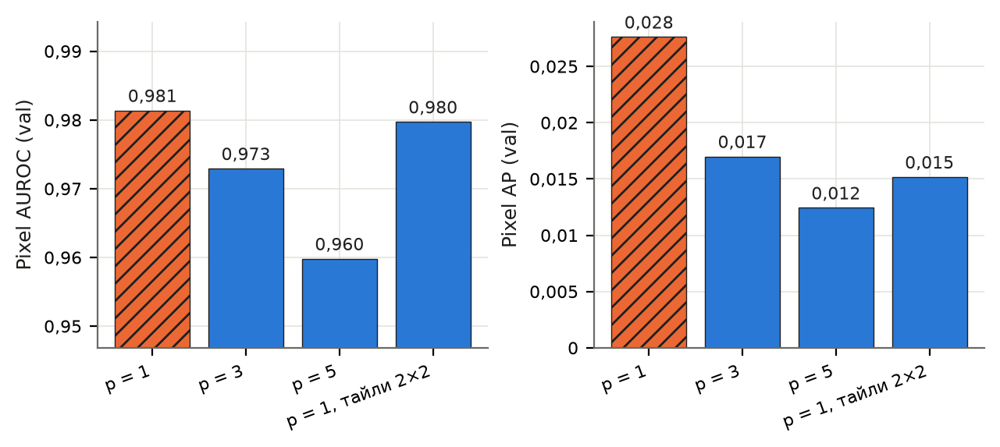{#st_patch_fig width=75%}

Якість монотонно падає зі збільшенням p: найкращий варіант p = 1 без агрегації (Pixel AUROC {{metrics.studies.selected.val_pixel_auroc:.4f}}), а Pixel AP за нього майже вдвічі вища, ніж за p = 3. Медіанний дефект `macaroni2` менший за патч, тож усереднення 3×3 чи 5×5 розмиває його сигнал серед нормальних сусідів. Рекомендацію PatchCore (p = 3) отримано на MVTec AD, де дефекти більші. Тайли 2×2 дали Pixel AUROC у межах нічиєї від p = 1, але нижчі Pixel AP і Image AUROC за довшого навчання й учетверо дорожчих ознак. Тому обрано p = 1 без тайлів. Взаємодія факторів при цьому існує: за p = 1 (рис. {@cost_fig}) порядок екстракторів інший, ніж за p = 3 — ResNet50 (Pixel AUROC 0,9783) випереджає MobileNetV2 (0,9753), хоча EfficientNetB0 (0,9814) лишається першим (`accuracy_vs_cost.csv`). Жадібний пошук, що фіксує backbone до вибору p, такого не враховує.

### 3.3. Регуляризація

Варіанти регуляризації (EfficientNetB0, p = 1) порівняно на рис. {@st_reg_fig} (повна таблиця — `study_regularization.csv`).

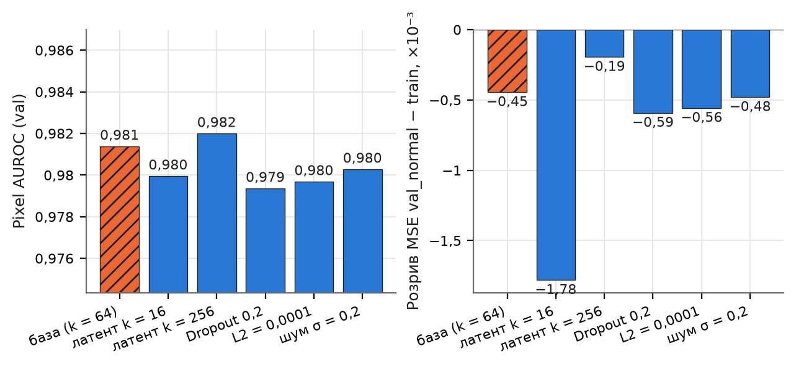{#st_reg_fig width=75%}

Жоден варіант не покращив базу більше, ніж на поріг нічиєї. Латент k = 256 випереджає k = 64 лише в четвертому знаку, тому збережено простішу базу. Dropout, L2 і шум трохи знижують якість, а k = 16 занадто вузьке і гірше відновлює навіть норму. Пояснення дає права панель: розрив MSE у всіх варіантах порядку 10⁻⁴…10⁻³ і навіть від'ємний, тобто перенавчання немає. Головка з {{metrics.model.head_params}} параметрами навчається на сотнях тисяч векторів і не може їх «запам'ятати», тож регуляризація лише обмежує модель. Розрив рахується однаково для обох наборів: колбек після кожної епохи проганяє фіксовані підвибірки train і `val_normal` без шуму, Dropout і L2-штрафу, які містить втрата Keras у режимі навчання. Підсумкова конфігурація: EfficientNetB0, p = {{metrics.studies.selected.patch_size}}, k = {{metrics.studies.selected.latent}}, без Dropout, L2 і шуму.

### 3.4. Навчання: втрати й метрики на train і val

Після кожної епохи всіх {{metrics.studies.selected.n_trainings}} навчань записувалися втрата Keras, MSE на train і `val_normal`, Pixel AUROC, Pixel AP і Image AUROC на розміченому val, а також 99-й перцентиль оцінок патчів train (`training_history.csv`; криві досліджень — `learning_curves_study.png`). На train-нормі AUROC не визначений, бо там лише один клас. В усіх дослідженнях Pixel AUROC виходить на плато за 20–30 епох, хоча MSE ще повільно спадає: подальше навчання покращує відновлення, але не детекцію. Криві фінальних моделей наведено на рис. {@lc_final}.

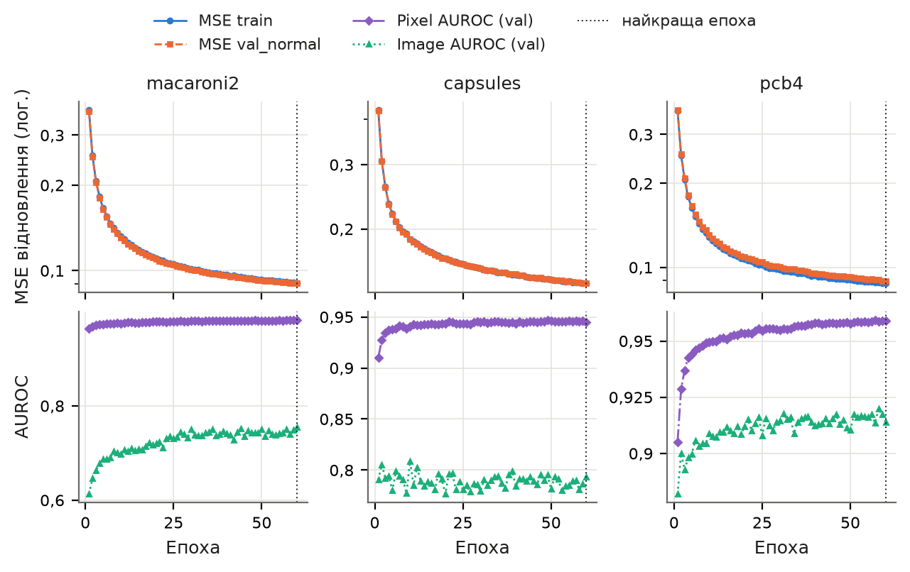{#lc_final width=66%}

MSE на train і `val_normal` практично збігаються (для `macaroni2` наприкінці {{metrics.training.macaroni2.train_mse:.4f}} і {{metrics.training.macaroni2.val_mse:.4f}}). **Раннє зупинення не спрацювало в жодному навчанні**: найкращою за MSE на `val_normal` була остання епоха (`best_epoch` фінальних моделей = {{metrics.training.macaroni2.best_epoch}}, {{metrics.training.capsules.best_epoch}}, {{metrics.training.pcb4.best_epoch}}). Так само було й у першому запуску (30 епох по 50 тис. векторів). Кількість епох подвоїли, зменшивши вдвічі кількість векторів на епоху, але й за 60 епох валідаційна MSE продовжує спадати. Фактичною межею навчання є бюджет епох, що на детекцію не впливає, бо Pixel AUROC давно на плато. Одне навчання триває близько {{metrics.training.macaroni2.seconds:.0f}} с.

Перенесення конфігурації на інші категорії вдале частково: Pixel AUROC на val становить {{metrics.training.capsules.val_pixel_auroc:.3f}} (`capsules`) і {{metrics.training.pcb4.val_pixel_auroc:.3f}} (`pcb4`). Image AUROC на `capsules` з першої епохи коливається біля {{metrics.training.capsules.val_image_auroc:.2f}} і не зростає: максимум карти чутливий до поодиноких «гарячих» патчів серед десятків капсул.

### 3.5. Якість на тестовій вибірці

Метрики на test наведено в табл. {@test}; остання колонка — опубліковані Image / Pixel AUROC (п. 3.6). Image F1 і ДІ — у `test_metrics.csv` і `test_metrics_full.csv`.

Pixel AUROC FAE на test становить {{metrics.test.FAE.macaroni2.pixel_auroc:.3f}} / {{metrics.test.FAE.capsules.pixel_auroc:.3f}} / {{metrics.test.FAE.pcb4.pixel_auroc:.3f}} (`macaroni2` / `capsules` / `pcb4`). Середнє {{metrics.test.FAE.mean.pixel_auroc:.3f}} — між PatchCore ({{metrics.test.PatchCore.mean.pixel_auroc:.3f}}) і PaDiM ({{metrics.test.PaDiM.mean.pixel_auroc:.3f}}). Значення близькі до валідаційних, тож вибір на val не дав помітного оптимізму.

Високий Pixel AUROC оманливий. **Pixel AP** на `macaroni2` становить лише {{metrics.test.FAE.macaroni2.pixel_ap:.3f}} у FAE і {{metrics.test.PatchCore.macaroni2.pixel_ap:.3f}} у PatchCore. Дефект у кілька десятків пікселів після збільшення з сітки з кроком 8 і згладжування σ = 4 «розливається» на нормальних сусідів, тому навіть знайдений дефект дає переважно хибнопозитивні пікселі. Так само й в авторів VisA: піксельна AP PaDiM на `macaroni2` там нижча за 1 % за AUROC понад 0,95. Різницю метрик видно на рис. {@roc}: ROC-криві всіх методів притиснуті до кута, а PR-криві чітко їх розводять.

{#test}

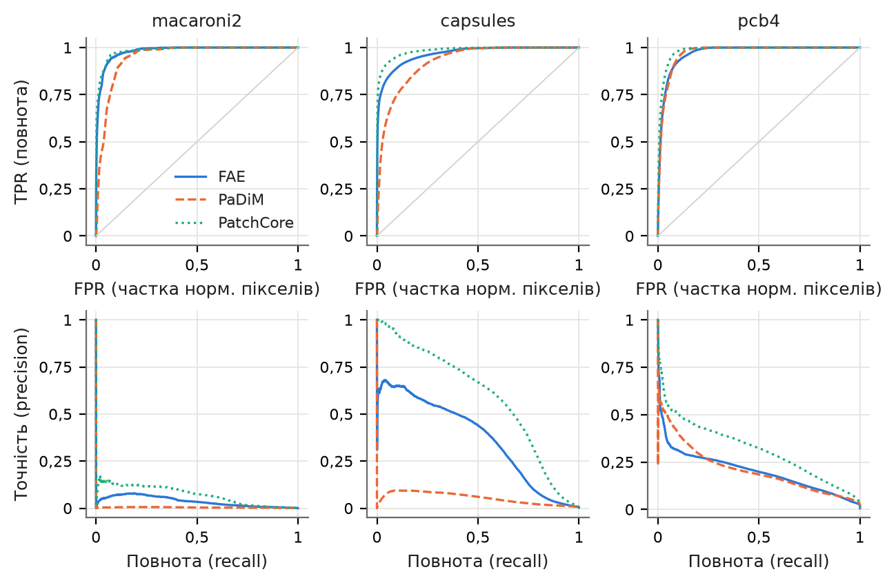{#roc width=62%}

**Image F1 на `macaroni2` і `capsules` практично дорівнює тривіальній стратегії «усе аномальне».** За слабкого Image AUROC поріг, обраний за максимумом F1 на val, сповзає вниз, тож більшість нормальних зображень test позначено аномальними. На `macaroni2` FAE дала 42 хибні тривоги з 50, PaDiM — 45 (`test_predictions.csv`). Тривіальне правило «усе аномальне» за частки аномалій π дає F1 = 2π/(1 + π): ≈ 0,67 для `macaroni2` (π = 0,5) і ≈ 0,77 для `capsules` (π = 0,625). Image F1 FAE ({{metrics.test.FAE.macaroni2.image_f1:.3f}} і {{metrics.test.FAE.capsules.image_f1:.3f}}) лише на тисячні вища за ці значення, тож корисного порогового класифікатора для цих категорій не отримано. Тому головними метриками порівняння є Pixel AUROC, Pixel AP та Image AUROC, які від порога не залежать. На `pcb4` Image F1 справді висока: {{metrics.test.FAE.pcb4.image_f1:.2f}} у FAE і {{metrics.test.PatchCore.pcb4.image_f1:.2f}} у PatchCore.

Приклади хибних спрацювань (FP) і пропусків (FN) FAE наведено на рис. {@maps}; карти поділено на поріг пікселя, тож 1 — межа рішення.

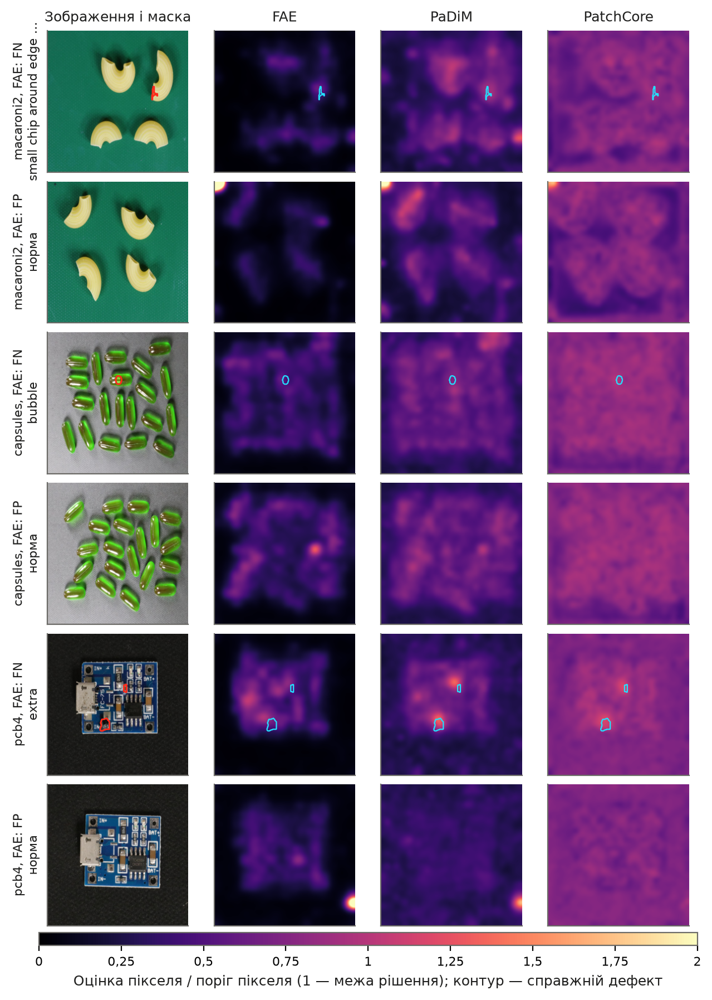{#maps width=52%}

FAE пропускає найдрібніші дефекти (скол краю, бульбашку в капсулі), бо їхній сигнал слабший за фонові варіації карти. Хибні спрацювання FAE на `macaroni2` і `pcb4` мають вигляд «гарячих» кутів кадру; причину цього не встановлено, її аналіз заплановано в ЛР № 5. Карти PaDiM найбільш «шумні», бо його статистики прив'язані до позиції, а об'єкти `macaroni2` і `capsules` щоразу розташовані по-різному. На `pcb4`, де плата лежить на тому самому місці, PaDiM майже не поступається іншим методам.

### 3.6. Порівняння із SOTA-методами

Pixel AUROC і Image AUROC з 95 % ДІ показано на рис. {@sota_fig}. Парні бутстреп-різниці FAE − SOTA для всіх категорій і метрик — у `sota_bootstrap.csv`; головні з них наведено нижче (Δ [95 % ДІ]).

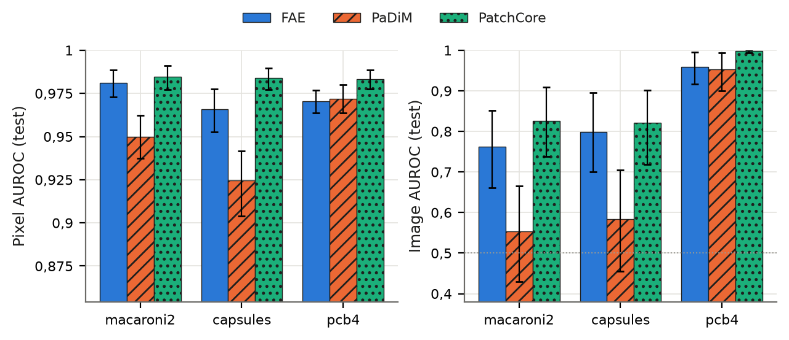{#sota_fig width=72%}

**FAE проти PaDiM.** На категоріях з об'єктами у випадкових положеннях FAE значуще краща: Pixel AUROC +{{metrics.sota.delta.macaroni2.fae_minus_padim.pixel_auroc.delta:.3f}} [{{metrics.sota.delta.macaroni2.fae_minus_padim.pixel_auroc.low:.3f}}; {{metrics.sota.delta.macaroni2.fae_minus_padim.pixel_auroc.high:.3f}}] на `macaroni2` і +{{metrics.sota.delta.capsules.fae_minus_padim.pixel_auroc.delta:.3f}} [{{metrics.sota.delta.capsules.fae_minus_padim.pixel_auroc.low:.3f}}; {{metrics.sota.delta.capsules.fae_minus_padim.pixel_auroc.high:.3f}}] на `capsules`, а Image AUROC — на {{metrics.sota.delta.macaroni2.fae_minus_padim.image_auroc.delta:.2f}} і {{metrics.sota.delta.capsules.fae_minus_padim.image_auroc.delta:.2f}}. На `pcb4` методи нерозрізнимі: {{metrics.sota.delta.pcb4.fae_minus_padim.pixel_auroc.delta:.3f}} [{{metrics.sota.delta.pcb4.fae_minus_padim.pixel_auroc.low:.3f}}; {{metrics.sota.delta.pcb4.fae_minus_padim.pixel_auroc.high:.3f}}]. FAE моделює вигляд нормального патча незалежно від його розташування, а PaDiM — розподіл у кожній позиції.

**FAE проти PatchCore.** PatchCore значуще кращий за Pixel AUROC на `capsules` ({{metrics.sota.delta.capsules.fae_minus_patchcore.pixel_auroc.delta:.3f}} [{{metrics.sota.delta.capsules.fae_minus_patchcore.pixel_auroc.low:.3f}}; {{metrics.sota.delta.capsules.fae_minus_patchcore.pixel_auroc.high:.3f}}]) і `pcb4` ({{metrics.sota.delta.pcb4.fae_minus_patchcore.pixel_auroc.delta:.3f}} [{{metrics.sota.delta.pcb4.fae_minus_patchcore.pixel_auroc.low:.3f}}; {{metrics.sota.delta.pcb4.fae_minus_patchcore.pixel_auroc.high:.3f}}]), а за Pixel AP — на всіх трьох категоріях (на `capsules` {{metrics.sota.delta.capsules.fae_minus_patchcore.pixel_ap.delta:.3f}}). На `macaroni2` різниця Pixel AUROC не значуща: {{metrics.sota.delta.macaroni2.fae_minus_patchcore.pixel_auroc.delta:.4f}} [{{metrics.sota.delta.macaroni2.fae_minus_patchcore.pixel_auroc.low:.4f}}; {{metrics.sota.delta.macaroni2.fae_minus_patchcore.pixel_auroc.high:.4f}}]. Попри асиметрію на користь FAE (п. 2.5), **PatchCore не поступається FAE, а здебільшого її перевершує**, а FAE посідає друге місце. Найближчий сусід у банку зберігає всі різновиди нормальних патчів, тоді як автоенкодер стискає їх у спільний латентний простір і рідкісні нормальні патчі відновлює гірше.

**Опубліковані результати** (остання колонка табл. {@test}; джерела й протоколи — `published_reference.csv`) наведено лише для довідки. Значення PaDiM взято зі статті авторів VisA [1] (табл. 7–8, колонка «Supervised»), середні PatchCore по VisA — з табл. 6 тієї ж статті, PatchCore по категоріях — з перезапуску в роботі CCAD [15] (табл. 8). Стаття DDAD, яку розглядали як джерело чисел по категоріях, потрібної таблиці не містить. Пряме порівняння некоректне: інші backbone (WideResNet50), роздільність, кадрування і повний офіційний test. Розкид між статтями теж великий: Image AUROC PatchCore на `pcb4` у CCAD — 0,697, хоча в середньому по VisA [1] — 0,924. Якісно реімплементації узгоджуються з літературою: PaDiM має низьку піксельну AP на `macaroni2` (0,008 у [1]), а PatchCore — Pixel AUROC близько 0,98 (0,984 у середньому в [1]).

### 3.7. Обчислювальна складність

Вартість усіх пар «головка × backbone» наведено в табл. {@flops}.

{#flops}

На EfficientNetB0 FAE потребує {{metrics.profiling.FAE.efficientnet_b0.gflops_backbone:.2f}} + {{metrics.profiling.FAE.efficientnet_b0.gflops_head:.2f}} GFLOPs (backbone + головка), а PaDiM — майже лише backbone (головка {{metrics.profiling.PaDiM.efficientnet_b0.gflops_head:.3f}} GFLOPs). Пошук найближчого сусіда в PatchCore коштує {{metrics.profiling.PatchCore.efficientnet_b0.gflops_head:.2f}} GFLOPs — більше, ніж весь ResNet50. Пам'ять головки: FAE {{metrics.profiling.FAE.efficientnet_b0.memory_mb:.1f}} МБ, PatchCore {{metrics.profiling.PatchCore.efficientnet_b0.memory_mb:.1f}} МБ, PaDiM {{metrics.profiling.PaDiM.efficientnet_b0.memory_mb:.1f}} МБ (1024 обернені коваріації). Банк і FLOPs PatchCore ростуть лінійно з обсягом train, а вартість FAE стала.

Компроміс «якість — вартість» для дев'яти пар показано на рис. {@cost_fig} (числа — `accuracy_vs_cost.csv`). Якість тут — Pixel AUROC на val `macaroni2` за p = 1, тобто на даних вибору конфігурації FAE, тому це ілюстрація компромісу, а не незалежна оцінка.

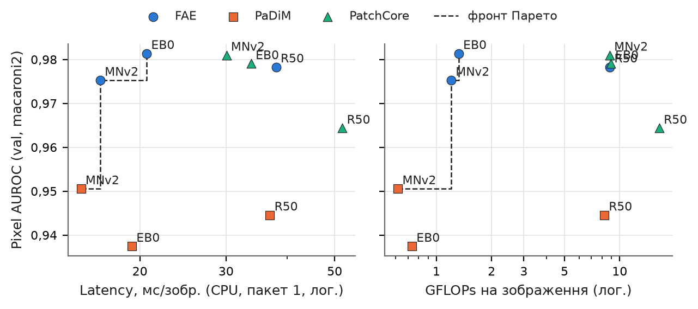{#cost_fig width=70%}

Фронт Парето за обома осями утворюють три точки: PaDiM + MobileNetV2 (найдешевша), FAE + MobileNetV2 і FAE + EfficientNetB0 (найточніша). Фронт побудовано за val однієї категорії, тож висновки щодо компромісу обережні: на test PatchCore значуще кращий за FAE за Pixel AP в усіх трьох категоріях (п. 3.6). На val `macaroni2` PatchCore майже не точніший за FAE, але повільніший: {{metrics.profiling.PatchCore.efficientnet_b0.latency_ms_b1_median:.1f}} проти {{metrics.profiling.FAE.efficientnet_b0.latency_ms_b1_median:.1f}} мс/зобр. на EfficientNetB0. ResNet50 не потрапляє на фронт з жодною головкою. На правій панелі підписи трьох точок біля 9 GFLOPs накладаються; їхні значення є в `accuracy_vs_cost.csv`. В одному потоці (`latency.csv`) FAE + EfficientNetB0 обробляє зображення за {{metrics.profiling.FAE.efficientnet_b0.latency_ms_b1_1thread:.1f}} мс, PaDiM — за {{metrics.profiling.PaDiM.efficientnet_b0.latency_ms_b1_1thread:.1f}} мс, PatchCore — за {{metrics.profiling.PatchCore.efficientnet_b0.latency_ms_b1_1thread:.1f}} мс: на слабкому пристрої відставання PatchCore зростає приблизно втричі. Пакет із {{metrics.config.latency_batch}} зображень скорочує час FAE до {{metrics.profiling.FAE.efficientnet_b0.latency_ms_b16:.1f}} мс/зобр.; декодування JPG і зменшення додають близько {{metrics.profiling.decode_resize_ms:.0f}} мс. На GPU latency не вимірювалася (п. 2.7).

### 3.8. Стан даних і виконані перетворення

Усі перетворення від сирих файлів до порогів рішення, з розмірностями і даними, на яких «вчиться» кожен крок, наведено в табл. {@transforms}; кількості по частинах розбиття — у табл. {@splits}.

Кроки, що навчаються, використовують лише норму train (нормалізація, головки) або розмічений val (пороги); test нічого не налаштовує. Backbone заморожено, зведення каналів і агрегація фіксовані. Уся лабораторна виконується на CPU за {{metrics.timing.total_seconds:.0f}} с (без першого завантаження архіву).

До ЛР № 5 передано: пакет `mllabs.anomaly` з `build_detector` — наскрізною диференційовною моделлю Keras «зображення → карта + оцінка» для Integrated Gradients і Grad-CAM, з окремим доступом до помилок відновлення патчів для perturbation analysis; головки `fae_head.keras` і конфігурації `detector.json` з порогами; розбиття `splits.csv`; прогнози `test_predictions.csv` з позначками TP/FP/FN/TN, типом і площею дефекту та σ яскравості тла для аналізу помилок.

{#transforms}

## 4. Висновок

Для детекції аномалій без учителя на VisA обрано категорії `macaroni2`, `capsules` і `pcb4`. Вони мають найбільшу мінливість сцени між кадрами і сильну піксельну незбалансованість: аномальних пікселів від {{metrics.data.macaroni2.anomalous_pixel_share:.3%}} до {{metrics.data.pcb4.anomalous_pixel_share:.2%}}. Запропоновано модель Feature Autoencoder — автоенкодер відновлення ознак патчів переднавченого backbone з {{metrics.model.head_params}} параметрами, наскрізно диференційовний разом із пост-обробкою. Дослідження {{metrics.studies.selected.n_trainings}} конфігурацій показало, що екстрактор і розмір патча важать більше за регуляризацію. Найкращими виявилися EfficientNetB0, який перевершив значно дорожчий ResNet50, і p = 1, бо дефекти менші за патч. Регуляризація виграшу не дала, бо модель не перенавчається, а раннє зупинення не спрацювало навіть за {{metrics.model.max_epochs}} епох, хоча Pixel AUROC виходить на плато раніше.

На test FAE досягла середнього Pixel AUROC {{metrics.test.FAE.mean.pixel_auroc:.3f}}. Вона значуще перевершила реімплементований PaDiM на `macaroni2` і `capsules` (+{{metrics.sota.delta.macaroni2.fae_minus_padim.pixel_auroc.delta:.3f}} і +{{metrics.sota.delta.capsules.fae_minus_padim.pixel_auroc.delta:.3f}}), але поступилася PatchCore ({{metrics.test.PatchCore.mean.pixel_auroc:.3f}}), особливо за Pixel AP. Умови порівняння сприяли FAE, тому перевага PatchCore надійна. Pixel AP на `macaroni2` низька в усіх методів ({{metrics.test.FAE.macaroni2.pixel_ap:.3f}} у FAE), а Image F1 на категоріях із кількома об'єктами не перевищує рівня тривіального правила, тож детекція найдрібніших дефектів лишається нерозв'язаною.

Профілювання на CPU (GPU для TensorFlow недоступний) показало, що вартість детектора визначає головка. FAE + EfficientNetB0 — це {{metrics.profiling.FAE.efficientnet_b0.gflops_backbone:.2f}} + {{metrics.profiling.FAE.efficientnet_b0.gflops_head:.2f}} GFLOPs, {{metrics.profiling.FAE.efficientnet_b0.memory_mb:.1f}} МБ пам'яті головки і {{metrics.profiling.FAE.efficientnet_b0.latency_ms_b1_median:.1f}} мс/зобр., тобто точка на фронті Парето, побудованому за val `macaroni2`. PatchCore точніший, але потребує {{metrics.profiling.PatchCore.efficientnet_b0.gflops_head:.1f}} GFLOPs на головку, банку, що росте з обсягом train, і {{metrics.profiling.PatchCore.efficientnet_b0.latency_ms_b1_median:.1f}} мс/зобр. FAE доцільна для edge-пристроїв з обмеженою пам'яттю, PatchCore — коли важлива максимальна якість. Модель і протокол передано в ЛР № 5.

## 5. Список використаної літератури

1. Zou Y., Jeong J., Pemula L., Zhang D., Dabeer O. SPot-the-Difference Self-supervised Pre-training for Anomaly Detection and Segmentation // Computer Vision — ECCV 2022. — Cham : Springer, 2022. — P. 392–408. — arXiv:2207.14315.
2. Visual Anomaly (VisA) Dataset [Електронний ресурс] // GitHub: amazon-science/spot-diff. — 2022. — Режим доступу: https://github.com/amazon-science/spot-diff.
3. Akcay S., Ameln D., Vaidya A., Lakshmanan B., Ahuja N., Genc U. Anomalib: A Deep Learning Library for Anomaly Detection // Proc. IEEE International Conference on Image Processing (ICIP). — 2022. — P. 1706–1710.
4. Roth K., Pemula L., Zepeda J., Schölkopf B., Brox T., Gehler P. Towards Total Recall in Industrial Anomaly Detection // Proc. IEEE/CVF CVPR. — 2022. — P. 14318–14328.
5. Deng J., Dong W., Socher R., Li L.-J., Li K., Fei-Fei L. ImageNet: A Large-Scale Hierarchical Image Database // Proc. IEEE CVPR. — 2009. — P. 248–255.
6. Chollet F. et al. Keras [Електронний ресурс]. — 2015. — Режим доступу: https://keras.io.
7. He K., Zhang X., Ren S., Sun J. Deep Residual Learning for Image Recognition // Proc. IEEE CVPR. — 2016. — P. 770–778.
8. Sandler M., Howard A., Zhu M., Zhmoginov A., Chen L.-C. MobileNetV2: Inverted Residuals and Linear Bottlenecks // Proc. IEEE/CVF CVPR. — 2018. — P. 4510–4520.
9. Tan M., Le Q. V. EfficientNet: Rethinking Model Scaling for Convolutional Neural Networks // Proc. 36th ICML. — 2019. — P. 6105–6114.
10. Vincent P., Larochelle H., Bengio Y., Manzagol P.-A. Extracting and Composing Robust Features with Denoising Autoencoders // Proc. 25th ICML. — 2008. — P. 1096–1103.
11. Shi Y., Yang J., Qi Z. Unsupervised anomaly segmentation via deep feature reconstruction // Neurocomputing. — 2021. — Vol. 424. — P. 9–22.
12. Defard T., Setkov A., Loesch A., Audigier R. PaDiM: a Patch Distribution Modeling Framework for Anomaly Detection and Localization // ICPR International Workshops and Challenges. — Cham : Springer, 2021. — P. 475–489.
13. Saito T., Rehmsmeier M. The precision-recall plot is more informative than the ROC plot when evaluating binary classifiers on imbalanced datasets // PLoS ONE. — 2015. — Vol. 10, № 3. — e0118432.
14. Efron B., Tibshirani R. J. An Introduction to the Bootstrap. — New York : Chapman & Hall, 1993. — 436 p.
15. Jin X., Diao L., Xiao Q., Hu Y., Zhang Z., Liu Y., Gu H. CCAD: Compressed Global Feature Conditioned Anomaly Detection [Електронний ресурс] : препринт // arXiv. — 2025. — arXiv:2512.21459. — Режим доступу: https://arxiv.org/abs/2512.21459.
