# ЛР №5 — Чому детектор вирішив саме так і де він ламається: конспект

## 1. Коротко

У ЛР4 ми навчили детектор дефектів: EfficientNetB0 перетворює фото на сітку 32×32 векторів ознак,
а Feature Autoencoder (FAE) їх відновлює; погано відновлена клітинка означає дефект. ЛР5 модель
**не перенавчає**, а розбирає її, як розбирають чужий бінарник: що саме вивчили ваги, на які
пікселі спирається рішення, чи можна вірити поясненням, чому модель помиляється, коли «світ
змінюється» і чи влізе вона в edge-пристрій. Дані ті самі: VisA, `macaroni2`, `capsules`, `pcb4`.

Головні результати:

- **Ваги.** FAE майже не відрізняється від повністю прозорої лінійної моделі. PCA на 64 компоненти дає
  Pixel AUROC 0,976 / 0,958 / 0,960 проти 0,981 / 0,966 / 0,971 у FAE, а ранги оцінок патчів у них
  корелюють на ρ = 0,986 / 0,970 / 0,978.
- **Пояснення.** На 54 аномаліях test піксельний AUROC карти моделі 0,931, Integrated Gradients
  0,905, HiResCAM 0,803, Grad-CAM 0,752, випадкової карти 0,508. Grad-CAM і HiResCAM чесно
  проходять перевірку рандомізацією: на повністю випадковій моделі ρ = 0,07 / 0,12. IG залишає
  ρ = 0,53, тобто частково «пояснює саме зображення».
- **Помилки.** На test 42 / 17 / 4 хибні тривоги (FP) і 3 / 8 / 4 пропуски (FN). На macaroni2 хибною
  тривогою закінчуються 84 % нормальних фото (FPR 0,84). Пропуски — переважно найдрібніші дефекти.
- **Дрейф.** Яскравість і зсув кадру майже не шкодять ранжуванню пікселів. Шум, розмиття й JPEG
  шкодять сильніше. Найгірше інше: від усіх трьох FPR при порозі ЛР4 злітає аж до 1,0.
- **Edge.** З чотирьох варіантів TFLite лише динамічне int8 вкладається і в 33 мс на кадр (30,0 мс,
  1 потік), і в допуск якості (ΔPixel AUROC −0,0008). Але це latency самого інференсу: ще 3,1 мс
  забирає пост-обробка карти, тож разом виходить ≈ 33,1 мс — бюджет 30 FPS вичерпано без запасу.
  Повне int8 удвічі швидше за fp32, але втрачає 0,019 Pixel AUROC.

## 2. Навіщо це взагалі

Уяви, що детектор із ЛР4 уже стоїть на лінії й зупиняє конвеєр. Технолог питає: «Чому він
забракував цю плату?». Відповідь «так сказала нейромережа» не годиться. Потрібно показати, *куди*
вона дивилася і чи це справді дефект, а не відблиск лампи. Друге питання: «Що буде, коли замінять
лампу або камера трохи зсунеться?». Третє: «Чи потягне це плата за $50?».

Без такого аналізу модель — «чорна скринька» з гарною цифрою AUROC. Ти не знаєш, де вона
зламається, і дізнаєшся про це від клієнта. Ця лабораторна — **аудит**: ми не покращуємо модель,
а з'ясовуємо, чому вона працює, коли вона *не* працює і наскільки можна вірити інструментам
пояснення. Останнє не формальність: методи пояснення самі можуть брехати, і для них є окремі тести.

Місце в ланцюжку:

- **ЛР1–3:** протокол «вчимося на train, обираємо на val, звітуємо на test», бутстреп, ДІ, витік.
- **ЛР4:** детектор FAE, збережений на диск як диференційовна модель «пікселі → карта»
  ([`labs/lab04/GUIDE.md`](../lab04/GUIDE.md), розділ 4.11).
- **ЛР5 (ця):** аналіз тієї самої моделі. Ані ваги, ані пороги ЛР4 не змінюються.

## 3. Словник

Тензор, канал, backbone, патч, автоенкодер, латент, помилка відновлення, карта аномалій, оцінка
зображення, маска, Pixel/Image AUROC, Pixel AP, відстань Махаланобіса, latency, медіана/p90 — у
[`labs/lab04/GUIDE.md`](../lab04/GUIDE.md), розділ 3. Кореляцію Спірмена і PCA пояснено в
[`labs/lab01/GUIDE.md`](../lab01/GUIDE.md), розділ 3. Бутстреп, ДІ, поріг із максимальним F1 — у
[`labs/lab02/GUIDE.md`](../lab02/GUIDE.md). Нижче — лише нове.

**Пояснення (XAI)**

| Термін | Пояснення | Аналогія |
|---|---|---|
| Пояснюваність (explainable AI, XAI) | Методи, що показують, *чому* модель видала саме таку відповідь | профайлер, який показує, де витрачено час |
| Атрибуція, карта важливості (attribution, saliency map) | Число на кожен піксель: наскільки він «відповідальний» за рішення | `blame` у git, тільки для пікселів |
| Градієнт за входом | Наскільки зміниться оцінка, якщо трохи змінити один піксель | чутливість формули Excel до однієї клітинки |
| Integrated Gradients (IG) | Градієнти усереднюються вздовж прямої від «нейтрального» зображення-бази до справжнього й множаться на різницю «фото − база» | бухгалтерський розклад приросту прибутку за статтями |
| База (baseline) | Зображення-точка відліку для IG: чорне, розмите, середнє, схожа норма | «нульовий рахунок», від якого міряють приріст |
| Аксіома повноти (completeness) | Сума атрибуцій IG дорівнює F(x) − F(b): різниці оцінок фото й бази | баланс сходиться до копійки |
| Правило трапецій | Наближення інтеграла сумою по m рівних кроках, крайні точки з вагою ½ | — |
| Expected Gradients | IG, усереднений по кількох базах | — |
| Активація (activation) | Вихід проміжного шару мережі на конкретному фото | значення змінних посеред виконання методу |
| Grad-CAM | Карта «вага каналу × активація каналу»; вага — **середній** градієнт оцінки за цим каналом | — |
| HiResCAM | Те саме, але градієнт множиться на активацію **поелементно**, без усереднення | — |
| Pointing game | Чи потрапив максимум карти в маску дефекту (розширену на 8 пікс.) | влучив / не влучив |
| Маса в масці / площа | Яка частка «яскравості» карти лежить на дефекті, поділена на частку площі дефекту. 1 — як у випадкової карти | — |
| IoU top-\|M\| | Беремо стільки найяскравіших пікселів карти, скільки пікселів у масці, і рахуємо перетин/об'єднання з маскою | — |
| SSIM | Структурна схожість двох зображень, від −1 до 1 | «порівняти дві картинки на око», але числом |

**Перевірка пояснень**

| Термін | Пояснення | Аналогія |
|---|---|---|
| Perturbation analysis | Псуємо (вилучаємо) патчі в порядку, який дає пояснення, і дивимося, як змінюється оцінка | мутаційне тестування: зіпсуй рядок і подивися, чи впаде тест |
| MoRF / LeRF | Most / Least Relevant First: спершу найважливіші / найменш важливі патчі | — |
| ABPC | Площа між кривими LeRF і MoRF. Більше — краще | — |
| Δ проти випадкового | На скільки крива MoRF нижча за криву випадкового порядку. Більше нуля — пояснення корисніше за жереб | порівняння з `Collections.shuffle` |
| Маска-оракул | «Порядок» патчів за справжньою маскою дефекту: що ідеальне пояснення мало б показати | відповідь із ключа |
| Sanity check рандомізацією | Замінюємо навчені ваги випадковими. Якщо пояснення не змінилося, то воно пояснює не модель | тест, який проходить і на порожній реалізації, нічого не тестує |
| Стійкість пояснення | Непомітний оку шум не має змінювати карту | детермінізм |

**Математика ваг**

| Термін | Пояснення | Аналогія |
|---|---|---|
| Адитивний розклад | Помилка патча — сума 512 доданків, по одному на канал. Кожен доданок має сенс сам по собі | рахунок у ресторані з окремими рядками |
| Сингулярні числа, SVD | Будь-яку матрицю можна розкласти на «поворот → розтяг по осях → поворот». Сингулярні числа — коефіцієнти розтягу | — |
| Ефективний ранг | Скільки напрямів матриця реально використовує, а не формально має | скільки колонок таблиці реально заповнені |
| Participation ratio | Те саме для хмари точок: у скількох вимірах вона реально «розкидана» | — |
| PCA як лінійний автоенкодер | Проєкція на k головних компонент і назад — найкращий з усіх *лінійних* автоенкодерів | кодек без жодної нелінійності |
| Головні кути між підпросторами | Наскільки два k-вимірні підпростори збігаються: косинус 1 — спільний напрям, 0 — перпендикулярні | — |
| Якобіан (Jacobian) | Матриця всіх часткових похідних «вихід за входом»: як кожен вихід реагує на кожен вхід | лінійне наближення функції в точці |
| Проектор | Лінійна операція, яку повторювати нема сенсу: `J·J = J` (тінь тіні = тінь) | ідемпотентний метод |
| Кусково-лінійна мережа | Мережа з активаціями ReLU/LeakyReLU: у малому околі будь-якої точки вона — звичайна лінійна функція | ламана замість кривої |

**Помилки, дрейф, edge**

| Термін | Пояснення | Аналогія |
|---|---|---|
| FP / FN / TP / TN | Хибна тривога / пропуск / правильна тривога / правильна «норма» на рівні зображення | — |
| FPR | Частка нормальних фото, на яких спрацювала тривога | частка «хибних алертів» |
| Дескриптор | Просте «фізичне» число про фото: яскравість, різкість країв, відстань максимуму до краю | — |
| Критерій Манна–Вітні | Перевіряє, чи значення однієї групи систематично більші за значення іншої (на рангах, без припущення нормальності) | — |
| Рангово-бісеріальна r | Розмір ефекту Манна–Вітні від −1 до 1: +1 — усі значення першої групи більші | — |
| Поправка Голма | Коли перевіряєш 10 гіпотез, шанс хибної «знахідки» росте. Голм завищує p-значення, щоб це компенсувати | — |
| Дрейф розподілу (distribution shift) | Дані на вході змінилися порівняно з навчальними: лампа, шум, фокус, положення | API почав повертати поля в іншому форматі |
| KS-статистика | Найбільша відстань між двома кумулятивними розподілами (0 — однакові, 1 — не перетинаються) | — |
| Монітор дрейфу | Сигнал **без міток**, що умови змінилися. Тут — медіанна помилка патчів кадру | health-check сервісу |
| TensorFlow Lite (TFLite) | Формат і рушій виконання моделей на мобільних і вбудованих пристроях | «скомпільований» JAR для слабкої JVM |
| Квантування (quantization) | Зберігати (й рахувати) числа меншою точністю: 16-біт float або 8-біт цілі | стиснення з втратами |
| Калібрування | Прогін кількох типових фото, щоб дізнатися діапазони активацій для повного int8 | прогрів JIT на типовому навантаженні |
| Бюджет кадру | Скільки мс є на одне фото: 33 мс = 30 FPS, 100 мс = 10 FPS | SLA на запит |

## 4. Як це зроблено — крок за кроком

### 4.0. Перед кроками: модель як формула, градієнти і правило ізоляції

#### 4.0.1. Модель ЛР4 як ланцюжок

Щоб «розібрати» модель, запишемо її як композицію функцій (`weights_analysis.py:3-8`):

```
x → φ(x) → F = φ·P → z = (F − μ)/σ → ẑ = g(h(z)) → e = ‖ẑ − z‖²/D → карта → max
```

Що тут що:

- `x` — фото 256×256.
- `φ(x)` — активації двох шарів EfficientNetB0. Шар «кроку 8» (240 каналів, сітка 32×32) бачить дрібну
  текстуру. Шар «кроку 16» (672 канали, сітка 16×16) бачить ширший контекст. Далі в тексті це
  **шар 8** і **шар 16**.
- `P` — фіксована матриця, що усереднює 912 каналів до D = 512 (`ChannelPooling` з ЛР4).
- `z` — нормалізація середнім і σ з train.
- `h`, `g` — енкодер і декодер FAE. **Лише вони навчалися.**
- `e` — помилка відновлення патча: середній квадрат різниці.
- Далі карта збільшується до 256×256 і згладжується (σ = 4). Оцінка зображення — її максимум.

Важливо для всієї лабораторної: рішення «аномалія / норма» приймає **одне число** — максимум карти.
Тому всі методи пояснення відповідають на питання «що зробило *найгарячішу* точку гарячою», а не
«що на всій карті».

#### 4.0.2. Градієнт і `tf.GradientTape`

Майже всі методи тут спираються на градієнт: «якщо цей піксель (чи цю активацію) трохи збільшити,
на скільки зросте оцінка?». Рахувати це вручну не треба. TensorFlow має «магнітофон»
`tf.GradientTape`: під час прямого проходу він записує всі операції, а потім прокручує запис назад і
за правилом ланцюжка отримує похідні (автоматичне диференціювання).

```python
# src/mllabs/labs/lab05/attribution.py:113-118
@tf.function(reduce_retracing=True)
def gradients(points: tf.Tensor) -> tuple[tf.Tensor, tf.Tensor]:
    with tf.GradientTape() as tape:
        tape.watch(points)  # вхід — не змінна, тож стрічку просимо стежити явно
        scores = score_function(points)
    return scores, tape.gradient(scores, points)
```

`with ... as tape:` — блок, усередині якого йде запис, як try-with-resources. `tape.watch` потрібен,
бо за замовчуванням стрічка стежить лише за навчуваними змінними (вагами), а нам потрібна похідна
за **пікселями**. `tf.function` з ЛР4 компілює функцію в граф (≈ `PreparedStatement`).

#### 4.0.3. Правило ізоляції

Те саме, що в ЛР1–4, але тут легко порушити непомітно. Усе, що в ЛР5 **обирається** (база IG,
шар Grad-CAM, порядок каналів, пороги для TFLite і для «оцінки без рамки»), обирається на розміченому
**val**. Test дає лише звітні числа (`lab.py:8-9`). Пороги ЛР4 не змінюються. Коли нижче на test
видно, що щось інше «було б краще», це спостереження, а не привід переобрати.

#### 4.0.4. Каркас кроків

```python
# src/mllabs/labs/lab05/lab.py:118-133 (переформатовано в один рядок на крок)
return [
    Step("1. Модель і дані ЛР4: перевірка узгодженості", timed("handoff", self._load)),
    Step("2. Інтерпретованість ваг FAE", timed("weights", self._analyze_weights)),
    Step("3. Integrated Gradients: вибір бази на val", timed("ig_baseline", self._select_baseline)),
    Step("4. Пояснення на test: IG, Grad-CAM, HiResCAM", timed("explanations", self._explain)),
    Step("5. Адекватність пояснень", timed("sanity", self._check_explanations)),
    Step("6. Граничні випадки FP/FN", timed("errors", self._analyze_errors)),
    Step("7. Дрейф розподілу", timed("drift", self._study_drift)),
    Step("8. Edge: TFLite, квантування, роздільність", timed("edge", self._study_edge)),
    Step("9. Межі придатності та зведення", self._summarize),
]
```

Як і раніше, `lab.py` лише оркеструє. Логіка лежить у парах «метод + сценарій»: `weights_analysis` +
`weights_study`, `attribution` + `xai_study`, `perturbation`/`sanity`/`localization` + `checks`,
`error_cases` + `errors_study`, `drift`, `edge` + `edge_study`. Таблиці збирає `summary`, графіки —
`plots`.

---

### Крок 1. Модель і дані ЛР4: перевірка узгодженості

- **Що:** відновлює три детектори з `labs/lab04/artifacts/models/`, читає розбиття, кеш зображень і
  кеш ознак. Потім перераховує оцінки val/test/train і звіряє test з `test_predictions.csv` ЛР4.
- **Навіщо:** якщо ЛР4 перезапустили, а таблиці лишилися старі, ЛР5 аналізувала б не ту модель, і
  ніхто б цього не помітив. Тому розбіжність понад 1e-3 зупиняє запуск з порадою, що робити.
- **Як:** усе, що знає про «звідки береться ЛР4», зібрано в одному класі `Lab4Handoff`
  (`handoff.py`). Звірка:

```python
# src/mllabs/labs/lab05/handoff.py:265-270
difference = float(np.max(np.abs(recomputed - predictions["score"].to_numpy())))
if difference > tolerance:
    raise Lab4HandoffError(
        f"{category}: оцінки test розходяться з ЛР4 на {difference:.2e} > {tolerance:.0e}. "
        "Модель і таблиці ЛР4 не узгоджені — перезапустіть `uv run mllabs run 4`."
    )
```

  Є два шляхи прогону (`inference.py`). `CachedScorer` бере готові ознаки з кешу і проганяє лише
  головку: це швидко, і саме так рахувала ЛР4. `DetectorRunner` проганяє повну модель із пікселів.
  Він потрібен, коли фото змінене (perturbation, дрейф). Додатково 8 фото test проганяються
  наскрізно й порівнюються з кешем (`workbench.py:132-134`).

  Крім того, крок готує для кожної категорії «робочий стіл» `CategoryBench` (`workbench.py:43-68`):
  прогони val/test/train, пошук схожих нормальних фото, фабрику баз IG, Grad-CAM.
- **Що вийшло** (`tables/handoff_check.csv`): з кешем max |Δ| ≈ 4,9e-6 у всіх трьох категоріях.
  Наскрізно 1,7e-4 / 3,5e-5 / 2,5e-4. Друга розбіжність більша, бо кеш ознак зберігається у
  `float16`. Модель і таблиці ЛР4 узгоджені.

### Крок 2. Інтерпретованість ваг FAE

- **Що:** чотири аналізи «що вивчили ваги»: (а) розклад помилки за каналами і шарами backbone;
  (б) спектри матриць ваг; (в) латентний простір; (г) порівняння з лінійним автоенкодером і якобіан.
- **Навіщо:** завдання вимагає «математичної інтерпретованості». Просто надрукувати 296 тис. ваг
  безглуздо. Ці чотири погляди перетворюють ваги на відповіді: що бачить модель (текстуру чи
  контекст), скільки напрямів вона реально використовує і чи потрібна їй взагалі нелінійність.

Дані розділено за правилом ізоляції (`weights_study.py:1-5`). З train береться 100 тис. випадкових
векторів (PCA, латент). Val потрібен лише для порядку каналів. Test дає звітні числа. Патч test
вважається **дефектним**, якщо маска покриває ≥ 25 % його пікселів. Патчі нормальних фото —
**нормальні**. Решта патчів аномальних фото — **контекст дефекту**.

#### 2а. Розклад помилки: канали й шари

Помилка патча `e = (1/D)·Σ_d (ẑ_d − z_d)²` — це **сума** 512 доданків. Доданок `e_d` — внесок каналу
`d`. Це не наближення, а тотожність: сума внесків дорівнює помилці до останнього знака (тест
`test_channel_contributions_sum_to_head_error`).

```python
# src/mllabs/labs/lab05/weights_analysis.py:103-107
def channel_errors(self, features: np.ndarray) -> np.ndarray:
    """``(n, h, w, D)`` ознак → ``(n, h, w, D)`` внесків каналів."""
    normalized = self._parts.normalize(features)
    reconstruction = self._core(tf.constant(normalized)).numpy()
    return np.square(reconstruction - normalized) / normalized.shape[-1]
```

Кожен із 512 каналів — середнє 1–2 вихідних каналів backbone, і з матриці `P` відомо, з якого вони
шару. Частка шару 8 у каналі `d` — сума ваг `P[i, d]` по каналах шару 8 (`weights_analysis.py:71-73`).
Тому помилку можна розкласти й **за шарами**: `errors @ layers.weights` дає дві карти, «лише шар 8» і
«лише шар 16», які в сумі дорівнюють карті моделі до згладжування (`weights_analysis.py:177`).

Ще один розклад — top-k каналів. На **val** для кожного каналу рахується `R_d` = середній внесок на
дефектних патчах / середній внесок на нормальних (`weights_analysis.py:138-142`). Канали
сортуються за `R_d` (`weights_study.py:129`), і на test будується карта лише з k найкращих.

**Що вийшло:**

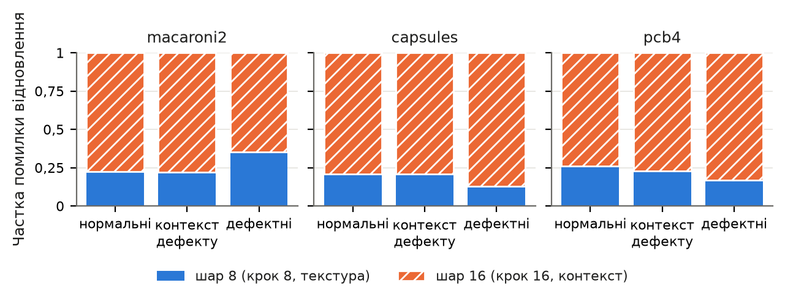

Стовпці — частка помилки, яку дає кожен шар (синє — шар 8, штрихування — шар 16), для трьох груп
патчів. На нормальних патчах шар 8 дає 22 / 21 / 26 % помилки. На дефектних картина залежить від
категорії. У macaroni2 частка шару 8 **росте** до 35 %: дрібні тріщини й сколи — це текстура. У
capsules і pcb4 вона **падає** до 13 % і 17 %: їхні дефекти (бульбашки, зайві чи відсутні деталі)
модель бачить через контекст шару 16.

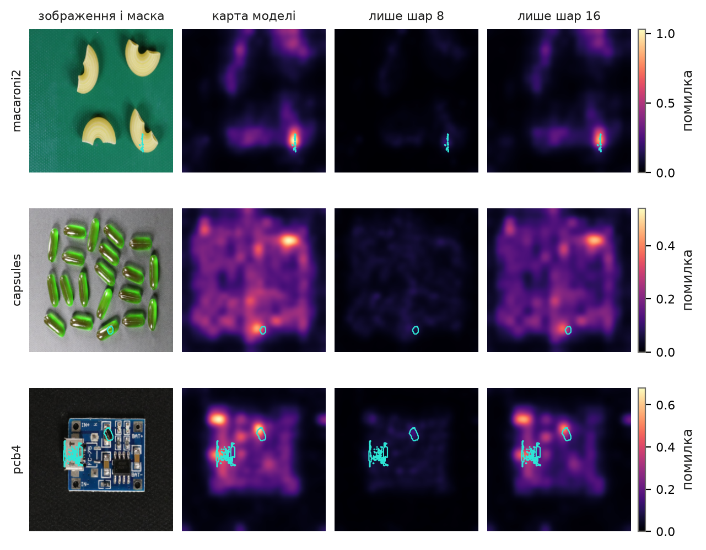

На прикладах видно, що «лише шар 8» майже темна, а форму карти моделі задає шар 16. Pixel AUROC
окремих шарів на test (`tables/error_by_layer_maps.csv`): macaroni2 — шар 8 **0,987**, шар 16 0,976,
повна 0,981; capsules — 0,967 / 0,959 / 0,966; pcb4 — 0,951 / 0,967 / 0,971.

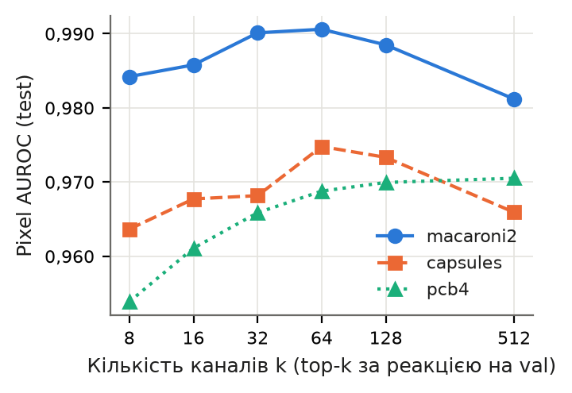

Вісь X — скільки найкращих (за val) каналів лишили, вісь Y — Pixel AUROC на test. При k = 64 вийшло
0,991 / 0,975 / 0,969 проти 0,981 / 0,966 / 0,971 на всіх 512. У capsules і pcb4 перші 32 канали —
**усі** з шару 16 (частка шару 8 у top-k = 0), у macaroni2 перші 8 на 88 % із шару 8
(`tables/top_channels.csv`).

**Чесно:** на macaroni2 «лише шар 8» і «top-64» на test кращі за повну модель. Це **не** привід
перебудувати модель: вибір за test — витік. Правильний висновок такий: у FAE є зайві канали, і
відбір каналів *на val* — кандидат на покращення в майбутньому.

#### 2б. Спектри ваг

Кожну матрицю `Dense` розкладаємо через SVD і дивимося на сингулярні числа: наскільки сильно
матриця розтягує простір уздовж кожного напряму. Сам по собі довгий список чисел мало що каже, тому
його стискають в одне число — **ефективний ранг**:

```python
# src/mllabs/labs/lab05/weights_analysis.py:237-242
def effective_rank(self) -> float:
    """``exp(H(p))``, ``p_i = σ_i² / Σσ²`` — «скільки напрямів реально працює»."""
    energy = self.singular_values**2
    share = energy / energy.sum()
    share = share[share > 0]
    return float(np.exp(-(share * np.log(share)).sum()))
```

На пальцях: якщо всі σ однакові, `exp(ентропії)` дорівнює їхній кількості. Якщо вся енергія в
одному σ, ефективний ранг дорівнює 1.

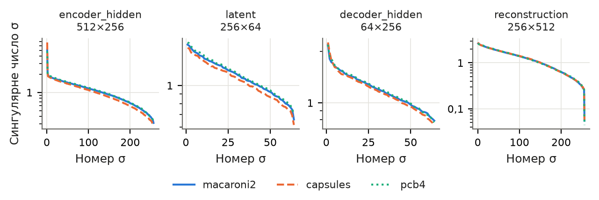

Вісь Y — сингулярне число (лог-шкала), вісь X — його номер. `encoder_hidden` (512×256): ефективний
ранг 172 / 138 / 177 з 256, і перше σ помітно відстає від решти. `latent` і `decoder_hidden`: ≈ 57–59
з 64, тобто «пляшкове горло» використано майже повністю. Найменше σ останнього шару
`reconstruction` ≈ 0,05: декодер практично «не вміє» виводити деякі напрями (`tables/weight_spectra.csv`).

Ще одна перевірка: чи можна за вагами першого шару (норма рядка `W_enc[d,:]`) вгадати, які канали
дають більшу помилку? Ні. Кореляція Спірмена 0,03 / −0,23 / 0,04 (`metrics.weights.<кат>.input_sensitivity_spearman`).
Отже, «прочитати» важливість каналу прямо з ваг не вдається, а розклад помилки (2а) вдається.

#### 2в. Латентний простір

Латентний код FAE має 64 числа. Чи всі 64 виміри справді заповнені? **Participation ratio**
`(Σλ)²/Σλ²` за власними числами коваріації кодів train (`weights_analysis.py:280-283`) дає 11,4 / 13,0
/ 7,2. Розкид кодів зосереджено в ≈ 7–13 напрямах. Решта вимірів формально є, але дисперсії в них
мало.

Альтернативна оцінка аномальності — відстань Махаланобіса коду до середнього коду train
(`weights_analysis.py:321-327`). Вона відповідає на питання «чи рідкісне це місце *на* многовиді
норм». Помилка відновлення відповідає на інше: «наскільки точка *поза* многовидом».

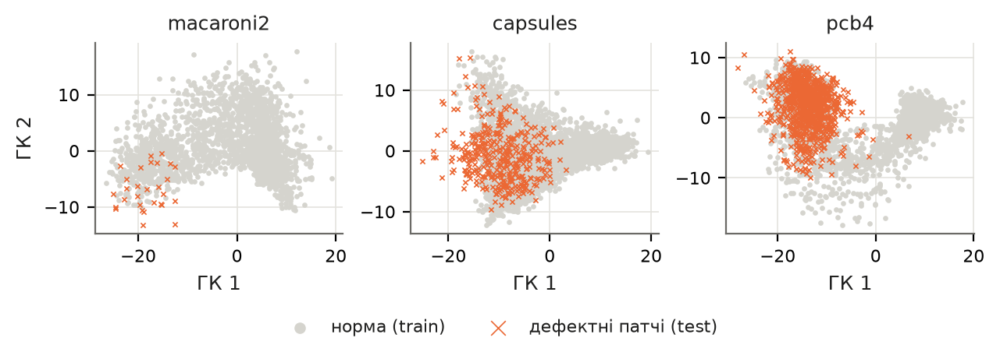

Сірі точки — коди train на площині двох головних компонент, хрестики — дефектні патчі test. Дефекти
лежать здебільшого *на краю* хмари норм, а не далеко від неї. Pixel AUROC Махаланобіса — 0,959 / 0,897
/ 0,896, помітно гірше за FAE. Висновок: FAE ловить дефекти саме як «погано відновлювані», а не як
«рідкісні коди».

#### 2г. Лінійний автоенкодер і якобіан

Найпрозоріший можливий автоенкодер — PCA: спроєктуй вектор на k головних компонент train і поверни
назад. Оцінка — залишок проєкції. Серед усіх *лінійних* автоенкодерів із латентом k саме PCA дає
найменшу помилку (теорема Еккарта–Янга):

```python
# src/mllabs/labs/lab05/weights_analysis.py:357-362
def residual(self, normalized: np.ndarray) -> np.ndarray:
    """``‖z − proj(z)‖² / D`` для ``(..., D)``."""
    flat = normalized.reshape(-1, normalized.shape[-1])
    restored = self._pca.inverse_transform(self._pca.transform(flat))
    errors = np.square(flat - restored).mean(axis=1)
    return errors.reshape(normalized.shape[:-1])
```

PCA-64 навчається на тих самих нормалізованих векторах train, що й FAE.

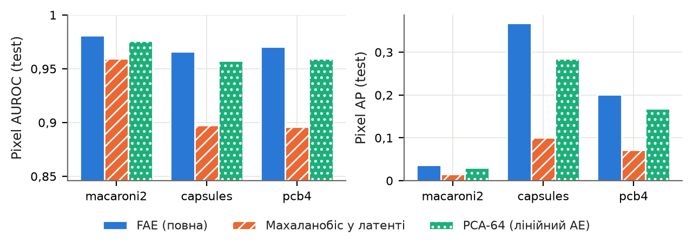

Ліворуч Pixel AUROC, праворуч Pixel AP. PCA-64 відстає від FAE лише на 0,005–0,011 AUROC (0,976 /
0,958 / 0,960). Ранги оцінок патчів FAE і PCA корелюють на ρ = 0,986 / 0,970 / 0,978
(`tables/latent_analysis.csv`). По AP розрив більший: 0,368 проти 0,285 на capsules. **Головний
висновок кроку:** FAE ≈ «трохи нелінійна PCA». Майже всю її якість пояснює проста геометрія:
дефект — це вектор, що виходить за 64-вимірний підпростір норм.

Чи збігаються підпростори PCA і декодера? Середній косинус головних кутів між 64 напрямами PCA і 64
головними вихідними напрямами останнього шару ≈ 0,60 / 0,60 / 0,62 (`weights_analysis.py:365-374`).
Підпростори частково спільні, але не тотожні. FAE знайшла інший, хоч і схожий за якістю, базис.

Нарешті, **якобіан**. FAE побудована з `Dense` і LeakyReLU, а така мережа *кусково-лінійна*: біля
будь-якої точки вона поводиться як `ẑ ≈ J·z + b`. Якби FAE була ідеальним «проектором на норму», то
`J` мав би 64 сингулярні числа ≈ 1 і решту ≈ 0, і `J·J = J`. Відхилення від цього рахуємо так:

```python
# src/mllabs/labs/lab05/weights_analysis.py:413-419
@tf.function
def jacobian(vectors: tf.Tensor) -> tf.Tensor:
    with tf.GradientTape() as tape:
        tape.watch(vectors)
        output = core(vectors[:, None, None, :], training=False)[:, 0, 0, :]
    # batch_jacobian: для кожного рядка пакета окремо — (n, D_out, D_in).
    return tape.batch_jacobian(output, vectors)
```

Далі `‖J² − J‖ / ‖J‖` (`weights_analysis.py:437-440`) — 0, якщо `J` точний проектор.

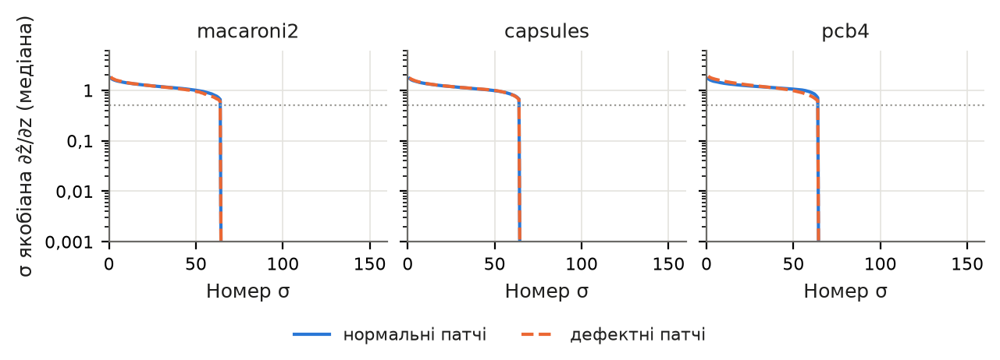

Медіанний спектр якобіана: рівно 64 сингулярних числа вище 0,5, далі обрив. Це латент 64: більше
напрямів через вузьке місце не пройде. Але перше σ ≈ 1,7–1,9, а не 1: FAE не просто проєктує, а ще й
розтягує деякі напрями. «Непроекційність» на нормальних патчах 0,19 / 0,19 / 0,15, на дефектних
0,23 / 0,20 / 0,25 (`tables/jacobian_spectrum.csv`). На дефектах FAE трохи менше схожа на проектор:
вони виводять її з «зони комфорту». У macaroni2 дефектних патчів test лише 29, тож це число найменш
надійне.

- **Чому саме ці методи:** розклад помилки точний і дешевий (кеш ознак). PCA дає еталон «без
  магії». Якобіан — найглибший доступний погляд на нелінійну мережу. Спектри — буквальний «аналіз
  ваг», якого вимагає завдання. Ці методи не пояснюють семантики окремих каналів backbone (що
  «означає» канал 137), і ми цього не стверджуємо.

### Крок 3. Integrated Gradients: вибір бази на val

- **Що:** для п'яти кандидатів у базу рахує IG на 5 аномаліях val кожної категорії і обирає базу за
  тим, наскільки добре карта |IG| збігається з маскою.
- **Навіщо:** IG завжди пояснює *відносно бази*. Для класифікатора кота стандартна база — чорне фото
  («нічого немає»). Для детектора аномалій **нейтральної бази не існує**: чорне, розмите чи середнє фото
  для нього саме є аномалією. Обрати базу «на око» означало б підігнати пояснення.
- **Як — ідея IG.** Проводимо пряму від бази `b` до фото `x`: `b + α·(x − b)`, α від 0 до 1. У кожній
  точці рахуємо градієнт оцінки за пікселями, усереднюємо вздовж шляху й множимо на `(x − b)`:

  `IG_i = (x_i − b_i) · середнє_α ∂F/∂x_i (b + α(x − b))`

  Головна властивість — **повнота**: сума всіх `IG_i` дорівнює `F(x) − F(b)`. Приклад на пальцях: якщо
  F(база) = 2,19, а F(фото) = 0,64, то сума атрибуцій дорівнює −1,55. Різниця «розподіляється» по
  пікселях до копійки.

  Інтеграл рахується правилом трапецій на m кроках. Повноту перевіряємо явно: якщо похибка
  перевищує 5 % порога зображення ЛР4, кроки подвоюються (64 → 128 → 256):

```python
# src/mllabs/labs/lab05/attribution.py:144-151
while True:
    attribution, score, baseline_score = self._integrate(image, baselines, steps)
    delta = score - baseline_score
    error = abs(float(attribution.sum()) - delta) / settings.scale
    if error <= settings.tolerance or steps >= limit:
        break
    steps *= 2
magnitude = np.abs(attribution).sum(axis=-1)
```

  `settings.scale` — поріг зображення ЛР4 категорії. Чому саме він, а не `|F(x) − F(b)|`, як було в
  плані? Рев'ю помітило, що відносна похибка упереджено пропускала «дуже аномальні» бази: при великому
  `|Δ|` будь-яка похибка здається малою (PLAN.md, «Зміни після рев'ю коду»). Тепер шкала однакова для
  всіх баз.

  Точки шляху рахуються пакетами по 33 (`attribution.py:187-200`). Сума `Σ w_i·g_i` накопичується
  одразу через `np.tensordot`, щоб у пам'яті не лежали градієнти всіх 257 точок. Вихідна карта —
  `Σ_канали |IG|`, згладжена тим самим σ = 4, що й карта моделі (`attribution.py:202-209`).

  Кандидати (`attribution.py:236-249`): розмите фото (σ = 10), найближча нормальна з train (з 5
  найближчих за мініатюрою 32×32 — та, яку детектор вважає найнормальнішою, `references.py:60-63`),
  Expected Gradients (4 найближчі норми), середнє train, чорне. Правило вибору:

```python
# src/mllabs/labs/lab05/xai_study.py:214-219
best = max(auroc[str(kind)] for kind in eligible)
# Перша (найпростіша) база в межах допуску від найкращої — правило простоти.
chosen = next(
    kind for kind in eligible if best - auroc[str(kind)] < config.selection_tolerance
)
```

  Допускаються бази, у яких повноту пройшли ≥ 80 % фото. Серед них при різниці AUROC < 0,01 перемагає
  перша за порядком у `config.py:195-201` (розмита → найближча норма → EG → середня → чорна).

- **Що вийшло** (`tables/ig_baselines_val.csv`, усі категорії):

| База | F(b), медіана | F(x) − F(b), медіана | Частка ε ≤ 0,05 | AUROC \|IG\| |
|---|---|---|---|---|
| розмите (σ = 10) | 2,19 | −1,55 | 0,93 | **0,871** |
| найближча норма | 0,38 | +0,30 | 0,87 | 0,865 |
| Expected Gradients | 0,59 | +0,17 | 0,53 | 0,852 |
| середнє train | 1,55 | −0,74 | 0,93 | 0,866 |
| чорне | 1,32 | −0,81 | 0,80 | 0,829 |

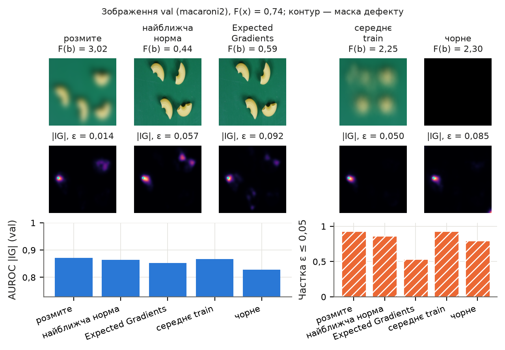

Верхній ряд — п'ять баз для одного фото val macaroni2 і їхні оцінки F(b). Другий ряд — карти |IG|.
Унизу — середній AUROC і частка фото, що пройшли повноту. Обрано **розмиту базу**
(`metrics.xai.ig_baseline = "blur"`).

**Чесні застереження:**

1. **Перемога — фактично нічия.** 0,871 проти 0,866 (середнє) і 0,865 (найближча норма) — різниця
   менша за допуск 0,01, а оцінено лише 15 фото. Розмита база перемогла й за AUROC, і за порядком
   пріоритету. Але з тим самим успіхом могла бути будь-яка з трьох.
2. **Знак IG інвертований.** Розмите фото для детектора аномальніше за справжнє. На test F(b) > F(x)
   у 65 з 68 пояснених фото (`tables/ig_completeness.csv`). Тоді сума IG від'ємна, і атрибуція
   пояснює «чим фото *менш* аномальне за своє розмиття», а не «чим воно аномальне». Тому в метриках
   використовується модуль |IG|, а знакову карту на панелях слід читати як «червоне й синє —
   протилежні напрями впливу», без «червоне = дефект».
3. Expected Gradients не пройшов перевірку повноти (0,53): F(x) − F(b) там ≈ 0 (0,012 на macaroni2),
   а шум інтегрування той самий.

- **Чому IG:** його вимагає завдання. До того ж це один із небагатьох методів із формальною
  гарантією (повнота), яку можна перевірити числом. Найдорожчий крок прогону: 624 с
  (`metrics.timing.steps_seconds.ig_baseline`), бо 75 IG часто доходять до 256 кроків.

### Крок 4. Пояснення на test: IG, Grad-CAM, HiResCAM

- **Що:** обирає на val шар для Grad-CAM/HiResCAM. Потім рахує IG на підвибірці test, Grad-CAM і
  HiResCAM на всіх фото test і міряє, наскільки кожна карта збігається з маскою і з картою моделі.
- **Навіщо:** це центральна вимога завдання. Кількісне порівняння з маскою показує, *чи* пояснення
  дивиться туди, де дефект, а не лише «гарно виглядає».

**Вибір зображень** (`xai_study.py:75-100`): IG дорогий (секунди на фото), тому його рахують на 15
аномаліях на категорію (по 5 з кожної третини за площею дефекту) + усіх FN + 5 «найвпевненіших» FP.
Разом 68 фото. Дешеві методи рахуються на всіх 150 аномаліях.

**Grad-CAM проти HiResCAM.** Обидва дивляться на активації `A` шару backbone і градієнт оцінки за ними:

```python
# src/mllabs/labs/lab05/attribution.py:320-325
for layer, values, grads in zip(
    ("shallow", "deep"), activations, gradients, strict=True
):
    weights = tf.reduce_mean(grads, axis=(1, 2), keepdims=True)  # α_c Grad-CAM
    maps[cam_key("gradcam", layer)] = tf.nn.relu(tf.reduce_sum(weights * values, -1))
    maps[cam_key("hirescam", layer)] = tf.nn.relu(tf.reduce_sum(grads * values, -1))
```

Різниця в одному рядку. Grad-CAM спершу **усереднює** градієнт по всій площині й отримує одну вагу
`α_c` на канал, а потім множить її на активацію каналу *всюди*. HiResCAM множить градієнт на
активацію **в кожній клітинці окремо**. Чому це важливо саме тут: ціль — максимум карти, тож градієнт
ненульовий лише біля однієї точки. Grad-CAM «розмазує» цей локальний сигнал по всьому кадру, і карта
світиться там, де канали просто активні (текстура макаронів, капсул). HiResCAM залишає його на
місці. `ReLU` в обох лишає лише «докази за аномалію».

Карти двох шарів зводяться до 256×256, кожна нормується на свій максимум, і їх середнє дає «злиття»
(`attribution.py:341-344`). Шар обирається на val тим самим правилом простоти. Для обох методів
переміг «злиття» за пріоритетом, хоча він не найкращий: для Grad-CAM шар 16 дає 0,762 проти 0,757, для
HiResCAM — 0,734 проти 0,730 (`tables/gradcam_layers_val.csv`). Різниця в межах допуску.

**Метрики** (`localization.py:72-95`) на кожному фото окремо: піксельний AUROC карти проти маски,
pointing game, маса в масці / площа, IoU top-|M|, Spearman ρ з картою моделі. Середні по фото — з
бутстреп-ДІ (перевибірка фото, як у ЛР4).

**Що вийшло** (`tables/localization_summary.csv`, 54 аномалії з IG-підвибірки, усі категорії):

| Метод | Pixel AUROC [95 % ДІ] | Pointing | Маса / площа | ρ з картою моделі |
|---|---|---|---|---|
| карта моделі | 0,931 [0,907; 0,951] | 0,48 | 4,2 | 1 |
| Integrated Gradients | 0,905 [0,874; 0,934] | 0,35 | 17,1 | 0,75 |
| HiResCAM | 0,803 [0,738; 0,867] | 0,50 | 37,5 | 0,26 |
| Grad-CAM | 0,752 [0,686; 0,818] | 0,35 | 5,8 | 0,11 |
| випадкова карта | 0,508 [0,498; 0,518] | 0 | 1,0 | 0 |

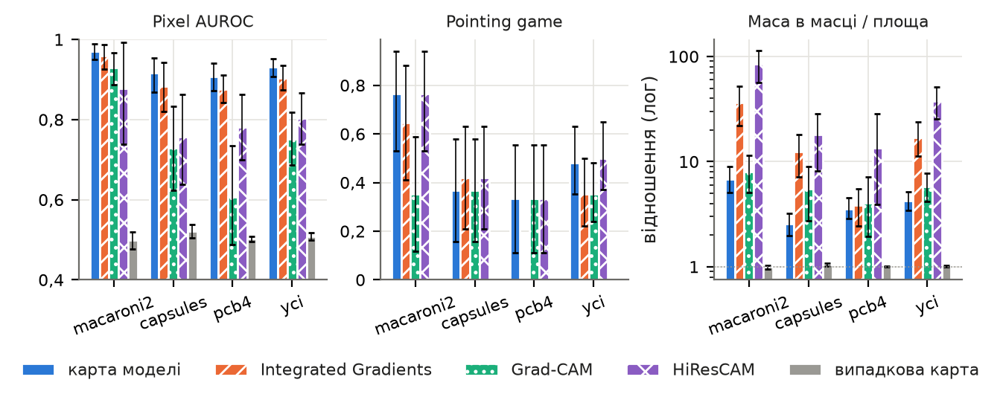

Три панелі — три метрики, групи стовпців — категорії, вуса — 95 % ДІ. Права панель у лог-шкалі,
пунктир 1 — рівень випадкової карти.

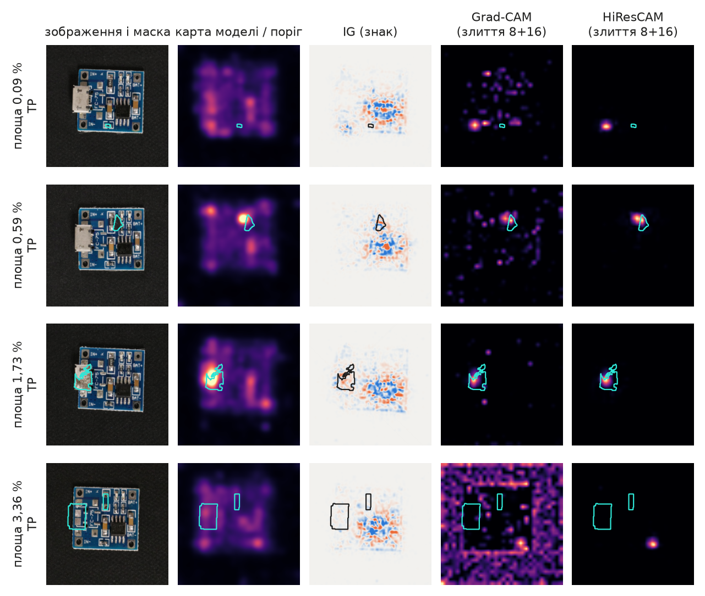

Рядок — одна аномалія (площа дефекту в підписі), колонки: фото з контуром маски, карта моделі, IG зі
знаком, Grad-CAM, HiResCAM. Аналогічні рисунки:
[macaroni2](artifacts/figures/xai_panels_macaroni2.png), [capsules](artifacts/figures/xai_panels_capsules.png).

Як це читати:

- **Карта моделі** як «пояснення самої себе» найкраща за AUROC. Це не дивно: решта методів пояснюють
  лише максимум, а не всю карту.
- **IG** найближчий до карти моделі (ρ = 0,75) і найкращий з «чужих» методів за AUROC. Але pointing
  на pcb4 = **0**: на панелях pcb4 |IG| стабільно світиться в центрі плати (мікросхема, густий
  дрібний рисунок), а не на дефекті. Ймовірна причина — розмита база. Шлях від розмитої плати до
  різкої проходить через фото, де максимум карти стоїть в іншому місці, а найбільша різниця «різке −
  розмите» якраз у густому рисунку. Це гіпотеза, окремо ми її не перевіряли.
- **HiResCAM** точно влучає (маса в масці в 37 разів вища за випадкову), але карта дуже розріджена:
  більшість пікселів нульові. AUROC «всередині фото» від цього страждає.
- **Grad-CAM** дифузний (на панелях видно «конфеті» по всьому кадру) і майже не узгоджений з картою
  моделі (ρ = 0,11). На pcb4 його AUROC 0,607, ДІ [0,487; 0,735] зачіпає рівень випадкової карти.
- Дрібні дефекти найважчі для всіх. Для найменшої третини за площею pointing карти моделі 0,22, для
  найбільшої 0,80 (`tables/localization_by_area.csv`).

Важливо розуміти, що пояснення має бути вірним **моделі**, а не масці. Якщо модель сама «дивиться»
повз дефект (pointing карти моделі 0,48), то вірне пояснення теж покаже повз. Тому поруч із AUROC
проти маски стоїть ρ з картою моделі.

IG пройшов повноту на 64 з 68 фото (`metrics.xai.ig_completeness_pass_share` = 0,94), медіана
кроків 128, максимум 256. Якщо лишити лише фото з пройденою повнотою, числа майже не змінюються:
IG 0,900 на 51 аномалії (`tables/localization_summary_complete_ig.csv`).

- **Чому ці методи:** IG і Grad-CAM вимагає завдання. HiResCAM додано, бо для цілі «максимум» Grad-CAM
  математично невдалий, і це видно в числах. Окремої «карти уваги» в моделі немає (механізму
  attention у FAE немає), тому роль «карти уваги» грає власна карта аномалій.

### Крок 5. Адекватність пояснень

Три незалежні перевірки: (а) perturbation, (б) рандомізація моделі, (в) стійкість до шуму.

#### 5а. Perturbation: MoRF, LeRF, ABPC

- **Ідея:** якщо пояснення каже «ці патчі важливі», то їхнє вилучення має знизити оцінку *швидше*,
  ніж вилучення випадкових патчів. На пальцях: є фото з оцінкою 1,0. Вилучаємо 8 найважливіших патчів
  за IG — оцінка 0,6. Вилучаємо 8 випадкових — 0,95. Отже, IG знайшов щось справжнє.
- **Як:** сітка 32×32 патчі (рідна для моделі). Важливість патча — середнє карти пояснення в ньому
  (`perturbation.py:78-81`). Стани: 0, 1, 2, 3, 5, 8 … 128 вилучених патчів. Для кожного стану модель
  проганяється наскрізно, і оцінка ділиться на оцінку без змін.

  Головна проблема: **будь-яке втручання в зображення для детектора аномалій саме є аномалією**.
  Чорний квадрат, шум, розмиття — усе це «дефект». Тому основний режим «вилучення» — заміна патча
  вмістом найближчого нормального фото train у тій самій позиції:

```python
# src/mllabs/labs/lab05/perturbation.py:94-99
selected = np.zeros(grid * grid, bool)
selected[patches] = True
block = image.shape[0] // grid
# np.repeat двічі «розтягує» сітку патчів до пікселів: (grid, grid) → (S, S).
pixels = np.repeat(np.repeat(selected.reshape(grid, grid), block, 0), block, 1)
return np.where(pixels[..., None], substitute, image)
```

  Другий режим — гаусів шум σ = 32 у патчі: «зашумлення», яке прямо вимагає завдання.

  Метрики на кожне фото (`perturbation.py:248-254`). **AUC** — середній нормований відгук по 14
  станах. **ABPC** = AUC_LeRF − AUC_MoRF. **Δ проти випадкового** = AUC випадкових порядків − AUC_MoRF;
  більше нуля означає, що пояснення краще за жереб. Нижня межа — 5 випадкових порядків. «Маска-оракул»
  вилучає патчі за покриттям маски (`checks.py:197-202`).

- **Що вийшло** (`tables/perturbation_summary.csv`, 15 аномалій × 3 категорії):

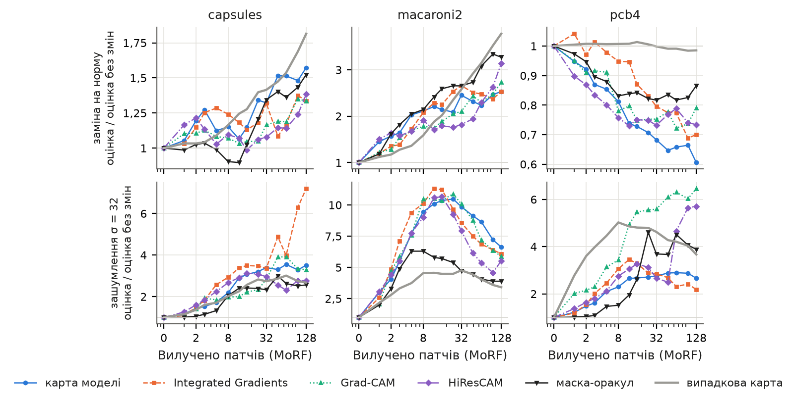

Вісь X — скільки патчів вилучено (MoRF), вісь Y — оцінка / оцінка без змін. Верхній ряд — заміна на
норму, нижній — шум. Сіра товста лінія — випадковий порядок.

Перше, що видно: на macaroni2 і capsules оцінка під час «вилучення» **росте** (до ≈ 3× на macaroni2).
Заміна шматків фото шматками іншого фото створює шви, і детектор бачить їх як аномалію. Наочно:

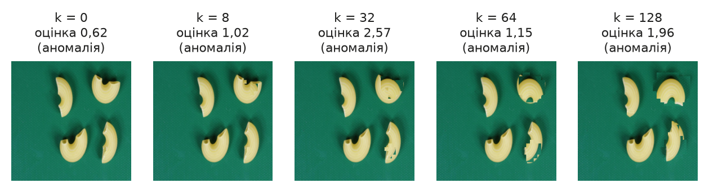

Оцінка іде 0,62 → 1,02 → 2,57 → 1,15 → 1,96 при 0 / 8 / 32 / 64 / 128 вилучених патчах.

Тому ABPC тут спотворена: «найважливіші» патчі лежать на об'єктах, і там заміна створює помітні шви,
а «неважливі» — на однорідному тлі, де шов непомітний. ABPC (заміна, усі категорії) у карти моделі
−0,275 і в IG −0,265, обидва ДІ нижче нуля. Опора — **Δ проти випадкового** (заміна на норму, усі
категорії):

| Метод | Δ проти випадкового [95 % ДІ] |
|---|---|
| HiResCAM | 0,206 [0,097; 0,303] |
| Grad-CAM | 0,197 [0,116; 0,283] |
| карта моделі | 0,121 [0,024; 0,213] |
| Integrated Gradients | 0,107 [0,001; 0,204] |
| маска-оракул | 0,025 [−0,109; 0,148] |

Усі чотири пояснення краще за випадковий порядок, хоча в IG нижня межа ДІ впритул до нуля.
Найчистіше результат видно на pcb4: там оцінка справді падає (крива нижче 1), а Δ у всіх методів
додатна з ДІ вище нуля (0,12–0,23).

**Чесні застереження:**

- **Оракул тут не верхня межа.** Дефекти малі: у macaroni2 вони займають частку пікселя-патча, тож
  маска покриває 1–2 патчі. Далі порядок оракула стає випадковим, а заміна самого дефектного патча
  несуміщеним вмістом створює нову аномалію. Тому в оракула Δ ≈ 0,025.
- **«Зашумлення» загалом не тлумачиться як якість пояснення.** На macaroni2 шум на «важливих»
  патчах піднімає оцінку до ≈ 10× (крива), і Δ у всіх методів від'ємна. Шум на об'єкті аномальніший,
  ніж шум на тлі. Цей режим показує, наскільки детектор чутливий до шуму, а не що пояснення погане.

#### 5б. Sanity check рандомізацією (Adebayo et al., 2018)

- **Ідея:** якщо замінити навчені ваги випадковими, а пояснення не зміниться, то метод показує не
  логіку моделі, а щось у самому фото (наприклад, контури). Як тест, що проходить і на заглушці.
- **Як:** три рівні рандомізації (`sanity.py:119-123`, `sanity.py:133-146`):
  1. випадкові ваги головки FAE, нормалізація μ/σ з train збережена;
  2. випадкова головка без нормалізації (μ = 0, σ = 1);
  3. випадкова вся модель: backbone теж з випадковими вагами He.

  Схожість карт із картами навченої моделі міряють Spearman ρ і SSIM, на рангах, на сітці 64×64
  (`sanity.py:155-169`). SSIM на рангах, бо на сирих розріджених картах (HiResCAM) спільне чорне тло
  завищувало б схожість. Рев'ю додало ключовий контроль: для кожного рівня рахується **Pixel AUROC
  самого рандомізованого детектора** (`checks.py:357-363`). Сенс простий: якщо «випадковий» детектор
  досі знаходить дефекти, то пояснення й не *повинно* змінитися.

- **Що вийшло** (`tables/sanity_randomization.csv`, усі категорії, 15 фото):

| Рівень | Pixel AUROC детектора | ρ IG | ρ Grad-CAM | ρ HiResCAM |
|---|---|---|---|---|
| випадкова головка (μ/σ з train) | 0,908 | 0,85 | 0,21 | 0,30 |
| випадкова головка без нормалізації | 0,827 | 0,80 | 0,07 | 0,15 |
| випадкова вся модель | 0,628 | 0,53 | 0,07 | 0,12 |

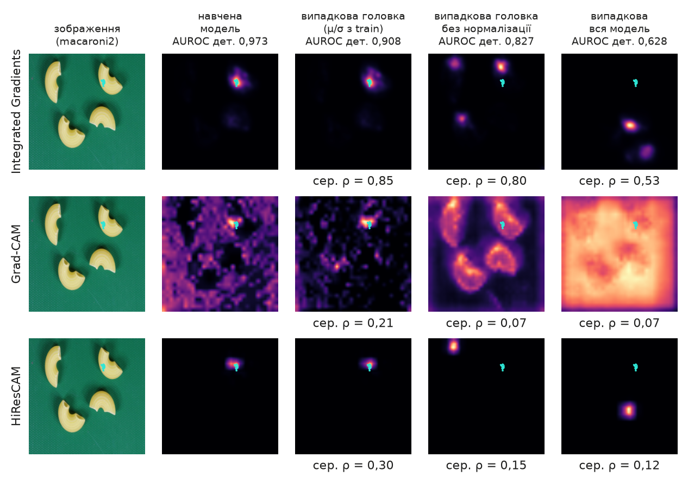

Рядки — методи, колонки — рівні. Над колонкою AUROC детектора (середнє трьох категорій, хоч фото з
macaroni2), під картою середня ρ.

Як це читати:

- **Перші два рівні — не тест пояснень.** Детектор із випадковою головкою досі локалізує дефекти
  (0,91 і 0,83). Випадкова проєкція нормалізованих ознак — теж непогана «відстань до норми», тобто
  це просто *інший робочий детектор*. Висока ρ IG тут нічого не доводить і нічого не спростовує.
- **Висновок можна робити лише на рівні «випадкова вся модель»** (AUROC детектора 0,628). Grad-CAM і
  HiResCAM тест проходять: ρ = 0,07 і 0,12, тобто їхні карти залежать від моделі.
- **IG проходить гірше: ρ = 0,53.** Частина його карти не залежить від ваг. Множник `(x − b)` у
  формулі IG — це різниця «фото − розмите фото», тобто контури. Вони однакові для будь-якої моделі.
  Окремий випадок — pcb4: там ρ IG = 0,83, але й повністю випадковий детектор pcb4 зберіг AUROC 0,80.
  На pcb4 тест неінформативний: випадкові згортки самі по собі «бачать» дефекти плати.

#### 5в. Стійкість до шуму

Шум σ = 2 одиниці яскравості (оку непомітний) і порівняння карт (`tables/explanation_stability.csv`):
ρ IG = 0,987, HiResCAM 0,723, Grad-CAM 0,620. IG найстабільніший, бо він усереднює градієнти по
десятках точок шляху. Grad-CAM/HiResCAM беруть один градієнт у точці максимуму, а максимум від шуму
може «перескочити».

**Підсумок кроку 5:** жоден метод не перемагає за всіма перевірками. HiResCAM — найкращий баланс
(влучність, perturbation, рандомізація), але нестабільний. IG стабільний і близький до карти моделі,
але частково «пояснює фото», а не модель. Grad-CAM для цієї моделі найслабший.

### Крок 6. Граничні випадки FP/FN

- **Що:** бере всі FP і FN FAE з `test_predictions.csv` ЛР4. Для кожного фото test рахує прості
  дескриптори, порівнює групи FP↔TN і FN↔TP, призначає «причину» за прозорими правилами і окремо
  перевіряє гіпотезу «рамки» з рев'ю ЛР4.
- **Навіщо:** завдання вимагає з'ясувати *фізичні* причини помилок: освітлення, текстура, малий
  дефект.

**Скільки помилок** (`metrics.errors`): macaroni2 FP 42 / TN 8, FN 3 / TP 47; capsules FP 17 / TN 13,
FN 8 / TP 42; pcb4 FP 4 / TN 47, FN 4 / TP 46. FPR 0,84 / 0,57 / 0,08 — це не баг ЛР5, а відомий
результат ЛР4: поріг macaroni2 з max F1 на val опинився на рівні оцінок самих норм
([ЛР4, питання 3](../lab04/GUIDE.md#7-що-може-спитати-викладач)).

**Дескриптори** (`error_cases.py:97-147`): σ яскравості, текстурна енергія (дисперсія лапласіана),
частка пересвіту, **медіанна помилка патчів** («уся сцена аномальніша?»), **локальність**
max/медіана, сила країв Собеля і яскравість у вікні 24×24 біля максимуму карти, відстань максимуму до
краю кадру. Для аномалій додаються площа й контраст дефекту.

**Порівняння груп** (`error_cases.py:252-294`): критерій Манна–Вітні, розмір ефекту `r = 2U/(n₁n₂) − 1`,
поправка Голма на 10–12 дескрипторів (`error_cases.py:239-249`). Групи з n < 5 лише описуються.

**Що вийшло** (`tables/error_groups.csv`). Усередині категорій значущий лише один дескриптор —
**локальність**: FP vs TN на macaroni2 r = 0,91, на capsules r = 1,00; FN vs TP на capsules r = −0,99.
Інакше кажучи, хибна тривога — це *один гострий пік* на звичайному тлі, а пропуск — дефект, що не
дав піку. Тут **чесне застереження:** локальність = max / медіана, а max і є оцінкою зображення. Тому
цей результат наполовину тавтологічний: він описує *форму* помилки, але не її фізичну причину.

У зведенні «усі категорії» значущих дескрипторів багато: текстурна енергія r = −0,73, яскравість
r = 0,53 тощо. **Їм не можна вірити як причинам.** 42 з 63 FP — це macaroni2 з її гладким зеленим
тлом, тож «FP мають низьку текстурну енергію» означає лише «FP здебільшого з macaroni2». Це класичне
змішування груп. Тому рисунок нижче показує **ранги всередині категорії**:

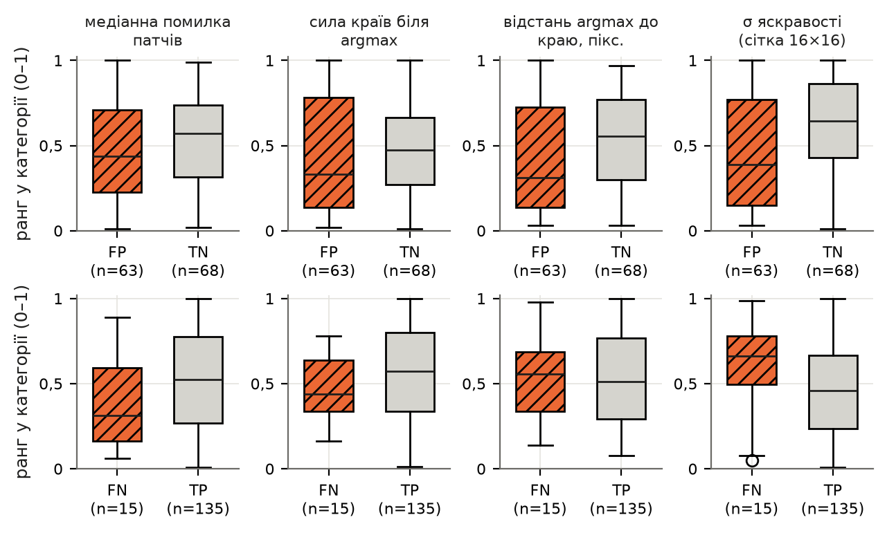

Верхній ряд — FP проти TN, нижній — FN проти TP. Вісь Y — ранг значення в межах своєї категорії
(0–1). Ящики FP і TN здебільшого перекриваються.

**Причини за правилами** (`error_cases.py:198-211`). Правила перевіряються по черзі, і спрацьовує
перше:

```python
# src/mllabs/labs/lab05/error_cases.py:200-211
checks = {
    "global": row["global_error"] > self.global_error,
    "glare": row["window_saturated"] > self.glare_share,
    "object_edge": row["edge_strength"] > self.edge_strength,
    "frame_border": row["border_distance"] < self.border_px,
}
for cause in self.fp_order:
    if checks[cause]:
        if cause == "frame_border" and row["border_edges"] >= 2:
            return "frame_corner"
        return cause
return "undetermined"
```

Пороги правил беруться **не** з помилок test (`errors_study.py:152-165`). «Глобальна» — p90 медіанної
помилки норм val, «край об'єкта» — p90 сили країв норм val. Лише межі «дрібний» і «низький контраст»
для FN — квартилі аномалій test: це описова характеристика вибірки, а не налаштування.

| Причина FP | macaroni2 (42) | capsules (17) | pcb4 (4) |
|---|---|---|---|
| край кадру | 16 | 2 | 1 |
| кут кадру | 6 | 0 | 0 |
| край об'єкта / структура | 4 | 5 | 1 |
| глобальна текстура / освітлення | 2 | 1 | 1 |
| не визначено | 14 | 9 | 1 |

FN: «дрібний дефект» — 1 з 3 (macaroni2), 6 з 8 (capsules), 3 з 4 (pcb4) (`tables/error_causes.csv`).
За типами дефектів: у capsules усі 8 FN мають тип `bubble`, у macaroni2 3 з 3 — `small chip around edge`
(`tables/error_by_defect_type.csv`; одне фото може мати кілька типів).

**Чесне застереження: порядок правил змінено post hoc.** У плані був порядок `global → glare →
object_edge → frame_border`. Після першого прогону його замінили на `frame_border → glare →
object_edge → global` (`config.py:231-232`): FP з максимумом у куті й трохи підвищеною медіаною
потрапляв у «глобальні». Оскільки рішення ухвалено, *побачивши* результат, поруч рахується таблиця
чутливості `tables/error_causes_plan_order.csv`. За порядком плану macaroni2 дає «край кадру» 11
замість 16 і «глобальна» 7 замість 2. Capsules: «край кадру» 1 замість 2, «глобальна» 3 замість 1.
pcb4 не змінюється. **Причини чутливі до порядку правил.** Тому їх слід подавати як гіпотези, а
стійкий висновок такий: великої частки FP macaroni2 (≥ 17 з 42 за будь-яким порядком) максимум
лежить біля краю чи в куті кадру.

**Гіпотеза «рамки»** (`errors_study.py:237-266`):

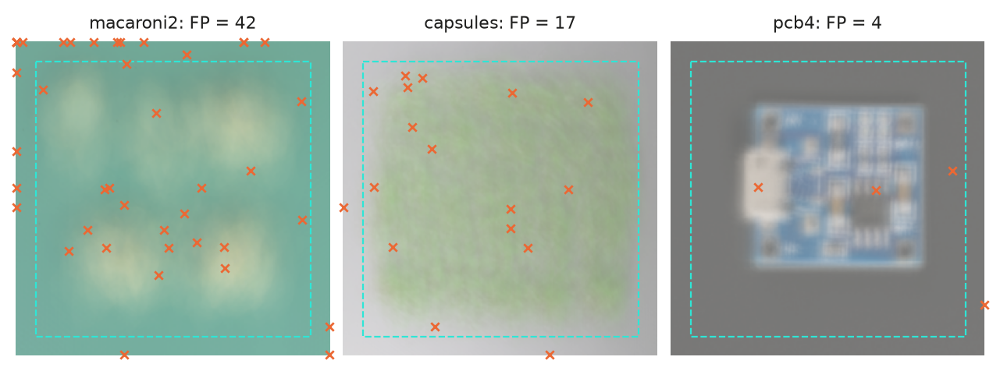

Хрестики — де стоїть максимум карти кожного FP, на тлі середнього фото категорії. Пунктир — смуга
16 пікс. На macaroni2 52 % максимумів FP у смузі, хоча смуга займає 23 % площі, а в кутах 14 % при
1,6 % площі (`tables/border_artifacts.csv`).

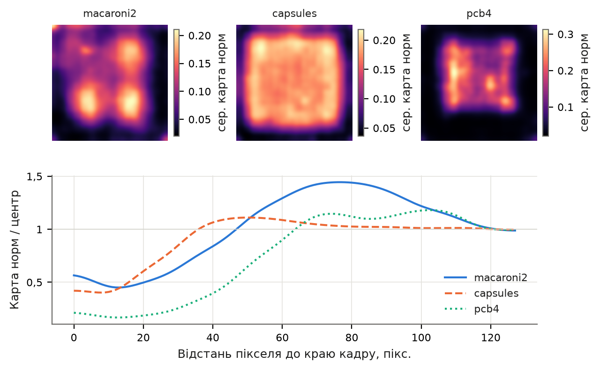

Але **середня** карта нормальних фото (зверху) біля краю *темніша*, ніж у центрі. Помилка крайового
кільця патчів train — лише 0,53 / 0,44 / 0,32 від центру. Отже, систематичної «рамки» немає. Є
поодинокі гарячі точки біля краю на окремих фото, і вони потрапляють у максимум, бо оцінка — це
максимум.

Діагностика «оцінка без смуги» (поріг перекалібровано на val, модель та сама):

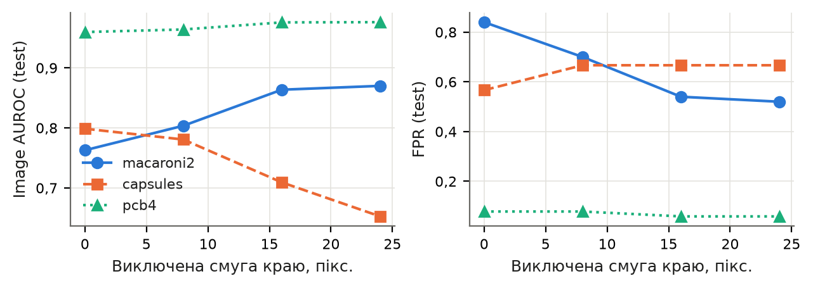

macaroni2: Image AUROC 0,763 → 0,870, FPR 0,84 → 0,52 при смузі 24 пікс. pcb4: 0,960 → 0,976.
capsules: **гірше**, 0,799 → 0,653, бо 7 масок test зачіпають смугу 24 пікс. Ширину смуги ми не
обирали (лише показали всі чотири), і на test її обирати не можна. Якщо застосовувати такий захід, то
з вибором на val і пам'ятаючи про дефекти біля краю.

**Чи помиляються інші методи там само** (`tables/error_overlap_methods.csv`): з 42 FP macaroni2 PaDiM
теж помиляється на 38, PatchCore на 16, усі три на 14. Значна частина FP macaroni2 — властивість даних
і ознак backbone, а не лише FAE.

Панелі найвпевненіших помилок із поясненнями:
[FP](artifacts/figures/fp_panels.png), [FN](artifacts/figures/fn_panels.png). На FP macaroni2 всі
три пояснення дружно вказують у кут кадру. Тут пояснення вірні моделі: модель справді «дивиться» в
кут.

### Крок 7. Дрейф розподілу

- **Що:** застосовує до всього test сім родин контрольованих змін по 2–3 рівні й міряє, що стається з
  якістю і хибними тривогами.
- **Навіщо:** детектор навчено на фото однієї камери при одному світлі. На лінії лампа старіє, об'єктив
  пилиться, камера зсувається, JPEG стискає сильніше. Нам потрібна **межа**: з якого рівня змін модель
  уже не можна використовувати без перекалібрування.
- **Як:** трансформації (`drift.py:58-149`). Кожна — клас з одним методом `apply` (інтерфейс
  `ImageTransform`). Фотометричні не чіпають маску, а зсув кадру зсуває і фото, і маску:

| Родина | Фізичний зміст | Рівні (`config.py:59-67`) |
|---|---|---|
| затемнення / підсилення | інша експозиція, лампа | ×0,85, ×0,7 / ×1,15, ×1,3 |
| градієнт освітлення | тінь, нерівне світло | амплітуда 0,1 / 0,2 / 0,4 |
| гаусів шум | шум сенсора | σ = 3 / 6 / 12 |
| розмиття | розфокус, рух | σ = 0,5 / 1 / 2 пікс. |
| JPEG | стиснення камери | якість 70 / 40 / 20 |
| зсув кадру | вібрація, позиціювання | 4 / 8 / 16 пікс. |

  На кожному рівні рахуються Pixel/Image AUROC, FPR і TPR **при порозі ЛР4**, зсув медіани оцінок
  норм, KS і **монітор дрейфу**. Монітор — це AUROC розрізнення «змінені норми vs чисті норми» за
  медіанною помилкою патчів кадру, без жодних міток (`drift.py:233-236`). **Межа** — перший рівень, на
  якому Pixel AUROC падає більше ніж на 0,02 *або* FPR зростає більше ніж на 0,10. Обидва допуски
  задано апріорі (`drift.py:254-274`, `config.py:245-246`).

- **Що вийшло:**

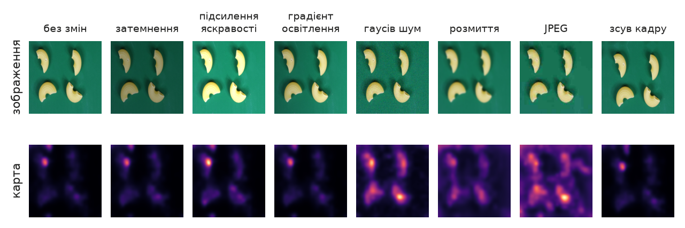

Одне фото macaroni2 під найсильнішим рівнем кожної родини (зверху) і його карта (знизу). Шум, розмиття
й JPEG «запалюють» усю карту.

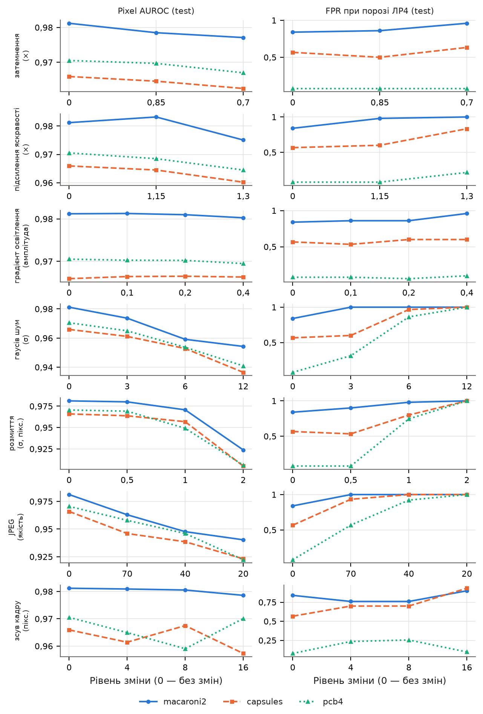

Ліворуч Pixel AUROC, праворуч FPR при порозі ЛР4. Рядок — родина, лінія — категорія.

- Яскравість, градієнт освітлення і зсув майже не шкодять **ранжуванню пікселів**: Pixel AUROC
  змінюється не більше ніж на ≈ 0,012 (`tables/drift.csv`).
- Шум σ = 12, розмиття σ = 2, JPEG 20 знижують Pixel AUROC до 0,937–0,954 / 0,905–0,924 / 0,922–0,940.
- **FPR ламається значно раніше.** pcb4: чисті 0,08 → шум σ = 6 0,86, розмиття σ = 1 0,75, JPEG 70
  0,57. Модель ще правильно впорядковує пікселі, але вся шкала оцінок зсунулася, і поріг ЛР4 більше
  не працює.

Межі (`tables/drift_limits.csv`, перший «поганий» рівень):

| Зміна | macaroni2 | capsules | pcb4 |
|---|---|---|---|
| затемнення | 0,7 | не досягнуто | не досягнуто |
| підсилення яскравості | 1,15 | 1,3 | 1,3 |
| градієнт освітлення | 0,4 | не досягнуто | не досягнуто |
| гаусів шум σ | 3 | 6 | 3 |
| розмиття σ | 1 | 1 | 1 |
| JPEG якість | 70 | 70 | 70 |
| зсув кадру | не досягнуто | 4 | 4 |

**Чесне застереження про macaroni2.** На чистих даних FPR macaroni2 уже 0,84. Межі macaroni2 в
таблиці майже всі через FPR: 0,84 → 0,98 при ×1,15 — це +0,14, понад допуск. Хоча Pixel AUROC
при ×1,15 навіть зріс (0,983). Для macaroni2 межі треба тлумачити **за Pixel AUROC**. Pixel AUROC
macaroni2 уперше падає більше ніж на 0,02 на шумі σ = 6 (0,959), розмитті σ = 2 (0,924) і JPEG 40
(0,948), а далі лише гіршає.

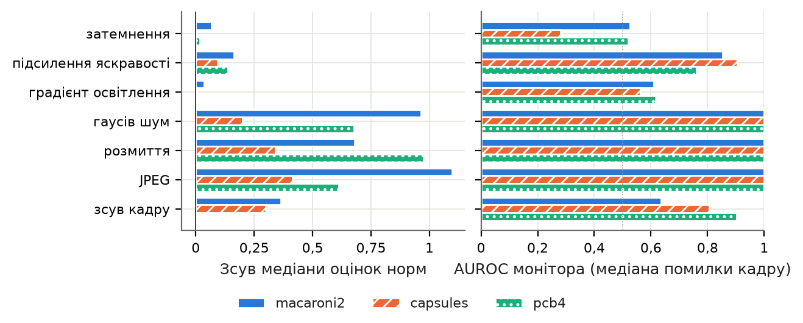

Ліворуч — зсув медіани оцінок норм під найсильнішим рівнем, праворуч — AUROC монітора (0,5 =
монітор нічого не бачить). Шум, розмиття і JPEG монітор помічає майже ідеально (AUROC ≈ 1). Отже,
edge-пристрій може сам підняти прапор «умови змінилися», не маючи міток. Затемнення монітор не
бачить: 0,45–0,53 на macaroni2 і pcb4. На capsules він 0,28–0,34, тобто медіанна помилка
*зменшується*. Такий монітор був би корисний лише як двосторонній. Зауваж, що вісь графіка
починається з 0,4, і стовпці capsules для затемнення там не видно.

- **Чому так:** реальних «дрейфових» даних VisA не має. Синтетичні трансформації дають контрольований
  рівень сили і дозволяють назвати межу числом. Обмеження: справжній дрейф (інша партія виробів, пил)
  може поводитися інакше.

### Крок 8. Edge: TFLite, квантування, роздільність

- **Що:** конвертує детектор у TFLite у чотирьох варіантах точності. Для кожного міряє розмір, latency
  одного кадру і якість на test. Окремо пробує менший вхід 224 і 192.
- **Навіщо:** завдання просить рекомендації для edge-пристроїв реального часу. Без вимірювань це були б
  слова.
- **Як — квантування простими словами.** Ваги зазвичай зберігаються як `float32` (4 байти). Варіанти:
  - **fp32** — без змін, еталон;
  - **fp16** — ваги у 16-бітних float: файл удвічі менший, а рахує CPU, як правило, усе одно в fp32;
  - **динамічне int8** — ваги у 8-бітних цілих (кожна вага ≈ `масштаб × ціле від −128 до 127`),
    активації переводяться в int8 «на льоту» на кожній операції;
  - **повне int8** — і ваги, і активації в int8. Для активацій заздалегідь потрібні діапазони, і їх
    отримують *калібруванням*: прогоном 64 нормальних фото train.

```python
# src/mllabs/labs/lab05/edge.py:54-63
def export(self, model: keras.Model, variant: TfliteVariant) -> bytes:
    """Буфер ``.tflite`` (вхід і виходи лишаються float32)."""
    converter = tf.lite.TFLiteConverter.from_keras_model(model)
    if variant is not TfliteVariant.FP32:
        converter.optimizations = [tf.lite.Optimize.DEFAULT]
    if variant is TfliteVariant.FP16:
        converter.target_spec.supported_types = [tf.float16]
    if variant is TfliteVariant.FULL_INT8:
        converter.representative_dataset = self._representative
    return converter.convert()
```

  Конвертується вся модель «фото → карта + оцінка», разом із пост-обробкою (`edge.py:34-41`). План
  (D9) очікував, що пост-обробка не сконвертується через `tf.newaxis`, але в підсумку вона
  конвертується (`edge.py:12-13`), тож latency включає й її. Latency міряє `LatencyBenchmark` з ЛР4:
  5 прогрівів, 30 вимірювань, медіана; лише `invoke`, batch = 1 (`edge.py:104-111`). Якість
  рахується з порогом ЛР4 і з порогом, перекаліброваним на val: квантування зсуває шкалу оцінок.

- **Що вийшло** (`tables/edge_variants.csv`, середнє трьох категорій):

| Варіант | Розмір, МБ | 1 потік, мс | × fp32 | усі потоки, мс | Pixel AUROC | Image F1 (поріг з val) |
|---|---|---|---|---|---|---|
| Keras fp32 (еталон) | — | — | — | — | 0,9725 | 0,789 |
| TFLite fp32 | 4,97 | 36,7 | 1,00 | 18,3 | 0,9725 | 0,789 |
| TFLite fp16-ваги | 2,56 | 36,6 | 1,00 | 18,3 | 0,9725 | 0,796 |
| TFLite динамічне int8 | 1,54 | 30,0 | 0,82 | 22,0 | 0,9718 | 0,784 |
| TFLite повне int8 | 1,68 | 19,4 | 0,53 | 14,4 | 0,9536 | 0,772 |

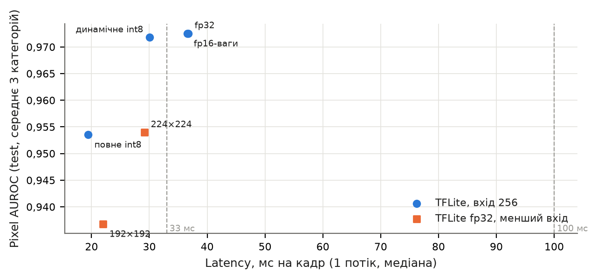

Вісь X — latency 1 потоку, вісь Y — Pixel AUROC. Пунктири — бюджети 33 і 100 мс. Хороша точка
лежить ліворуч і вгорі.

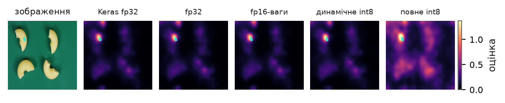

Як читати:

- **fp16** зменшує файл удвічі й нічого не дає за швидкістю на CPU.
- **Динамічне int8** — єдиний варіант, що вкладається і в 33 мс, і в допуск ΔPixel AUROC ≤ 0,01
  (−0,0008, `tables/limits_edge.csv`). Дивина: на всіх потоках він *повільніший* за fp32 (22,0 проти
  18,3 мс). Ймовірно, перетворення «на льоту» погано паралеляться. Ми це не профілювали.
  І середнє приховує втрату на pcb4: там Image AUROC падає з 0,960 до 0,944, а Image F1 — з 0,920 до
  0,874 (0,879 після перекалібрування порога; `tables/edge_variants_full.csv`).
- **Пост-обробка** (збільшення карти й згладжування) у TFLite не входить і виміряна окремо: 3,1 мс в
  1 потоці, 2,3 мс на всіх ядрах (`metrics.edge.postprocess_ms`). Для динамічного int8 це
  30,0 + 3,1 ≈ 33,1 мс — на самій межі 33 мс; fp32 на всіх ядрах (18,3 + 2,3 мс) вкладається із запасом.
- **Повне int8** удвічі швидше за fp32, але втрачає 0,019 Pixel AUROC, а карта помітно «зашумлюється»
  (останній кадр рисунка). Відхилення оцінок від Keras сягає 3,9 на pcb4 (`tables/edge_variants_full.csv`).
  Поріг ЛР4 там непридатний: Image F1 pcb4 за порогом ЛР4 0,662, за перекаліброваним 0,868.
- **Менший вхід:** 224×224 — 29,1 мс, ΔPixel AUROC −0,019; 192×192 — 22,0 мс, −0,036
  (`tables/edge_resolution.csv`). Обидва за допуском. Дрібні дефекти не переживають зменшення.
- Довідка ЛР4 (`tables/edge_lr4_summary.csv`): MobileNetV2 1,20 GFLOPs, EfficientNetB0 1,32, ResNet50
  8,82. MobileNetV2 не перенавчали, це лише орієнтир.

**Чесні застереження:**

- Latency виміряно на **Apple M1 Pro**, а не на edge-платі. Переносити можна лише **співвідношення**
  (повне int8 ≈ 0,53× fp32), але не мілісекунди. 30,0 мс динамічного int8 — запас лише 3 мс до 33 мс
  бюджету, і його повністю з'їдає пост-обробка (3,1 мс); на ARM-платі запасу майже напевно не буде.
- Під час прогону машина не була вільна: load average 7,6 / 7,8 / 9,6 (`metrics.edge.device`).
- Розмір `.tflite` — це не пікова пам'ять: робочі буфери інтерпретатора не вимірювалися.
- API `tf.lite` у TF 2.21 позначено застарілим (Google переносить його в `ai_edge_litert`), тож у
  журналі будуть попередження.

### Крок 9. Межі придатності та зведення

- **Що:** зводить у `tables/limits_of_applicability.csv` три види меж: edge-варіанти, межі дрейфу і
  частоти помилок. Правила апріорні й лежать у `config.py`.

```python
# src/mllabs/labs/lab05/summary.py:562-570
quality_ok = delta >= -tolerance
if not quality_ok:
    verdict = "непридатний: втрата якості понад допуск"
elif latency <= fast:
    verdict = f"придатний для {1000 / fast:.0f} FPS"
elif latency <= slow:
    verdict = f"лише {1000 / slow:.0f} FPS"
else:
    verdict = "непридатний для реального часу (1 потік)"
```

- **Що вийшло:**
  - **Edge:** fp32 і fp16 — «лише 10 FPS»; динамічне int8 — «придатний для 30 FPS»; повне int8, 224 і
    192 — «непридатний: втрата якості понад допуск». Вердикт код виносить за latency інференсу без
    пост-обробки, тому «придатний для 30 FPS» слід читати як «на межі 30 FPS» (див. крок 8).
  - **Помилки** (FPR/FNR > 0,5 — «ненадійне», > 0,1 — «з контролем людиною», `summary.py:633-635`):
    macaroni2 — FPR 0,84, «рішення на рівні зображення ненадійне». capsules — FPR 0,57, теж
    «ненадійне». pcb4 — FP 4/51, FN 4/50, «прийнятно».
  - **Дрейф:** таблиця меж із кроку 7.
- **Час прогону** (`metrics.timing`): 2225 с ≈ **37 хв** на 10 ядрах. План закладав 20–30 хв (PLAN.md,
  P6), а оцінка в розділі 5.1 плану була 17–25 хв. Найдовші кроки: вибір бази IG 609 с, пояснення на
  test 486 с, перевірки адекватності 457 с, edge 451 с.

### 4.10. Що з усього цього випливає (одним списком)

1. Як класифікатор «брак / не брак» модель придатна лише на pcb4. Карту дефектів дають усі три
   категорії (Pixel AUROC 0,966–0,981), але на macaroni2 і capsules поріг на рівні зображення потребує
   людини.
2. Детектор — це, по суті, лінійна геометрія «вихід за підпростір норм» (PCA-64 майже так само
   добра). Це добре для довіри: поведінку можна пояснити без нейромережевої магії.
3. Пояснення не безкоштовні: Grad-CAM для цілі «максимум» розмазаний, IG залежить від бази й частково
   пояснює саме фото, HiResCAM влучний, але нестабільний. Жодному не можна вірити без перевірок із
   кроку 5.
4. Поріг ЛР4 крихкий: шум, розфокус чи сильніший JPEG ламають FPR раніше, ніж якість ранжування.
   Медіанна помилка кадру — дешевий і робочий монітор для цих змін, але не для затемнення.
5. Найближче до 30 FPS на одному ядрі CPU — динамічне int8, але з пост-обробкою воно на самій межі
   бюджету; із запасом гарантовано 10 FPS. Чи вистачить його на реальній ARM-платі, треба міряти на ній.

## 5. Python очима Java-розробника

Уже пояснене в розділах 5 [ЛР1](../lab01/GUIDE.md)–[ЛР4](../lab04/GUIDE.md) (`dataclass`, `Protocol`,
`StrEnum`, `match`, `next(...)` з генератором, `@override`, `einsum`, `None` в індексі, `tf.function`,
`dict.fromkeys`) тут не повторюється.

| У Java ти б написав | У Python тут написано | Де |
|---|---|---|
| `Iterator<T>` з полем-станом і `hasNext/next` | функція з `yield`: кожен `yield` віддає елемент і «заморожує» функцію до наступного запиту | `weights_analysis.py:109-119` |
| рекурсивний обхід дерева з `addAll` | `yield from _all_layers(layer)` — віддати всі елементи вкладеного генератора | `sanity.py:31-37` |
| ручне диференціювання формули | `with tf.GradientTape() as tape:` … `tape.gradient(y, x)`; для входів-не-змінних — `tape.watch(x)` | `attribution.py:113-118` |
| цикл по рядках пакета з окремим якобіаном кожного | `tape.batch_jacobian(output, vectors)` → `(n, D_out, D_in)` | `weights_analysis.py:419` |
| `Σ_i w[i] * g[i]` циклом по масивах | `np.tensordot(weights, gradients, axes=1)` — згортка по першій осі | `attribution.py:199` |
| вкладені цикли «кожна α × кожен піксель» | broadcasting: `padded[:, None, None, None] * difference` — `(n,1,1,1) × (S,S,3) → (n,S,S,3)` без копій | `attribution.py:195` |
| тернарний оператор для кожного елемента масиву | `np.where(маска, a, b)` | `perturbation.py:99` |
| `abstract` метод у базовому класі | метод, що кидає `NotImplementedError`, і `@override` у нащадках (шаблонний метод) | `drift.py:45-55`, `drift.py:64-66` |
| `Map<String, Function<Double, ImageTransform>>` | словник, де значення — сам клас (`BrightnessGain`) або лямбда: клас у Python теж «функція-конструктор» | `drift.py:153-161` |
| `Function<Double, DriftEvaluator>` у конструкторі | `lambda threshold: DriftEvaluator(...)` як фабрика | `lab.py:426-428` |
| `ByteArrayOutputStream` | `io.BytesIO()` — файл у пам'яті для перекодування JPEG | `drift.py:120-124` |
| рефлексія `field != null` | `getattr(layer, "kernel", None) is not None` — атрибут або значення за замовчуванням | `sanity.py:64` |
| глибока копія об'єкта з хуком на кожне поле | `keras.models.clone_model(head, clone_function=clone_layer)`; клон шару — `layer.__class__.from_config(layer.get_config())` | `sanity.py:86-94` |
| `flatMap` по списку в комірці | `frame.explode("defect_type")` — рядок з кількома типами стає кількома рядками | `errors_study.py:206-207` |
| `rows.forEach(r -> cause(r))` з локальним класом-стратегією | функція, оголошена всередині методу, і `cases.apply(cause, axis=1)` | `error_cases.py:229-236` |
| `new Random(seed ^ key)` | `np.random.default_rng((seed, key))` — кортеж як зерно: окремий відтворюваний потік на кожне фото | `perturbation.py:153` |
| `Collections.sort` (стабільне) | `np.argsort(-val.channel_ratio(), kind="stable")` — сортування за спаданням; рівні значення лишаються в початковому порядку | `weights_study.py:129`, `perturbation.py:87` |
| `if (flag == Boolean.TRUE)` для `Boolean`, що буває `null` | `per_image["ig_completeness_ok"] == True  # noqa: E712`: колонка містить `NaN`, і `is True`/`bool()` не годяться | `lab.py:265` |

## 6. Запусти й поекспериментуй

```bash
uv run mllabs run 4        # спершу, якщо немає labs/lab04/artifacts/models (≈ 29 хв)
uv run mllabs run 5        # ≈ 37 хв на 10 ядрах; перезаписує labs/lab05/artifacts/
uv run pytest tests/labs/test_lab05_*.py   # мікро-ЛР4 на синтетиці, без мережі
```

Перед експериментами скопіюй `labs/lab05/artifacts/`. Не запускай поруч важкі процеси: latency
втратить сенс. Параметри — у `src/mllabs/labs/lab05/config.py`.

1. **Прибери розмиту базу:** `ig_baselines` без `BaselineKind.BLUR` (`config.py:195-201`). Серед
   решти, що пройшли повноту, найкраща «середнє train» (0,866), але «найближча норма» (0,865)
   у межах 0,01 і стоїть раніше за пріоритетом. Тому оберуться **найближча норма**. Очікуй: F(b)
   стане меншим за F(x) (медіана F(x) − F(b) на val +0,30), знак IG стане «нормальним» (додатне =
   аномальніше). Повнота на test, найпевніше, проходитиме рідше (на val macaroni2 лише 0,6). Локалізація
   IG зміниться в другому знаку, напрям наперед невідомий. Цікаво перевірити, чи зникне pointing = 0
   на pcb4.
2. **Порядок правил FP як у плані:** `fp_cause_order = ("global", "glare", "object_edge",
   "frame_border")` (`config.py:231`). Очікуй, що `error_causes.csv` стане ідентичною поточній
   `error_causes_plan_order.csv`: macaroni2 «край кадру» 16 → 11, «глобальна» 2 → 7; capsules
   «край кадру» 2 → 1, «глобальна» 1 → 3; pcb4 без змін. Це наочна демонстрація, що «причини» — гіпотези.
3. **Межі дрейфу лише за Pixel AUROC:** `drift_fpr_tolerance: 0.10 → 1.0` (`config.py:246`). FPR більше
   не зможе «зламати» межу, і `drift_limits.csv` стане таким (порахуй сам з `drift.csv`): яскравість,
   градієнт освітлення і зсув — «не досягнуто» скрізь; шум — 6 / 12 / 12; розмиття — 2 / 2 / 1;
   JPEG — 40 / 40 / 40 (macaroni2 / capsules / pcb4). Порівняй із поточною таблицею: майже всі межі
   зараз визначає FPR, тобто поріг, а не модель.
4. **М'якший допуск квантування:** `quantization_auroc_tolerance: 0.01 → 0.02` (`config.py:259`).
   Повне int8 (−0,0190, 19,4 мс) і вхід 224 (−0,0186, 29,1 мс) стануть «придатний для 30 FPS», а 192
   (−0,0358) лишиться непридатним. Висновок цілком залежить від апріорного допуску, тому допуск має
   бути обґрунтований вимогами виробництва, а не підібраний під результат.
5. **Вужчі ДІ perturbation:** `random_orders: 5 → 20` (`config.py:213`). Крок 5 подовжиться (кожен
   порядок — 13 прогонів на фото), середнє Δ майже не зміниться, але оцінка «випадкової» кривої стане
   точнішою.

## 7. Що може спитати викладач

**1. Що означає «інтерпретованість ваг» для автоенкодера з 296 тис. параметрів?**
Не читати ваги, а відповісти на питання про них. Помилка точно розкладається на 512 канальних
доданків і, через матрицю `P`, на два шари backbone. Спектри показують, скільки напрямів реально
використано (латент — 58–59 з 64). PCA-64 показує, що майже всю якість дає лінійна геометрія
(ρ = 0,97–0,99 з FAE). Якобіан підтверджує, що локально FAE — розтягнутий проектор рангу 64.

**2. Чому база IG не чорне зображення, як у статті?**
Бо для детектора аномалій чорне фото — сама аномалія (F(b) медіана 1,32 при порогах 0,42–0,57).
Нейтральної бази немає. Базу обирав код на val за AUROC |IG|. Перемогла розмита, але з відривом
0,005 від середньої — фактично нічия. Ціна такого вибору: знак IG інвертований (F(b) > F(x) у 65 з 68
фото test), тому в метриках використовується |IG|.

**3. Ваш IG проходить перевірку повноти. Значить, пояснення правильне?**
Ні. Повнота гарантує лише коректність *інтегрування*: сума атрибуцій дорівнює F(x) − F(b). Про те,
чи дивиться IG на дефект, вона нічого не каже (pointing на pcb4 = 0). Чи пояснює IG модель, а не
фото, теж ні: на випадковій моделі ρ = 0,53. Для цього й існують кроки 4 і 5.

**4. Чому Grad-CAM тут гірший за HiResCAM?**
Ціль — максимум карти, тож градієнт ненульовий лише біля однієї точки. Grad-CAM усереднює його по
площині в одну вагу на канал і множить на активацію *всюди*, тому карта світиться, де канали просто
активні. HiResCAM множить поелементно й лишає сигнал на місці. Числа: маса в масці 37,5 проти 5,8,
Pixel AUROC 0,803 проти 0,752.

**5. Sanity check: IG має ρ = 0,85 зі «випадковою головкою». Метод провалив тест?**
На цьому рівні — ні, тест неінформативний. Детектор із випадковою головкою і збереженою
нормалізацією досі локалізує дефекти (AUROC 0,908): це просто інший робочий детектор, і схожі пояснення
очікувані. Висновок можна робити лише для повністю випадкової моделі (AUROC 0,628). Там Grad-CAM і
HiResCAM проходять (ρ 0,07 / 0,12), а IG частково ні (0,53). На pcb4 і цей рівень неінформативний: випадкова
модель pcb4 зберегла AUROC 0,80.

**6. ABPC від'ємна. Пояснення гірші за випадкові?**
Ні. ABPC спотворена артефактом: заміна патчів шматками іншого фото сама створює аномалію (оцінка
macaroni2 росте до ≈ 3×). Сильніше це видно на об'єктах, куди вказують «важливі» патчі. Тому опора —
Δ проти випадкового порядку, де артефакт однаковий: у всіх чотирьох методів вона додатна (0,11–0,21).
Оракул тут не верхня межа (Δ 0,025): дефекти займають 1–2 патчі, далі його порядок випадковий.

**7. Які фізичні причини хибних тривог ви знайшли?**
Стійко — одну. На macaroni2 максимум карти FP непропорційно часто біля краю й у кутах кадру: 52 %
у 16-піксельній смузі, яка займає 23 % площі. Систематичної «рамки» немає, бо середня карта норм біля
краю навіть темніша. Решта причин — гіпотези за правилами, і вони чутливі до порядку правил, який ми
змінили після першого прогону (є таблиця чутливості). Пропуски — переважно найдрібніші дефекти.
Багато «значущих» відмінностей у зведенні по категоріях — артефакт змішування: 42 з 63 FP з macaroni2.

**8. Чому межі дрейфу macaroni2 такі суворі (×1,15 яскравості вже «погано»)?**
Бо межу визначає зростання FPR на 0,10, а FPR macaroni2 і без дрейфу 0,84. Pixel AUROC при ×1,15
навіть зріс. Для macaroni2 межі треба читати за Pixel AUROC: він уперше падає понад 0,02 на шумі σ = 6,
розмитті σ = 2 і JPEG 40.

**9. 30,0 мс — отже, на edge буде 30 FPS?**
Ні. По-перше, це лише інференс: з пост-обробкою (3,1 мс) виходить ≈ 33,1 мс, тобто бюджет 33 мс
вичерпано без запасу. По-друге, це M1 Pro, причому під навантаженням (load average 7,6–9,6). На
ARM-платі мілісекунди будуть інші. Переноситься співвідношення (динамічне int8 ≈ 0,82× fp32, повне ≈
0,53×) і висновок про якість: динамічне int8 у середньому Pixel AUROC не втрачає (але на pcb4 Image F1
падає з 0,920 до 0,874), повне втрачає 0,019 Pixel AUROC і потребує перекалібрування порога. Абсолютну latency треба міряти на цільовому пристрої.

**10. Ви бачите, що «лише шар 8» на macaroni2 краще за повну модель. Чому не перебудували?**
Бо це видно на test. Обрати конфігурацію за test — витік, і число стало б оптимістичним. Чесний
шлях — повторити відбір шарів або каналів на val у новій версії ЛР4.

## 8. Що почитати далі

1. **Sundararajan, Taly, Yan, «Axiomatic Attribution for Deep Networks» (ICML 2017, arXiv 1703.01365)**
   — розділи 2–3: аксіоми чутливості й повноти, чому IG інтегрує вздовж шляху.
2. **Sturmfels, Lundberg, Lee, «Visualizing the Impact of Feature Attribution Baselines» (Distill,
   2020, distill.pub/2020/attribution-baselines)** — інтерактивна стаття саме про проблему вибору бази,
   з розмитою базою й Expected Gradients.
3. **Draelos, Carin, «Use HiResCAM instead of Grad-CAM for faithful explanations» (arXiv 2011.08891)**
   — розділ 3: доказ, що усереднення градієнта в Grad-CAM може показувати те, чого модель не
   використовує.
4. **Adebayo et al., «Sanity Checks for Saliency Maps» (NeurIPS 2018, arXiv 1810.03292)** — рис. 1–2:
   як «гарні» карти виявляються детекторами країв. Читай разом із нашим контролем «AUROC
   рандомізованого детектора».
5. **TensorFlow Lite: «Post-training quantization» (tensorflow.org/lite/performance/post_training_quantization,
   тепер ai.google.dev/edge/litert)** — таблиця «технік»: що саме квантує динамічне і повне int8,
   навіщо `representative_dataset`.
