## 1. Постановка завдання

Об'єкт дослідження — детектор аномалій із ЛР № 4. Ознаки патчів вилучає переднавчений EfficientNetB0, а Feature Autoencoder (FAE) їх відновлює; помилка відновлення утворює карту аномалій. Дані — категорії `macaroni2`, `capsules` і `pcb4` датасету VisA [14]. Завдання:

1. **Аналіз інтерпретованості ваг**: проаналізувати математичну інтерпретованість результатів моделі ЛР № 4.
2. **Спеціалізований XAI для візуальних даних**: застосувати Integrated Gradients, Grad-CAM для backbone тощо; побудувати карти уваги (heatmaps).
3. **Перевірка на адекватність**: оцінити стійкість і якість пояснень, зокрема perturbation analysis — вилучення або зашумлення найважливіших патчів і зміна помилки відновлення.
4. **Дослідження граничних випадків**: проаналізувати хибні спрацювання (FP) і пропуски (FN) на динамічному чи неоднорідному тлі та з'ясувати фізичні чи структурні причини, чому модель пропустила об'єкт або сприйняла зміну освітлення чи текстури за аномалію.
5. **Науковий звіт**: детальний аналіз із рекомендаціями щодо меж придатності методу для edge-пристроїв реального часу.

Тема роботи містить також дрейф розподілу даних і межі надійності «чорних скриньок». Тому додатково досліджено контрольований дрейф (освітлення, шум, розмиття, стиснення, зсув кадру), а для edge-розгортання — конвертацію в TensorFlow Lite і квантування.

## 2. Опис проведеної роботи

### 2.1. Модель і дані з ЛР № 4

Модель не перенавчалася. Детектори трьох категорій завантажено з артефактів ЛР № 4 разом із порогами, обраними на val, і розбиттям. Конфігурація: EfficientNetB0 [15], шари `block4a_expand_activation` (крок 8, далі «шар 8») і `block6a_expand_activation` (крок 16, «шар 16»), зведення каналів до D = 512, p = 1, латент k = 64. Перераховані оцінки test збігаються зі збереженими в `test_predictions.csv` ЛР № 4: найбільша розбіжність становить {{metrics.handoff.capsules.max_score_diff:.6f}} за обчислення з кешу ознак і {{metrics.handoff.pcb4.end_to_end_diff:.4f}} за наскрізного проходу «зображення → оцінка» (`handoff_check.csv`), що менше за допуск {{metrics.config.score_tolerance}}. Отже, усі пояснення стосуються саме тієї моделі, яку оцінено в ЛР № 4.

Test не впливав на жоден вибір. Базу IG і шар Grad-CAM обрано на розміченому val, на ньому ж перекалібровано пороги TFLite-варіантів; test використано лише для звітних чисел. Дорогі методи (IG, perturbation) застосовано до підвибірки: {{metrics.config.ig_anomalies_per_category}} аномалій test на категорію, стратифікованих за терцилями площі дефекту, плюс усі FN і найвпевненіші FP — разом {{metrics.xai.n_ig_images}} зображень. Дешеві методи застосовано до всіх {{metrics.xai.localization_all_anomalies.model_map.macaroni2.n}} аномалій test кожної категорії. Seed — {{metrics.config.seed}}. Допоміжні таблиці й рисунки, названі в тексті іменем файлу, містяться в каталозі `artifacts/` роботи; до звіту їх не включено через обсяг.

### 2.2. Методика аналізу ваг

Навчаються лише ваги FAE; backbone і матриця зведення каналів $P$ фіксовані. Аналіз ваг складається з чотирьох частин.

**Точний розклад помилки.** Оцінка патча — сума внесків каналів:

$$e = \frac{1}{D}\sum_{d=1}^{D}\left(\hat z_d - z_d\right)^2 = \sum_{d=1}^{D} e_d .$$

Кожен із 512 каналів — середнє вхідних каналів backbone з вагами $P_{\cdot d}$, тож внесок $e_d$ точно ділиться між шаром 8 і шаром 16. Розклад рахувався для трьох груп патчів test: нормальні (патчі нормальних зображень), дефектні (покриття маскою ≥ {{metrics.config.defect_patch_coverage:.0%}}) і «контекст дефекту» (решта патчів аномальних зображень). Карти «лише шар 8» і «лише шар 16» отримано тією самою пост-обробкою з частин розкладу; перенавчання тут немає.

**Спектри ваг.** Для кожної матриці `Dense` обчислено сингулярні числа й ефективний ранг $\exp H(\sigma^2/\sum\sigma^2)$ (ентропійна міра кількості «працюючих» напрямів). Канали ранжовано за відношенням середньої помилки на дефектних і нормальних патчах val. Окремо перевірено, чи норма рядка ваг енкодера $\lVert W_{d,:}\rVert$ передбачає внесок каналу в помилку.

**Латентний простір і лінійний еталон.** Ефективну розмірність латенту оцінено як participation ratio $(\sum\lambda)^2/\sum\lambda^2$ за {{metrics.config.train_vectors}} векторами train. Відстань Махаланобіса в латенті перевірено як альтернативну оцінку. Еталоном слугує PCA-{{metrics.config.pca_components}} — оптимальний *лінійний* автоенкодер з тим самим «горлом».

**Локальний якобіан.** FAE з активаціями leaky ReLU кусково-лінійний, тобто локально $\hat z \approx Jz + b$, де $J = \partial\hat z/\partial z$ має ранг не більше 64. Для ідеального ортогонального проектора на многовид норми $J^2 = J$, тож відхилення $\lVert J^2 - J\rVert_F/\lVert J\rVert_F$ показує, наскільки модель працює як проекція. Якобіан обчислено на {{metrics.config.jacobian_patches}} нормальних і дефектних патчах кожної категорії.

### 2.3. Методи пояснення

Ціллю всіх градієнтних методів є оцінка зображення $S = \max$ карти аномалій — саме вона ухвалює рішення «норма / аномалія». Через max градієнт проходить лише через окіл найаномальнішої точки, тому пояснення стосуються рішення, а не всієї карти. «Механізму уваги» модель не має, тож роль «карти уваги» виконує власна карта аномалій моделі; її порівнюють з поясненнями.

**Integrated Gradients (IG)** [1] інтегрує градієнт уздовж прямої від бази $b$ до зображення $x$:

$$\mathrm{IG}_i(x) = (x_i - b_i)\int_0^1 \frac{\partial S\big(b + \alpha(x-b)\big)}{\partial x_i}\,d\alpha, \qquad \sum_i \mathrm{IG}_i = S(x) - S(b).$$

Друга рівність — аксіома повноти. Похибку повноти $\varepsilon = |\sum_i \mathrm{IG}_i - (S(x)-S(b))|$ нормовано на поріг зображення ЛР № 4 (абсолютний критерій). Інтегрування виконано правилом трапецій з {{metrics.config.ig_steps}} кроків і подвоєнням до {{metrics.config.ig_max_steps}}, доки $\varepsilon$ не стане меншою за {{metrics.config.completeness_tolerance}}. Карта атрибуції — сума модулів по каналах, згладжена гаусовим ядром σ = {{metrics.config.attribution_blur_sigma:.0f}}, як і карта моделі.

Нейтральної бази для детектора аномалій апріорі немає, тому кандидатів було п'ять: розмите зображення (σ = {{metrics.config.baseline_blur_sigma:.0f}} пікс.), найближче нормальне зображення train, Expected Gradients (EG) [2] за {{metrics.config.expected_gradients_k}} найближчими нормами, середнє зображення train і чорне. Базу обирав код на val ({{metrics.config.val_images_for_selection}} аномалій на категорію) за AUROC карти |IG| проти маски. Обов'язкова умова — повноту пройшли щонайменше {{metrics.config.min_completeness_pass_share:.0%}} зображень. Різниця, менша за {{metrics.config.selection_tolerance}}, вважалася нічиєю, і тоді обиралася база, що стоїть першою у фіксованому порядку пріоритету (розмита → найближча норма → EG → середня → чорна).

**Grad-CAM** [3] і **HiResCAM** [4] застосовано до двох шарів backbone, з яких модель бере ознаки:

$$L_{\text{Grad-CAM}} = \mathrm{ReLU}\Big(\sum_c \bar\alpha_c A^c\Big),\ \ \bar\alpha_c = \operatorname{mean}_{ij}\frac{\partial S}{\partial A^c_{ij}}; \qquad L_{\text{HiResCAM}} = \mathrm{ReLU}\Big(\sum_c \frac{\partial S}{\partial A^c}\odot A^c\Big).$$

Grad-CAM усереднює градієнт по всій карті, тоді як HiResCAM зберігає його просторову локалізацію; для max-цілі, де градієнт зосереджено в одній точці, це принципова різниця. Варіант шару (8, 16 чи злиття нормованих карт) обрано на val за тим самим правилом нічиєї.

**Метрики локалізації** (для кожного аномального зображення, далі середнє з 95% бутстреп-ДІ, {{metrics.config.bootstrap_repeats}} повторів): піксельний AUROC карти проти маски; pointing game [5] — чи потрапляє argmax карти в маску, розширену на {{metrics.config.pointing_tolerance_px}} пікс.; відношення частки маси карти в масці до частки площі маски (1 — рівень випадкової карти); Spearman ρ з картою моделі. Нижньою межею слугує випадкова карта (рівномірний шум).

### 2.4. Методика перевірки адекватності пояснень

**Perturbation analysis** [6]. Зображення поділено на сітку 32×32 патчів по 8 пікс. — рідну сітку моделі. Патчі впорядковано за середньою важливістю в кожному поясненні та вилучено найважливіші першими (MoRF) або найменш важливі першими (LeRF), k ∈ {0, 1, 2, …, 128} патчів. Основний відгук — оцінка зображення, нормована на значення без змін. Вона є максимумом згладженої карти помилки відновлення, тобто прямо відображає зміну reconstruction error у найаномальнішій точці; середню помилку відновлення по всіх патчах і в зоні маски обчислено як додаткові відгуки. Вилучення виконано у двох режимах:

- **заміна на норму** (основний режим): вміст патча замінюється тим самим патчем найближчого нормального зображення train;
- **зашумлення** (прямо вимагає завдання): гаусів шум σ = {{metrics.config.noise_sigma:.0f}}.

Еталонами є {{metrics.config.random_orders}} випадкових порядків (нижня межа) і «маска-оракул» — порядок за покриттям справжньою маскою. Метрики: AUC MoRF — середній нормований відгук по станах (менше — краще); ABPC = AUC LeRF − AUC MoRF [6] (більше — краще); **Δ проти випадкового** = AUC випадкових − AUC MoRF (більше нуля — пояснення краще за випадковий порядок).

Для детектора аномалій perturbation має принципову ваду: будь-яке втручання в зображення саме може бути аномалією. Шви навколо вставленого патча чи шум підвищують оцінку незалежно від того, чи вилучено справжній дефект. Тому вирішальною метрикою обрано Δ проти випадкового порядку: випадкове вилучення створює такі самі артефакти.

**Sanity check рандомізацією моделі** [7]. Якщо пояснення майже не змінюється, коли ваги моделі замінено випадковими, то воно описує зображення, а не модель. Перевірено три рівні: (1) випадкова головка FAE зі збереженою нормалізацією μ/σ з train; (2) випадкова головка без нормалізації (μ = 0, σ = 1); (3) випадкова вся модель, тобто й backbone. Схожість з поясненням навченої моделі вимірюється Spearman ρ і SSIM [8]. SSIM рахується на **рангових** картах, бо на сирих розріджених картах її завищує нульове тло. Для кожного рівня обчислено також Pixel AUROC самого рандомізованого детектора: якщо він і далі локалізує дефекти, висока схожість пояснень провалом тесту не є. Вибірка — {{metrics.config.sanity_images_per_category}} зображень на категорію.

**Стійкість** — схожість пояснень до і після гаусового шуму σ = {{metrics.config.stability_noise_sigma:.0f}} на вході, тобто непомітної для ока зміни.

### 2.5. Методика аналізу FP і FN

Аналізуються всі FP і FN FAE на test за порогами ЛР № 4 з val. Помилки val непридатні, бо на ньому пороги й обирали. VisA складається зі статичних знімків, тому «динамічне тло» з постановки дослідити безпосередньо неможливо: зміну умов зйомки замінено контрольованим дрейфом (п. 2.6), а неоднорідність сцени описано дескрипторами кадру. Для кожного зображення test обчислено дескриптори: σ яскравості на сітці 16×16, текстурну енергію (дисперсію лапласіана), частку пересвічених пікселів, медіанну помилку патчів (глобальна складова), «локальність» max/медіана, а в околі argmax карти (вікно 24×24) — силу країв, яскравість відносно медіани кадру, пересвіт і відстань до краю кадру. Для аномалій додано площу і контраст дефекту. Дескриптор σ яскравості рахується по всьому кадру (об'єкти разом із тлом), тож це міра неоднорідності сцени загалом, а не лише тла. Групи FP↔TN і FN↔TP порівняно критерієм Манна–Вітні з поправкою Голма на кількість дескрипторів [9]; ефект оцінено рангово-бісеріальною кореляцією r.

Причини помилок встановлено прозорими правилами з порогами з `config`. Для FP: «край кадру / кут» (argmax ближче ніж {{metrics.config.border_px}} пікс. до краю), «відблиск» (пересвіт у вікні > {{metrics.config.glare_share:.0%}}), «край об'єкта / структура» (сила країв > p90 норм), «глобальна текстура / освітлення» (медіанна помилка > p90 норм val). Для FN: «дрібний дефект» (площа < p25), «низький контраст» (< p25), «дефект не дав максимуму карти». Правила — гіпотези, а не доведені причини. Окремо досліджено крайові артефакти, на які вказувало рев'ю ЛР № 4 («гарячі кути»), і перетин помилок FAE з помилками методів PaDiM [16] і PatchCore [17] з ЛР № 4.

### 2.6. Дрейф розподілу і edge-розгортання

**Дрейф** змодельовано сімома родинами детермінованих трансформацій test (за зразком [10]): затемнення і підсилення яскравості (інша експозиція), лінійний градієнт освітлення (тінь), гаусів шум (сенсор за слабкого світла), гаусове розмиття (розфокусування), JPEG (стиснення камери) і зсув кадру (вібрація). Дрейф синтетичний: реальні зміни (інша партія виробів, пил на об'єктиві, рух тла) можуть діяти інакше, тому отримані межі — орієнтир, а не гарантія. Для кожного рівня обчислено Pixel AUROC, Image AUROC і FPR за порогом ЛР № 4. **Межа** — перший рівень, на якому Pixel AUROC падає більш ніж на {{metrics.config.drift_auroc_tolerance}} або FPR зростає більш ніж на {{metrics.config.drift_fpr_tolerance}}; обидва допуски задано апріорі. Перевірено також, чи може пристрій помітити дрейф сам, без міток (подібно до [11]): «монітором» слугує медіанна помилка патчів кадру, а його якість — AUROC розрізнення «норми під дрейфом» і «чистих норм».

**Edge.** Підмодель «зображення → помилки патчів» (backbone + FAE) конвертовано в TensorFlow Lite [12] у чотирьох варіантах: fp32, fp16-ваги, динамічне int8 і повне int8 [13] (калібрування на {{metrics.config.calibration_images}} нормах train). Повна модель не конвертується: пост-обробка ЛР № 4 використовує операцію, якої немає серед вбудованих операцій TFLite. Тому збільшення карти й згладжування виконуються окремо, у latency варіантів не входять і виміряні окремо. Latency виміряно інтерпретатором TFLite ({{metrics.config.latency_warmup}} прогрівів, {{metrics.config.latency_runs}} вимірювань, медіана) в 1 потоці і на всіх ядрах. Окремо досліджено меншу роздільність входу (224 і 192). Варіант вважається придатним, якщо вкладається в бюджет кадру 33 мс (30 FPS) або 100 мс (10 FPS) і втрачає не більше {{metrics.config.quantization_auroc_tolerance}} Pixel AUROC відносно fp32. **Пристрій — {{metrics.edge.device.cpu}}** (CPU, TensorFlow {{metrics.edge.device.tf_version}}), а не edge-плата; під час вимірювань систему навантажували й інші процеси. Абсолютні мілісекунди на ARM Cortex-A чи Jetson будуть іншими, тому переносити варто лише співвідношення між варіантами (колонки «× fp32»). Розмір файлу `.tflite` не дорівнює піковому споживанню RAM: тензорну арену не вимірювали.

## 3. Результати

### 3.1. Інтерпретованість ваг і помилки відновлення

Частки помилки відновлення, що припадають на шари backbone, показано на рис. {@layers}, а якість карт, отриманих з частин розкладу, — у табл. {@layer_maps}.

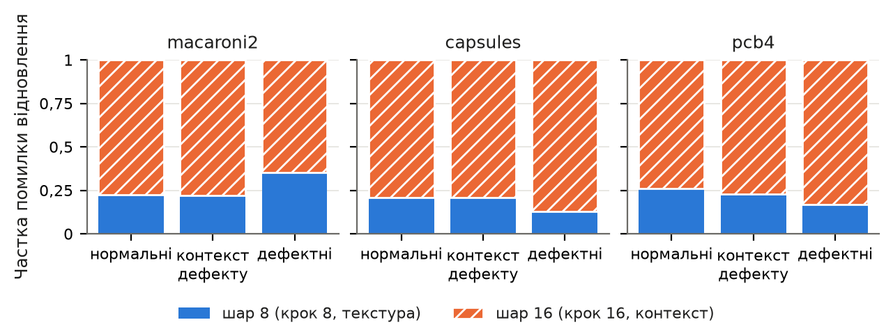{#layers width=66%}

На нормальних патчах шару 8 припадає {{metrics.weights.capsules.shallow_share_normal:.0%}}–{{metrics.weights.pcb4.shallow_share_normal:.0%}} помилки. Це близько до його частки серед 512 зведених каналів (приблизно чверть; `top_channels.csv`, рядок k = 512), тобто норма відновлюється однаково добре з обох шарів. На дефектах картина залежить від категорії. У `macaroni2` частка шару 8 зростає до {{metrics.weights.macaroni2.shallow_share_defect:.0%}}: дрібні подряпини й плями — це порушення текстури. У `capsules` і `pcb4` вона падає до {{metrics.weights.capsules.shallow_share_defect:.0%}} і {{metrics.weights.pcb4.shallow_share_defect:.0%}}: більшу частину помилки на деформаціях капсул і відсутніх чи зайвих компонентах плати дає глибший шар.

Таблиця: Pixel AUROC на test карт, побудованих з частин розкладу помилки, та альтернативних оцінок {#layer_maps}

| Категорія | FAE (повна) | лише шар 8 | лише шар 16 | Махаланобіс у латенті | PCA-64 (лінійний АЕ) |
|---|---|---|---|---|---|
| macaroni2 | {{metrics.weights.macaroni2.pixel_auroc_full:.4f}} | {{metrics.weights.macaroni2.pixel_auroc_shallow_only:.4f}} | {{metrics.weights.macaroni2.pixel_auroc_deep_only:.4f}} | {{metrics.weights.latent.macaroni2.mahalanobis_pixel_auroc:.4f}} | {{metrics.weights.linear.macaroni2.pca_pixel_auroc:.4f}} |
| capsules | {{metrics.weights.capsules.pixel_auroc_full:.4f}} | {{metrics.weights.capsules.pixel_auroc_shallow_only:.4f}} | {{metrics.weights.capsules.pixel_auroc_deep_only:.4f}} | {{metrics.weights.latent.capsules.mahalanobis_pixel_auroc:.4f}} | {{metrics.weights.linear.capsules.pca_pixel_auroc:.4f}} |
| pcb4 | {{metrics.weights.pcb4.pixel_auroc_full:.4f}} | {{metrics.weights.pcb4.pixel_auroc_shallow_only:.4f}} | {{metrics.weights.pcb4.pixel_auroc_deep_only:.4f}} | {{metrics.weights.latent.pcb4.mahalanobis_pixel_auroc:.4f}} | {{metrics.weights.linear.pcb4.pca_pixel_auroc:.4f}} |

Розклад має практичний наслідок. Для `macaroni2` карта «лише шар 8» локалізує краще за повну модель і за Pixel AUROC ({{metrics.weights.macaroni2.pixel_auroc_shallow_only:.4f}} проти {{metrics.weights.macaroni2.pixel_auroc_full:.4f}}), і за Pixel AP (значення AP — у `error_by_layer_maps.csv`). Для `pcb4`, навпаки, шар 16 кращий за шар 8, а найвищий результат дає лише повна модель. Для `capsules` свідчення змішані: Pixel AP карти «лише шар 16» значно вища, ніж карти «лише шар 8», проте за Pixel AUROC карта «лише шар 8» ({{metrics.weights.capsules.pixel_auroc_shallow_only:.4f}}) не поступається ні повній моделі ({{metrics.weights.capsules.pixel_auroc_full:.4f}}), ні шару 16 ({{metrics.weights.capsules.pixel_auroc_deep_only:.4f}}). Отже, провідну роль глибшого шару однозначно підтверджено лише для `pcb4`.

Аналогічно діє вибір підмножини каналів: 64 канали з найбільшою реакцією на дефекти val дають на test Pixel AUROC {{metrics.weights.macaroni2.top_k_pixel_auroc.64:.4f}} для `macaroni2` і {{metrics.weights.capsules.top_k_pixel_auroc.64:.4f}} для `capsules`, а для `pcb4` виграшу немає ({{metrics.weights.pcb4.top_k_pixel_auroc.64:.4f}} проти {{metrics.weights.pcb4.pixel_auroc_full:.4f}}). Порядок каналів визначено на val, однак k = 64 як найкраще значення видно лише на test. Тому це свідчення того, що частина каналів додає шум, а не обраний новий гіперпараметр. Для `macaroni2` у топ-64 переважають канали шару 8, для `capsules` і `pcb4` — майже виключно шару 16 (`top_channels.csv`).

**Спектри ваг** (`weight_spectra.csv`). Ефективний ранг матриці `latent` (256→64) становить {{metrics.weights.spectra.macaroni2.latent.effective_rank:.1f}} з 64, матриці `decoder_hidden` — {{metrics.weights.spectra.macaroni2.decoder_hidden.effective_rank:.1f}}: «горло» використовується майже повністю, мертвих напрямів немає. Перший шар енкодера має одне домінантне сингулярне число (σ_max = {{metrics.weights.spectra.macaroni2.encoder_hidden.sigma_max:.2f}} за ефективного рангу {{metrics.weights.spectra.macaroni2.encoder_hidden.effective_rank:.0f}} з 256). Утім **ваги самі по собі не пояснюють, які канали важливі для детекції**: Spearman ρ між нормою рядка ваг енкодера і внеском каналу в помилку становить {{metrics.weights.macaroni2.input_sensitivity_spearman:.2f}} (`macaroni2`), {{metrics.weights.capsules.input_sensitivity_spearman:.2f}} (`capsules`) і {{metrics.weights.pcb4.input_sensitivity_spearman:.2f}} (`pcb4`). Інтерпретовними виявилися не ваги, а розклад помилки.

**Латентний простір** (`latent_analysis.csv`). Хоча латент має 64 виміри, дисперсія кодів норми зосереджена приблизно в {{metrics.weights.latent.macaroni2.participation_ratio:.0f}} (`macaroni2`), {{metrics.weights.latent.capsules.participation_ratio:.0f}} (`capsules`) і {{metrics.weights.latent.pcb4.participation_ratio:.0f}} (`pcb4`) ефективних вимірах. Відстань Махаланобіса в латенті локалізує гірше за помилку відновлення в усіх категоріях (табл. {@layer_maps}). Отже, дефект проявляється як вихід *за межі* многовиду норми, який фіксує помилка відновлення, а не як рідкісна точка *на* многовиді.
**FAE майже лінійна.** PCA-64 відтворює карти FAE з ρ = {{metrics.weights.linear.capsules.fae_pca_spearman:.3f}}–{{metrics.weights.linear.macaroni2.fae_pca_spearman:.3f}} і поступається за Pixel AUROC лише в другому–третьому знаку (табл. {@layer_maps}). Нелінійність дає більше за Pixel AP: на `capsules` {{metrics.weights.linear.capsules.fae_pixel_ap:.3f}} проти {{metrics.weights.linear.capsules.pca_pixel_ap:.3f}}. Підпростори PCA і декодера збігаються лише частково (середній косинус головних кутів ≈ {{metrics.weights.linear.macaroni2.principal_angles_cos_mean:.2f}}), тобто схожих карт досягнуто різними базисами. Якобіан FAE (`jacobian_spectrum.csv`) має рівно {{metrics.weights.jacobian.macaroni2.rank_normal:.0f}} сингулярні числа, більші за {{metrics.config.singular_threshold}}. Відхилення від проектора $\lVert J^2-J\rVert/\lVert J\rVert$ на нормальних патчах становить {{metrics.weights.jacobian.macaroni2.projection_error_normal:.2f}} / {{metrics.weights.jacobian.capsules.projection_error_normal:.2f}} / {{metrics.weights.jacobian.pcb4.projection_error_normal:.2f}}, на дефектних — більше: {{metrics.weights.jacobian.macaroni2.projection_error_defect:.2f}} / {{metrics.weights.jacobian.capsules.projection_error_defect:.2f}} / {{metrics.weights.jacobian.pcb4.projection_error_defect:.2f}}. **Математична інтерпретація моделі**: FAE локально є наближеною проекцією на 64-вимірний підпростір нормальних ознак, а оцінка аномальності — квадрат норми залишку, ортогонального до цього підпростору. На дефектах модель поводиться менш «проекційно», бо вони лежать поза областю, де вона навчалася.

### 3.2. Вибір бази IG і шару Grad-CAM

Результати вибору бази на val наведено в табл. {@ig_val}.

**Нейтральної бази для детектора аномалій не існує.** Розмите, середнє і чорне зображення для моделі *аномальніші* за дефектне зображення: медіана F(b) розмитої бази становить {{metrics.xai.baselines_score.blur.macaroni2:.2f}} на `macaroni2` і {{metrics.xai.baselines_score.blur.pcb4:.2f}} на `pcb4` за порогів {{metrics.handoff.macaroni2.threshold_image:.2f}} і {{metrics.handoff.pcb4.threshold_image:.2f}}. Близькі до норми лише найближче нормальне зображення та EG. Проте EG не виконала умову повноти: на `macaroni2` і `capsules` критерій пройшла меншість зображень (колонка «Частка ε ≤ 0,05»), хоча медіана кроків досягла максимуму {{metrics.config.ig_max_steps}}; на `pcb4` його пройшли всі. Причину окремо не досліджено. Імовірне пояснення (припущення, не перевірене експериментом): у реалізації кроки інтегрування діляться порівну між {{metrics.config.expected_gradients_k}} базами, тож кожен шлях інтегрується грубіше, ніж для одиночної бази.

{#ig_val}

Обрано базу **«розмите, σ = {{metrics.config.baseline_blur_sigma:.0f}} пікс.»**, але **перевагу над іншими вона має лише формально**. Середні AUROC |IG| розмитої бази, середнього train і найближчої норми (рядки «усі» табл. {@ig_val}) різняться менше ніж на поріг нічиєї {{metrics.config.selection_tolerance}}, тож фактично це нічия, вирішена порядком пріоритету. За категоріями лідери різні: середнє train на `macaroni2`, розмите на `capsules`, найближча норма на `pcb4`. Наслідок вибору треба враховувати при читанні всіх карт IG. Для розмитої бази F(b) > F(x), тому сума атрибуцій від'ємна і **знак IG інвертований**: атрибуція пояснює, чим зображення *менш* аномальне за розмиту копію. Найбільше атрибуції отримують ділянки з чіткою структурою, яку знищило розмиття, а не обов'язково дефект. Тому для локалізації використано модуль |IG|.

Шар Grad-CAM обрано за табл. {@gc_val}.

{#gc_val}

Шар 8 для Grad-CAM помітно гірший, а шар 16 і злиття розрізняються менше ніж на поріг нічиєї. Згідно з правилом обрано злиття, хоча шар 16 формально трохи кращий. Для HiResCAM усі три варіанти близькі, і так само обрано злиття. На test IG пройшли перевірку повноти {{metrics.xai.ig_completeness_pass_share:.0%}} зображень (медіана кроків — {{metrics.xai.ig_steps_used.median:.0f}}, максимум — {{metrics.xai.ig_steps_used.max}}).

### 3.3. Карти пояснень і якість локалізації

Пояснення чотирьох аномалій `macaroni2` різної площі показано на рис. {@xai_mac}, а `pcb4` — на рис. {@xai_pcb}.

На `macaroni2` (рис. {@xai_mac}) карта моделі, HiResCAM і |IG| здебільшого вказують на дефект. Grad-CAM дає дифузну, зернисту карту: усереднення градієнта по шару розподіляє точкову max-ціль на всі активні канали (третій рядок). У другому рядку дефект (вузьку подряпину) карта моделі майже не підсвічує; рішення ухвалено через інший макарон, і HiResCAM вказує саме туди. Це вірне пояснення *рішення*, хоча й не дефекту.

На `pcb4` (рис. {@xai_pcb}) проявляється вада бази IG. В усіх рядках атрибуція IG зосереджена на мікросхемі в центрі плати, найструктурованішій ділянці, яку розмиття знищує найсильніше, і не залежить від положення дефекту. HiResCAM і карта моделі натомість вказують на дефект (рядки 2–3). Рядок 4 — випадок, коли жоден метод дефекту не знаходить.

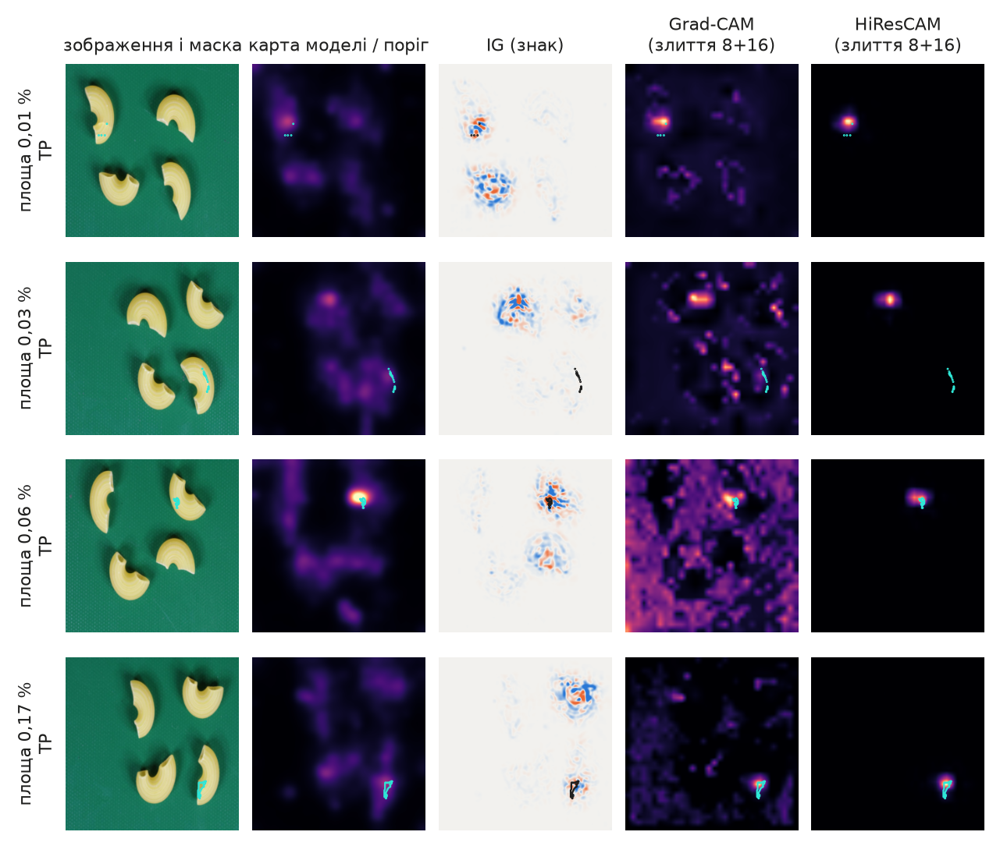{#xai_mac width=48%}

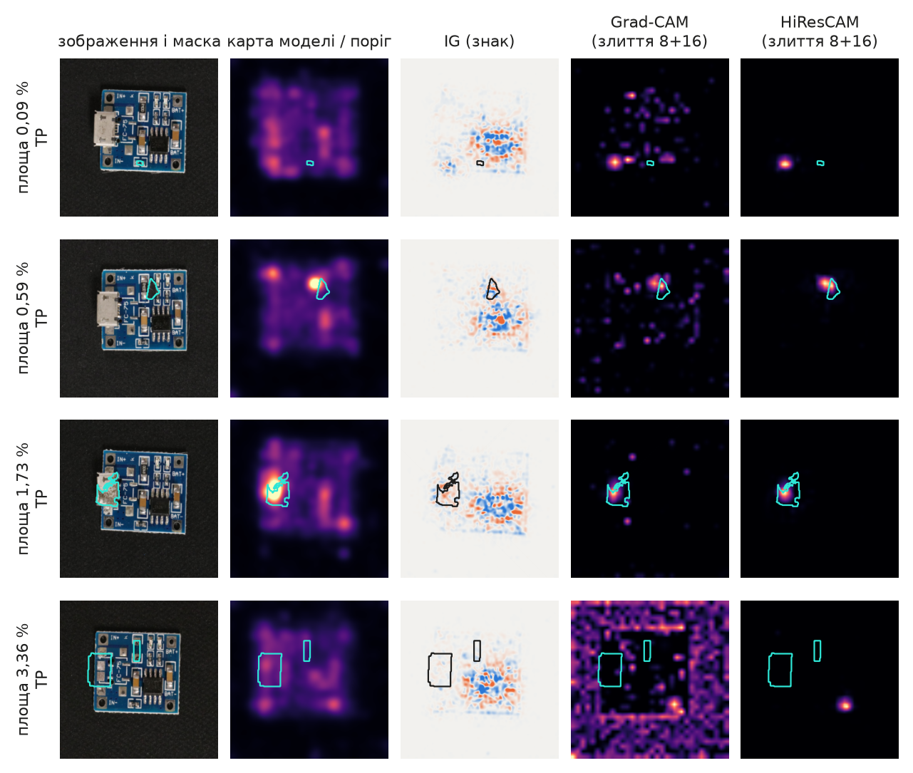{#xai_pcb width=54%}

Кількісне порівняння по трьох категоріях разом наведено в табл. {@loc}. Значення за категоріями з 95% ДІ містяться в `localization_summary.csv` (підвибірка IG) і `localization_all_anomalies.csv` (усі аномалії).

Таблиця: Якість локалізації пояснень на аномаліях test, три категорії разом {#loc}

| Метод | Pixel AUROC (підвибірка IG, n = {{metrics.xai.localization.ig.усі.n}}) | Pointing game | Маса в масці / площа | ρ з картою моделі | Pixel AUROC (усі, n = {{metrics.xai.localization_all_anomalies.model_map.усі.n}}) | Pointing game (усі) |
|---|---|---|---|---|---|---|
| карта моделі | {{metrics.xai.localization.model_map.усі.pixel_auroc:.3f}} | {{metrics.xai.localization.model_map.усі.pointing_game:.2f}} | {{metrics.xai.localization.model_map.усі.mass_in_mask_ratio:.1f}} | 1 | {{metrics.xai.localization_all_anomalies.model_map.усі.pixel_auroc:.3f}} | {{metrics.xai.localization_all_anomalies.model_map.усі.pointing_game:.2f}} |
| Integrated Gradients | {{metrics.xai.localization.ig.усі.pixel_auroc:.3f}} | {{metrics.xai.localization.ig.усі.pointing_game:.2f}} | {{metrics.xai.localization.ig.усі.mass_in_mask_ratio:.1f}} | {{metrics.xai.localization.ig.усі.spearman_model_map:.2f}} | — | — |
| HiResCAM | {{metrics.xai.localization.hirescam.усі.pixel_auroc:.3f}} | {{metrics.xai.localization.hirescam.усі.pointing_game:.2f}} | {{metrics.xai.localization.hirescam.усі.mass_in_mask_ratio:.1f}} | {{metrics.xai.localization.hirescam.усі.spearman_model_map:.2f}} | {{metrics.xai.localization_all_anomalies.hirescam.усі.pixel_auroc:.3f}} | {{metrics.xai.localization_all_anomalies.hirescam.усі.pointing_game:.2f}} |
| Grad-CAM | {{metrics.xai.localization.gradcam.усі.pixel_auroc:.3f}} | {{metrics.xai.localization.gradcam.усі.pointing_game:.2f}} | {{metrics.xai.localization.gradcam.усі.mass_in_mask_ratio:.1f}} | {{metrics.xai.localization.gradcam.усі.spearman_model_map:.2f}} | {{metrics.xai.localization_all_anomalies.gradcam.усі.pixel_auroc:.3f}} | {{metrics.xai.localization_all_anomalies.gradcam.усі.pointing_game:.2f}} |
| випадкова карта | {{metrics.xai.localization.random.усі.pixel_auroc:.3f}} | {{metrics.xai.localization.random.усі.pointing_game:.2f}} | {{metrics.xai.localization.random.усі.mass_in_mask_ratio:.1f}} | {{metrics.xai.localization.random.усі.spearman_model_map:.2f}} | {{metrics.xai.localization_all_anomalies.random.усі.pixel_auroc:.3f}} | {{metrics.xai.localization_all_anomalies.random.усі.pointing_game:.2f}} |

Карта моделі локалізує найкраще (Pixel AUROC {{metrics.xai.localization.model_map.усі.pixel_auroc:.3f}}). IG поступається їй небагато ({{metrics.xai.localization.ig.усі.pixel_auroc:.3f}}), але на `pcb4` має pointing game {{metrics.xai.localization.ig.pcb4.pointing_game:.2f}}: argmax |IG| жодного разу не потрапив у дефект, що узгоджується з рис. {@xai_pcb}. HiResCAM має найвищу концентрацію маси в масці (у {{metrics.xai.localization.hirescam.усі.mass_in_mask_ratio:.0f}} разів вище за випадкову), бо його карта майже точкова. Grad-CAM найслабший і майже не корелює з картою моделі (ρ = {{metrics.xai.localization.gradcam.усі.spearman_model_map:.2f}}): він пояснює активації backbone загалом, а не рішення головки. На всіх {{metrics.xai.localization_all_anomalies.model_map.усі.n}} аномаліях порядок методів той самий, а pointing game HiResCAM майже дорівнює pointing game карти моделі: HiResCAM вказує туди ж, куди максимум карти.

Без зображень, що не пройшли перевірку повноти IG навіть за {{metrics.xai.ig_steps_used.max}} кроків (`localization_summary_complete_ig.csv`), Pixel AUROC IG становить {{metrics.xai.localization_complete_ig.ig.усі.pixel_auroc:.3f}} проти {{metrics.xai.localization.ig.усі.pixel_auroc:.3f}}, тож висновки не змінюються. За терцилями площі дефекту (`localization_by_area.csv`) усі методи гірше працюють на найдрібніших дефектах; найбільше страждає pointing game.

### 3.4. Perturbation analysis

Криві MoRF наведено на рис. {@pert}, підсумкові метрики — у табл. {@pert_tab}.

Застереження з п. 2.4 підтвердилося: **втручання саме створює аномалію.** На `macaroni2` і `capsules` вилучення *випадкових* патчів заміною на норму підвищує оцінку: AUC випадкового порядку становить {{metrics.sanity.perturbation.anomaly.replace.score_rel.ig.macaroni2.auc_random:.2f}} і {{metrics.sanity.perturbation.anomaly.replace.score_rel.ig.capsules.auc_random:.2f}}, тобто понад 1 (без змін — 1). Через це:

- ABPC близька до нуля або від'ємна для більшості методів, бо вилучення найменш важливих патчів теж підвищує оцінку;
- **маска-оракул не є верхньою межею.** На `macaroni2` у режимі заміни оракул гірший за випадковий порядок (Δ = {{metrics.sanity.perturbation.anomaly.replace.score_rel.oracle.macaroni2.delta_vs_random:.3f}}): заміна патчів дефекту на «норму» з іншого кадру не прибирає аномалію, а переносить шов у те саме місце;
- у режимі зашумлення на `macaroni2` *усі* методи гірші за випадковий порядок (Δ ≈ {{metrics.sanity.perturbation.anomaly.noise.score_rel.model_map.macaroni2.delta_vs_random:.1f}} для карти моделі). Найважливіші патчі лежать на макаронах, і шум на текстурі об'єкта для моделі аномальніший, ніж шум на рівномірному зеленому тлі, куди здебільшого потрапляють випадкові патчі.

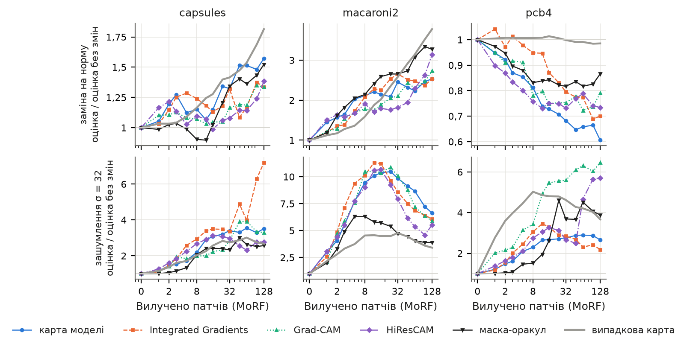{#pert width=80%}

Таблиця: Δ проти випадкового порядку (AUC випадкових − AUC MoRF) на аномаліях test; Δ > 0 — пояснення краще за випадковий порядок {#pert_tab}

| Порядок вилучення | macaroni2, заміна | capsules, заміна | pcb4, заміна | усі, заміна | усі, зашумлення |
|---|---|---|---|---|---|
| карта моделі | {{metrics.sanity.perturbation.anomaly.replace.score_rel.model_map.macaroni2.delta_vs_random:.3f}} | {{metrics.sanity.perturbation.anomaly.replace.score_rel.model_map.capsules.delta_vs_random:.3f}} | {{metrics.sanity.perturbation.anomaly.replace.score_rel.model_map.pcb4.delta_vs_random:.3f}} | {{metrics.sanity.perturbation.anomaly.replace.score_rel.model_map.усі.delta_vs_random:.3f}} | {{metrics.sanity.perturbation.anomaly.noise.score_rel.model_map.усі.delta_vs_random:.3f}} |
| Integrated Gradients | {{metrics.sanity.perturbation.anomaly.replace.score_rel.ig.macaroni2.delta_vs_random:.3f}} | {{metrics.sanity.perturbation.anomaly.replace.score_rel.ig.capsules.delta_vs_random:.3f}} | {{metrics.sanity.perturbation.anomaly.replace.score_rel.ig.pcb4.delta_vs_random:.3f}} | {{metrics.sanity.perturbation.anomaly.replace.score_rel.ig.усі.delta_vs_random:.3f}} | {{metrics.sanity.perturbation.anomaly.noise.score_rel.ig.усі.delta_vs_random:.3f}} |
| Grad-CAM | {{metrics.sanity.perturbation.anomaly.replace.score_rel.gradcam.macaroni2.delta_vs_random:.3f}} | {{metrics.sanity.perturbation.anomaly.replace.score_rel.gradcam.capsules.delta_vs_random:.3f}} | {{metrics.sanity.perturbation.anomaly.replace.score_rel.gradcam.pcb4.delta_vs_random:.3f}} | {{metrics.sanity.perturbation.anomaly.replace.score_rel.gradcam.усі.delta_vs_random:.3f}} | {{metrics.sanity.perturbation.anomaly.noise.score_rel.gradcam.усі.delta_vs_random:.3f}} |
| HiResCAM | {{metrics.sanity.perturbation.anomaly.replace.score_rel.hirescam.macaroni2.delta_vs_random:.3f}} | {{metrics.sanity.perturbation.anomaly.replace.score_rel.hirescam.capsules.delta_vs_random:.3f}} | {{metrics.sanity.perturbation.anomaly.replace.score_rel.hirescam.pcb4.delta_vs_random:.3f}} | {{metrics.sanity.perturbation.anomaly.replace.score_rel.hirescam.усі.delta_vs_random:.3f}} | {{metrics.sanity.perturbation.anomaly.noise.score_rel.hirescam.усі.delta_vs_random:.3f}} |
| маска-оракул | {{metrics.sanity.perturbation.anomaly.replace.score_rel.oracle.macaroni2.delta_vs_random:.3f}} | {{metrics.sanity.perturbation.anomaly.replace.score_rel.oracle.capsules.delta_vs_random:.3f}} | {{metrics.sanity.perturbation.anomaly.replace.score_rel.oracle.pcb4.delta_vs_random:.3f}} | {{metrics.sanity.perturbation.anomaly.replace.score_rel.oracle.усі.delta_vs_random:.3f}} | {{metrics.sanity.perturbation.anomaly.noise.score_rel.oracle.усі.delta_vs_random:.3f}} |
| *AUC випадкового порядку* | {{metrics.sanity.perturbation.anomaly.replace.score_rel.ig.macaroni2.auc_random:.3f}} | {{metrics.sanity.perturbation.anomaly.replace.score_rel.ig.capsules.auc_random:.3f}} | {{metrics.sanity.perturbation.anomaly.replace.score_rel.ig.pcb4.auc_random:.3f}} | {{metrics.sanity.perturbation.anomaly.replace.score_rel.ig.усі.auc_random:.3f}} | {{metrics.sanity.perturbation.anomaly.noise.score_rel.ig.усі.auc_random:.3f}} |

Найчистіший експеримент — `pcb4` у режимі заміни. Плата стоїть у фіксованому положенні, тож заміна патча тим самим місцем нормальної плати майже не залишає шва, і випадковий порядок оцінки не змінює (AUC {{metrics.sanity.perturbation.anomaly.replace.score_rel.ig.pcb4.auc_random:.3f}}). Тут усі пояснення значуще кращі за випадкові (95% бутстреп-ДІ Δ не містять нуля; AUC MoRF, ABPC і ДІ для всіх комбінацій — у `perturbation_summary.csv`): найкраще — карта моделі, далі HiResCAM, Grad-CAM і IG. Пояснення, що вказують на найаномальніші точки моделі, випереджають навіть оракул, бо оцінку зображення визначає максимум карти, а він не завжди лежить у масці (п. 3.6).

На `macaroni2` і `capsules` у режимі заміни ДІ Δ не містять нуля для Grad-CAM і HiResCAM, а для карти моделі та IG — містять; ці оцінки змішані з артефактами втручання. По трьох категоріях разом Δ > 0 значуще для всіх чотирьох пояснень (для IG нижня межа ДІ близька до нуля), але не для оракула. Додатковий відгук — середня помилка відновлення по патчах — дає той самий знак: у режимі заміни Δ додатна для всіх пояснень (від {{metrics.sanity.perturbation.anomaly.replace.error_rel.gradcam.усі.delta_vs_random:.2f}} у Grad-CAM до {{metrics.sanity.perturbation.anomaly.replace.error_rel.hirescam.усі.delta_vs_random:.2f}} у HiResCAM).

На хибних спрацюваннях (`perturbation_fp.csv`) питання інше: чи вказує пояснення на «хибний доказ». На `pcb4` заміна найважливіших за IG патчів знижує оцінку сильніше за випадкову (Δ = {{metrics.sanity.perturbation.false_positive.replace.score_rel.ig.pcb4.delta_vs_random:.3f}}), але FP там лише {{metrics.sanity.perturbation.false_positive.replace.score_rel.ig.pcb4.n}} — менше за прийнятий мінімум групи {{metrics.config.min_group_size}}, тож результат описовий. На `macaroni2` значущого ефекту немає в жодного методу. Отже, perturbation analysis підтверджує вірність пояснень найчистіше на `pcb4`, де втручання не порушує розподіл даних; на `macaroni2` і `capsules` він значною мірою вимірює артефакти втручання.

### 3.5. Рандомізація моделі та стійкість пояснень

Приклад пояснень навченої і рандомізованих моделей наведено на рис. {@sanity}, а зведені результати — у табл. {@sanity_tab}. Значення ρ і SSIM (на рангах) за категоріями — у `sanity_randomization.csv`.

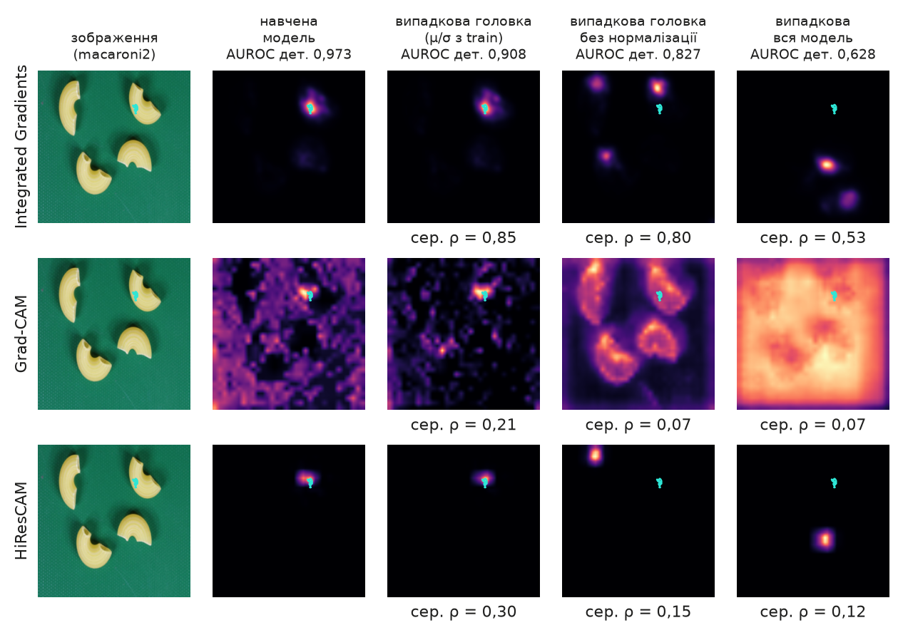{#sanity width=62%}

Таблиця: Pixel AUROC рандомізованого детектора і Spearman ρ його пояснень з поясненнями навченої моделі (ρ — по трьох категоріях разом) {#sanity_tab}

| Рівень рандомізації | AUROC детектора, macaroni2 | AUROC детектора, capsules | AUROC детектора, pcb4 | ρ IG | ρ Grad-CAM | ρ HiResCAM |
|---|---|---|---|---|---|---|
| навчена модель | {{metrics.sanity.randomization.trained_pixel_auroc.macaroni2:.3f}} | {{metrics.sanity.randomization.trained_pixel_auroc.capsules:.3f}} | {{metrics.sanity.randomization.trained_pixel_auroc.pcb4:.3f}} | 1 | 1 | 1 |
| випадкова головка (μ/σ з train) | {{metrics.sanity.randomization.head.detector_pixel_auroc.macaroni2:.3f}} | {{metrics.sanity.randomization.head.detector_pixel_auroc.capsules:.3f}} | {{metrics.sanity.randomization.head.detector_pixel_auroc.pcb4:.3f}} | {{metrics.sanity.randomization.head.ig.spearman:.2f}} | {{metrics.sanity.randomization.head.gradcam.spearman:.2f}} | {{metrics.sanity.randomization.head.hirescam.spearman:.2f}} |
| випадкова головка без нормалізації | {{metrics.sanity.randomization.head_no_norm.detector_pixel_auroc.macaroni2:.3f}} | {{metrics.sanity.randomization.head_no_norm.detector_pixel_auroc.capsules:.3f}} | {{metrics.sanity.randomization.head_no_norm.detector_pixel_auroc.pcb4:.3f}} | {{metrics.sanity.randomization.head_no_norm.ig.spearman:.2f}} | {{metrics.sanity.randomization.head_no_norm.gradcam.spearman:.2f}} | {{metrics.sanity.randomization.head_no_norm.hirescam.spearman:.2f}} |
| випадкова вся модель | {{metrics.sanity.randomization.full.detector_pixel_auroc.macaroni2:.3f}} | {{metrics.sanity.randomization.full.detector_pixel_auroc.capsules:.3f}} | {{metrics.sanity.randomization.full.detector_pixel_auroc.pcb4:.3f}} | {{metrics.sanity.randomization.full.ig.spearman:.2f}} | {{metrics.sanity.randomization.full.gradcam.spearman:.2f}} | {{metrics.sanity.randomization.full.hirescam.spearman:.2f}} |

Колонки «AUROC детектора» змінюють прочитання таблиці. **Обидві «випадкові головки» досі локалізують дефекти**: Pixel AUROC {{metrics.sanity.randomization.head.detector_pixel_auroc.macaroni2:.3f}} і {{metrics.sanity.randomization.head_no_norm.detector_pixel_auroc.macaroni2:.3f}} на `macaroni2` проти {{metrics.sanity.randomization.trained_pixel_auroc.macaroni2:.3f}} у навченої моделі. Випадкова головка зі збереженими μ/σ — це випадкова проекція z-оцінок, тобто фактично діагональна гаусова відстань до середнього train. Тому висока схожість IG на цих рівнях (ρ = {{metrics.sanity.randomization.head.ig.spearman:.2f}} і {{metrics.sanity.randomization.head_no_norm.ig.spearman:.2f}}) не означає провалу тесту: модель після рандомізації головки все ще «працює», і пояснення мають бути схожими.

Висновок про незалежність пояснень від моделі можна робити лише на рівні **«випадкова вся модель»**, і лише для `macaroni2` і `capsules`, де детектор справді втратив локалізацію (Pixel AUROC {{metrics.sanity.randomization.full.detector_pixel_auroc.macaroni2:.3f}} і {{metrics.sanity.randomization.full.detector_pixel_auroc.capsules:.3f}}). На `pcb4` навіть повністю випадкова модель має Pixel AUROC {{metrics.sanity.randomization.full.detector_pixel_auroc.pcb4:.3f}}. Плата контрастна і стоїть у фіксованому місці, тож будь-які згорткові ознаки відрізняють її деталі, і цей рівень для `pcb4` неінформативний. На інформативних категоріях Grad-CAM і HiResCAM тест проходять: ρ становить {{metrics.sanity.randomization.full.gradcam.spearman_by_category.macaroni2:.2f}} і {{metrics.sanity.randomization.full.hirescam.spearman_by_category.macaroni2:.2f}} на `macaroni2`, {{metrics.sanity.randomization.full.gradcam.spearman_by_category.capsules:.2f}} і {{metrics.sanity.randomization.full.hirescam.spearman_by_category.capsules:.2f}} на `capsules`. IG має ρ = {{metrics.sanity.randomization.full.ig.spearman_by_category.capsules:.2f}} на `capsules`, але на `macaroni2` зберігає ρ = {{metrics.sanity.randomization.full.ig.spearman_by_category.macaroni2:.2f}} при детекторі на рівні випадкового. Це ознака того, що з розмитою базою IG частково відображає структуру самого зображення (контури макаронів), а не модель. Саме від такого ефекту застерігає [7]. Вибірка мала ({{metrics.config.sanity_images_per_category}} зображень на категорію), тож висновок попередній.

**Стійкість до шуму σ = {{metrics.config.stability_noise_sigma:.0f}}** (`explanation_stability.csv`) обернена до результатів рандомізації. IG майже не змінюється (ρ = {{metrics.sanity.stability.ig.spearman:.3f}}), а Grad-CAM ({{metrics.sanity.stability.gradcam.spearman:.2f}}) і HiResCAM ({{metrics.sanity.stability.hirescam.spearman:.2f}}) змінюються помітно, особливо на `capsules` і `pcb4`. Max-ціль робить градієнтні карти чутливими до того, яка з кількох близьких за висотою вершин карти стала максимумом; IG інтегрує по шляху, і це згладжує. Отже, жоден метод не є найкращим за всіма критеріями: Grad-CAM і HiResCAM залежать від моделі, але нестабільні, а IG стабільний, проте частково описує зображення.

### 3.6. FP і FN: фізичні та структурні причини

За порогами ЛР № 4 на test отримано {{metrics.errors.macaroni2.n_fp}} FP проти {{metrics.errors.macaroni2.n_tn}} TN у `macaroni2`, {{metrics.errors.capsules.n_fp}} проти {{metrics.errors.capsules.n_tn}} у `capsules` і {{metrics.errors.pcb4.n_fp}} проти {{metrics.errors.pcb4.n_tn}} у `pcb4`; FN — {{metrics.errors.macaroni2.n_fn}}, {{metrics.errors.capsules.n_fn}} і {{metrics.errors.pcb4.n_fn}} (TP — {{metrics.errors.macaroni2.n_tp}}, {{metrics.errors.capsules.n_tp}} і {{metrics.errors.pcb4.n_tp}}). Причини за правилами п. 2.5 наведено в табл. {@causes} (частки — у `error_causes.csv`).

Таблиця: Кількість FP і FN за причинами (порядок перевірки FP: край кадру → відблиск → край об'єкта → глобальна) {#causes}

| Помилка | Причина (правило) | macaroni2 | capsules | pcb4 |
|---|---|---|---|---|
| FP | край кадру | {{metrics.errors.macaroni2.fp_cause_counts.frame_border}} | {{metrics.errors.capsules.fp_cause_counts.frame_border}} | {{metrics.errors.pcb4.fp_cause_counts.frame_border}} |
| FP | кут кадру | {{metrics.errors.macaroni2.fp_cause_counts.frame_corner}} | — | — |
| FP | край об'єкта / структура | {{metrics.errors.macaroni2.fp_cause_counts.object_edge}} | {{metrics.errors.capsules.fp_cause_counts.object_edge}} | {{metrics.errors.pcb4.fp_cause_counts.object_edge}} |
| FP | глобальна текстура / освітлення | {{metrics.errors.macaroni2.fp_cause_counts.global}} | {{metrics.errors.capsules.fp_cause_counts.global}} | {{metrics.errors.pcb4.fp_cause_counts.global}} |
| FP | не визначено | {{metrics.errors.macaroni2.fp_cause_counts.undetermined}} | {{metrics.errors.capsules.fp_cause_counts.undetermined}} | {{metrics.errors.pcb4.fp_cause_counts.undetermined}} |
| FN | дрібний дефект | {{metrics.errors.macaroni2.fn_cause_counts.small}} | {{metrics.errors.capsules.fn_cause_counts.small}} | {{metrics.errors.pcb4.fn_cause_counts.small}} |
| FN | низький контраст | — | {{metrics.errors.capsules.fn_cause_counts.low_contrast}} | — |
| FN | дефект не дав максимуму карти | — | {{metrics.errors.capsules.fn_cause_counts.off_map}} | — |
| FN | не визначено | {{metrics.errors.macaroni2.fn_cause_counts.undetermined}} | — | {{metrics.errors.pcb4.fn_cause_counts.undetermined}} |

**Застереження щодо табл. {@causes}: порядок правил FP змінено post hoc.** Після першого прогону його змінено із запланованого («глобальна → відблиск → край об'єкта → край кадру») на поточний, бо FP з максимумом біля краю й водночас підвищеною медіанною помилкою потрапляли до «глобальних». Тому розподіл причин FP — описовий, а не перевірена гіпотеза. Чутливість до порядку (`error_causes_plan_order.csv`) суттєва: на `macaroni2` за планом «край кадру» мав би {{metrics.errors.macaroni2.fp_cause_counts_plan_order.frame_border}} FP замість {{metrics.errors.macaroni2.fp_cause_counts.frame_border}}, а «глобальна» — {{metrics.errors.macaroni2.fp_cause_counts_plan_order.global}} замість {{metrics.errors.macaroni2.fp_cause_counts.global}}. Від порядку не залежать кількість «кутових» FP на `macaroni2`, частка невизначених FP ({{metrics.errors.macaroni2.fp_cause_shares.undetermined:.0%}} на `macaroni2` і {{metrics.errors.capsules.fp_cause_shares.undetermined:.0%}} на `capsules`) і причини FN, серед яких переважає «дрібний дефект» ({{metrics.errors.capsules.fn_cause_shares.small:.0%}} у `capsules` і {{metrics.errors.pcb4.fn_cause_shares.small:.0%}} у `pcb4`). Відблиск (пересвіт) не пояснює жодного FP.

**Статистичне порівняння груп** (`error_groups.csv`). У межах кожної категорії після поправки Голма значущим лишається лише один дескриптор — «локальність max/медіана» (r = {{metrics.errors.group_effects.macaroni2.fp_vs_tn.locality.r:.2f}} для FP↔TN на `macaroni2`, {{metrics.errors.group_effects.capsules.fp_vs_tn.locality.r:.2f}} на `capsules`, {{metrics.errors.group_effects.capsules.fn_vs_tp.locality.r:.2f}} для FN↔TP на `capsules`). **Цей зв'язок тавтологічний**: оцінка зображення є максимумом карти, тож зображення з оцінкою вище порога (FP, TP) за побудовою мають більше відношення max/медіана. Причин він не розкриває, а лише підтверджує, що помилки спричиняє локальний пік, а не загальне підвищення помилки по кадру. Значущі різниці в об'єднаній вибірці «усі» (текстурна енергія, середня яскравість) змішані з категорією: {{metrics.errors.macaroni2.n_fp}} з {{metrics.errors.total.n_fp}} FP — це `macaroni2` з гладким зеленим тлом, а {{metrics.errors.pcb4.n_tn}} з {{metrics.errors.total.n_tn}} TN — `pcb4` з насиченою текстурою. Отже, значущої фізичної ознаки освітлення чи текстури, що відрізняла б FP від TN *усередині* категорії, не знайдено; σ яскравості кадру не розрізняє групи в жодній категорії. Для `pcb4` і FN `macaroni2` групи менші за {{metrics.config.min_group_size}}, тому порівняння там не проводилося.

**Перетин з іншими методами** ЛР № 4 (`error_overlap_methods.csv`). З {{metrics.errors.macaroni2.overlap.FP.n_fae}} FP `macaroni2` {{metrics.errors.macaroni2.overlap.FP.also_PaDiM}} є також FP PaDiM, а {{metrics.errors.macaroni2.overlap.FP.all_methods}} — FP усіх трьох методів; з {{metrics.errors.capsules.overlap.FP.n_fae}} FP `capsules` {{metrics.errors.capsules.overlap.FP.also_PatchCore}} є також FP PatchCore. Отже, значна частина тривог — властивість самих нормальних зображень, на яких різні методи бачать щось незвичне; решта — специфіка FAE і порогу.

Найвпевненіші FP і FN з поясненнями наведено на рис. {@fp} і {@fn}. Серед FP вирізняються два типи. Перший — **точковий «гарячий» кут або край кадру** (`macaroni2`, `pcb4`): карта моделі має яскраву точку на межі кадру, де немає жодного об'єкта, і всі градієнтні методи вказують туди ж. Другий — **розподілена тривога** на `capsules`, де десятки капсул у випадкових положеннях дають кілька рівновисоких максимумів, з яких один перевищує поріг. Тут правила причину не визначають.

FN (рис. {@fn}) — це насамперед **дрібні дефекти**: бульбашка в капсулі чи скол краю макарона площею в кілька пікселів, сигнал яких після збільшення з сітки кроку 8 і згладження слабший за фонові коливання карти. В одному FN `capsules` (рядок 3) максимум карти лежить на краю кадру, далеко від дефекту, тобто пропуск спричинила max-агрегація, а не нечутливість. За типами дефектів (`error_by_defect_type.csv`) у `capsules` найчастіше пропускаються бульбашки з найменшою медіанною площею.

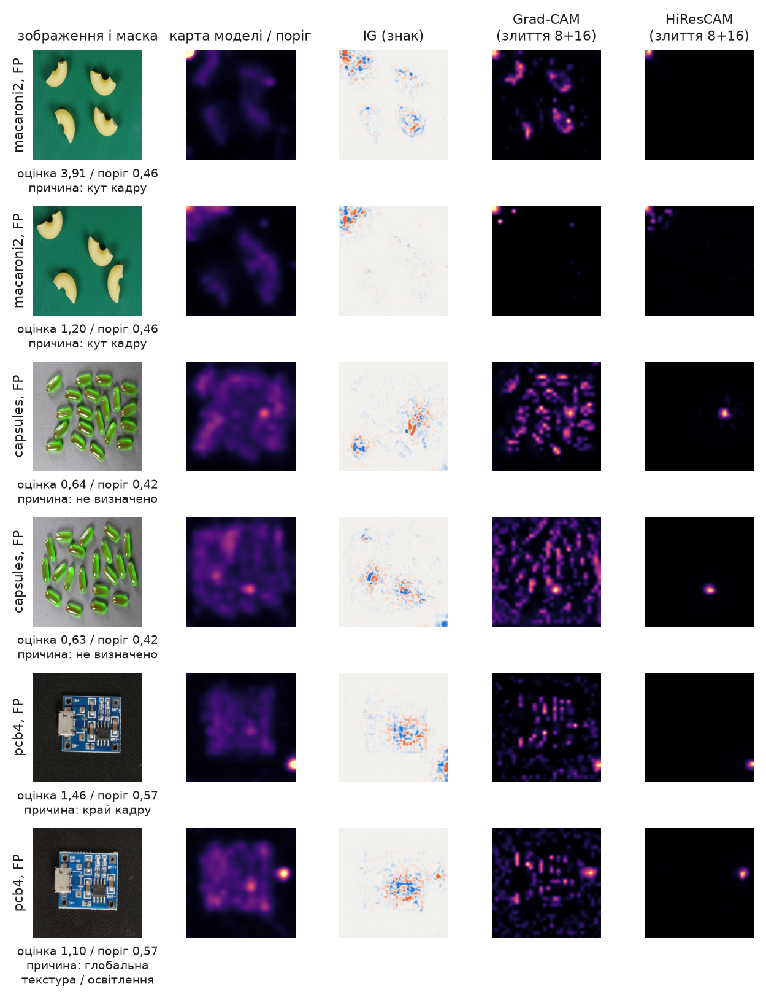{#fp width=54%}

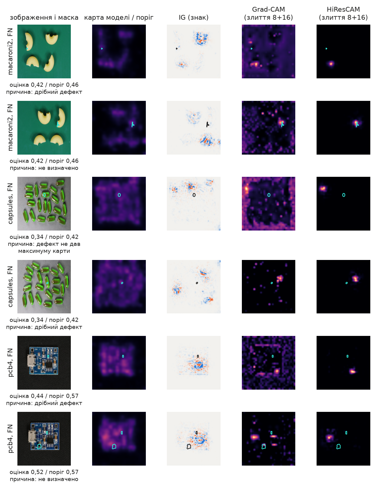{#fn width=54%}

**Крайові артефакти.** Положення argmax FP показано на рис. {@fp_loc}.

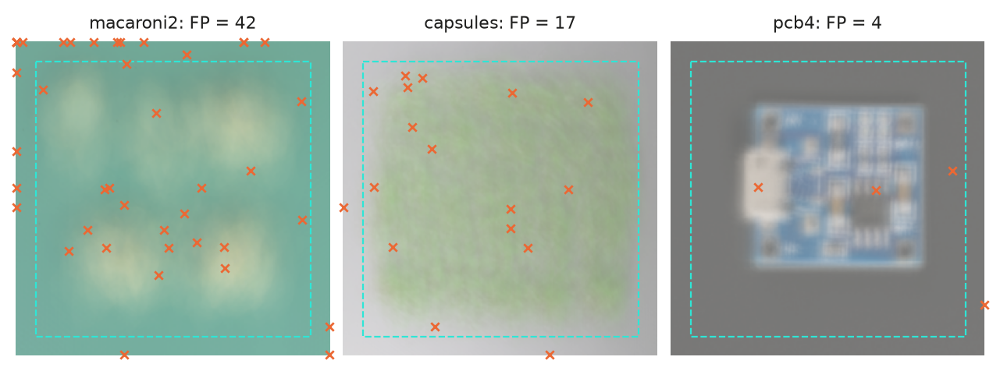{#fp_loc width=62%}

На `macaroni2` {{metrics.errors.macaroni2.fp_argmax_border_share:.0%}} максимумів FP лежить у смузі {{metrics.config.border_px}} пікс. уздовж краю, хоча вона займає {{metrics.errors.macaroni2.border_area_share:.0%}} площі. У кутових квадратах таких максимумів {{metrics.errors.macaroni2.fp_argmax_corner_share:.0%}} за частки площі {{metrics.errors.macaroni2.corner_area_share:.1%}}. На `capsules` і `pcb4` FP біля краю не концентруються. Водночас це не систематична «рамка»: у середньому на нормальних зображеннях край кадру *менш* аномальний за центр — помилка зовнішнього кільця патчів становить {{metrics.errors.macaroni2.ring_to_center_error_ratio:.2f}} від центральної на `macaroni2` (`border_artifacts.csv`), бо там зазвичай однорідне тло. Отже, «гарячі кути» — **рідкісні точкові викиди** на окремих кадрах. Їх імовірна структурна причина (гіпотеза) — доповнення (padding) згорток backbone і дзеркальне доповнення під час згладжування, що змінюють ознаки крайових патчів. Кадри з нетиповим вмістом біля краю (тінь, край макарона, що виходить за кадр) дають ознаки, яких у train біля краю не було. 

Діагностично перевірено виключення крайової смуги з порогом, перекаліброваним на val (`border_exclusion.csv`). Для `macaroni2` виключення смуги 24 пікс. підвищує Image AUROC з {{metrics.errors.border_exclusion.0.macaroni2.image_auroc:.3f}} до {{metrics.errors.border_exclusion.24.macaroni2.image_auroc:.3f}} і знижує FPR з {{metrics.errors.border_exclusion.0.macaroni2.fpr:.2f}} до {{metrics.errors.border_exclusion.24.macaroni2.fpr:.2f}}. Жодна маска test у смугу не потрапляє, тож ціна — лише сліпа зона біля краю. Для `capsules` той самий захід шкідливий: Image AUROC падає до {{metrics.errors.border_exclusion.24.capsules.image_auroc:.3f}}, а {{metrics.errors.border_exclusion.24.capsules.masks_touching_band}} масок дефектів перетинають смугу, бо капсули лежать до самого краю. Отже, виключення краю — рішення окремо для кожної категорії, а не універсальне виправлення. Навіть після нього FPR `macaroni2` лишається високим.

### 3.7. Дрейф розподілу

Залежність якості від рівня дрейфу наведено на рис. {@drift}, межі — у табл. {@drift_lim}.

**До змін освітлення стійка локалізація, але не рішення на рівні зображення.** Затемнення, градієнт освітлення і підсилення яскравості змінюють Pixel AUROC менше ніж на допуск, а зсув кадру змінює його мало, бо FAE оцінює кожен патч незалежно від позиції. Проте підсилення яскравості досягає межі в усіх трьох категоріях (табл. {@drift_lim}: ×{{metrics.drift.limits.brightness_up.macaroni2}} для `macaroni2`, ×{{metrics.drift.limits.brightness_up.capsules}} для `capsules` і `pcb4`) через зростання FPR: пересвічені нормальні кадри частіше перевищують поріг (рис. {@drift}, праворуч; `drift.csv`). **Найчутливіша модель до спотворень високочастотної структури**: шуму, розмиття і JPEG. Розмиття σ = 2 знижує Pixel AUROC `macaroni2` з {{metrics.drift.clean.clean.macaroni2.pixel_auroc:.3f}} до {{metrics.drift.blur.2.macaroni2.pixel_auroc:.3f}}, бо ознаки обох шарів backbone значною мірою кодують текстуру й контури, які розмиття знищує. Ще чутливіший FPR: за шуму σ = 6 він сягає {{metrics.drift.noise.6.pcb4.fpr:.2f}} на `pcb4` і {{metrics.drift.noise.6.capsules.fpr:.2f}} на `capsules`. Модель навчена на чистих кадрах і правильно сигналізує, що вони інші, але для цехового детектора це хибна тривога.

Для `pcb4` і `capsules` межі в табл. {@drift_lim} змістовні, і найчастіше їх визначає зростання FPR, а не падіння Pixel AUROC. **Для `macaroni2` межі за FPR неінформативні**: FPR уже на чистих даних становить {{metrics.drift.clean.clean.macaroni2.fpr:.2f}}, тож зростання на {{metrics.config.drift_fpr_tolerance}} означає, що тривогу дають майже всі норми. Тому межі `macaroni2` слід читати за Pixel AUROC (`drift.csv`). Допуск {{metrics.config.drift_auroc_tolerance}} перевищується за шуму σ = 6 ({{metrics.drift.noise.6.macaroni2.pixel_auroc:.3f}}), JPEG якості 40 ({{metrics.drift.jpeg.40.macaroni2.pixel_auroc:.3f}}; за якості 70 — ще {{metrics.drift.jpeg.70.macaroni2.pixel_auroc:.3f}}) і розмиття σ = 2; для яскравості, градієнта освітлення і зсуву цей допуск не перевищено.

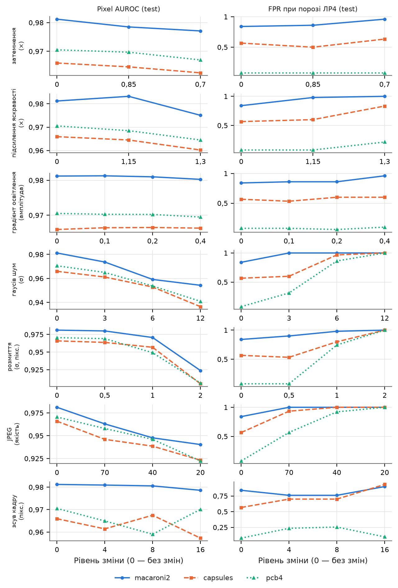{#drift width=58%}

{#drift_lim}

Чи помітить дрейф сам пристрій, показано на рис. {@drift_mon}.

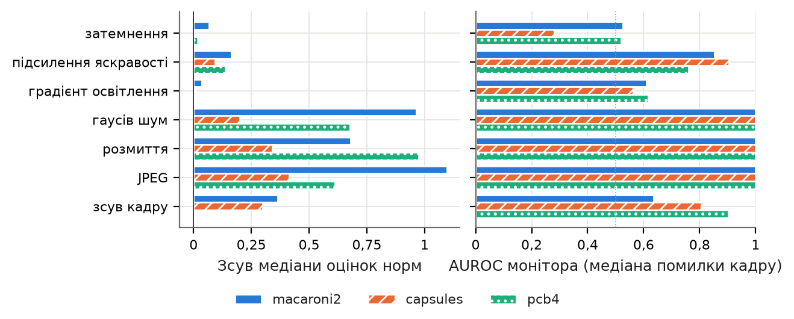{#drift_mon width=58%}

Медіанна помилка патчів кадру — простий монітор, що не потребує міток. Шум, розмиття і JPEG він виявляє майже безпомилково (AUROC монітора {{metrics.drift.noise.12.macaroni2.monitor_auroc:.2f}} за шуму σ = 12, {{metrics.drift.blur.2.pcb4.monitor_auroc:.2f}} за розмиття σ = 2 на `pcb4`). Саме ці спотворення найбільше погіршують якість. Затемнення і градієнт освітлення монітор не бачить (AUROC близько 0.5 або нижче), але для `capsules` і `pcb4` вони й не виводять якість за допуск. Підсилення яскравості і зсув виявляються лише частково, хоча FPR вони підвищують, — це «тихий» дрейф, який монітор може пропустити.

### 3.8. Edge-розгортання: TFLite, квантування, роздільність

Варіанти TFLite порівняно в табл. {@edge} (latency — {{metrics.edge.device.cpu}}; Pixel AUROC і F1 — середнє по трьох категоріях).

{#edge}

TFLite fp32 відтворює карти Keras (Spearman ρ карт ≈ 1) і сам по собі швидший за Keras: {{metrics.edge.mean.fp32.latency_ms_1:.1f}} проти {{metrics.edge.lr4_backbones.EfficientNetB0.latency_keras_ms_1:.1f}} мс в 1 потоці. **fp16-ваги** зменшують файл до ×{{metrics.edge.relative_to_fp32.fp16.size_mb:.2f}}, але не прискорюють: обчислення на CPU лишаються в fp32. **Динамічне int8** зменшує модель до ×{{metrics.edge.relative_to_fp32.dynamic_int8.size_mb:.2f}} і прискорює однопотоковий прохід до ×{{metrics.edge.relative_to_fp32.dynamic_int8.latency_ms_1:.2f}} від fp32; середній Pixel AUROC змінюється на {{metrics.edge.mean.dynamic_int8.pixel_auroc_delta:.4f}}, тобто в межах допуску. Проте втрата нерівномірна: на `pcb4` — єдиній категорії, де метод придатний як автоматичний класифікатор, — Image AUROC падає з {{metrics.edge.fp32.pcb4.image_auroc:.3f}} до {{metrics.edge.dynamic_int8.pcb4.image_auroc:.3f}}, а Image F1 — з {{metrics.edge.fp32.pcb4.image_f1_lr4_threshold:.3f}} до {{metrics.edge.dynamic_int8.pcb4.image_f1_lr4_threshold:.3f}} за порогом ЛР № 4 і до {{metrics.edge.dynamic_int8.pcb4.image_f1_recalibrated:.3f}} після перекалібрування (`edge_variants_full.csv`). Крім того, на всіх ядрах динамічне int8 *повільніше* за fp32 (×{{metrics.edge.relative_to_fp32.dynamic_int8.latency_ms_усі:.2f}}), тож його перевага обмежена одноядерними пристроями. **Повне int8** — найшвидше (×{{metrics.edge.relative_to_fp32.full_int8.latency_ms_1:.2f}} від fp32), але втрачає Pixel AUROC понад допуск і спотворює карти: ρ з картою fp32 на `capsules` лише {{metrics.edge.full_int8.capsules.map_spearman:.2f}}. Шкала оцінок зміщується так, що поріг ЛР № 4 стає непридатним: Image F1 на `pcb4` падає до {{metrics.edge.full_int8.pcb4.image_f1_lr4_threshold:.2f}} і відновлюється до {{metrics.edge.full_int8.pcb4.image_f1_recalibrated:.2f}} лише після перекалібрування порогу на val. Компроміс «якість — latency» показано на рис. {@edge_fig}.

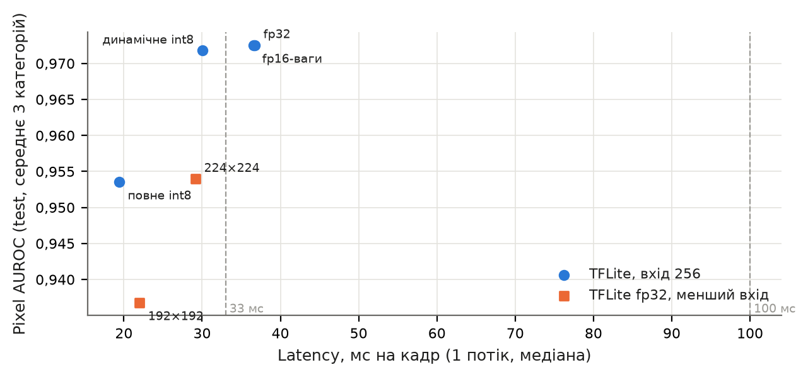{#edge_fig width=56%}

За latency самого інференсу лише динамічне int8 лежить ліворуч від межі 33 мс у межах допуску якості; повне int8 і зменшені входи швидші, але помітно нижчі за якістю. **Пост-обробка змінює висновок щодо 30 FPS.** Збільшення карти і згладжування, виміряні окремо, займають {{metrics.edge.postprocess_ms.latency_ms_1:.1f}} мс в 1 потоці ({{metrics.edge.postprocess_ms.share_of_fp32_1:.0%}} від latency fp32). Для динамічного int8 це {{metrics.edge.mean.dynamic_int8.latency_ms_1:.1f}} + {{metrics.edge.postprocess_ms.latency_ms_1:.1f}} ≈ 33.1 мс на кадр: бюджет 33 мс вичерпано без жодного запасу (до того ж 90-й процентиль latency інференсу — {{metrics.edge.mean.dynamic_int8.latency_p90_ms_1:.1f}} мс). Отже, з пост-обробкою 30 FPS на одному ядрі не гарантовано. На всіх ядрах fp32 з пост-обробкою ({{metrics.edge.mean.fp32.latency_ms_усі:.1f}} + {{metrics.edge.postprocess_ms.latency_ms_усі:.1f}} мс) вкладається в 33 мс із запасом, а бюджет 100 мс (10 FPS) виконують усі варіанти.

Менша роздільність входу (табл. {@edge_res}) прискорює майже пропорційно кількості пікселів, але дефекти, і так менші за патч, зменшуються ще більше.

{#edge_res}

Вхід 224×224 вже виходить за допуск якості, а за 192×192 Image AUROC `pcb4` падає з {{metrics.edge.resolution.256.pcb4.image_auroc:.3f}} до {{metrics.edge.resolution.192.pcb4.image_auroc:.3f}}. З backbone ЛР № 4 (`edge_lr4_summary.csv`; Keras, 1 потік) MobileNetV2 швидший за EfficientNetB0 ({{metrics.edge.lr4_backbones.MobileNetV2.latency_keras_ms_1:.1f}} проти {{metrics.edge.lr4_backbones.EfficientNetB0.latency_keras_ms_1:.1f}} мс) за нижчого Pixel AUROC на val `macaroni2` ({{metrics.edge.lr4_backbones.MobileNetV2.pixel_auroc_val_macaroni2:.3f}} проти {{metrics.edge.lr4_backbones.EfficientNetB0.pixel_auroc_val_macaroni2:.3f}}). ResNet50 для edge непридатний: {{metrics.edge.lr4_backbones.ResNet50.gflops:.1f}} GFLOPs проти {{metrics.edge.lr4_backbones.EfficientNetB0.gflops:.1f}} і {{metrics.edge.lr4_backbones.ResNet50.latency_keras_ms_1:.0f}} мс без виграшу в якості.

### 3.9. Межі придатності та рекомендації

Межі придатності мають три аспекти: обчислювальний (табл. {@limits}), умови зйомки (табл. {@drift_lim}) і надійність рішення на рівні зображення (п. 3.6); їх зведення — у `limits_of_applicability.csv`. Пороги задано в конфігурації апріорі.

{#limits}

Висновок «придатний для 30 FPS» у табл. {@limits} сформовано автоматично за latency інференсу; з урахуванням пост-обробки (п. 3.8) його слід читати як «на межі 30 FPS». **Рекомендації щодо розгортання на edge-пристроях реального часу:**

1. **Формат моделі.** На одному ядрі найближчим до 30 FPS є TFLite з динамічним int8, але з пост-обробкою він вичерпує бюджет 33 мс без запасу, а на `pcb4` втрачає Image F1; поріг слід перекалібрувати на val, а частоту кадрів перевірити на цільовій платі. Із запасом метод придатний для 10 FPS; на багатоядерному пристрої 30 FPS досяжні з fp32 на всіх ядрах. Повне int8 і вхід 224/192 виходять за допуск якості.
2. **Роль за категоріями.** Для об'єктів у фіксованому положенні (`pcb4`) метод придатний як автоматичний класифікатор: FPR {{metrics.drift.clean.clean.pcb4.fpr:.2f}}, пропущено {{metrics.errors.pcb4.n_fn}} аномалії проти {{metrics.errors.pcb4.n_tp}} виявлених. Для сцен із кількома об'єктами у випадкових положеннях (FPR {{metrics.drift.clean.clean.macaroni2.fpr:.2f}} на `macaroni2` і {{metrics.drift.clean.clean.capsules.fpr:.2f}} на `capsules`) — лише як підказка операторові з картою аномалій, яка добре локалізує дефекти (Pixel AUROC {{metrics.drift.clean.clean.macaroni2.pixel_auroc:.2f}} і {{metrics.drift.clean.clean.capsules.pixel_auroc:.2f}}).
3. **Умови зйомки** (табл. {@drift_lim}). Потрібні різкість, стиснення без втрат або JPEG якістю понад {{metrics.drift.limits.jpeg.pcb4}}, достатнє світло проти шуму сенсора, стабільна експозиція без пересвіту і механічне фіксування камери. Вбудований монітор медіанної помилки патчів сигналізує про шум, розмиття і JPEG, але пересвіт і зсув виявляє лише частково.
4. **Крайова смуга.** Її виключення знижує FPR `macaroni2`, але шкодить `capsules`; рішення ухвалюється окремо для кожної лінії.
5. **Пояснення.** Операторові варто показувати карту моделі і HiResCAM: обидва вказують на точку, що визначила рішення (pointing game HiResCAM — {{metrics.xai.localization_all_anomalies.hirescam.усі.pointing_game:.2f}}), а HiResCAM проходить тест рандомізації. IG з розмитою базою і Grad-CAM для max-цілі не рекомендовано.

## 4. Висновок

Детектор аномалій ЛР № 4 (EfficientNetB0 + Feature Autoencoder) проаналізовано без перенавчання. Локальний якобіан і порівняння з PCA-64 показали, що модель локально є наближеною проекцією на 64-вимірний підпростір нормальних ознак: PCA-64 відтворює її карти з ρ ≥ {{metrics.weights.linear.capsules.fae_pca_spearman:.2f}}, а ефективна розмірність латенту — лише {{metrics.weights.latent.pcb4.participation_ratio:.0f}}–{{metrics.weights.latent.capsules.participation_ratio:.0f}}. Ваги самі по собі не вказують на важливі канали, проте точний розклад помилки за шарами backbone інтерпретовний: текстурні дефекти `macaroni2` фіксує шар кроку 8 (карта лише з нього дає Pixel AUROC {{metrics.weights.macaroni2.pixel_auroc_shallow_only:.3f}} проти {{metrics.weights.macaroni2.pixel_auroc_full:.3f}}), дефекти `pcb4` — шар кроку 16, а для `capsules` свідчення змішані.

З методів пояснення найкраще локалізує власна карта моделі (Pixel AUROC {{metrics.xai.localization_all_anomalies.model_map.усі.pixel_auroc:.3f}}). HiResCAM вказує туди ж, куди максимум карти, і проходить тест рандомізації, але нестабільний до шуму. IG стабільний (ρ = {{metrics.sanity.stability.ig.spearman:.2f}}), проте нейтральної бази для детектора аномалій не існує: розмита база виграла на val лише в межах нічиєї, інвертує знак атрибуції і на `pcb4` підсвічує структуру плати замість дефекту. Grad-CAM для max-цілі найслабший. Perturbation analysis обмежений, бо заміна чи зашумлення патчів самі створюють аномалію; найчистіший результат отримано на `pcb4` із заміною на норму, де всі пояснення значуще кращі за випадковий порядок.

Головне обмеження надійності — рішення на рівні зображення для сцен із кількома об'єктами: FPR {{metrics.drift.clean.clean.macaroni2.fpr:.2f}} на `macaroni2` і {{metrics.drift.clean.clean.capsules.fpr:.2f}} на `capsules`. Хибні тривоги спричиняють поодинокі локальні піки карти, зокрема «гарячі кути» кадру на `macaroni2`, а пропуски — дефекти, менші за патч; ознаки освітлення чи текстури, що відрізняла б FP від TN усередині категорії, не знайдено. До змін освітлення стійка локалізація, але підсилення яскравості підвищує FPR понад допуск в усіх трьох категоріях; найчутливіша модель до шуму, розмиття і JPEG, які виявляє вбудований монітор медіанної помилки. Дрейф синтетичний, а VisA статичний, тож поведінку на динамічному тлі безпосередньо не перевірено. Для edge найкращий компроміс — TFLite з динамічним int8 ({{metrics.edge.dynamic_int8.pcb4.size_mb:.1f}} МБ, ×{{metrics.edge.relative_to_fp32.dynamic_int8.latency_ms_1:.2f}} latency fp32, середня зміна Pixel AUROC {{metrics.edge.mean.dynamic_int8.pixel_auroc_delta:.4f}}), однак разом із пост-обробкою він вичерпує бюджет 30 FPS на одному ядрі без запасу і знижує Image F1 на `pcb4`; із запасом забезпечено 10 FPS. Отже, метод придатний для автоматичного контролю об'єктів у фіксованому положенні (`pcb4`), а для неоднорідних сцен — лише як система підказок операторові.

## 5. Список використаної літератури

1. Sundararajan M., Taly A., Yan Q. Axiomatic Attribution for Deep Networks // Proc. 34th ICML. — 2017. — P. 3319–3328.
2. Erion G., Janizek J. D., Sturmfels P., Lundberg S. M., Lee S.-I. Improving performance of deep learning models with axiomatic attribution priors and expected gradients // Nature Machine Intelligence. — 2021. — Vol. 3. — P. 620–631.
3. Selvaraju R. R., Cogswell M., Das A., Vedantam R., Parikh D., Batra D. Grad-CAM: Visual Explanations from Deep Networks via Gradient-Based Localization // Proc. IEEE ICCV. — 2017. — P. 618–626.
4. Draelos R. L., Carin L. Use HiResCAM instead of Grad-CAM for faithful explanations of convolutional neural networks [Електронний ресурс] : препринт // arXiv. — 2020. — arXiv:2011.08891.
5. Zhang J., Bargal S. A., Lin Z., Brandt J., Shen X., Sclaroff S. Top-Down Neural Attention by Excitation Backprop // International Journal of Computer Vision. — 2018. — Vol. 126. — P. 1084–1102.
6. Samek W., Binder A., Montavon G., Lapuschkin S., Müller K.-R. Evaluating the Visualization of What a Deep Neural Network Has Learned // IEEE Transactions on Neural Networks and Learning Systems. — 2017. — Vol. 28, № 11. — P. 2660–2673.
7. Adebayo J., Gilmer J., Muelly M., Goodfellow I., Hardt M., Kim B. Sanity Checks for Saliency Maps // Advances in Neural Information Processing Systems 31 (NeurIPS). — 2018. — P. 9505–9515.
8. Wang Z., Bovik A. C., Sheikh H. R., Simoncelli E. P. Image Quality Assessment: From Error Visibility to Structural Similarity // IEEE Transactions on Image Processing. — 2004. — Vol. 13, № 4. — P. 600–612.
9. Holm S. A Simple Sequentially Rejective Multiple Test Procedure // Scandinavian Journal of Statistics. — 1979. — Vol. 6, № 2. — P. 65–70.
10. Hendrycks D., Dietterich T. Benchmarking Neural Network Robustness to Common Corruptions and Perturbations // Proc. ICLR. — 2019.
11. Rabanser S., Günnemann S., Lipton Z. C. Failing Loudly: An Empirical Study of Methods for Detecting Dataset Shift // Advances in Neural Information Processing Systems 32 (NeurIPS). — 2019.
12. TensorFlow Lite (нині LiteRT): Model conversion and optimization [Електронний ресурс] // TensorFlow. — Режим доступу: https://www.tensorflow.org/lite (дата звернення: 17.11.2026).
13. Jacob B., Kligys S., Chen B., Zhu M., Tang M., Howard A., Adam H., Kalenichenko D. Quantization and Training of Neural Networks for Efficient Integer-Arithmetic-Only Inference // Proc. IEEE/CVF CVPR. — 2018. — P. 2704–2713.
14. Zou Y., Jeong J., Pemula L., Zhang D., Dabeer O. SPot-the-Difference Self-supervised Pre-training for Anomaly Detection and Segmentation // Computer Vision — ECCV 2022. — Cham : Springer, 2022. — P. 392–408.
15. Tan M., Le Q. V. EfficientNet: Rethinking Model Scaling for Convolutional Neural Networks // Proc. 36th ICML. — 2019. — P. 6105–6114.
16. Defard T., Setkov A., Loesch A., Audigier R. PaDiM: A Patch Distribution Modeling Framework for Anomaly Detection and Localization // Pattern Recognition. ICPR International Workshops and Challenges. — Cham : Springer, 2021. — P. 475–489.
17. Roth K., Pemula L., Zepeda J., Schölkopf B., Brox T., Gehler P. Towards Total Recall in Industrial Anomaly Detection // Proc. IEEE/CVF CVPR. — 2022. — P. 14318–14328.
